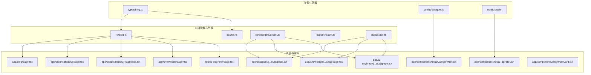
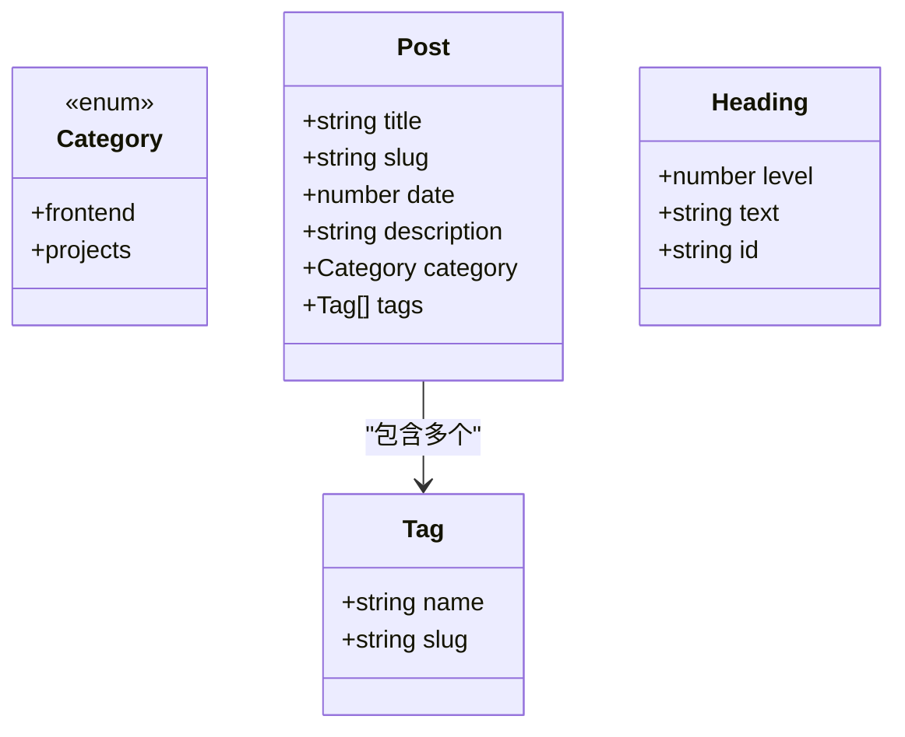
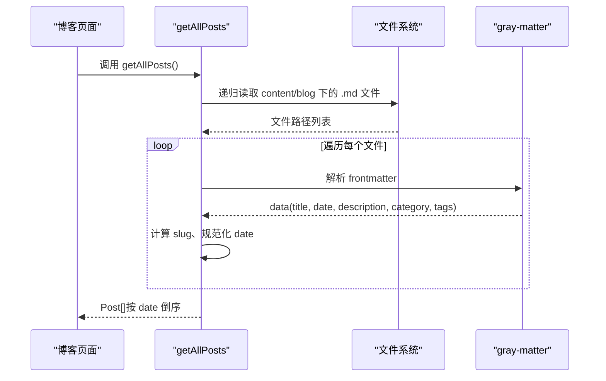
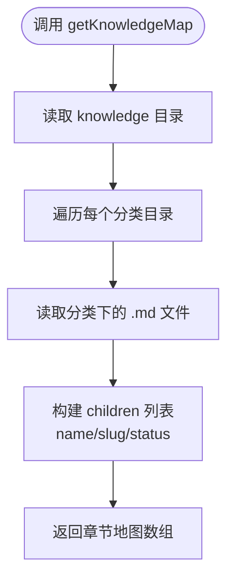
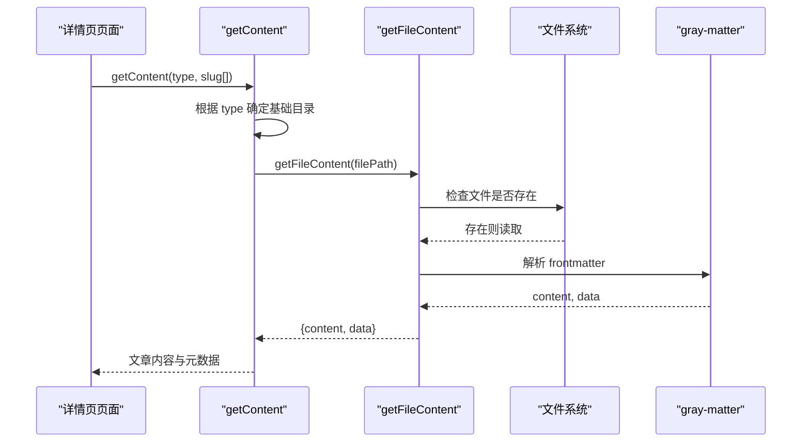
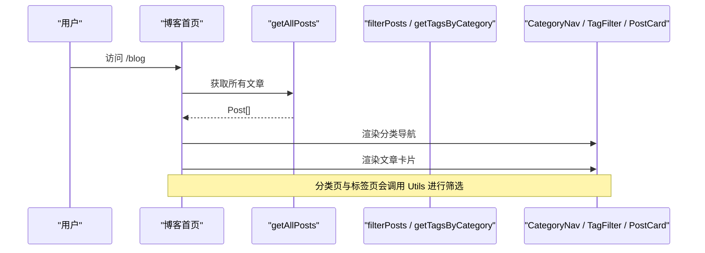
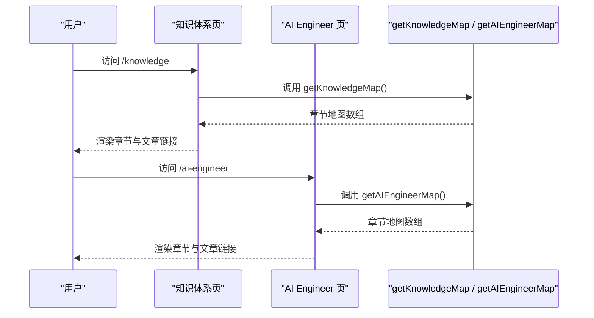

# API 参考

<cite>
**本文引用的文件**   
- [types/blog.ts](file://types/blog.ts)
- [lib/blog.ts](file://lib/blog.ts)
- [lib/utils.ts](file://lib/utils.ts)
- [lib/post/getContent.ts](file://lib/post/getContent.ts)
- [lib/post/reader.ts](file://lib/post/reader.ts)
- [lib/post/toc.ts](file://lib/post/toc.ts)
- [config/category.ts](file://config/category.ts)
- [config/tag.ts](file://config/tag.ts)
- [app/blog/page.tsx](file://app/blog/page.tsx)
- [app/blog/[category]/page.tsx](file://app/blog/[category]/page.tsx)
- [app/blog/[category]/[tag]/page.tsx](file://app/blog/[category]/[tag]/page.tsx)
- [app/blog/post/[...slug]/page.tsx](file://app/blog/post/[...slug]/page.tsx)
- [app/knowledge/page.tsx](file://app/knowledge/page.tsx)
- [app/knowledge/[...slug]/page.tsx](file://app/knowledge/[...slug]/page.tsx)
- [app/ai-engineer/page.tsx](file://app/ai-engineer/page.tsx)
- [app/ai-engineer/[...slug]/page.tsx](file://app/ai-engineer/[...slug]/page.tsx)
- [app/components/blog/CategoryNav.tsx](file://app/components/blog/CategoryNav.tsx)
- [app/components/blog/TagFilter.tsx](file://app/components/blog/TagFilter.tsx)
- [app/components/blog/PostCard.tsx](file://app/components/blog/PostCard.tsx)
</cite>

## 目录
1. [简介](#简介)
2. [项目结构](#项目结构)
3. [核心类型定义](#核心类型定义)
4. [公共 API 总览](#公共-api-总览)
5. [博客内容管理 API](#博客内容管理-api)
6. [知识体系与 AI Engineer 地图 API](#知识体系与-ai-engineer-地图-api)
7. [工具函数与数据处理](#工具函数与数据处理)
8. [配置项说明](#配置项说明)
9. [架构与数据流](#架构与数据流)
10. [使用示例与集成指南](#使用示例与集成指南)
11. [错误处理与边界情况](#错误处理与边界情况)
12. [性能与扩展建议](#性能与扩展建议)
13. [常见问题排查](#常见问题排查)
14. [结论](#结论)

## 简介
本 API 参考文档面向 HuRui.dev 博客项目的开发者，系统化记录与博客内容管理、知识体系导航、AI Engineer 知识图谱相关的公共接口、工具函数、类型定义和配置项。文档重点覆盖：
- 博客文章列表与详情读取
- 分类与标签筛选
- 知识体系与 AI Engineer 章节地图
- Markdown 标题提取与目录生成
- 分类与标签的配置方式
- 页面组件如何消费这些 API

## 项目结构
本项目采用 Next.js App Router 组织页面，结合 TypeScript 类型定义与模块化库函数，将“内容读取”“数据处理”“页面展示”分层清晰：
- 类型定义集中在 types 目录
- 博客内容与知识地图逻辑集中在 lib 目录
- 页面路由在 app 目录中按功能模块划分
- 分类与标签的显示配置集中在 config 目录

**图表来源**
- [types/blog.ts:1-16](file://types/blog.ts#L1-L16)
- [lib/blog.ts:1-134](file://lib/blog.ts#L1-L134)
- [lib/utils.ts:1-36](file://lib/utils.ts#L1-L36)
- [lib/post/getContent.ts:1-21](file://lib/post/getContent.ts#L1-L21)
- [lib/post/reader.ts:1-12](file://lib/post/reader.ts#L1-L12)
- [lib/post/toc.ts:1-23](file://lib/post/toc.ts#L1-L23)
- [config/category.ts:1-9](file://config/category.ts#L1-L9)
- [config/tag.ts:1-11](file://config/tag.ts#L1-L11)
- [app/blog/page.tsx:1-20](file://app/blog/page.tsx#L1-L20)
- [app/blog/[category]/page.tsx:1-35](file://app/blog/[category]/page.tsx#L1-L35)
- [app/blog/[category]/[tag]/page.tsx:1-34](file://app/blog/[category]/[tag]/page.tsx#L1-L34)
- [app/blog/post/[...slug]/page.tsx:1-27](file://app/blog/post/[...slug]/page.tsx#L1-L27)
- [app/knowledge/page.tsx:1-58](file://app/knowledge/page.tsx#L1-L58)
- [app/knowledge/[...slug]/page.tsx:1-44](file://app/knowledge/[...slug]/page.tsx#L1-L44)
- [app/ai-engineer/page.tsx:1-33](file://app/ai-engineer/page.tsx#L1-L33)
- [app/ai-engineer/[...slug]/page.tsx:1-44](file://app/ai-engineer/[...slug]/page.tsx#L1-L44)
- [app/components/blog/CategoryNav.tsx:1-45](file://app/components/blog/CategoryNav.tsx#L1-L45)
- [app/components/blog/TagFilter.tsx:1-52](file://app/components/blog/TagFilter.tsx#L1-L52)
- [app/components/blog/PostCard.tsx:1-43](file://app/components/blog/PostCard.tsx#L1-L43)

**章节来源**
- [types/blog.ts:1-16](file://types/blog.ts#L1-L16)
- [lib/blog.ts:1-134](file://lib/blog.ts#L1-L134)
- [lib/utils.ts:1-36](file://lib/utils.ts#L1-L36)
- [lib/post/getContent.ts:1-21](file://lib/post/getContent.ts#L1-L21)
- [lib/post/reader.ts:1-12](file://lib/post/reader.ts#L1-L12)
- [lib/post/toc.ts:1-23](file://lib/post/toc.ts#L1-L23)
- [config/category.ts:1-9](file://config/category.ts#L1-L9)
- [config/tag.ts:1-11](file://config/tag.ts#L1-L11)

## 核心类型定义
本节说明 Post、Tag、Category、Heading 等关键类型的字段含义和使用场景。

- Category
  - 含义：文章所属的分类枚举值
  - 取值：前端分类与项目经验分类
  - 使用场景：用于分类导航、过滤文章、渲染分类按钮

- Tag
  - 含义：文章的标签对象
  - 字段：
    - name：标签显示名称
    - slug：标签 URL 标识
  - 使用场景：用于标签筛选、URL 路由、标签列表展示

- Post
  - 含义：一篇博客文章的数据模型
  - 字段：
    - title：文章标题
    - slug：文章路径标识（相对 content/blog）
    - date：发布时间戳
    - description：文章描述
    - category：所属分类
    - tags：标签数组
  - 使用场景：文章列表、卡片展示、排序、筛选

- Heading
  - 含义：Markdown 标题节点
  - 字段：
    - level：标题层级
    - text：标题文本
    - id：根据标题文本生成的锚点 ID
  - 使用场景：生成侧边目录、跳转锚点

**图表来源**
- [types/blog.ts:1-16](file://types/blog.ts#L1-L16)
- [lib/post/toc.ts:1-23](file://lib/post/toc.ts#L1-L23)

**章节来源**
- [types/blog.ts:1-16](file://types/blog.ts#L1-L16)
- [lib/post/toc.ts:1-23](file://lib/post/toc.ts#L1-L23)

## 公共 API 总览
本项目对外暴露的主要公共 API 包括：
- 博客内容管理
  - getAllPosts：获取所有博客文章
  - getAllCategories：获取所有分类
  - getAllTags：获取所有标签
- 知识体系与 AI Engineer 地图
  - getKnowledgeMap：获取前端知识体系章节地图
  - getAIEngineerMap：获取 AI Engineer 知识章节地图
- 文章内容读取
  - getContent：根据类型与 slug 读取具体文章内容
- 工具函数
  - getTagsByCategory：按分类提取标签
  - filterPosts：按分类与标签过滤文章
  - formatTags：格式化标签为字符串
- 目录与标题
  - extractHeadings：从 Markdown 内容中提取标题

**章节来源**
- [lib/blog.ts:24-133](file://lib/blog.ts#L24-L133)
- [lib/utils.ts:3-36](file://lib/utils.ts#L3-L36)
- [lib/post/getContent.ts:6-20](file://lib/post/getContent.ts#L6-L20)
- [lib/post/toc.ts:7-22](file://lib/post/toc.ts#L7-L22)

## 博客内容管理 API

### getAllPosts
- 作用：递归扫描博客内容目录，解析每篇文章 frontmatter，返回按时间倒序的文章列表
- 参数：无
- 返回值：Post[]
- 行为说明：
  - 读取 content/blog 下所有 .md 文件
  - 解析 frontmatter 中的 title、date、description、category、tags
  - 计算 slug：相对 blog 目录的路径，去除 .md 后缀
  - 对日期进行容错处理，无效日期回退到当前时间
  - 返回按 date 降序排列的文章数组
- 错误处理：
  - 若 frontmatter 缺少 date，则使用当前时间
  - 若 frontmatter 缺少 description，则使用空字符串
  - 若 frontmatter 缺少 category，则默认使用 blog
- 使用示例：
  - 在博客首页调用，渲染文章卡片列表
  - 在分类页或标签页先调用，再结合 filterPosts 进行筛选

**图表来源**
- [lib/blog.ts:9-51](file://lib/blog.ts#L9-L51)
- [lib/post/reader.ts:4-10](file://lib/post/reader.ts#L4-L10)

**章节来源**
- [lib/blog.ts:24-51](file://lib/blog.ts#L24-L51)
- [app/blog/page.tsx:1-20](file://app/blog/page.tsx#L1-L20)

### getAllCategories
- 作用：从所有文章中提取唯一分类集合，并添加“全部”选项
- 参数：无
- 返回值：string[]（包含 All 与所有分类）
- 使用场景：分类导航、下拉选择器
- 注意：该函数返回的是分类字符串数组，并非 CATEGORY_CONFIG 中的完整配置对象

**章节来源**
- [lib/blog.ts:53-57](file://lib/blog.ts#L53-L57)

### getAllTags
- 作用：从所有文章中收集标签名称，去重后返回
- 参数：无
- 返回值：string[]（包含 all 与所有标签名称）
- 使用场景：标签筛选栏、标签云
- 注意：该函数返回的是标签名称数组，不包含 slug；如需 slug，请使用 getTagsByCategory

**章节来源**
- [lib/blog.ts:59-70](file://lib/blog.ts#L59-L70)

## 知识体系与 AI Engineer 地图 API

### getKnowledgeMap
- 作用：扫描前端知识体系目录，构建章节树形结构
- 参数：无
- 返回值：章节数组，每项包含：
  - title：分类标题（去除编号前缀）
  - children：子条目数组，每项包含：
    - name：文章名（去除编号前缀）
    - slug：知识体系详情页路由
    - status：完成度状态（outline/draft/done），来自 frontmatter
- 使用场景：知识体系主页展示章节与文章链接
- 错误处理：
  - 若 frontmatter 缺少 status，默认返回 outline

**图表来源**
- [lib/blog.ts:83-106](file://lib/blog.ts#L83-L106)

**章节来源**
- [lib/blog.ts:83-106](file://lib/blog.ts#L83-L106)
- [app/knowledge/page.tsx:1-58](file://app/knowledge/page.tsx#L1-L58)

### getAIEngineerMap
- 作用：扫描 AI Engineer 知识目录，构建章节树形结构
- 参数：无
- 返回值：章节数组，结构与 getKnowledgeMap 相同
- 使用场景：AI Engineer 主页展示章节与文章链接
- 错误处理：
  - 若 frontmatter 缺少 status，默认返回 outline

**章节来源**
- [lib/blog.ts:108-133](file://lib/blog.ts#L108-L133)
- [app/ai-engineer/page.tsx:1-33](file://app/ai-engineer/page.tsx#L1-L33)

## 工具函数与数据处理

### getTagsByCategory
- 作用：根据分类过滤文章，并提取该分类下的唯一标签（含 name 与 slug）
- 参数：
  - posts：Post[]
  - category：可选的 Category
- 返回值：Tag[]（去重后的标签列表）
- 使用场景：分类页渲染标签筛选栏

**章节来源**
- [lib/utils.ts:3-17](file://lib/utils.ts#L3-L17)

### filterPosts
- 作用：按分类与标签过滤文章
- 参数：
  - posts：Post[]
  - category：可选的 Category
  - tagSlug：可选的标签 slug
- 返回值：Post[]（过滤后的文章列表）
- 使用场景：分类页、标签页渲染文章列表

**章节来源**
- [lib/utils.ts:19-33](file://lib/utils.ts#L19-L33)

### formatTags
- 作用：将标签数组格式化为以逗号分隔的字符串
- 参数：{ name: string }[]
- 返回值：string
- 使用场景：日志输出、简单展示

**章节来源**
- [lib/utils.ts:35-36](file://lib/utils.ts#L35-L36)

### getContent
- 作用：根据内容类型与 slug 数组读取具体 Markdown 文章内容
- 参数：
  - type：'blog' | 'knowledge' | 'ai-engineer'
  - slug：string[]（路径片段数组）
- 返回值：{ content: string; data: object } 或 null（文件不存在时）
- 行为说明：
  - 对 knowledge 与 ai-engineer 类型，会对 slug 进行 decodeURIComponent 解码
  - 拼接 baseMap 对应的基础目录与 slug，追加 .md 后缀
  - 通过 reader 读取文件并解析 frontmatter
- 使用场景：文章详情页、知识详情页、AI Engineer 详情页

**图表来源**
- [lib/post/getContent.ts:6-20](file://lib/post/getContent.ts#L6-L20)
- [lib/post/reader.ts:4-10](file://lib/post/reader.ts#L4-L10)

**章节来源**
- [lib/post/getContent.ts:1-21](file://lib/post/getContent.ts#L1-L21)
- [lib/post/reader.ts:1-12](file://lib/post/reader.ts#L1-L12)
- [app/blog/post/[...slug]/page.tsx:1-27](file://app/blog/post/[...slug]/page.tsx#L1-L27)
- [app/knowledge/[...slug]/page.tsx:1-44](file://app/knowledge/[...slug]/page.tsx#L1-L44)
- [app/ai-engineer/[...slug]/page.tsx:1-44](file://app/ai-engineer/[...slug]/page.tsx#L1-L44)

### extractHeadings
- 作用：从 Markdown 内容中提取 1 至 3 级标题，生成目录结构
- 参数：markdown：string
- 返回值：Heading[]
- 行为说明：
  - 匹配 # 到 ### 的标题行
  - 生成 id：标题文本小写化并将空格替换为连字符
- 使用场景：侧边目录、锚点跳转

**章节来源**
- [lib/post/toc.ts:1-23](file://lib/post/toc.ts#L1-L23)

## 配置项说明

### 分类配置 CATEGORY_CONFIG
- 位置：config/category.ts
- 作用：定义分类的显示标签
- 字段：
  - frontend.label：前端知识的显示名称
  - projects.label：项目经验的显示名称
- 使用场景：分类导航组件渲染分类按钮

**章节来源**
- [config/category.ts:1-9](file://config/category.ts#L1-L9)
- [app/components/blog/CategoryNav.tsx:1-45](file://app/components/blog/CategoryNav.tsx#L1-L45)

### 标签配置 TAG_CONFIG
- 位置：config/tag.ts
- 作用：定义标签的显示名称与颜色
- 字段：
  - javascript.label：JavaScript 标签显示名称
  - javascript.color：标签颜色
  - react.label：React 标签显示名称
  - react.color：标签颜色
- 使用场景：标签样式渲染、主题化展示

**章节来源**
- [config/tag.ts:1-11](file://config/tag.ts#L1-L11)

## 架构与数据流

### 博客列表与详情数据流

**图表来源**
- [app/blog/page.tsx:1-20](file://app/blog/page.tsx#L1-L20)
- [app/blog/[category]/page.tsx:1-35](file://app/blog/[category]/page.tsx#L1-L35)
- [app/blog/[category]/[tag]/page.tsx:1-34](file://app/blog/[category]/[tag]/page.tsx#L1-L34)
- [lib/blog.ts:24-70](file://lib/blog.ts#L24-L70)
- [lib/utils.ts:3-33](file://lib/utils.ts#L3-L33)

### 知识体系与 AI Engineer 地图数据流

**图表来源**
- [app/knowledge/page.tsx:1-58](file://app/knowledge/page.tsx#L1-L58)
- [app/ai-engineer/page.tsx:1-33](file://app/ai-engineer/page.tsx#L1-L33)
- [lib/blog.ts:83-133](file://lib/blog.ts#L83-L133)

## 使用示例与集成指南

### 在博客首页展示文章列表
- 步骤：
  - 调用 getAllPosts 获取文章数组
  - 渲染 CategoryNav 提供分类导航
  - 遍历 Post 数组，使用 PostCard 渲染卡片
- 关键点：
  - PostCard 依赖 Post 的 title、date、tags、description、slug
  - CategoryNav 依赖 CATEGORY_CONFIG 渲染分类按钮

**章节来源**
- [app/blog/page.tsx:1-20](file://app/blog/page.tsx#L1-L20)
- [app/components/blog/PostCard.tsx:1-43](file://app/components/blog/PostCard.tsx#L1-L43)
- [app/components/blog/CategoryNav.tsx:1-45](file://app/components/blog/CategoryNav.tsx#L1-L45)

### 在分类页按分类筛选文章
- 步骤：
  - 从路由参数获取 category
  - 调用 getAllPosts 获取文章数组
  - 使用 filterPosts(posts, category) 过滤文章
  - 使用 getTagsByCategory(posts, category) 获取标签列表
  - 渲染 TagFilter 与 PostCard
- 关键点：
  - TagFilter 依赖 Tag.name 与 Tag.slug
  - PostCard 接收 referrer 参数用于返回来源

**章节来源**
- [app/blog/[category]/page.tsx:1-35](file://app/blog/[category]/page.tsx#L1-L35)
- [lib/utils.ts:3-33](file://lib/utils.ts#L3-L33)
- [app/components/blog/TagFilter.tsx:1-52](file://app/components/blog/TagFilter.tsx#L1-L52)

### 在标签页按分类与标签筛选文章
- 步骤：
  - 从路由参数获取 category 与 tag
  - 调用 getAllPosts 获取文章数组
  - 使用 filterPosts(posts, category, tag) 过滤文章
  - 使用 getTagsByCategory(posts, category) 获取标签列表
  - 渲染 TagFilter 与 PostCard
- 关键点：
  - filterPosts 支持同时按分类与标签过滤

**章节来源**
- [app/blog/[category]/[tag]/page.tsx:1-34](file://app/blog/[category]/[tag]/page.tsx#L1-L34)
- [lib/utils.ts:19-33](file://lib/utils.ts#L19-L33)

### 在文章详情页渲染内容与目录
- 步骤：
  - 从路由参数获取 slug 数组
  - 调用 getContent('blog', slugArray) 获取文章内容与 frontmatter
  - 调用 extractHeadings(post.content) 生成目录
  - 渲染 ContentLayout、MarkdownRenderer、BackButton
- 关键点：
  - getContent 返回 null 时需处理“文章不存在”的情况

**章节来源**
- [app/blog/post/[...slug]/page.tsx:1-27](file://app/blog/post/[...slug]/page.tsx#L1-L27)
- [lib/post/getContent.ts:6-20](file://lib/post/getContent.ts#L6-L20)
- [lib/post/toc.ts:7-22](file://lib/post/toc.ts#L7-L22)

### 在知识体系页展示章节地图
- 步骤：
  - 调用 getKnowledgeMap() 获取章节地图
  - 遍历 section.title 与 section.children
  - 渲染章节标题与文章链接
  - 根据 item.status 显示“待完善”标记
- 关键点：
  - status 来自 frontmatter，默认 outline

**章节来源**
- [app/knowledge/page.tsx:1-58](file://app/knowledge/page.tsx#L1-L58)
- [lib/blog.ts:83-106](file://lib/blog.ts#L83-L106)

### 在 AI Engineer 页展示章节地图
- 步骤：
  - 调用 getAIEngineerMap() 获取章节地图
  - 遍历 section.title 与 section.children
  - 渲染章节标题与文章链接
- 关键点：
  - status 来自 frontmatter，默认 outline

**章节来源**
- [app/ai-engineer/page.tsx:1-33](file://app/ai-engineer/page.tsx#L1-L33)
- [lib/blog.ts:108-133](file://lib/blog.ts#L108-L133)

## 错误处理与边界情况
- 文件不存在
  - getContent 在文件不存在时返回 null
  - 详情页应判断 post 是否为 null，并返回“文章不存在”或 404
- 日期无效
  - getAllPosts 对非法日期进行容错，回退到当前时间
- 缺失 frontmatter 字段
  - description 缺失时使用空字符串
  - category 缺失时默认使用 blog
  - status 缺失时默认使用 outline
- 标签为空
  - TagFilter 在无标签时直接返回 null，不渲染筛选栏

**章节来源**
- [lib/post/getContent.ts:6-20](file://lib/post/getContent.ts#L6-L20)
- [lib/blog.ts:37-47](file://lib/blog.ts#L37-L47)
- [lib/blog.ts:72-81](file://lib/blog.ts#L72-L81)
- [app/components/blog/TagFilter.tsx:13-13](file://app/components/blog/TagFilter.tsx#L13-L13)

## 性能与扩展建议
- 文件读取性能
  - getAllPosts 与地图 API 均使用同步文件系统读取，适合构建期或静态站点生成
  - 若内容量增长，可考虑缓存结果或使用异步读取优化
- 目录生成性能
  - extractHeadings 使用正则逐行匹配，建议在长文档中避免频繁调用
- 扩展方向
  - 增加分页：在 getAllPosts 基础上增加分页参数
  - 增加搜索：基于全文索引或轻量搜索引擎
  - 增加 SEO：利用 getContent 的 data 字段生成 metadata

[本节为通用指导，不直接分析具体文件]

## 常见问题排查
- 问题：分类导航未显示
  - 检查 CATEGORY_CONFIG 是否定义了分类键与 label
  - 检查 CategoryNav 是否正确导入并使用 CATEGORY_CONFIG
- 问题：标签筛选无效
  - 检查 Post.tags 是否包含 slug 字段
  - 检查 getTagsByCategory 与 filterPosts 的参数是否正确
- 问题：文章详情页 404
  - 检查 getContent 的 type 与 slug 是否匹配实际文件路径
  - 检查路由参数 slug 数组是否与文件目录一致
- 问题：知识体系或 AI Engineer 章节未显示
  - 检查 content 目录下是否有对应的 .md 文件
  - 检查 frontmatter 中是否包含必要的 title、status 字段

**章节来源**
- [app/components/blog/CategoryNav.tsx:1-45](file://app/components/blog/CategoryNav.tsx#L1-L45)
- [lib/utils.ts:3-33](file://lib/utils.ts#L3-L33)
- [lib/post/getContent.ts:6-20](file://lib/post/getContent.ts#L6-L20)
- [lib/blog.ts:83-133](file://lib/blog.ts#L83-L133)

## 结论
HuRui.dev 博客项目的 API 设计围绕“内容读取—数据处理—页面展示”三层展开，类型定义清晰、职责分离明确。公共 API 如 getAllPosts、getKnowledgeMap、getAIEngineerMap、getContent 以及工具函数 getTagsByCategory、filterPosts、extractHeadings，共同支撑了博客列表、分类与标签筛选、知识体系与 AI Engineer 章节地图、文章详情与目录生成等核心功能。通过合理的配置项 CATEGORY_CONFIG 与 TAG_CONFIG，项目实现了可扩展的分类与标签展示能力。在实际集成中，建议关注文件读取性能、frontmatter 字段完整性与路由参数一致性，以确保稳定可靠的运行体验。