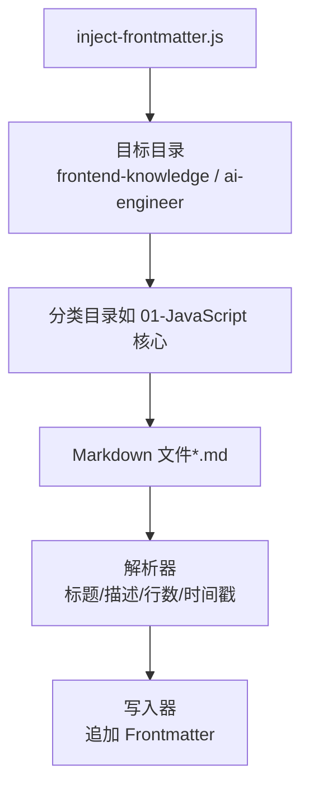
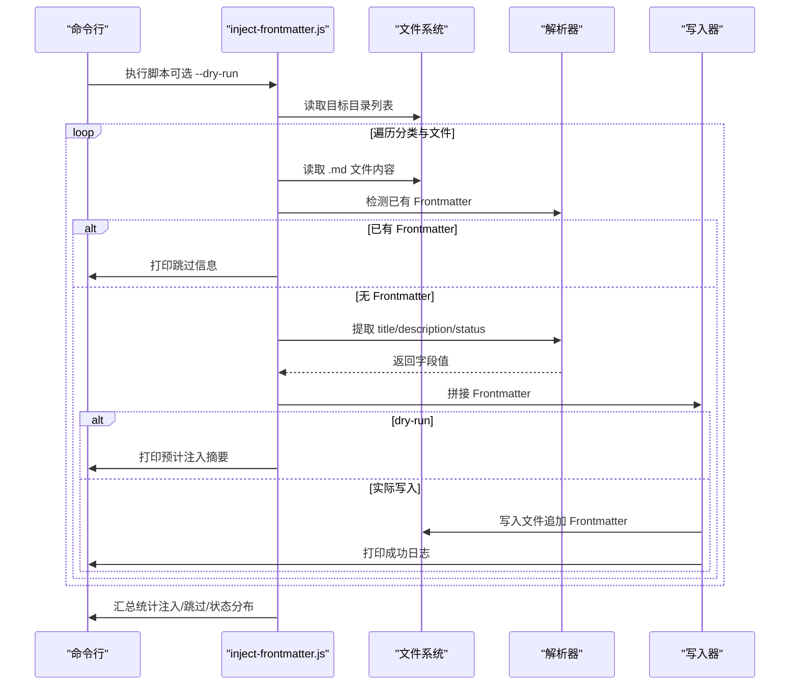
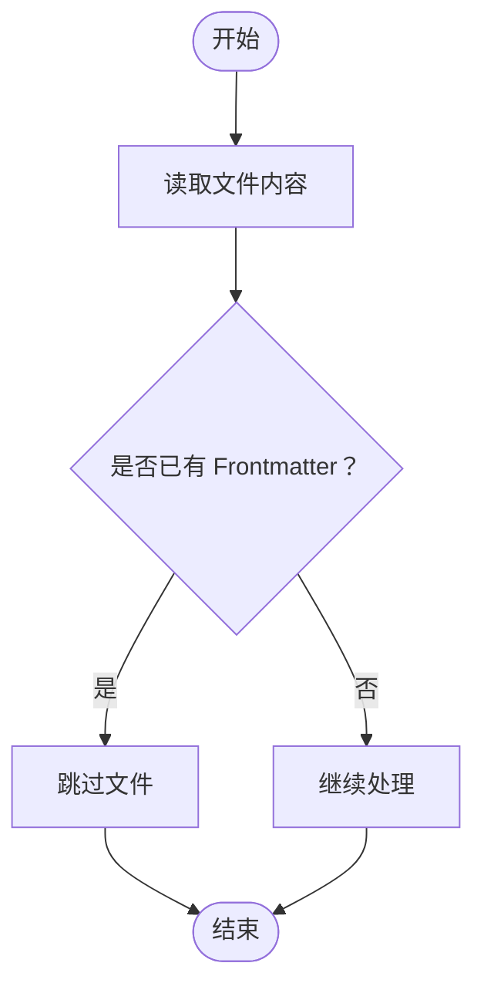
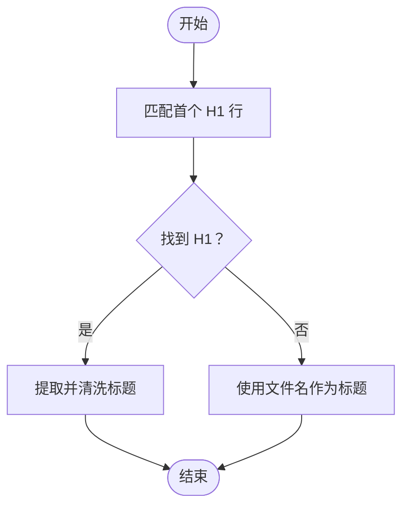
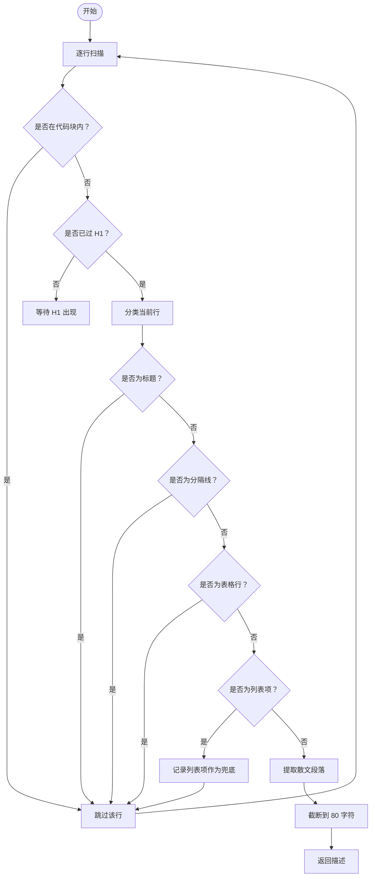
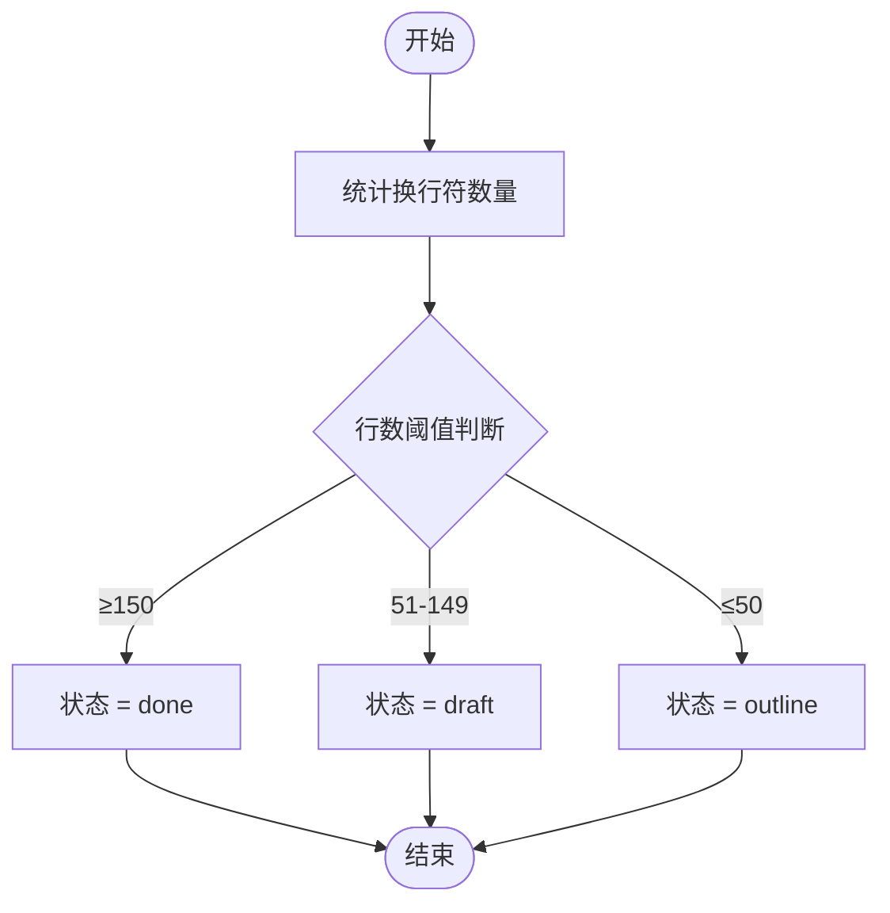
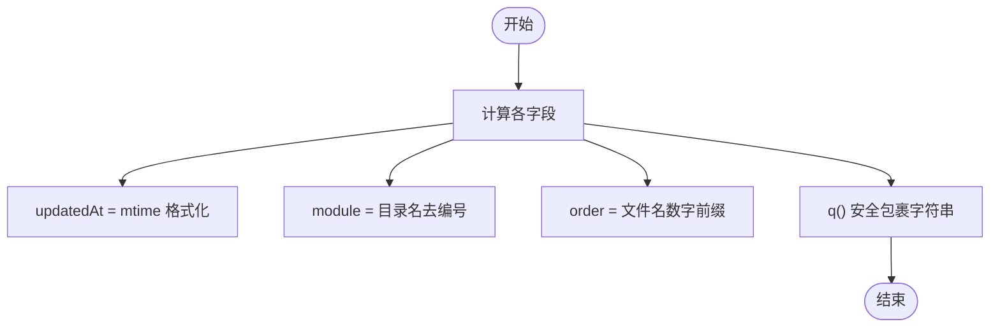
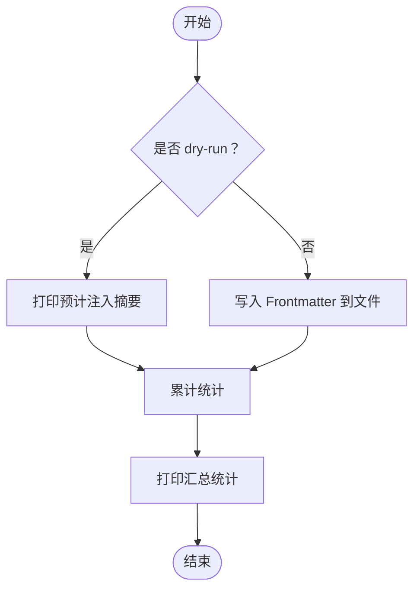
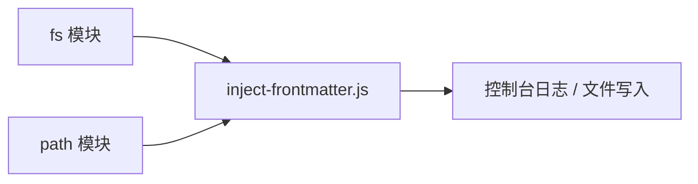

# Frontmatter 处理机制

<cite>
**本文引用的文件**   
- [scripts/inject-frontmatter.js](file://scripts/inject-frontmatter.js)
</cite>

## 目录
1. [简介](#简介)
2. [项目结构定位](#项目结构定位)
3. [核心组件与职责](#核心组件与职责)
4. [架构总览](#架构总览)
5. [详细算法解析](#详细算法解析)
6. [依赖关系分析](#依赖关系分析)
7. [性能与复杂度](#性能与复杂度)
8. [常见问题与调试技巧](#常见问题与调试技巧)
9. [结论](#结论)

## 简介
本文件面向需要理解并维护博客内容自动化处理的开发者，系统性说明 `scripts/inject-frontmatter.js` 的 Frontmatter 注入机制。该脚本用于在 Markdown 正文前自动注入结构化元数据，字段包括标题、描述、更新时间、模块名、排序号与完成状态；同时保证对已有 Frontmatter 的文件幂等跳过，并提供 dry-run 预览模式。

## 项目结构定位
Frontmatter 注入逻辑集中在单一 Node.js 脚本中，目标目录为：
- `content/frontend-knowledge`
- `content/ai-engineer`

脚本会递归遍历这两个目录下的分类子目录与 `.md` 文件，按规则生成并写入 Frontmatter。

**图表来源**
- [scripts/inject-frontmatter.js:22-25](file://scripts/inject-frontmatter.js#L22-L25)
- [scripts/inject-frontmatter.js:123-179](file://scripts/inject-frontmatter.js#L123-L179)

**章节来源**
- [scripts/inject-frontmatter.js:22-25](file://scripts/inject-frontmatter.js#L22-L25)

## 核心组件与职责
- 入口与参数
  - 支持 `--dry-run` 参数，仅打印预计注入结果，不修改文件。
- 目标扫描
  - 遍历两个目标根目录及其子目录，筛选 `.md` 文件。
- 已有 Frontmatter 检测
  - 使用正则判断是否已存在以 `---` 包裹的 YAML 头，避免覆盖。
- 字段提取
  - 标题：取首个 H1 行文本。
  - 描述：取 H1 之后首个实质段落，清理内联语法并截断到 SEO 友好长度。
  - 更新时间：文件 mtime，格式化为 YYYY-MM-DD。
  - 模块名：分类目录名去除编号前缀。
  - 排序号：文件名中的数字前缀。
  - 状态：根据正文行数映射 outline/draft/done。
- 输出与统计
  - 打印注入数量、跳过数量与状态分布。

**章节来源**
- [scripts/inject-frontmatter.js:4-18](file://scripts/inject-frontmatter.js#L4-L18)
- [scripts/inject-frontmatter.js:20-25](file://scripts/inject-frontmatter.js#L20-L25)
- [scripts/inject-frontmatter.js:27-30](file://scripts/inject-frontmatter.js#L27-L30)
- [scripts/inject-frontmatter.js:32-36](file://scripts/inject-frontmatter.js#L32-L36)
- [scripts/inject-frontmatter.js:66-104](file://scripts/inject-frontmatter.js#L66-L104)
- [scripts/inject-frontmatter.js:106-112](file://scripts/inject-frontmatter.js#L106-L112)
- [scripts/inject-frontmatter.js:123-179](file://scripts/inject-frontmatter.js#L123-L179)

## 架构总览
整体流程如下：

**图表来源**
- [scripts/inject-frontmatter.js:20-25](file://scripts/inject-frontmatter.js#L20-L25)
- [scripts/inject-frontmatter.js:123-179](file://scripts/inject-frontmatter.js#L123-L179)

## 详细算法解析

### 已有 Frontmatter 判定与幂等性
- 判定规则
  - 要求首行为 `---`，且存在闭合 `---`，中间内容任意。
  - 正文内部的 `---` 分隔线不会误判为 Frontmatter。
- 幂等保障
  - 若检测到已有 Frontmatter，直接跳过该文件，绝不覆盖既有内容。
  - 多次运行脚本不会产生重复注入或破坏现有结构。

**图表来源**
- [scripts/inject-frontmatter.js:27-30](file://scripts/inject-frontmatter.js#L27-L30)
- [scripts/inject-frontmatter.js:141-146](file://scripts/inject-frontmatter.js#L141-L146)

**章节来源**
- [scripts/inject-frontmatter.js:27-30](file://scripts/inject-frontmatter.js#L27-L30)
- [scripts/inject-frontmatter.js:141-146](file://scripts/inject-frontmatter.js#L141-L146)

### 标题提取规则
- 规则
  - 匹配文档开头的 H1 行：`^#\s+(.+?)\s*$`。
  - 若无 H1，则回退到文件名（去除编号前缀）。
- 特点
  - 仅考虑首行 H1，避免多级标题干扰。
  - 去除首尾空白，确保标题整洁。

**图表来源**
- [scripts/inject-frontmatter.js:32-36](file://scripts/inject-frontmatter.js#L32-L36)
- [scripts/inject-frontmatter.js:148-152](file://scripts/inject-frontmatter.js#L148-L152)

**章节来源**
- [scripts/inject-frontmatter.js:32-36](file://scripts/inject-frontmatter.js#L32-L36)
- [scripts/inject-frontmatter.js:148-152](file://scripts/inject-frontmatter.js#L148-L152)

### 描述生成策略
- 选择范围
  - 仅在 H1 之后的正文区域寻找首个“实质段落”。
  - 跳过代码块、各级标题、分隔线、表格行。
- 段落优先级
  - 优先散文段落；若不存在，则回退到首个列表项。
- 内容清洗
  - 移除图片、链接、加粗、下划线、反引号、删除线等内联语法。
  - 移除装饰性 emoji，保留语义箭头。
  - 合并多余空白并裁剪至 80 字符以内，尽量落在句读处。
- 兜底
  - 若无法提取有效段落，则使用“标题 —— 模块知识要点”作为默认描述。

**图表来源**
- [scripts/inject-frontmatter.js:38-50](file://scripts/inject-frontmatter.js#L38-L50)
- [scripts/inject-frontmatter.js:52-64](file://scripts/inject-frontmatter.js#L52-L64)
- [scripts/inject-frontmatter.js:66-104](file://scripts/inject-frontmatter.js#L66-L104)
- [scripts/inject-frontmatter.js:152-154](file://scripts/inject-frontmatter.js#L152-L154)

**章节来源**
- [scripts/inject-frontmatter.js:38-50](file://scripts/inject-frontmatter.js#L38-L50)
- [scripts/inject-frontmatter.js:52-64](file://scripts/inject-frontmatter.js#L52-L64)
- [scripts/inject-frontmatter.js:66-104](file://scripts/inject-frontmatter.js#L66-L104)
- [scripts/inject-frontmatter.js:152-154](file://scripts/inject-frontmatter.js#L152-L154)

### 状态判定机制
- 依据
  - 统计正文换行符数量，近似等价于行数。
- 阈值
  - ≥150 行：done
  - 51–149 行：draft
  - ≤50 行：outline
- 目的
  - 与 roadmap 的 A/B1/B2 判定阈值保持一致，便于统一规划进度。

**图表来源**
- [scripts/inject-frontmatter.js:106-112](file://scripts/inject-frontmatter.js#L106-L112)
- [scripts/inject-frontmatter.js:154](file://scripts/inject-frontmatter.js#L154)

**章节来源**
- [scripts/inject-frontmatter.js:106-112](file://scripts/inject-frontmatter.js#L106-L112)
- [scripts/inject-frontmatter.js:154](file://scripts/inject-frontmatter.js#L154)

### 其他字段处理
- 更新时间 updatedAt
  - 取自文件 mtime，格式化为 YYYY-MM-DD。
- 模块名 module
  - 分类目录名去除编号前缀（如 `01-前端认知` → `前端认知`）。
- 排序号 order
  - 从文件名中提取数字前缀（如 `01-xxx.md` → `1`），未匹配则为 `0`。
- YAML 安全包裹
  - 对字符串字段进行单引号包裹，并对内部单引号转义，避免 YAML 解析错误。

**图表来源**
- [scripts/inject-frontmatter.js:114-117](file://scripts/inject-frontmatter.js#L114-L117)
- [scripts/inject-frontmatter.js:133-155](file://scripts/inject-frontmatter.js#L133-L155)

**章节来源**
- [scripts/inject-frontmatter.js:114-117](file://scripts/inject-frontmatter.js#L114-L117)
- [scripts/inject-frontmatter.js:133-155](file://scripts/inject-frontmatter.js#L133-L155)

### 注入与输出
- 注入方式
  - 将生成的 Frontmatter 拼接到原始正文之前，保持原内容不变。
- Dry-run 模式
  - 当传入 `--dry-run` 时，不写入文件，仅打印每条文件的预计注入摘要（状态、标题、描述前缀）。
- 统计输出
  - 打印注入总数、跳过总数以及状态分布（done/draft/outline）。

**图表来源**
- [scripts/inject-frontmatter.js:167-177](file://scripts/inject-frontmatter.js#L167-L177)
- [scripts/inject-frontmatter.js:182-185](file://scripts/inject-frontmatter.js#L182-L185)

**章节来源**
- [scripts/inject-frontmatter.js:167-177](file://scripts/inject-frontmatter.js#L167-L177)
- [scripts/inject-frontmatter.js:182-185](file://scripts/inject-frontmatter.js#L182-L185)

## 依赖关系分析
- 外部依赖
  - Node.js 内置模块 `fs` 与 `path`，用于文件读写与路径拼接。
- 内部耦合
  - 脚本自包含所有逻辑，无其他模块导入，降低耦合度。
- 输入输出
  - 输入：目标目录下的 Markdown 文件。
  - 输出：带 Frontmatter 的 Markdown 文件或控制台日志。

**图表来源**
- [scripts/inject-frontmatter.js:1-2](file://scripts/inject-frontmatter.js#L1-L2)
- [scripts/inject-frontmatter.js:123-179](file://scripts/inject-frontmatter.js#L123-L179)

**章节来源**
- [scripts/inject-frontmatter.js:1-2](file://scripts/inject-frontmatter.js#L1-L2)

## 性能与复杂度
- 时间复杂度
  - 主要开销在于逐行扫描 Markdown 内容以提取描述与统计行数，近似 O(N)，N 为文件总行数。
- 空间复杂度
  - 主要为内存中缓存每份文件的内容与临时字符串，近似 O(M)，M 为单文件大小。
- I/O 特征
  - 顺序读取与顺序写入，适合批量处理大量小文件。
- 优化建议
  - 对于超大文件，可考虑流式读取与分块处理，但当前场景下必要性较低。

[本节为通用性能讨论，不直接分析具体文件]

## 常见问题与调试技巧
- 问题：为何某些文件未被注入？
  - 可能原因：文件已存在 Frontmatter，被脚本跳过。
  - 排查方法：查看控制台输出中的“跳过（已有 frontmatter）”提示。
- 问题：描述为空或不准确？
  - 可能原因：H1 后没有合适段落，或段落过短被过滤。
  - 排查方法：检查 H1 后的首个非标题、非分隔线、非表格、非代码块的段落长度与内容。
- 问题：状态不符合预期？
  - 可能原因：行数阈值未达到对应区间。
  - 排查方法：统计文件换行符数量，对照 threshold（≤50/51-149/≥150）。
- 调试技巧
  - 使用 `--dry-run` 预览注入结果，确认标题、描述与状态是否符合预期。
  - 逐步缩小目标目录，先对单个分类进行测试，再全量执行。
  - 关注控制台输出的统计信息，核对注入与跳过数量。

**章节来源**
- [scripts/inject-frontmatter.js:167-177](file://scripts/inject-frontmatter.js#L167-L177)
- [scripts/inject-frontmatter.js:182-185](file://scripts/inject-frontmatter.js#L182-L185)

## 结论
`scripts/inject-frontmatter.js` 提供了稳定、幂等的 Markdown Frontmatter 注入能力，通过明确的标题与描述提取规则、基于行数的状态判定以及安全的 YAML 包装，确保内容元数据的自动生成与一致性。配合 dry-run 模式与清晰的日志输出，便于开发与运维阶段的验证与排错。建议在新增内容或重构分类结构后，定期运行该脚本以保持 Frontmatter 的完整性与准确性。