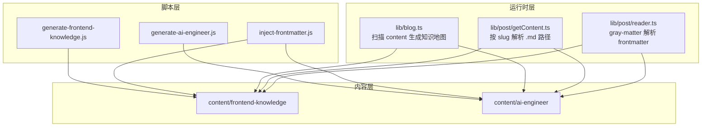
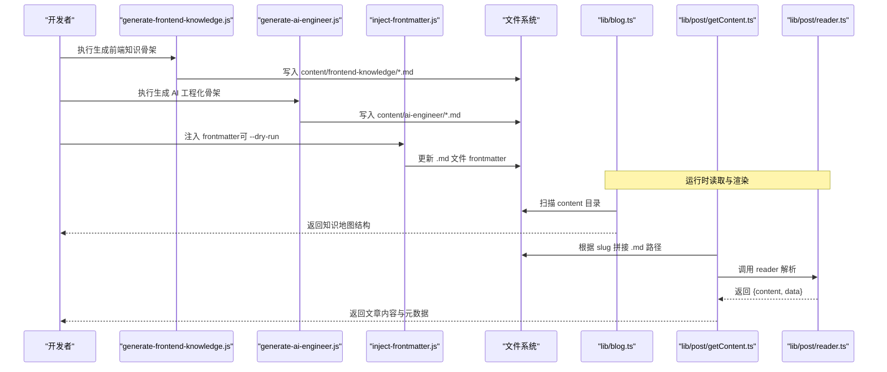
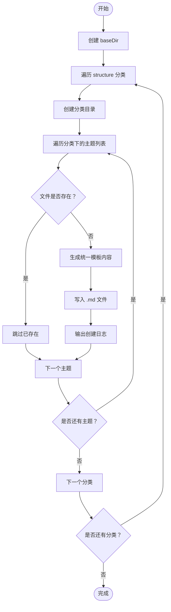
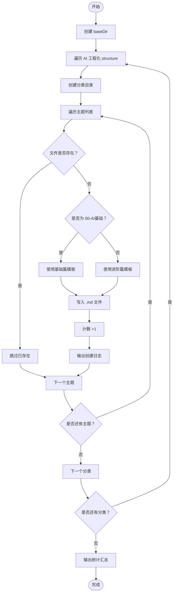
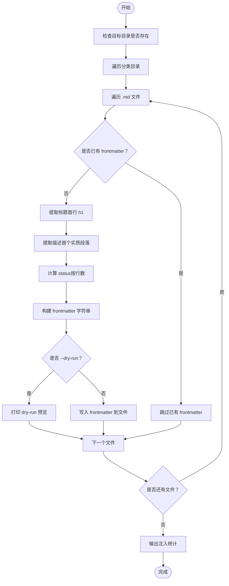
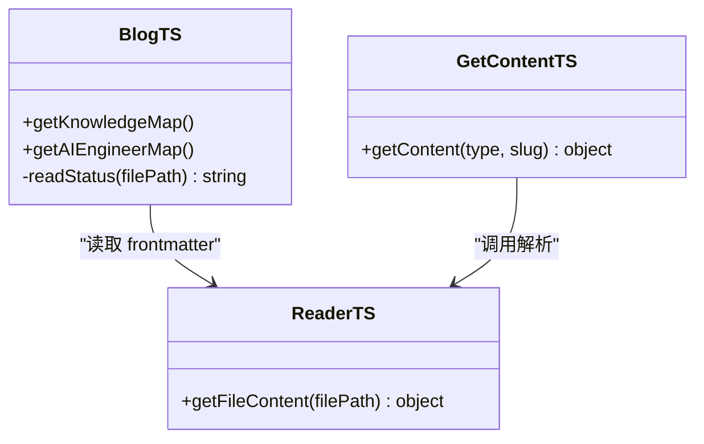
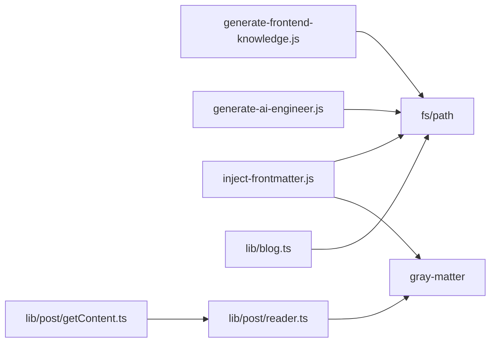

# 内容生成脚本

<cite>
**本文引用的文件**   
- [scripts/generate-frontend-knowledge.js](file://scripts/generate-frontend-knowledge.js)
- [scripts/generate-ai-engineer.js](file://scripts/generate-ai-engineer.js)
- [scripts/inject-frontmatter.js](file://scripts/inject-frontmatter.js)
- [lib/blog.ts](file://lib/blog.ts)
- [lib/post/getContent.ts](file://lib/post/getContent.ts)
- [lib/post/reader.ts](file://lib/post/reader.ts)
- [lib/navigation/getBackPath.ts](file://lib/navigation/getBackPath.ts)
- [package.json](file://package.json)
</cite>

## 目录
1. [简介](#简介)
2. [项目结构](#项目结构)
3. [核心组件](#核心组件)
4. [架构总览](#架构总览)
5. [详细组件分析](#详细组件分析)
6. [依赖关系分析](#依赖关系分析)
7. [性能与扩展性](#性能与扩展性)
8. [批量处理最佳实践](#批量处理最佳实践)
9. [执行示例](#执行示例)
10. [故障排查指南](#故障排查指南)
11. [结论](#结论)

## 简介
本仓库包含两套内容生成脚本，用于快速搭建“前端知识体系”和“AI Engineer”两大知识库的骨架文章与目录结构：
- generate-frontend-knowledge.js：根据预定义的知识体系结构，为前端知识目录生成占位 Markdown 文件。
- generate-ai-engineer.js：根据 AI 工程化知识体系结构，生成对应模块的文章骨架，并对基础篇使用更简化的模板。
- inject-frontmatter.js：为 content 下的两类知识库批量注入 frontmatter（标题、摘要、更新时间、模块名、排序号、完成度状态），并支持 dry-run 预览。

这些脚本与运行时读取逻辑配合，共同实现从文件系统到页面路由的知识地图构建。

## 项目结构
与内容生成相关的目录与文件如下：
- scripts：内容生成与元数据注入脚本
- content：实际的内容源目录，分为 frontend-knowledge 与 ai-engineer 两个板块
- lib：运行时读取与导航工具，负责将 content 映射为页面路由与导航结构

图表来源
- [scripts/generate-frontend-knowledge.js:1-214](file://scripts/generate-frontend-knowledge.js#L1-L214)
- [scripts/generate-ai-engineer.js:1-221](file://scripts/generate-ai-engineer.js#L1-L221)
- [scripts/inject-frontmatter.js:1-186](file://scripts/inject-frontmatter.js#L1-L186)
- [lib/blog.ts:83-133](file://lib/blog.ts#L83-L133)
- [lib/post/getContent.ts:1-21](file://lib/post/getContent.ts#L1-L21)
- [lib/post/reader.ts:1-12](file://lib/post/reader.ts#L1-L12)

章节来源
- [scripts/generate-frontend-knowledge.js:1-214](file://scripts/generate-frontend-knowledge.js#L1-L214)
- [scripts/generate-ai-engineer.js:1-221](file://scripts/generate-ai-engineer.js#L1-L221)
- [scripts/inject-frontmatter.js:1-186](file://scripts/inject-frontmatter.js#L1-L186)
- [lib/blog.ts:83-133](file://lib/blog.ts#L83-L133)
- [lib/post/getContent.ts:1-21](file://lib/post/getContent.ts#L1-L21)
- [lib/post/reader.ts:1-12](file://lib/post/reader.ts#L1-L12)

## 核心组件
- generate-frontend-knowledge.js
  - 功能：基于内置 structure 配置，遍历每个分类与主题，生成带编号的文件名（如 01-xxx.md）及统一模板内容；已存在文件不会覆盖。
  - 关键行为：创建 baseDir 目录；按分类创建子目录；对每个主题生成占位内容；控制台输出创建日志。
- generate-ai-engineer.js
  - 功能：与前者类似，但针对 AI 工程化领域，提供基础篇模板与普通篇模板两种内容结构；同样保护已有文件。
  - 关键行为：统计新增与跳过数量；对 00-AI基础 使用简化模板；其余模块使用进阶模板。
- inject-frontmatter.js
  - 功能：为 content/frontend-knowledge 与 content/ai-engineer 下所有 .md 文件注入 frontmatter，字段包括 title、description、updatedAt、module、order、status。
  - 关键行为：检测是否已有 frontmatter；提取首行 h1 作为标题；抽取首个实质段落作为 description；根据行数判定 status；支持 --dry-run 预览模式。

章节来源
- [scripts/generate-frontend-knowledge.js:10-59](file://scripts/generate-frontend-knowledge.js#L10-L59)
- [scripts/generate-frontend-knowledge.js:64-167](file://scripts/generate-frontend-knowledge.js#L64-L167)
- [scripts/generate-frontend-knowledge.js:182-213](file://scripts/generate-frontend-knowledge.js#L182-L213)
- [scripts/generate-ai-engineer.js:9-57](file://scripts/generate-ai-engineer.js#L9-L57)
- [scripts/generate-ai-engineer.js:62-95](file://scripts/generate-ai-engineer.js#L62-L95)
- [scripts/generate-ai-engineer.js:100-178](file://scripts/generate-ai-engineer.js#L100-L178)
- [scripts/generate-ai-engineer.js:183-220](file://scripts/generate-ai-engineer.js#L183-L220)
- [scripts/inject-frontmatter.js:4-18](file://scripts/inject-frontmatter.js#L4-L18)
- [scripts/inject-frontmatter.js:28-117](file://scripts/inject-frontmatter.js#L28-L117)
- [scripts/inject-frontmatter.js:123-185](file://scripts/inject-frontmatter.js#L123-L185)

## 架构总览
内容生成与知识地图构建的整体流程如下：
- 生成阶段：脚本根据 structure 配置生成 .md 骨架文件，确保目录结构与命名规范。
- 元数据阶段：inject-frontmatter.js 为 .md 文件注入 frontmatter，便于运行时渲染与 SEO。
- 运行阶段：lib/blog.ts 扫描 content 目录，构建知识地图；lib/post/getContent.ts 根据路由 slug 定位具体 .md 文件；lib/post/reader.ts 通过 gray-matter 解析 frontmatter 与正文。

图表来源
- [scripts/generate-frontend-knowledge.js:182-213](file://scripts/generate-frontend-knowledge.js#L182-L213)
- [scripts/generate-ai-engineer.js:183-220](file://scripts/generate-ai-engineer.js#L183-L220)
- [scripts/inject-frontmatter.js:123-185](file://scripts/inject-frontmatter.js#L123-L185)
- [lib/blog.ts:83-133](file://lib/blog.ts#L83-L133)
- [lib/post/getContent.ts:6-20](file://lib/post/getContent.ts#L6-L20)
- [lib/post/reader.ts:4-10](file://lib/post/reader.ts#L4-L10)

## 详细组件分析

### 组件一：generate-frontend-knowledge.js
- 目标目录：content/frontend-knowledge
- 结构配置：structure 对象定义了分类与主题列表，例如“00-前端认知”“01-JavaScript核心”等
- 文件命名：序号+主题名，如 01-xxx.md
- 内容模板：统一模板包含“是什么/为什么/核心原理/代码实现/总结”等章节
- 安全策略：若文件已存在则跳过，不覆盖既有成稿
- 执行流程：
  - 创建 baseDir
  - 遍历 structure，为每个分类创建目录
  - 为每个主题生成文件名与内容，写入文件
  - 控制台输出创建日志

图表来源
- [scripts/generate-frontend-knowledge.js:182-213](file://scripts/generate-frontend-knowledge.js#L182-L213)

章节来源
- [scripts/generate-frontend-knowledge.js:10-59](file://scripts/generate-frontend-knowledge.js#L10-L59)
- [scripts/generate-frontend-knowledge.js:64-167](file://scripts/generate-frontend-knowledge.js#L64-L167)
- [scripts/generate-frontend-knowledge.js:182-213](file://scripts/generate-frontend-knowledge.js#L182-L213)

### 组件二：generate-ai-engineer.js
- 目标目录：content/ai-engineer
- 结构配置：structure 对象定义 AI 工程化各模块与主题
- 模板差异：
  - 基础篇（00-AI基础）：使用 generateBasicContent，结构更简洁
  - 其他模块：使用 generateContent，包含工程实践等章节
- 安全策略：已存在文件跳过，绝不覆盖
- 统计信息：记录新增与跳过数量，并在结束时输出汇总

图表来源
- [scripts/generate-ai-engineer.js:183-220](file://scripts/generate-ai-engineer.js#L183-L220)

章节来源
- [scripts/generate-ai-engineer.js:9-57](file://scripts/generate-ai-engineer.js#L9-L57)
- [scripts/generate-ai-engineer.js:62-95](file://scripts/generate-ai-engineer.js#L62-L95)
- [scripts/generate-ai-engineer.js:100-178](file://scripts/generate-ai-engineer.js#L100-L178)
- [scripts/generate-ai-engineer.js:183-220](file://scripts/generate-ai-engineer.js#L183-L220)

### 组件三：inject-frontmatter.js
- 目标目录：content/frontend-knowledge 与 content/ai-engineer
- 注入字段：
  - title：取自正文首行 h1
  - description：h1 后首个实质段落，去除内联语法并截断
  - updatedAt：文件修改时间（YYYY-MM-DD）
  - module：分类目录名（去掉“编号-”前缀）
  - order：文件名中的数字序号
  - status：根据行数映射 outline/draft/done
- 安全策略：已有 frontmatter 的文件一律跳过，幂等执行
- 可选参数：--dry-run 仅打印预计注入结果，不写盘

图表来源
- [scripts/inject-frontmatter.js:28-117](file://scripts/inject-frontmatter.js#L28-L117)
- [scripts/inject-frontmatter.js:123-185](file://scripts/inject-frontmatter.js#L123-L185)

章节来源
- [scripts/inject-frontmatter.js:4-18](file://scripts/inject-frontmatter.js#L4-L18)
- [scripts/inject-frontmatter.js:28-117](file://scripts/inject-frontmatter.js#L28-L117)
- [scripts/inject-frontmatter.js:123-185](file://scripts/inject-frontmatter.js#L123-L185)

### 运行时读取与路由映射
- lib/blog.ts
  - getKnowledgeMap：扫描 content/frontend-knowledge，构建知识地图，slug 形如 /knowledge/{category}/{filename}
  - getAIEngineerMap：扫描 content/ai-engineer，构建知识地图，slug 形如 /ai-engineer/{category}/{filename}
  - readStatus：读取 .md 文件的 frontmatter 中 status 字段，默认 outline
- lib/post/getContent.ts
  - getContent：根据类型与 slug 数组拼接 .md 路径，支持 knowledge 与 ai-engineer 的 URL 解码
- lib/post/reader.ts
  - getFileContent：使用 gray-matter 解析 .md 文件，返回 content 与 data（frontmatter）

图表来源
- [lib/blog.ts:72-133](file://lib/blog.ts#L72-L133)
- [lib/post/getContent.ts:1-21](file://lib/post/getContent.ts#L1-L21)
- [lib/post/reader.ts:1-12](file://lib/post/reader.ts#L1-L12)

章节来源
- [lib/blog.ts:72-133](file://lib/blog.ts#L72-L133)
- [lib/post/getContent.ts:1-21](file://lib/post/getContent.ts#L1-L21)
- [lib/post/reader.ts:1-12](file://lib/post/reader.ts#L1-L12)

## 依赖关系分析
- 脚本层依赖 Node.js 原生 fs 与 path 模块
- inject-frontmatter.js 依赖 gray-matter（由 package.json 引入）
- 运行时 lib/post/reader.ts 也依赖 gray-matter
- lib/blog.ts 直接操作文件系统以构建知识地图
- lib/post/getContent.ts 与 lib/post/reader.ts 协作完成内容读取

图表来源
- [scripts/generate-frontend-knowledge.js:1-2](file://scripts/generate-frontend-knowledge.js#L1-L2)
- [scripts/generate-ai-engineer.js:1-2](file://scripts/generate-ai-engineer.js#L1-L2)
- [scripts/inject-frontmatter.js:1-2](file://scripts/inject-frontmatter.js#L1-L2)
- [lib/post/reader.ts:1-3](file://lib/post/reader.ts#L1-L3)
- [package.json:15-15](file://package.json#L15-L15)

章节来源
- [scripts/generate-frontend-knowledge.js:1-2](file://scripts/generate-frontend-knowledge.js#L1-L2)
- [scripts/generate-ai-engineer.js:1-2](file://scripts/generate-ai-engineer.js#L1-L2)
- [scripts/inject-frontmatter.js:1-2](file://scripts/inject-frontmatter.js#L1-L2)
- [lib/post/reader.ts:1-3](file://lib/post/reader.ts#L1-L3)
- [package.json:15-15](file://package.json#L15-L15)

## 性能与扩展性
- 性能特征
  - 脚本均为同步 I/O，适合一次性批量生成，不适合高频实时场景
  - inject-frontmatter.js 会逐文件读取与写入，建议先使用 --dry-run 评估影响范围
- 可扩展点
  - 在 generate-frontend-knowledge.js 与 generate-ai-engineer.js 中扩展 structure 配置即可增加新分类或主题
  - 可在 inject-frontmatter.js 中扩展 frontmatter 字段（如 author、tags、cover）
  - 在 lib/blog.ts 中扩展 getKnowledgeMap/getAIEngineerMap 以支持新的内容板块
  - 在 lib/post/getContent.ts 中扩展 ContentType 以支持新的内容类型

[本节为通用指导，不涉及具体文件分析]

## 批量处理最佳实践
- 错误处理
  - 脚本对已存在文件进行保护，避免覆盖既有内容
  - inject-frontmatter.js 对已有 frontmatter 的文件跳过，保证幂等
  - 建议在 CI 中捕获脚本退出码，失败时中断流水线
- 日志输出
  - 生成脚本会输出创建与跳过日志，便于审计
  - inject-frontmatter.js 支持 --dry-run，先预览再落盘
- 进度跟踪
  - generate-ai-engineer.js 输出新增与跳过统计
  - inject-frontmatter.js 输出注入与跳过统计，以及 status 分布
- 推荐流程
  - 首次初始化：执行 generate-frontend-knowledge.js 与 generate-ai-engineer.js
  - 元数据补齐：执行 inject-frontmatter.js --dry-run 预览，确认无误后再次执行不带参数的版本
  - 迭代更新：新增主题后重新运行生成脚本（不会覆盖已有文件），随后运行 inject-frontmatter.js 补齐元数据

章节来源
- [scripts/generate-frontend-knowledge.js:197-206](file://scripts/generate-frontend-knowledge.js#L197-L206)
- [scripts/generate-ai-engineer.js:197-212](file://scripts/generate-ai-engineer.js#L197-L212)
- [scripts/inject-frontmatter.js:141-146](file://scripts/inject-frontmatter.js#L141-L146)
- [scripts/inject-frontmatter.js:167-174](file://scripts/inject-frontmatter.js#L167-L174)
- [scripts/inject-frontmatter.js:182-185](file://scripts/inject-frontmatter.js#L182-L185)

## 执行示例
- 安装依赖（如需）
  - 项目依赖 gray-matter，已在 package.json 中声明
- 生成前端知识骨架
  - node scripts/generate-frontend-knowledge.js
- 生成 AI 工程化骨架
  - node scripts/generate-ai-engineer.js
- 注入 frontmatter（预览）
  - node scripts/inject-frontmatter.js --dry-run
- 注入 frontmatter（落盘）
  - node scripts/inject-frontmatter.js

章节来源
- [package.json:15-15](file://package.json#L15-L15)
- [scripts/generate-frontend-knowledge.js:182-213](file://scripts/generate-frontend-knowledge.js#L182-L213)
- [scripts/generate-ai-engineer.js:183-220](file://scripts/generate-ai-engineer.js#L183-L220)
- [scripts/inject-frontmatter.js:167-185](file://scripts/inject-frontmatter.js#L167-L185)

## 故障排查指南
- 问题：脚本未生成任何文件
  - 检查 Node.js 环境是否正常
  - 确认当前工作目录正确（脚本基于 process.cwd() 拼接路径）
  - 查看控制台是否有权限错误或路径不存在提示
- 问题：部分文件未被生成
  - 检查 structure 配置是否包含该主题
  - 确认同名文件是否已存在（脚本会跳过已存在文件）
- 问题：frontmatter 未注入或字段缺失
  - 确认 .md 文件是否已有 frontmatter（已有则跳过）
  - 检查 h1 标题是否存在，否则 title 可能回退为文件名
  - 检查 description 是否能成功抽取（若无实质段落，将回退为默认描述）
  - 使用 --dry-run 预览即将注入的内容
- 问题：运行时无法读取内容
  - 检查 lib/post/getContent.ts 中 slug 是否正确解码
  - 确认 .md 文件路径与 slug 一致
  - 检查 gray-matter 是否正确解析 frontmatter

章节来源
- [scripts/generate-frontend-knowledge.js:182-213](file://scripts/generate-frontend-knowledge.js#L182-L213)
- [scripts/generate-ai-engineer.js:183-220](file://scripts/generate-ai-engineer.js#L183-L220)
- [scripts/inject-frontmatter.js:28-117](file://scripts/inject-frontmatter.js#L28-L117)
- [scripts/inject-frontmatter.js:123-185](file://scripts/inject-frontmatter.js#L123-L185)
- [lib/post/getContent.ts:6-20](file://lib/post/getContent.ts#L6-L20)
- [lib/post/reader.ts:4-10](file://lib/post/reader.ts#L4-L10)

## 结论
- generate-frontend-knowledge.js 与 generate-ai-engineer.js 提供了稳定的内容骨架生成能力，结合 inject-frontmatter.js 可快速补齐元数据，形成完整的知识地图。
- 运行时通过 lib/blog.ts 与 lib/post/getContent.ts 将 content 目录映射为页面路由，lib/post/reader.ts 负责解析 frontmatter 与正文。
- 推荐在生产环境中遵循“先生成骨架、再注入 frontmatter、最后运行站点”的流程，并使用 --dry-run 与日志输出进行可控迭代。

[本节为总结性内容，不涉及具体文件分析]