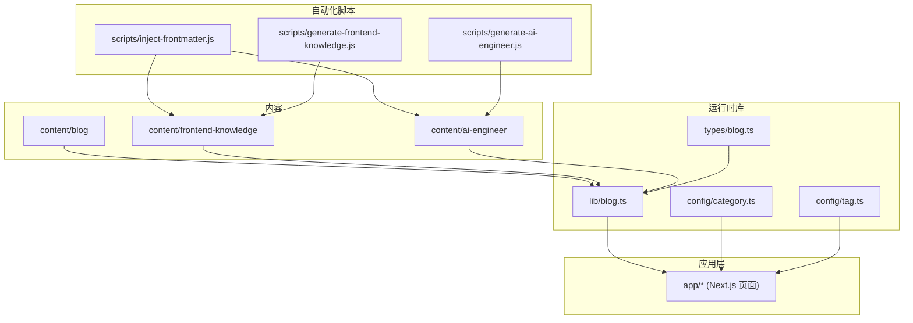
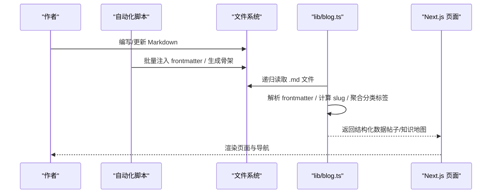
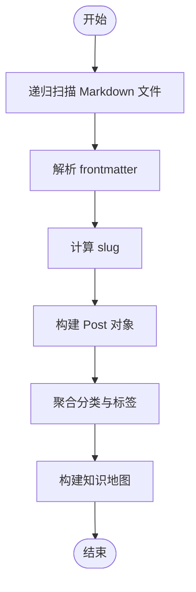
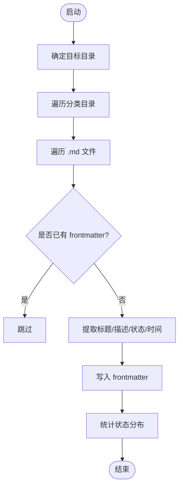
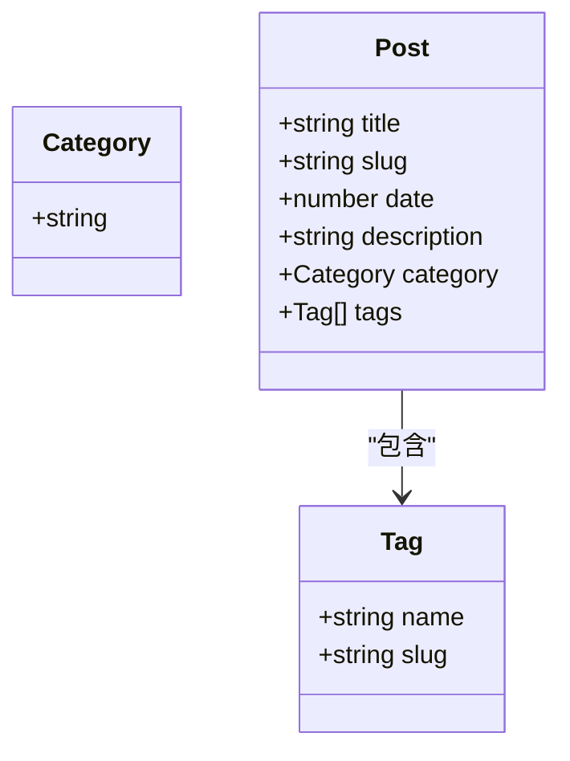
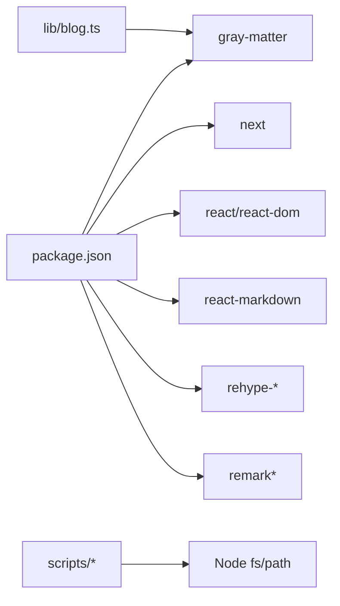

# 内容管理

<cite>
**本文引用的文件**   
- [README.md](file://README.md)
- [package.json](file://package.json)
- [scripts/inject-frontmatter.js](file://scripts/inject-frontmatter.js)
- [scripts/generate-ai-engineer.js](file://scripts/generate-ai-engineer.js)
- [scripts/generate-frontend-knowledge.js](file://scripts/generate-frontend-knowledge.js)
- [lib/blog.ts](file://lib/blog.ts)
- [types/blog.ts](file://types/blog.ts)
- [config/category.ts](file://config/category.ts)
- [config/tag.ts](file://config/tag.ts)
- [content/frontend-knowledge/01-JavaScript核心/01-数据类型.md](file://content/frontend-knowledge/01-JavaScript核心/01-数据类型.md)
- [content/ai-engineer/00-AI基础/01-什么是LLM.md](file://content/ai-engineer/00-AI基础/01-什么是LLM.md)
</cite>

## 目录
1. [简介](#简介)
2. [项目结构](#项目结构)
3. [核心组件](#核心组件)
4. [架构总览](#架构总览)
5. [详细组件分析](#详细组件分析)
6. [依赖关系分析](#依赖关系分析)
7. [性能与可扩展性](#性能与可扩展性)
8. [故障排查指南](#故障排查指南)
9. [结论](#结论)
10. [附录：规范与最佳实践](#附录：规范与最佳实践)

## 简介
本文件系统性地梳理 HuRui.dev 博客的内容管理体系，覆盖 Markdown 内容组织、frontmatter 字段规范、内容处理流程、自动化脚本（frontmatter 注入、知识地图生成、AI 工程文档骨架生成）、类型定义与校验规则，以及新增内容类型、扩展字段和自定义处理逻辑的方法。目标是让非技术读者也能理解并高效参与内容创作与批量处理。

## 项目结构
本项目采用“内容即数据”的静态站点模式：
- content 目录存放所有 Markdown 内容，分为 blog、frontend-knowledge、ai-engineer 三大板块。
- lib 目录提供内容读取、分类、标签聚合与知识地图构建等运行时逻辑。
- scripts 目录提供批量处理与模板生成的自动化脚本。
- types 与 config 提供类型定义与配置常量。
- app 为 Next.js 应用层，负责渲染页面与展示内容。

图表来源
- [lib/blog.ts:1-134](file://lib/blog.ts#L1-L134)
- [scripts/inject-frontmatter.js:1-186](file://scripts/inject-frontmatter.js#L1-L186)
- [scripts/generate-frontend-knowledge.js:1-214](file://scripts/generate-frontend-knowledge.js#L1-L214)
- [scripts/generate-ai-engineer.js:1-221](file://scripts/generate-ai-engineer.js#L1-L221)

章节来源
- [README.md:1-37](file://README.md#L1-L37)
- [package.json:1-53](file://package.json#L1-L53)

## 核心组件
- 内容存储与组织
  - blog：面向文章列表、分类与标签展示。
  - frontend-knowledge：前端知识体系，按模块目录组织，文件名以编号前缀排序。
  - ai-engineer：AI 工程知识体系，结构与前端知识类似。
- 运行时内容处理
  - lib/blog.ts：递归扫描 Markdown，解析 frontmatter，构建帖子列表、分类、标签与知识地图。
- 类型与配置
  - types/blog.ts：Post、Tag、Category 类型定义。
  - config/category.ts、config/tag.ts：分类与标签的配置映射。
- 自动化脚本
  - inject-frontmatter.js：为 frontend-knowledge 与 ai-engineer 批量注入 frontmatter。
  - generate-frontend-knowledge.js：根据结构定义生成前端知识占位文章。
  - generate-ai-engineer.js：根据结构定义生成 AI 工程知识占位文章。

章节来源
- [lib/blog.ts:1-134](file://lib/blog.ts#L1-L134)
- [types/blog.ts:1-16](file://types/blog.ts#L1-L16)
- [config/category.ts:1-9](file://config/category.ts#L1-L9)
- [config/tag.ts:1-11](file://config/tag.ts#L1-L11)
- [scripts/inject-frontmatter.js:1-186](file://scripts/inject-frontmatter.js#L1-L186)
- [scripts/generate-frontend-knowledge.js:1-214](file://scripts/generate-frontend-knowledge.js#L1-L214)
- [scripts/generate-ai-engineer.js:1-221](file://scripts/generate-ai-engineer.js#L1-L221)

## 架构总览
内容从 Markdown 到页面的整体流程如下：

图表来源
- [scripts/inject-frontmatter.js:123-180](file://scripts/inject-frontmatter.js#L123-L180)
- [scripts/generate-frontend-knowledge.js:182-210](file://scripts/generate-frontend-knowledge.js#L182-L210)
- [scripts/generate-ai-engineer.js:183-217](file://scripts/generate-ai-engineer.js#L183-L217)
- [lib/blog.ts:9-50](file://lib/blog.ts#L9-L50)
- [lib/blog.ts:83-133](file://lib/blog.ts#L83-L133)

## 详细组件分析

### Markdown 内容与 Frontmatter 规范
- 内容目录
  - content/blog：博客文章，使用 date、title、description、category、tags 等字段。
  - content/frontend-knowledge：前端知识，使用 title、description、updatedAt、module、order、status 等字段。
  - content/ai-engineer：AI 工程知识，字段与前端的知识体系一致。
- Frontmatter 字段说明
  - 通用字段
    - title：文章标题，优先取正文首行 h1。
    - description：SEO 摘要，取自 h1 后首个实质段落，去除内联语法并截断。
    - updatedAt：最后更新时间，来源于文件 mtime。
    - module：所属模块名称，来自分类目录名（去除编号前缀）。
    - order：排序号，来自文件名编号。
    - status：完成度状态，依据正文行数判定 outline/draft/done。
  - 博客字段
    - date：发布时间戳或日期字符串。
    - category：分类（如 frontend、projects），由类型与配置约束。
    - tags：标签数组，包含 name 与 slug。
- 示例文件参考
  - 前端知识示例：[content/frontend-knowledge/01-JavaScript核心/01-数据类型.md](file://content/frontend-knowledge/01-JavaScript核心/01-数据类型.md)
  - AI 工程示例：[content/ai-engineer/00-AI基础/01-什么是LLM.md](file://content/ai-engineer/00-AI基础/01-什么是LLM.md)

章节来源
- [scripts/inject-frontmatter.js:27-117](file://scripts/inject-frontmatter.js#L27-L117)
- [content/frontend-knowledge/01-JavaScript核心/01-数据类型.md:1-8](file://content/frontend-knowledge/01-JavaScript核心/01-数据类型.md#L1-L8)
- [content/ai-engineer/00-AI基础/01-什么是LLM.md:1-8](file://content/ai-engineer/00-AI基础/01-什么是LLM.md#L1-L8)

### 内容处理流程（运行时）
- 递归扫描 Markdown 文件，解析 frontmatter，构造 Post 对象。
- 计算 slug：基于相对路径，兼容 Windows 路径分隔符。
- 聚合分类与标签：用于页面筛选与导航。
- 构建知识地图：遍历 knowledge 与 ai-engineer 目录，输出层级结构，附带 status。

图表来源
- [lib/blog.ts:9-50](file://lib/blog.ts#L9-L50)
- [lib/blog.ts:53-70](file://lib/blog.ts#L53-L70)
- [lib/blog.ts:83-133](file://lib/blog.ts#L83-L133)

章节来源
- [lib/blog.ts:1-134](file://lib/blog.ts#L1-L134)

### 自动化脚本工作原理

#### Frontmatter 注入脚本
- 目标目录：content/frontend-knowledge 与 content/ai-engineer。
- 行为
  - 跳过已有 frontmatter 的文件，确保幂等与安全。
  - 提取标题：正文首行 h1。
  - 提取描述：h1 后首个实质段落，清理内联语法并按句读截断。
  - 计算状态：按行数阈值映射 outline/draft/done。
  - 写入 frontmatter：title、description、updatedAt、module、order、status。
- 支持 dry-run 模式预览结果。

图表来源
- [scripts/inject-frontmatter.js:20-25](file://scripts/inject-frontmatter.js#L20-L25)
- [scripts/inject-frontmatter.js:27-117](file://scripts/inject-frontmatter.js#L27-L117)
- [scripts/inject-frontmatter.js:123-180](file://scripts/inject-frontmatter.js#L123-L180)

章节来源
- [scripts/inject-frontmatter.js:1-186](file://scripts/inject-frontmatter.js#L1-L186)

#### 前端知识生成脚本
- 行为
  - 根据结构定义创建分类目录与文章文件。
  - 已存在文件不覆盖，仅补齐缺失的占位骨架。
  - 统一模板包含“是什么/为什么/核心原理/代码实现/总结”等章节。
- 注意
  - 默认不清空旧目录，避免误删成稿。

章节来源
- [scripts/generate-frontend-knowledge.js:1-214](file://scripts/generate-frontend-knowledge.js#L1-L214)

#### AI 工程文档生成脚本
- 行为
  - 根据结构定义创建分类目录与文章文件。
  - 对“00-AI基础”使用基础篇模板，其他模块使用进阶篇模板。
  - 已存在文件不覆盖，保护既有内容。

章节来源
- [scripts/generate-ai-engineer.js:1-221](file://scripts/generate-ai-engineer.js#L1-L221)

### 内容类型定义与验证规则
- 类型定义
  - Category：限定为 'frontend' | 'projects'。
  - Tag：包含 name 与 slug。
  - Post：包含 title、slug、date、description、category、tags。
- 运行时校验
  - lib/blog.ts 在读取 frontmatter 时进行基本容错：
    - date 无效时使用当前时间。
    - description 回退到 desc 字段。
    - category 默认值 'blog'。
    - tags 默认空数组。
    - status 默认 'outline'。
- 配置映射
  - config/category.ts：分类标签映射。
  - config/tag.ts：标签颜色与显示名映射。

图表来源
- [types/blog.ts:1-16](file://types/blog.ts#L1-L16)

章节来源
- [types/blog.ts:1-16](file://types/blog.ts#L1-L16)
- [lib/blog.ts:24-50](file://lib/blog.ts#L24-L50)
- [lib/blog.ts:72-81](file://lib/blog.ts#L72-L81)
- [config/category.ts:1-9](file://config/category.ts#L1-L9)
- [config/tag.ts:1-11](file://config/tag.ts#L1-L11)

### 如何添加新的内容类型
步骤建议：
- 在 content 下新增目录（例如 content/new-type）。
- 若需要自动生成骨架，新增对应生成脚本或在现有脚本中扩展 structure 定义。
- 在 lib/blog.ts 中添加读取与映射逻辑，输出新类型的知识地图或列表。
- 在 types/blog.ts 中扩展类型定义（如需）。
- 在 config/category.ts 或 config/tag.ts 中补充显示配置。
- 在 app 层新增路由与页面，消费新类型的数据。

章节来源
- [scripts/generate-frontend-knowledge.js:64-167](file://scripts/generate-frontend-knowledge.js#L64-L167)
- [scripts/generate-ai-engineer.js:100-178](file://scripts/generate-ai-engineer.js#L100-L178)
- [lib/blog.ts:83-133](file://lib/blog.ts#L83-L133)
- [types/blog.ts:1-16](file://types/blog.ts#L1-L16)
- [config/category.ts:1-9](file://config/category.ts#L1-L9)
- [config/tag.ts:1-11](file://config/tag.ts#L1-L11)

### 如何扩展内容字段
- 在 frontmatter 中新增字段（例如 author、cover、keywords）。
- 在 lib/blog.ts 的解析逻辑中读取并透传到 Post 对象。
- 在 types/blog.ts 中扩展 Post 类型，保证 TypeScript 校验。
- 在 app 层页面中消费新字段进行展示或过滤。

章节来源
- [lib/blog.ts:24-50](file://lib/blog.ts#L24-L50)
- [types/blog.ts:8-15](file://types/blog.ts#L8-L15)

### 如何自定义内容处理逻辑
- 在 lib/blog.ts 中新增函数，封装特定业务逻辑（如摘要增强、标签清洗、链接规范化）。
- 在脚本中增加预处理或后处理步骤（如注入额外元数据、批量重命名、格式校验）。
- 在 app 层通过 hooks 或组件复用这些逻辑。

章节来源
- [lib/blog.ts:1-134](file://lib/blog.ts#L1-L134)
- [scripts/inject-frontmatter.js:1-186](file://scripts/inject-frontmatter.js#L1-L186)

## 依赖关系分析
- 运行时依赖
  - gray-matter：解析 Markdown frontmatter。
  - fs/path：文件系统操作。
- 脚本依赖
  - Node.js 原生 fs/path。
- 应用依赖
  - Next.js、React、Tailwind、Markdown 渲染相关库。

图表来源
- [package.json:12-30](file://package.json#L12-L30)
- [lib/blog.ts:1-4](file://lib/blog.ts#L1-L4)

章节来源
- [package.json:1-53](file://package.json#L1-L53)
- [lib/blog.ts:1-4](file://lib/blog.ts#L1-L4)

## 性能与可扩展性
- 内容扫描
  - 递归读取目录，适合中小规模知识库；当内容量增长时可考虑增量扫描或缓存。
- Frontmatter 解析
  - gray-matter 解析开销较低；可结合内存缓存减少重复 IO。
- 脚本执行
  - 注入与生成脚本均为一次性任务，建议在 CI 或本地开发阶段运行。
- 可扩展性
  - 通过结构定义集中管理内容骨架，便于批量生成与维护。
  - 类型与配置分离，降低耦合，提升可维护性。

[本节为通用指导，无需具体文件引用]

## 故障排查指南
- Frontmatter 未生效
  - 检查文件是否以 --- 包裹且位于文件开头。
  - 确认脚本是否因已有 frontmatter 而跳过。
- 状态判断异常
  - 检查正文行数是否符合 outline/draft/done 阈值。
- 知识地图缺失条目
  - 确认目录结构与文件名编号是否正确。
  - 检查 lib/blog.ts 中的读取逻辑是否匹配新目录。
- 类型错误
  - 核对 types/blog.ts 与 lib/blog.ts 的字段一致性。
  - 确保 config/category.ts 与 config/tag.ts 的配置与页面消费一致。

章节来源
- [scripts/inject-frontmatter.js:27-30](file://scripts/inject-frontmatter.js#L27-L30)
- [scripts/inject-frontmatter.js:106-117](file://scripts/inject-frontmatter.js#L106-L117)
- [lib/blog.ts:72-81](file://lib/blog.ts#L72-L81)
- [lib/blog.ts:83-133](file://lib/blog.ts#L83-L133)
- [types/blog.ts:1-16](file://types/blog.ts#L1-L16)
- [config/category.ts:1-9](file://config/category.ts#L1-L9)
- [config/tag.ts:1-11](file://config/tag.ts#L1-L11)

## 结论
本项目通过清晰的目录组织、规范的 frontmatter、完善的类型与配置，以及自动化脚本，构建了稳定高效的内容管理系统。运行时库将 Markdown 内容转化为结构化数据，供 Next.js 页面渲染。新增内容类型与字段可通过扩展脚本、类型与配置快速落地，满足持续演进的知识库需求。

[本节为总结性内容，无需具体文件引用]

## 附录：规范与最佳实践
- 内容创作规范
  - 使用编号前缀控制排序（如 01-xxx.md）。
  - 首行 h1 作为标题，保持简洁明确。
  - 摘要段落尽量完整表达主题，避免过多装饰符号。
  - 合理划分模块目录，保持分类清晰。
- 批量处理工具使用方法
  - 注入 frontmatter：node scripts/inject-frontmatter.js [--dry-run]
  - 生成前端知识骨架：node scripts/generate-frontend-knowledge.js
  - 生成 AI 工程知识骨架：node scripts/generate-ai-engineer.js
- 安全与幂等
  - 脚本均具备“已存在则跳过”的保护机制，避免覆盖成稿。
  - 建议在提交前运行脚本并检查变更。

章节来源
- [scripts/inject-frontmatter.js:17-18](file://scripts/inject-frontmatter.js#L17-L18)
- [scripts/inject-frontmatter.js:141-146](file://scripts/inject-frontmatter.js#L141-L146)
- [scripts/generate-frontend-knowledge.js:197-201](file://scripts/generate-frontend-knowledge.js#L197-L201)
- [scripts/generate-ai-engineer.js:197-202](file://scripts/generate-ai-engineer.js#L197-L202)