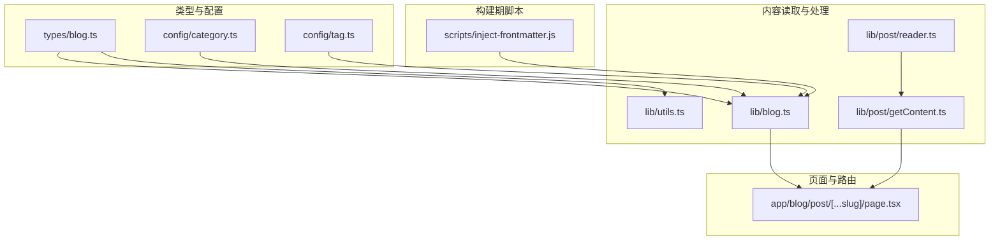
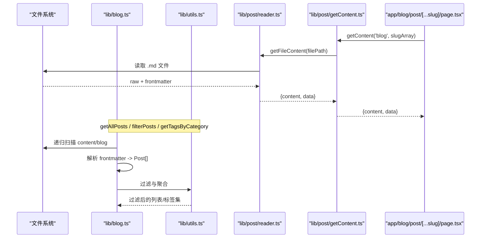
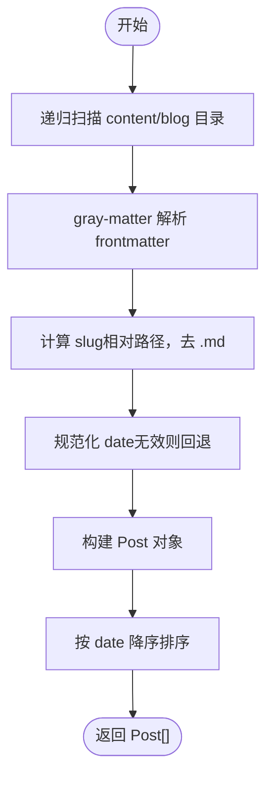
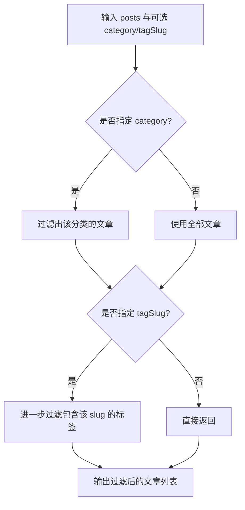
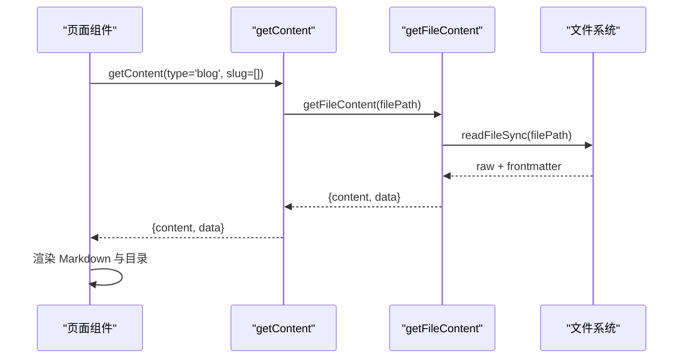
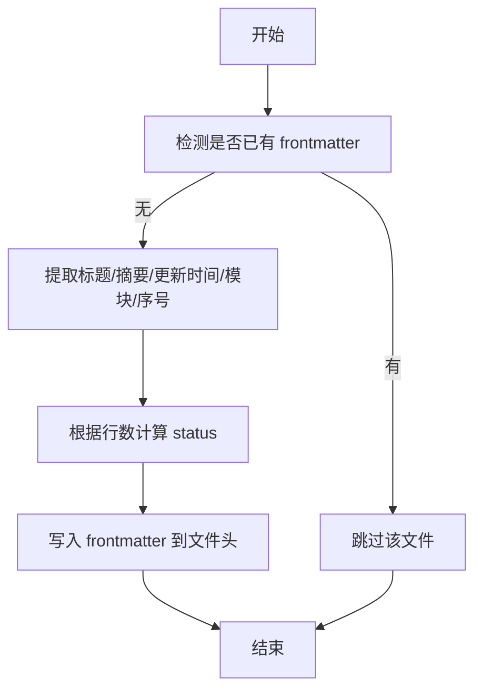
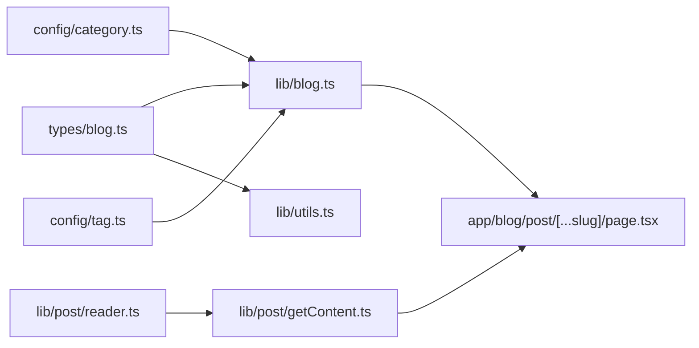

# 内容类型定义

<cite>
**本文引用的文件**   
- [types/blog.ts](file://types/blog.ts)
- [config/category.ts](file://config/category.ts)
- [config/tag.ts](file://config/tag.ts)
- [lib/blog.ts](file://lib/blog.ts)
- [lib/utils.ts](file://lib/utils.ts)
- [lib/post/getContent.ts](file://lib/post/getContent.ts)
- [lib/post/reader.ts](file://lib/post/reader.ts)
- [app/blog/post/[...slug]/page.tsx](file://app/blog/post/[...slug]/page.tsx)
- [scripts/inject-frontmatter.js](file://scripts/inject-frontmatter.js)
</cite>

## 目录
1. [引言](#引言)
2. [项目结构](#项目结构)
3. [核心类型与配置](#核心类型与配置)
4. [架构总览](#架构总览)
5. [详细组件分析](#详细组件分析)
6. [依赖关系分析](#依赖关系分析)
7. [性能与可扩展性](#性能与可扩展性)
8. [故障排查指南](#故障排查指南)
9. [结论](#结论)
10. [附录：扩展新内容类型的实践](#附录扩展新内容类型的实践)

## 引言
本文聚焦于内容类型系统的 TypeScript 定义与配置结构，围绕 Post、Tag、Category 等核心数据模型，说明字段含义、约束规则与验证逻辑；解释分类系统与标签系统的设计原理，包括枚举类型、slug 生成规则与关联关系管理；并提供扩展新内容类型、添加自定义字段与验证规则的类型安全开发模式与最佳实践。

## 项目结构
本项目采用“类型定义 + 运行时配置 + 内容读取工具”的分层组织方式：
- types 目录集中声明核心类型（Post、Tag、Category）。
- config 目录维护分类与标签的显示配置（label、color 等）。
- lib 目录提供内容扫描、过滤、聚合与路由解析能力。
- app 目录通过 Next.js App Router 消费上述类型与工具。
- scripts 目录提供批量注入 frontmatter 的工具脚本。



**图表来源**
- [types/blog.ts:1-16](file://types/blog.ts#L1-L16)
- [config/category.ts:1-9](file://config/category.ts#L1-L9)
- [config/tag.ts:1-11](file://config/tag.ts#L1-L11)
- [lib/blog.ts:1-134](file://lib/blog.ts#L1-L134)
- [lib/utils.ts:1-37](file://lib/utils.ts#L1-L37)
- [lib/post/getContent.ts:1-20](file://lib/post/getContent.ts#L1-L20)
- [lib/post/reader.ts:1-11](file://lib/post/reader.ts#L1-L11)
- [app/blog/post/[...slug]/page.tsx:1-27](file://app/blog/post/[...slug]/page.tsx#L1-L27)
- [scripts/inject-frontmatter.js:1-185](file://scripts/inject-frontmatter.js#L1-L185)

**章节来源**
- [types/blog.ts:1-16](file://types/blog.ts#L1-L16)
- [lib/blog.ts:1-134](file://lib/blog.ts#L1-L134)

## 核心类型与配置
本节梳理核心类型与配置的语义、约束与使用位置。

- Category（分类枚举）
  - 定义：限定为固定字面量集合，用于强类型约束文章所属分类。
  - 用途：Post.category 字段、过滤与导航。
  - 相关实现：类型定义在类型文件中；分类显示标签在配置文件中。

- Tag（标签对象）
  - 定义：包含 name 与 slug 两个字符串字段。
  - 用途：文章可拥有多个标签；slug 作为稳定标识用于路由与筛选。
  - 相关实现：类型定义在类型文件中；标签显示颜色等元信息在配置文件中。

- Post（文章对象）
  - 定义：包含 title、slug、date、description、category、tags 等字段。
  - 约束：
    - category 必须属于 Category 枚举。
    - tags 为 Tag[]，每个 tag 具备唯一 slug。
    - date 为时间戳数字，由 frontmatter 解析并校验。
  - 数据来源：从 Markdown 文件的 frontmatter 中解析得到。

- 分类与标签配置
  - CATEGORY_CONFIG：为每个分类键提供 label 等展示信息。
  - TAG_CONFIG：为每个标签键提供 label、color 等展示信息。

```mermaid
classDiagram
class Category {
<<enum>>
"frontend"
"projects"
}
class Tag {
+string name
+string slug
}
class Post {
+string title
+string slug
+number date
+string description
+Category category
+Tag[] tags
}
class CategoryConfig {
+Record~string, {label}
}
class TagConfig {
+Record~string, {label,color}
}
Post --> Category : "使用"
Post --> Tag : "包含多个"
CategoryConfig --> Category : "按 key 映射"
TagConfig --> Tag : "按 slug 映射"
```

**图表来源**
- [types/blog.ts:1-16](file://types/blog.ts#L1-L16)
- [config/category.ts:1-9](file://config/category.ts#L1-L9)
- [config/tag.ts:1-11](file://config/tag.ts#L1-L11)

**章节来源**
- [types/blog.ts:1-16](file://types/blog.ts#L1-L16)
- [config/category.ts:1-9](file://config/category.ts#L1-L9)
- [config/tag.ts:1-11](file://config/tag.ts#L1-L11)

## 架构总览
内容类型系统在运行时的关键流程如下：
- 扫描 content 目录下的 Markdown 文件。
- 使用 gray-matter 解析 frontmatter，构造 Post 对象。
- 计算 slug（基于相对路径），规范化日期。
- 聚合分类与标签，提供过滤与排序能力。
- 页面组件根据路由参数获取文章内容并渲染。



**图表来源**
- [lib/blog.ts:24-70](file://lib/blog.ts#L24-L70)
- [lib/utils.ts:3-33](file://lib/utils.ts#L3-L33)
- [lib/post/getContent.ts:6-20](file://lib/post/getContent.ts#L6-L20)
- [lib/post/reader.ts:4-11](file://lib/post/reader.ts#L4-L11)
- [app/blog/post/[...slug]/page.tsx:11-27](file://app/blog/post/[...slug]/page.tsx#L11-L27)

## 详细组件分析

### 类型定义模块（types/blog.ts）
- 职责：集中声明 Category、Tag、Post 三个核心类型，确保全仓类型一致。
- 关键点：
  - Category 使用字面量联合类型，避免非法分类值。
  - Tag 同时保留 name 与 slug，便于展示与路由识别。
  - Post.date 使用 number 表示时间戳，利于排序与比较。

**章节来源**
- [types/blog.ts:1-16](file://types/blog.ts#L1-L16)

### 分类与标签配置（config/category.ts、config/tag.ts）
- 职责：为前端展示提供稳定的键到元信息的映射。
- 关键点：
  - CATEGORY_CONFIG 以分类键为 key，提供 label。
  - TAG_CONFIG 以标签 slug 为 key，提供 label 与 color。
- 建议：新增分类或标签时，同步更新对应配置文件，保持类型与展示一致性。

**章节来源**
- [config/category.ts:1-9](file://config/category.ts#L1-L9)
- [config/tag.ts:1-11](file://config/tag.ts#L1-L11)

### 内容读取与聚合（lib/blog.ts）
- 职责：
  - 递归扫描 content/blog 目录，解析每篇 Markdown 的 frontmatter。
  - 计算 slug（基于相对路径，去除 .md 后缀）。
  - 标准化 date（若无效则回退为当前时间）。
  - 聚合所有分类与标签，供导航与筛选使用。
- 关键逻辑：
  - getAllPosts：返回 Post[]，并按 date 降序排列。
  - getAllCategories：提取所有出现过的分类，并追加“全部”选项。
  - getAllTags：去重收集所有标签名，并追加“全部”选项。



**图表来源**
- [lib/blog.ts:24-51](file://lib/blog.ts#L24-L51)

**章节来源**
- [lib/blog.ts:24-70](file://lib/blog.ts#L24-L70)

### 过滤与聚合工具（lib/utils.ts）
- 职责：
  - getTagsByCategory：按分类聚合标签，并以 slug 去重。
  - filterPosts：按分类与标签 slug 过滤文章列表。
  - formatTags：将标签数组格式化为展示字符串。
- 关键点：
  - 使用 Map 以 slug 为键进行去重，保证标签唯一性。
  - filterPosts 支持可选的分类与标签筛选条件。



**图表来源**
- [lib/utils.ts:3-33](file://lib/utils.ts#L3-L33)

**章节来源**
- [lib/utils.ts:1-37](file://lib/utils.ts#L1-L37)

### 内容获取与渲染（lib/post/getContent.ts、lib/post/reader.ts、app/blog/post/[...slug]/page.tsx）
- 职责：
  - getContent：根据内容类型与 slug 数组拼接文件路径并读取。
  - reader.getFileContent：统一封装 gray-matter 解析。
  - page：接收路由参数，调用 getContent 获取文章并渲染。
- 关键点：
  - 对 knowledge 与 ai-engineer 类型进行 URL 解码，兼容中文 slug。
  - 页面在未找到文章时返回友好提示。



**图表来源**
- [lib/post/getContent.ts:6-20](file://lib/post/getContent.ts#L6-L20)
- [lib/post/reader.ts:4-11](file://lib/post/reader.ts#L4-L11)
- [app/blog/post/[...slug]/page.tsx:11-27](file://app/blog/post/[...slug]/page.tsx#L11-L27)

**章节来源**
- [lib/post/getContent.ts:1-20](file://lib/post/getContent.ts#L1-L20)
- [lib/post/reader.ts:1-11](file://lib/post/reader.ts#L1-L11)
- [app/blog/post/[...slug]/page.tsx:1-27](file://app/blog/post/[...slug]/page.tsx#L1-L27)

### Frontmatter 注入脚本（scripts/inject-frontmatter.js）
- 职责：为知识体系与 AI Engineer 板块批量注入 frontmatter 字段（title、description、updatedAt、module、order、status）。
- 关键点：
  - 幂等：已存在 frontmatter 的文件跳过，不覆盖既有正文。
  - 状态判定：根据正文行数映射 outline/draft/done。
  - 标题与摘要：自动提取首行 h1 与首个实质段落。



**图表来源**
- [scripts/inject-frontmatter.js:27-30](file://scripts/inject-frontmatter.js#L27-L30)
- [scripts/inject-frontmatter.js:157-177](file://scripts/inject-frontmatter.js#L157-L177)

**章节来源**
- [scripts/inject-frontmatter.js:1-185](file://scripts/inject-frontmatter.js#L1-L185)

## 依赖关系分析
- 类型依赖：
  - lib/blog.ts 与 lib/utils.ts 均依赖 types/blog.ts 中的 Post、Tag、Category。
- 配置依赖：
  - 展示层（如导航、标签筛选）依赖 config/category.ts 与 config/tag.ts。
- 运行时依赖：
  - lib/blog.ts 使用 gray-matter 解析 frontmatter。
  - lib/post/getContent.ts 与 lib/post/reader.ts 协作完成文件读取与解析。
- 路由依赖：
  - app/blog/post/[...slug]/page.tsx 通过 getContent 获取文章内容。



**图表来源**
- [types/blog.ts:1-16](file://types/blog.ts#L1-L16)
- [config/category.ts:1-9](file://config/category.ts#L1-L9)
- [config/tag.ts:1-11](file://config/tag.ts#L1-L11)
- [lib/blog.ts:1-134](file://lib/blog.ts#L1-L134)
- [lib/utils.ts:1-37](file://lib/utils.ts#L1-L37)
- [lib/post/getContent.ts:1-20](file://lib/post/getContent.ts#L1-L20)
- [lib/post/reader.ts:1-11](file://lib/post/reader.ts#L1-L11)
- [app/blog/post/[...slug]/page.tsx:1-27](file://app/blog/post/[...slug]/page.tsx#L1-L27)

**章节来源**
- [lib/blog.ts:1-134](file://lib/blog.ts#L1-L134)
- [lib/utils.ts:1-37](file://lib/utils.ts#L1-L37)

## 性能与可扩展性
- 性能要点：
  - getAllPosts 使用 Set 去重标签，Map 去重标签对象，降低重复计算。
  - 文件读取集中在 lib/blog.ts 与 lib/post/reader.ts，便于缓存与优化。
- 可扩展性：
  - 新增分类：在 Category 类型与 CATEGORY_CONFIG 中同步扩展。
  - 新增标签：在 Tag 类型与 TAG_CONFIG 中同步扩展。
  - 新增内容类型：参考 knowledge 与 ai-engineer 的实现，在 lib/post/getContent.ts 中添加类型映射，并在 lib/blog.ts 中增加对应的扫描与聚合逻辑。

[本节为通用指导，无需具体文件引用]

## 故障排查指南
- 常见问题与定位：
  - slug 异常：检查 lib/blog.ts 中 slug 计算逻辑，确认相对路径与 .md 后缀处理正确。
  - date 异常：检查 frontmatter 中 date 字段是否为有效时间字符串；无效时将回退为当前时间。
  - 分类/标签缺失：确认 config/category.ts 与 config/tag.ts 是否包含对应键。
  - 页面无法渲染：检查 app/blog/post/[...slug]/page.tsx 是否正确调用 getContent 并处理未找到文章的情况。
- 调试建议：
  - 在 lib/blog.ts 中打印解析后的 Post 对象，确认字段完整性。
  - 使用 scripts/inject-frontmatter.js 的 dry-run 模式预览将要注入的 frontmatter。

**章节来源**
- [lib/blog.ts:31-47](file://lib/blog.ts#L31-L47)
- [app/blog/post/[...slug]/page.tsx:11-27](file://app/blog/post/[...slug]/page.tsx#L11-L27)
- [scripts/inject-frontmatter.js:27-30](file://scripts/inject-frontmatter.js#L27-L30)

## 结论
本设计文档梳理了内容类型系统的 TypeScript 定义与配置结构，明确了 Post、Tag、Category 的核心字段与约束，解释了分类与标签系统的设计原理与 slug 生成规则，并提供了扩展新内容类型的实践路径。通过类型安全的开发与配置分离，系统具备良好的可维护性与可扩展性。

[本节为总结性内容，无需具体文件引用]

## 附录：扩展新内容类型的实践
- 步骤概览：
  1. 在 types/blog.ts 中扩展新的枚举或类型（如需）。
  2. 在 config/category.ts 或 config/tag.ts 中添加展示配置。
  3. 在 lib/post/getContent.ts 中添加新的 ContentType 映射。
  4. 在 lib/blog.ts 中新增对应目录的扫描与聚合逻辑（参考 knowledge/ai-engineer）。
  5. 在 app 路由下新增页面组件，消费 getContent 与类型。
  6. 如需批量注入 frontmatter，扩展 scripts/inject-frontmatter.js 的目标目录与字段。

- 注意事项：
  - 保持类型与配置的一致性，避免运行时错误。
  - slug 生成需遵循稳定、可读、URL 友好的原则。
  - 对新增字段进行必要的前端展示适配与后端校验。

[本节为概念性指导，无需具体文件引用]