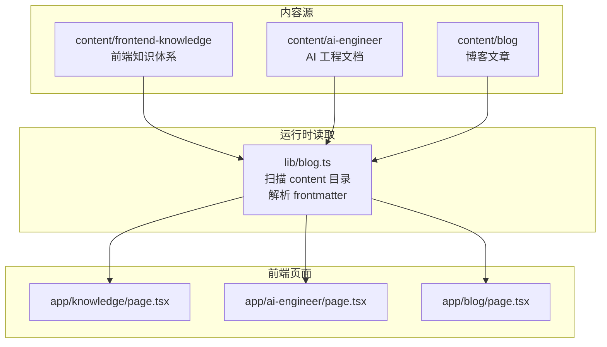
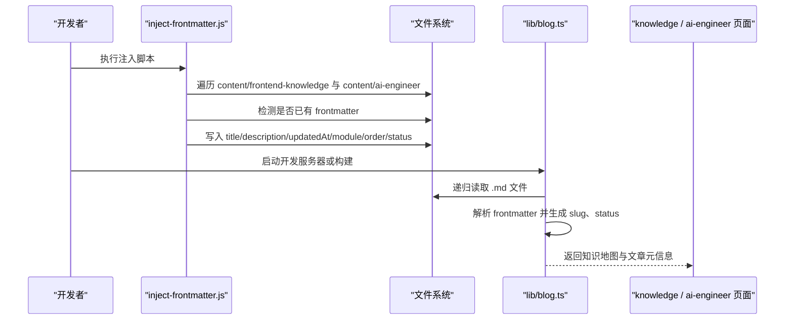
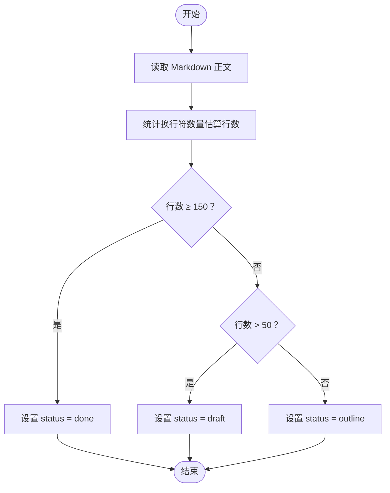
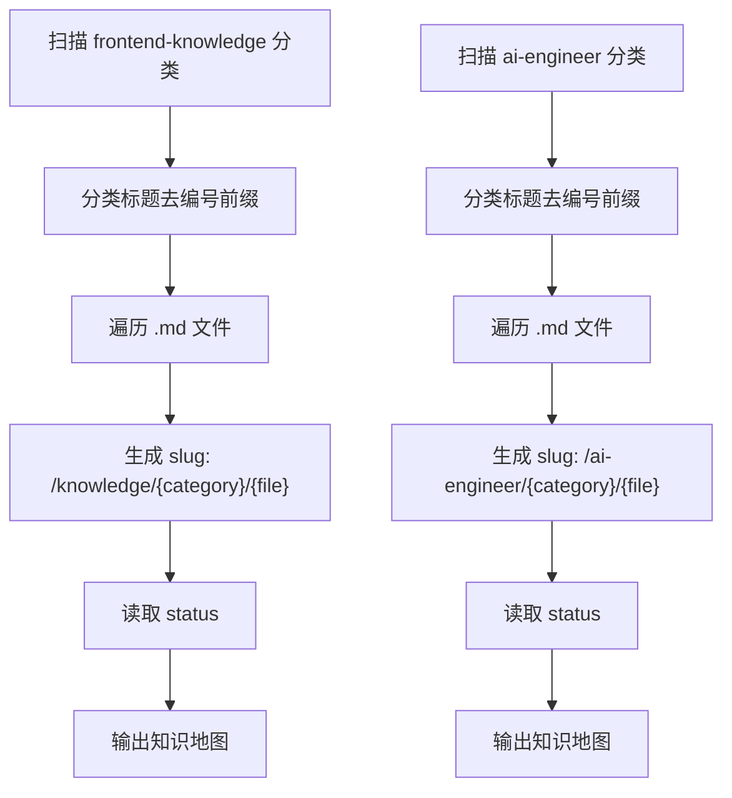
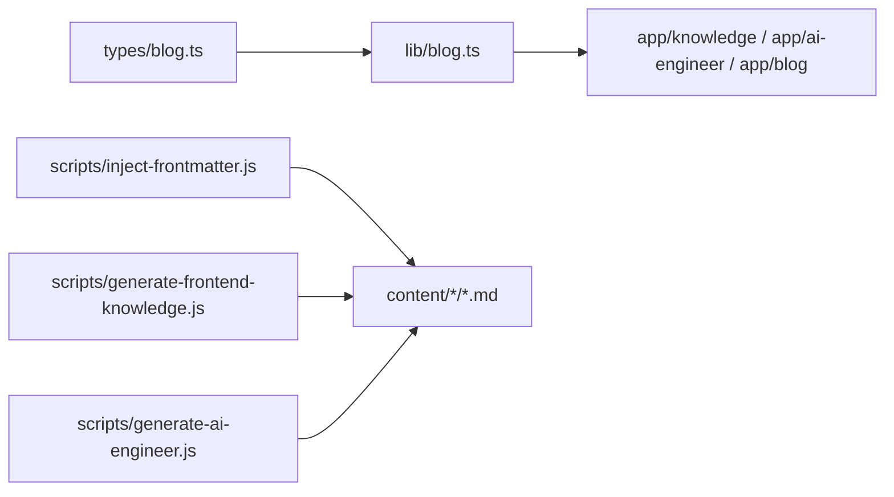

# 内容结构规范

<cite>
**本文引用的文件 **
- [lib/blog.ts](file://lib/blog.ts)
- [types/blog.ts](file://types/blog.ts)
- [scripts/inject-frontmatter.js](file://scripts/inject-frontmatter.js)
- [scripts/generate-frontend-knowledge.js](file://scripts/generate-frontend-knowledge.js)
- [scripts/generate-ai-engineer.js](file://scripts/generate-ai-engineer.js)
- [content/ai-engineer/00-AI基础/01-什么是LLM.md](file://content/ai-engineer/00-AI基础/01-什么是LLM.md)
- [content/frontend-knowledge/00-前端认知/02-浏览器工作原理总览.md](file://content/frontend-knowledge/00-前端认知/02-浏览器工作原理总览.md)
</cite>

## 目录
1. [引言](#引言)
2. [项目结构与内容分区](#项目结构与内容分区)
3. [核心组件与数据流](#核心组件与数据流)
4. [详细组件分析](#详细组件分析)
5. [依赖关系分析](#依赖关系分析)
6. [性能与可维护性建议](#性能与可维护性建议)
7. [故障排查指南](#故障排查指南)
8. [结论](#结论)
9. [附录：字段与命名约定速查](#附录字段与命名约定速查)

## 引言
本规范面向 HuRui.dev 博客的内容生产与维护，目标是统一 Markdown 内容的目录组织、文件命名、frontmatter 字段定义、状态管理与完成度判定标准，并给出创作最佳实践。文档同时解释前端知识体系与 AI 工程文档的分类方式，以及脚本如何自动生成骨架、注入 frontmatter 和构建站点导航。

## 项目结构与内容分区
仓库采用 Next.js App Router 架构，内容集中在 `content` 目录，分为两大板块：
- 前端知识体系：`content/frontend-knowledge`
- AI 工程文档：`content/ai-engineer`

此外，`content/blog` 用于普通博客文章，由运行时逻辑按分类与标签展示；而 `app/knowledge` 与 `app/ai-engineer` 是知识体系的页面入口，分别渲染对应目录的导航与详情。

**图表来源**
- [lib/blog.ts:6-7](file://lib/blog.ts#L6-L7)
- [lib/blog.ts:83-133](file://lib/blog.ts#L83-L133)

**章节来源**
- [lib/blog.ts:6-7](file://lib/blog.ts#L6-L7)
- [lib/blog.ts:83-133](file://lib/blog.ts#L83-L133)

## 核心组件与数据流
- `lib/blog.ts` 负责递归扫描 `content/blog`、`content/frontend-knowledge`、`content/ai-engineer`，使用 gray-matter 解析 frontmatter，并生成站点可用的文章列表、分类、标签与知识地图。
- `scripts/inject-frontmatter.js` 批量为尚未包含 frontmatter 的文章注入元信息，包括标题、描述、更新时间、模块名、排序号与完成度状态。
- `scripts/generate-frontend-knowledge.js` 与 `scripts/generate-ai-engineer.js` 根据预设的知识体系结构生成占位文章，保护已存在文件不被覆盖。

**图表来源**
- [scripts/inject-frontmatter.js:20-25](file://scripts/inject-frontmatter.js#L20-L25)
- [scripts/inject-frontmatter.js:123-179](file://scripts/inject-frontmatter.js#L123-L179)
- [lib/blog.ts:24-50](file://lib/blog.ts#L24-L50)
- [lib/blog.ts:83-133](file://lib/blog.ts#L83-L133)

**章节来源**
- [lib/blog.ts:24-50](file://lib/blog.ts#L24-L50)
- [lib/blog.ts:83-133](file://lib/blog.ts#L83-L133)
- [scripts/inject-frontmatter.js:20-25](file://scripts/inject-frontmatter.js#L20-L25)
- [scripts/inject-frontmatter.js:123-179](file://scripts/inject-frontmatter.js#L123-L179)

## 详细组件分析

### 目录结构与分类规则
- 顶层内容目录：
  - `content/frontend-knowledge`：前端知识体系
  - `content/ai-engineer`：AI 工程文档
  - `content/blog`：博客文章（按子目录作为分类）
- 分类目录命名：
  - 以两位数字编号开头，后接中文分类名，例如：
    - `00-前端认知`
    - `01-JavaScript核心`
    - `00-AI基础`
    - `04-Agent架构`
- 文章文件命名：
  - 以两位数字编号开头，后接中文标题，扩展名为 `.md`，例如：
    - `01-什么是LLM.md`
    - `02-浏览器工作原理总览.md`

该命名规则在生成脚本中被强制应用，确保目录与文件顺序稳定且可读。

**章节来源**
- [scripts/generate-frontend-knowledge.js:64-167](file://scripts/generate-frontend-knowledge.js#L64-L167)
- [scripts/generate-ai-engineer.js:100-178](file://scripts/generate-ai-engineer.js#L100-L178)
- [scripts/generate-frontend-knowledge.js:189-207](file://scripts/generate-frontend-knowledge.js#L189-L207)
- [scripts/generate-ai-engineer.js:189-212](file://scripts/generate-ai-engineer.js#L189-L212)

### frontmatter 字段定义
所有知识类文章应包含以下 frontmatter 字段：
- `title`：文章标题，通常与正文首行 H1 一致
- `description`：SEO 摘要，优先取 H1 之后首个实质段落，去除内联语法并截断
- `updatedAt`：最后更新时间，格式为 `YYYY-MM-DD`
- `module`：所属模块名称，即分类目录名去掉编号前缀后的中文名称
- `order`：排序号，来自文件名中的两位数字编号
- `status`：内容状态，取值范围为 `outline`、`draft`、`done`

示例路径参考：
- AI 工程文章示例：[content/ai-engineer/00-AI基础/01-什么是LLM.md](file://content/ai-engineer/00-AI基础/01-什么是LLM.md)
- 前端知识文章示例：[content/frontend-knowledge/00-前端认知/02-浏览器工作原理总览.md](file://content/frontend-knowledge/00-前端认知/02-浏览器工作原理总览.md)

**章节来源**
- [scripts/inject-frontmatter.js:4-17](file://scripts/inject-frontmatter.js#L4-L17)
- [scripts/inject-frontmatter.js:157-165](file://scripts/inject-frontmatter.js#L157-L165)
- [content/ai-engineer/00-AI基础/01-什么是LLM.md:1-8](file://content/ai-engineer/00-AI基础/01-什么是LLM.md#L1-L8)
- [content/frontend-knowledge/00-前端认知/02-浏览器工作原理总览.md:1-8](file://content/frontend-knowledge/00-前端认知/02-浏览器工作原理总览.md#L1-L8)

### 内容状态管理机制与完成度判定
状态字段 `status` 表示文章当前完成度，支持三种值：
- `outline`：大纲阶段，正文行数不超过 50 行
- `draft`：草稿阶段，正文行数超过 50 行但不达到 150 行
- `done`：成稿阶段，正文行数达到或超过 150 行

判定逻辑由注入脚本实现，并在运行时被 `lib/blog.ts` 读取，用于知识地图展示。

**图表来源**
- [scripts/inject-frontmatter.js:106-112](file://scripts/inject-frontmatter.js#L106-L112)
- [lib/blog.ts:72-81](file://lib/blog.ts#L72-L81)

**章节来源**
- [scripts/inject-frontmatter.js:106-112](file://scripts/inject-frontmatter.js#L106-L112)
- [lib/blog.ts:72-81](file://lib/blog.ts#L72-L81)

### 前端知识体系与 AI 工程文档分类
- 前端知识体系分类目录（示例）：
  - `00-前端认知`
  - `01-JavaScript核心`
  - `02-JavaScript进阶`
  - `03-浏览器与网络`
  - `04-React体系`
  - `05-工程化`
  - `06-前端架构`
  - `07-算法与数据结构`
  - `08-TypeScript体系`
  - `09-CSS与样式工程`
- AI 工程文档分类目录（示例）：
  - `00-AI基础`
  - `01-AI工程认知`
  - `02-LLM基础`
  - `03-RAG体系`
  - `04-Agent架构`
  - `05-MCP协议`
  - `06-工程化实践`
  - `07-产品与架构`

这些分类由生成脚本的结构配置决定，新增主题时应同步更新脚本结构，避免目录与代码不一致。

**章节来源**
- [scripts/generate-frontend-knowledge.js:64-167](file://scripts/generate-frontend-knowledge.js#L64-L167)
- [scripts/generate-ai-engineer.js:100-178](file://scripts/generate-ai-engineer.js#L100-L178)

### 运行时导航与 Slug 生成
- 前端知识地图：
  - 读取 `content/frontend-knowledge` 下每个分类目录
  - 对每个分类生成 `title`（去掉编号前缀）
  - 对每个文件生成 `name`（去掉编号前缀与 `.md`）
  - 生成路由 slug：`/knowledge/{category}/{fileNameWithoutMd}`
  - 读取每篇文章的 `status`
- AI 工程地图：
  - 读取 `content/ai-engineer` 下每个分类目录
  - 生成 `title`、`name`、slug：`/ai-engineer/{category}/{fileNameWithoutMd}`
  - 读取每篇文章的 `status`

**图表来源**
- [lib/blog.ts:83-106](file://lib/blog.ts#L83-L106)
- [lib/blog.ts:108-133](file://lib/blog.ts#L108-L133)

**章节来源**
- [lib/blog.ts:83-106](file://lib/blog.ts#L83-L106)
- [lib/blog.ts:108-133](file://lib/blog.ts#L108-L133)

## 依赖关系分析
- 类型定义：
  - `types/blog.ts` 定义了博客文章的通用类型，包括 `Post`、`Category`、`Tag`。
- 运行时逻辑：
  - `lib/blog.ts` 依赖 `gray-matter` 解析 frontmatter，并基于 `types/blog.ts` 的类型进行数据处理。
- 脚本工具：
  - `scripts/inject-frontmatter.js` 直接操作文件系统，不依赖业务类型，但遵循与运行时一致的字段约定。
  - `scripts/generate-frontend-knowledge.js` 与 `scripts/generate-ai-engineer.js` 通过结构配置生成目录与文件，保证内容组织一致性。

**图表来源**
- [types/blog.ts:1-16](file://types/blog.ts#L1-L16)
- [lib/blog.ts:1-4](file://lib/blog.ts#L1-L4)
- [scripts/inject-frontmatter.js:1-3](file://scripts/inject-frontmatter.js#L1-L3)
- [scripts/generate-frontend-knowledge.js:1-5](file://scripts/generate-frontend-knowledge.js#L1-L5)
- [scripts/generate-ai-engineer.js:1-4](file://scripts/generate-ai-engineer.js#L1-L4)

**章节来源**
- [types/blog.ts:1-16](file://types/blog.ts#L1-L16)
- [lib/blog.ts:1-4](file://lib/blog.ts#L1-L4)
- [scripts/inject-frontmatter.js:1-3](file://scripts/inject-frontmatter.js#L1-L3)
- [scripts/generate-frontend-knowledge.js:1-5](file://scripts/generate-frontend-knowledge.js#L1-L5)
- [scripts/generate-ai-engineer.js:1-4](file://scripts/generate-ai-engineer.js#L1-L4)

## 性能与可维护性建议
- 控制单篇文章体量：
  - 将长文拆分为多个小节，保持每篇聚焦一个知识点，便于状态管理与阅读体验。
- 合理使用 frontmatter：
  - 保持 `description` 简洁准确，利于 SEO 与卡片预览。
  - 使用 `updatedAt` 记录最近修改时间，便于版本回溯。
- 自动化优先：
  - 新增主题时优先更新生成脚本的结构配置，再手动补充内容，减少重复劳动。
- 状态管理：
  - 在写作过程中及时更新 `status`，使知识地图能真实反映完成度。
- 命名一致性：
  - 严格遵循“编号-中文”的文件与目录命名，避免 slug 异常与导航错乱。

## 故障排查指南
- 无法识别 frontmatter：
  - 检查文件头部是否以 `---` 包裹，且闭合正确；脚本会跳过已有 frontmatter 的文件。
- 状态不正确：
  - 若自动判定不符合预期，可在 frontmatter 中显式设置 `status`，或在完成后调整正文行数。
- 导航缺失或 slug 错误：
  - 确认分类目录与文件命名符合“编号-中文”规则；检查 `lib/blog.ts` 生成的 slug 是否与页面路由匹配。
- 脚本未生成新主题：
  - 检查生成脚本的 `structure` 配置是否包含新分类；确认目标目录是否存在且权限正常。

**章节来源**
- [scripts/inject-frontmatter.js:27-30](file://scripts/inject-frontmatter.js#L27-L30)
- [scripts/inject-frontmatter.js:141-146](file://scripts/inject-frontmatter.js#L141-L146)
- [lib/blog.ts:93-102](file://lib/blog.ts#L93-L102)
- [lib/blog.ts:120-129](file://lib/blog.ts#L120-L129)

## 结论
HuRui.dev 博客通过清晰的目录结构、严格的文件命名规范、统一的 frontmatter 字段定义与自动化的脚本工具，构建了可扩展、可维护的内容体系。前端知识体系与 AI 工程文档采用相同的组织原则，便于读者系统学习，也便于作者持续迭代。建议在创作中坚持“小步快跑、状态透明、命名一致”的原则，配合脚本与运行时逻辑，提升整体内容质量与站点体验。

## 附录：字段与命名约定速查
- 目录命名：
  - 两位数字编号 + 中文分类名，如 `00-前端认知`、`04-Agent架构`
- 文件命名：
  - 两位数字编号 + 中文标题 + `.md`，如 `01-什么是LLM.md`、`02-浏览器工作原理总览.md`
- frontmatter 字段：
  - `title`：文章标题
  - `description`：SEO 摘要
  - `updatedAt`：更新时间，格式 `YYYY-MM-DD`
  - `module`：模块名（分类目录名去掉编号前缀）
  - `order`：排序号（文件名编号）
  - `status`：内容状态，取值 `outline`、`draft`、`done`
- 完成度阈值：
  - `outline`：≤ 50 行
  - `draft`：> 50 行且 < 150 行
  - `done`：≥ 150 行

**章节来源**
- [scripts/generate-frontend-knowledge.js:189-207](file://scripts/generate-frontend-knowledge.js#L189-L207)
- [scripts/generate-ai-engineer.js:189-212](file://scripts/generate-ai-engineer.js#L189-L212)
- [scripts/inject-frontmatter.js:106-112](file://scripts/inject-frontmatter.js#L106-L112)
- [scripts/inject-frontmatter.js:157-165](file://scripts/inject-frontmatter.js#L157-L165)