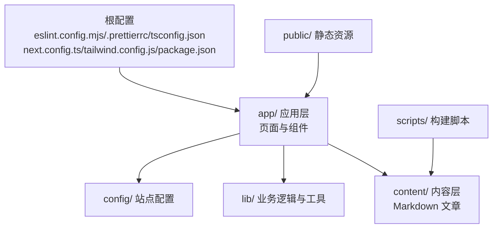
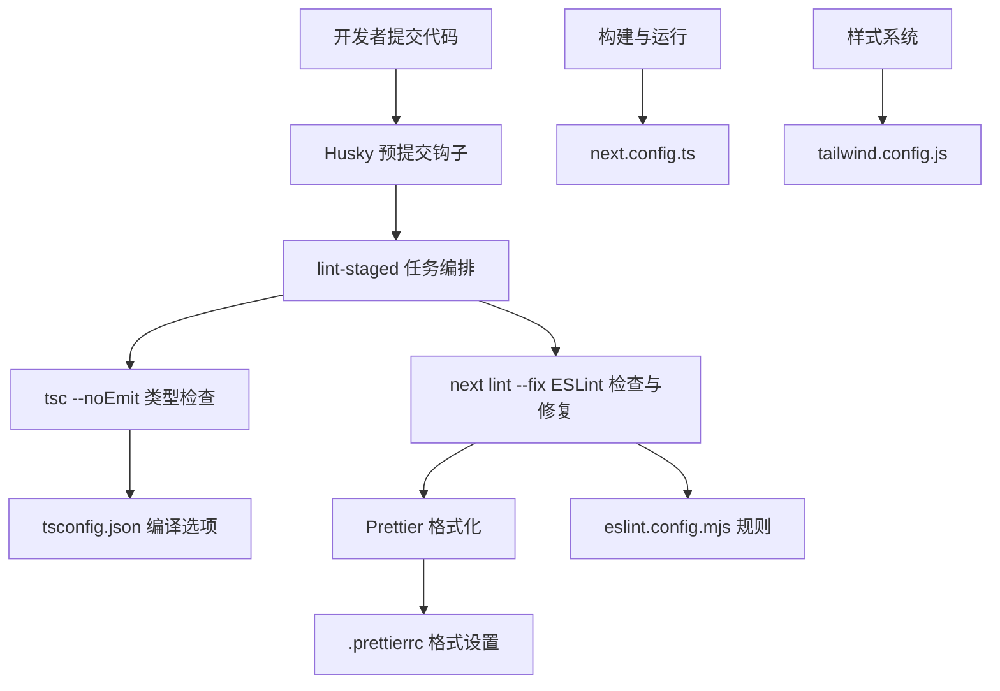
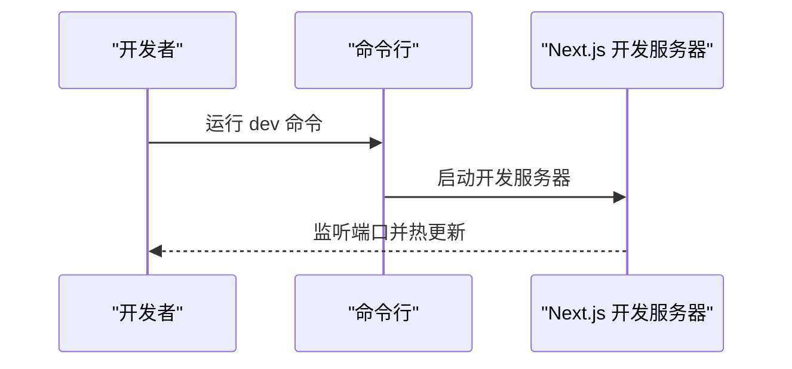
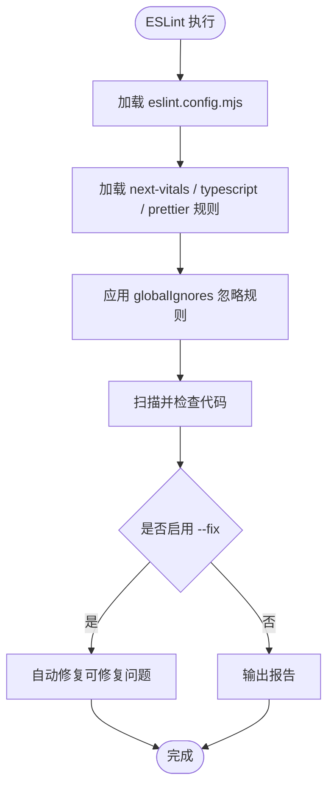
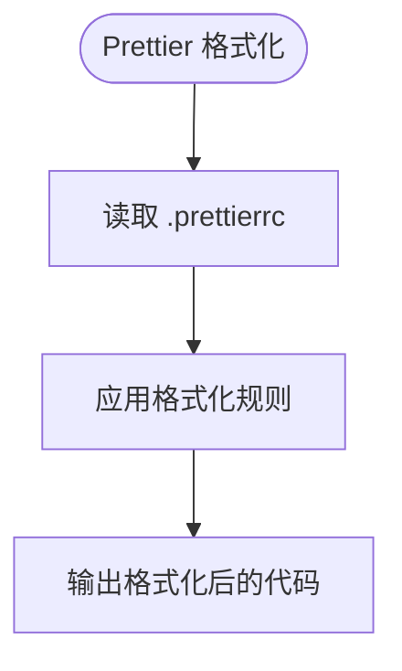
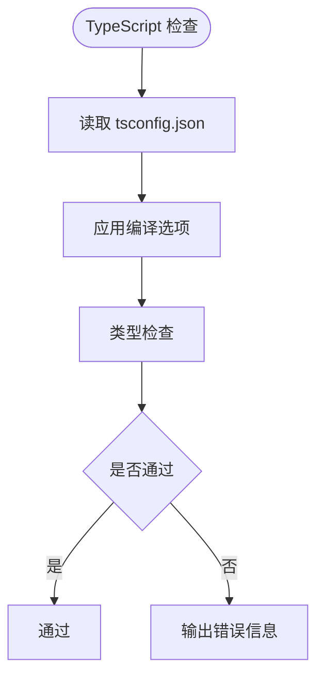
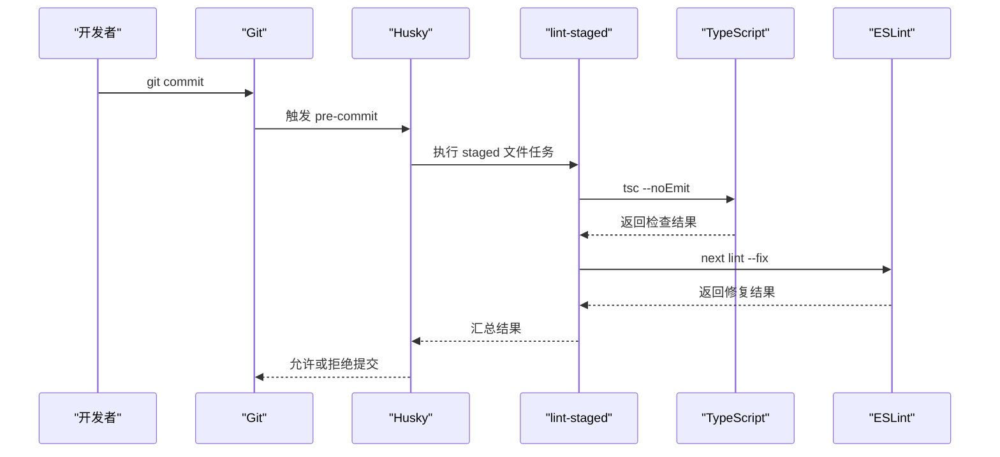
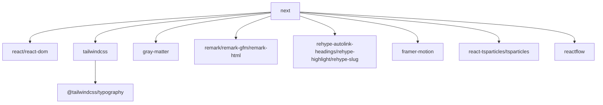
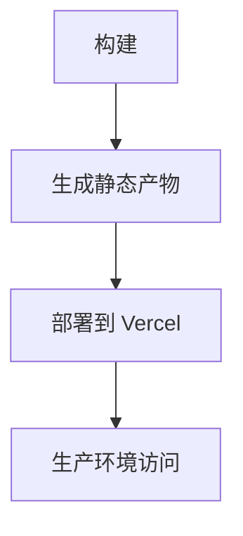

# 开发指南

<cite>
**本文引用的文件**   
- [README.md](file://README.md)
- [package.json](file://package.json)
- [eslint.config.mjs](file://eslint.config.mjs)
- [.prettierrc](file://.prettierrc)
- [next.config.ts](file://next.config.ts)
- [tailwind.config.js](file://tailwind.config.js)
- [tsconfig.json](file://tsconfig.json)
</cite>

## 目录
1. [简介](#简介)
2. [项目结构](#项目结构)
3. [核心组件](#核心组件)
4. [架构总览](#架构总览)
5. [详细组件分析](#详细组件分析)
6. [依赖分析](#依赖分析)
7. [性能考虑](#性能考虑)
8. [故障排查指南](#故障排查指南)
9. [结论](#结论)
10. [附录](#附录)

## 简介
本指南面向 HuRui.dev 博客项目的开发者，覆盖以下内容：
- 开发环境配置要求与安装步骤
- 代码规范标准（ESLint、Prettier、TypeScript）
- Git 工作流与提交规范（Husky、lint-staged）
- 代码审查流程与分支管理策略
- 调试技巧与性能分析方法
- 新功能开发完整流程
- 构建流程、部署配置与生产注意事项

本项目基于 Next.js App Router，使用 TypeScript、Tailwind CSS、React 生态工具链进行开发与构建。

## 项目结构
- 应用路由与页面位于 app/ 目录，采用 Next.js App Router 的目录约定
- 内容数据以 Markdown 形式存放于 content/ 目录，并通过脚本生成或注入 Frontmatter
- 样式通过 Tailwind CSS 与 @tailwindcss/typography 插件处理
- 工程化配置集中在根目录配置文件（如 eslint.config.mjs、.prettierrc、tsconfig.json、next.config.ts、tailwind.config.js）

[无图表来源，因为该图为概念性结构示意]

## 核心组件
本节聚焦开发工具链与关键配置，帮助团队统一编码风格、自动化检查与格式化、以及本地开发体验。

- ESLint 规则
  - 启用 next-vitals 与 TypeScript 规则集
  - 集成 Prettier 规则并覆盖默认忽略路径
  - 提供统一的代码质量检查入口

- Prettier 格式化
  - 分号、单引号、尾随逗号、打印宽度、缩进等基础格式规范
  - JSX 中双引号的开关由配置控制

- Husky 钩子与 lint-staged
  - 通过 package.json scripts.prepare 初始化 Husky
  - 在 pre-commit 阶段执行类型检查与 Lint 修复（lint-staged）

- TypeScript 编译选项
  - 严格模式开启，模块解析为 bundler 模式
  - 支持 React JSX 转换与增量编译
  - 路径别名 @/* 指向根目录

- Next.js 与 Tailwind
  - Next.js 配置为空对象，按需扩展
  - Tailwind 启用 typography 插件与 darkMode: class

**章节来源**
- [package.json:5-11](file://package.json#L5-L11)
- [package.json:31-45](file://package.json#L31-L45)
- [package.json:46-51](file://package.json#L46-L51)
- [eslint.config.mjs:1-20](file://eslint.config.mjs#L1-L20)
- [.prettierrc:1-9](file://.prettierrc#L1-L9)
- [tsconfig.json:1-35](file://tsconfig.json#L1-L35)
- [next.config.ts:1-8](file://next.config.ts#L1-L8)
- [tailwind.config.js:1-9](file://tailwind.config.js#L1-L9)

## 架构总览
下图展示开发工具链之间的协作关系：Husky 在提交前触发 lint-staged，后者依次运行 TypeScript 类型检查与 ESLint 自动修复；ESLint 继承 Next.js 与 Prettier 规则；Prettier 负责统一代码风格；TS 编译器确保类型安全；Next.js 与 Tailwind 负责构建与样式。

**图表来源**
- [package.json:5-11](file://package.json#L5-L11)
- [package.json:46-51](file://package.json#L46-L51)
- [eslint.config.mjs:1-20](file://eslint.config.mjs#L1-L20)
- [.prettierrc:1-9](file://.prettierrc#L1-L9)
- [tsconfig.json:1-35](file://tsconfig.json#L1-L35)
- [next.config.ts:1-8](file://next.config.ts#L1-L8)
- [tailwind.config.js:1-9](file://tailwind.config.js#L1-L9)

## 详细组件分析

### 开发环境与安装
- Node.js 版本：建议使用与 Next.js 16.x 兼容的版本（参考官方文档）
- 包管理器：npm/yarn/pnpm/bun 均可（README 列出多种命令）
- 安装依赖后，运行开发服务器即可预览站点

**图表来源**
- [README.md:5-15](file://README.md#L5-L15)
- [package.json:5-11](file://package.json#L5-L11)

**章节来源**
- [README.md:1-37](file://README.md#L1-L37)
- [package.json:5-11](file://package.json#L5-L11)

### 代码规范标准

#### ESLint 规则
- 启用 next-vitals 与 TypeScript 规则集，保证性能与类型安全
- 覆盖默认忽略路径，避免对构建产物进行检查
- 集成 Prettier 规则，消除风格冲突

**图表来源**
- [eslint.config.mjs:1-20](file://eslint.config.mjs#L1-L20)

**章节来源**
- [eslint.config.mjs:1-20](file://eslint.config.mjs#L1-L20)

#### Prettier 格式化
- 统一的分号、引号、尾随逗号、打印宽度与缩进策略
- JSX 中使用双引号（jsxSingleQuote 关闭）

**图表来源**
- [.prettierrc:1-9](file://.prettierrc#L1-L9)

**章节来源**
- [.prettierrc:1-9](file://.prettierrc#L1-L9)

#### TypeScript 编译选项
- 严格模式开启，确保类型安全
- 模块解析为 bundler 模式，适配现代构建工具
- 启用 React JSX 转换与增量编译，提升开发体验
- 路径别名 @/* 简化导入路径

**图表来源**
- [tsconfig.json:1-35](file://tsconfig.json#L1-L35)

**章节来源**
- [tsconfig.json:1-35](file://tsconfig.json#L1-L35)

### Git 工作流程与提交规范

#### Husky 与 lint-staged
- 通过 prepare 脚本初始化 Husky
- 在 pre-commit 阶段，lint-staged 对暂存文件执行：
  - tsc --noEmit 类型检查
  - next lint --fix 自动修复

**图表来源**
- [package.json:5-11](file://package.json#L5-L11)
- [package.json:46-51](file://package.json#L46-L51)

**章节来源**
- [package.json:5-11](file://package.json#L5-L11)
- [package.json:46-51](file://package.json#L46-L51)

#### 提交规范建议
- 使用语义化提交信息（例如 feat、fix、docs、style、refactor、perf、test、build、ci、chore、revert）
- 提交信息应简洁明确，描述变更意图与影响范围
- 大型变更拆分为多个小提交，便于审查与回滚

#### 分支管理策略
- main/master：稳定发布分支
- develop：集成开发分支
- feature/*：功能分支
- fix/*：缺陷修复分支
- release/*：预发布分支
- hotfix/*：紧急修复分支

### 代码审查流程
- 所有变更需通过 Pull Request 进行审查
- 至少一名维护者批准后方可合并
- CI 检查通过后（类型检查、Lint、构建）方可合并
- 审查重点：
  - 代码可读性与一致性
  - 类型定义与接口契约
  - 性能与可维护性
  - 测试覆盖（如有）

### 调试技巧
- 使用浏览器开发者工具进行前端调试
- 利用 Next.js 内置的错误堆栈与日志输出定位问题
- 针对 Markdown 渲染问题，检查 rehype/remark 插件链与内容结构
- 针对样式问题，使用 Tailwind 类名与 darkMode: class 切换验证主题

### 性能分析方法
- 使用 next-vitals 指标监控核心性能指标
- 分析页面加载时间、首屏渲染时间与交互延迟
- 优化图片与字体资源，合理使用 next/font
- 减少不必要的重渲染与状态更新

### 常见问题排查
- 类型检查失败：检查 tsconfig 与组件 props 类型定义
- Lint 报错：根据 ESLint 提示修复代码风格与潜在问题
- 构建失败：检查依赖版本与 Next.js/Tailwind 配置兼容性
- 样式异常：确认 Tailwind 插件与 darkMode 配置正确

**章节来源**
- [package.json:5-11](file://package.json#L5-L11)
- [package.json:46-51](file://package.json#L46-L51)
- [eslint.config.mjs:1-20](file://eslint.config.mjs#L1-L20)
- [.prettierrc:1-9](file://.prettierrc#L1-L9)
- [tsconfig.json:1-35](file://tsconfig.json#L1-L35)
- [next.config.ts:1-8](file://next.config.ts#L1-L8)
- [tailwind.config.js:1-9](file://tailwind.config.js#L1-L9)

## 依赖分析
下图展示关键依赖之间的关系：Next.js 作为框架核心，React 与 ReactDOM 提供 UI 能力；Tailwind 与 typography 插件负责样式；gray-matter、remark、rehype 系列用于 Markdown 处理；framer-motion、react-tsparticles、reactflow 提供动效与可视化能力。

**图表来源**
- [package.json:12-30](file://package.json#L12-L30)

**章节来源**
- [package.json:12-30](file://package.json#L12-L30)

## 性能考虑
- 使用 next-vitals 监控核心 Web 指标
- 合理拆分组件与懒加载非关键资源
- 优化 Markdown 渲染管线，避免重复计算
- 使用 Tailwind 的按需生成特性减少样式体积
- 谨慎使用第三方库，评估其对打包体积与运行时性能的影响

[无章节来源，因为本节为通用指导]

## 故障排查指南
- 开发服务器无法启动：检查 Node.js 版本与依赖安装是否成功
- 类型检查失败：核对 tsconfig 与组件类型定义
- Lint 报错：根据 ESLint 提示修复代码风格与潜在问题
- 样式不生效：检查 Tailwind 配置与类名拼写
- Markdown 渲染异常：检查 remark/rehype 插件链与内容结构

**章节来源**
- [package.json:5-11](file://package.json#L5-L11)
- [eslint.config.mjs:1-20](file://eslint.config.mjs#L1-L20)
- [tailwind.config.js:1-9](file://tailwind.config.js#L1-L9)

## 结论
本指南明确了 HuRui.dev 博客项目的开发环境、代码规范、Git 工作流与工具链配置。遵循本文档的实践，有助于团队保持代码质量、提升协作效率，并确保构建与部署的稳定可靠。

[无章节来源，因为本节为总结性内容]

## 附录

### 构建与部署
- 构建命令：next build
- 启动生产服务：next start
- 推荐部署平台：Vercel（Next.js 官方推荐）

**图表来源**
- [README.md:32-37](file://README.md#L32-L37)
- [package.json:5-11](file://package.json#L5-L11)

**章节来源**
- [README.md:32-37](file://README.md#L32-L37)
- [package.json:5-11](file://package.json#L5-L11)

### 新功能开发流程
- 需求分析与设计：明确功能目标、用户场景与技术方案
- 创建功能分支：feature/<功能名>
- 实现与自测：编写代码、补充类型定义、进行本地测试
- 提交与推送：遵循提交规范，触发 Husky 与 lint-staged 检查
- 发起 Pull Request：邀请代码审查，响应审查意见
- 合并与发布：CI 通过后合并至主分支，按发布流程上线

[无章节来源，因为本节为流程性指导]