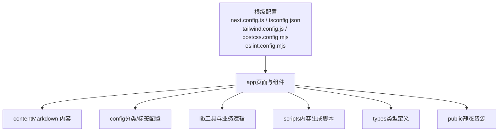

# 快速开始

<cite>
**本文引用的文件**   
- [package.json](file://package.json)
- [README.md](file://README.md)
- [next.config.ts](file://next.config.ts)
- [tsconfig.json](file://tsconfig.json)
- [.gitignore](file://.gitignore)
- [eslint.config.mjs](file://eslint.config.mjs)
- [tailwind.config.js](file://tailwind.config.js)
- [postcss.config.mjs](file://postcss.config.mjs)
</cite>

## 目录
1. [简介](#简介)
2. [项目结构](#项目结构)
3. [环境要求](#环境要求)
4. [安装与启动](#安装与启动)
5. [常用脚本命令](#常用脚本命令)
6. [开发工作流](#开发工作流)
7. [常见问题与解决方案](#常见问题与解决方案)
8. [结论](#结论)

## 简介
本指南帮助你从零开始搭建 HuRui.dev 博客项目的本地开发环境，包括 Node.js 版本、包管理器选择、依赖安装、开发服务器启动以及常用脚本说明。项目基于 Next.js App Router，使用 TypeScript、Tailwind CSS、ESLint 和 Prettier 等工具链，内容以 Markdown 驱动，适合前端开发者快速上手。

## 项目结构
仓库采用按功能/页面划分的目录组织方式：
- app：Next.js App Router 的页面与组件（含路由、布局、通用组件）
- content：Markdown 文章与知识体系内容
- config：分类、标签等业务配置
- lib：业务逻辑与工具函数
- scripts：内容生成与注入脚本
- types：类型定义
- public：静态资源
- 根级配置文件：Next.js、TypeScript、Tailwind、PostCSS、ESLint、Prettier 等

[本节为概念性结构说明，不直接分析具体文件]

## 环境要求
- Node.js：建议使用 18.x 或更高版本（Next.js 16 系列推荐）
- 包管理器：npm、yarn、pnpm 或 bun 均可（项目 README 支持多种包管理器）
- 操作系统：macOS、Windows、Linux 均可
- 编辑器：推荐使用 VS Code，并启用 ESLint、Prettier 插件以获得最佳体验

说明：
- 项目通过 package.json 声明了 Next.js、React、TypeScript、Tailwind 等依赖，构建与运行由 Next.js 提供。
- TypeScript 编译目标为 ES2017，模块解析策略为 bundler，严格模式开启。

**章节来源**
- [package.json:12-45](file://package.json#L12-L45)
- [tsconfig.json:1-35](file://tsconfig.json#L1-L35)
- [README.md:1-17](file://README.md#L1-L17)

## 安装与启动
以下命令以 npm 为例，其他包管理器可替换为 yarn、pnpm 或 bun。

1. 克隆仓库
- git clone https://github.com/hurui/my-blog.git
- cd my-blog

2. 安装依赖
- npm install

3. 启动开发服务器
- npm run dev

4. 打开浏览器访问
- http://localhost:3000

提示：
- 首次运行会自动下载依赖并启动 Next.js 开发服务器。
- 修改 app/page.tsx 等页面文件后，浏览器会热更新。

**章节来源**
- [README.md:3-19](file://README.md#L3-L19)
- [package.json:5-10](file://package.json#L5-L10)

## 常用脚本命令
- dev：启动 Next.js 开发服务器，支持热重载
- build：执行生产构建，输出到 .next 目录
- start：在生产模式下启动已构建的应用
- lint：运行 ESLint 检查代码质量
- prepare：初始化 Husky Git Hooks（提交前自动执行 lint-staged 任务）

补充说明：
- lint-staged 对 *.ts、*.tsx 文件在提交前执行 tsc --noEmit 与 next lint --fix，保证代码类型正确与风格一致。

**章节来源**
- [package.json:5-10](file://package.json#L5-L10)
- [package.json:46-51](file://package.json#L46-L51)

## 开发工作流
建议的日常流程如下：
1. 拉取最新代码
- git pull

2. 修复依赖冲突（如有）
- rm -rf node_modules
- npm install

3. 启动开发服务器
- npm run dev

4. 编写与调试
- 编辑 app 下的页面与组件
- 新增或修改 content 下的 Markdown 内容
- 使用 Tailwind 进行样式调整

5. 提交前检查
- 保存文件时 IDE 应自动触发 ESLint/Prettier
- 提交代码时自动执行 lint-staged（tsc + next lint）

6. 构建与部署
- npm run build
- npm run start

注意：
- .next 与 out 目录由 Next.js 生成，已被 .gitignore 忽略，无需手动清理。
- 若遇到端口占用，可在终端中查看报错信息并更换端口或使用系统工具释放端口。

**章节来源**
- [.gitignore:16-18](file://.gitignore#L16-L18)
- [package.json:46-51](file://package.json#L46-L51)

## 常见问题与解决方案
- 无法启动开发服务器
  - 确认 Node.js 版本是否满足要求（建议 18+）
  - 删除 node_modules 与锁文件后重新安装依赖
  - 检查端口 3000 是否被占用

- 依赖安装失败
  - 切换镜像源（如淘宝镜像）重试
  - 尝试使用不同包管理器（yarn/pnpm/bun）

- 构建时报错
  - 先执行 npm run lint 修复代码问题
  - 检查 TypeScript 配置与路径别名 @/* 是否正确
  - 清理 .next 目录后重新构建

- 样式未生效
  - 确认 tailwind.config.js 与 postcss.config.mjs 已正确引入 Tailwind
  - 重启开发服务器

- Git Hooks 未生效
  - 确保已执行 npm install（prepare 脚本会初始化 husky）
  - 检查 .husky 目录是否存在

**章节来源**
- [package.json:5-10](file://package.json#L5-L10)
- [package.json:46-51](file://package.json#L46-L51)
- [tailwind.config.js:1-9](file://tailwind.config.js#L1-L9)
- [postcss.config.mjs:1-8](file://postcss.config.mjs#L1-L8)
- [.gitignore:16-18](file://.gitignore#L16-L18)

## 结论
按照本指南完成环境准备与依赖安装后，即可在本地启动 HuRui.dev 博客的开发服务器并进行内容创作与页面开发。结合 Next.js 的热重载、TypeScript 的类型检查、Tailwind 的原子化样式以及 ESLint/Prettier 的代码规范，你将获得高效且稳定的开发体验。