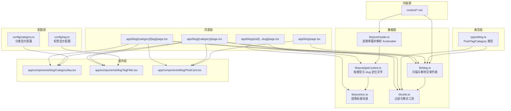
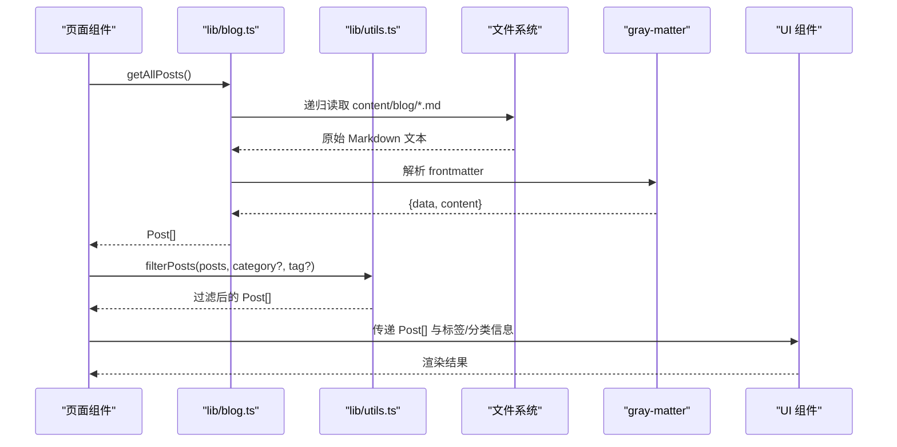
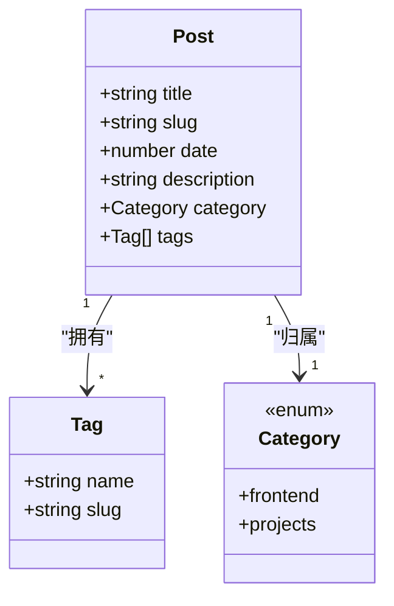
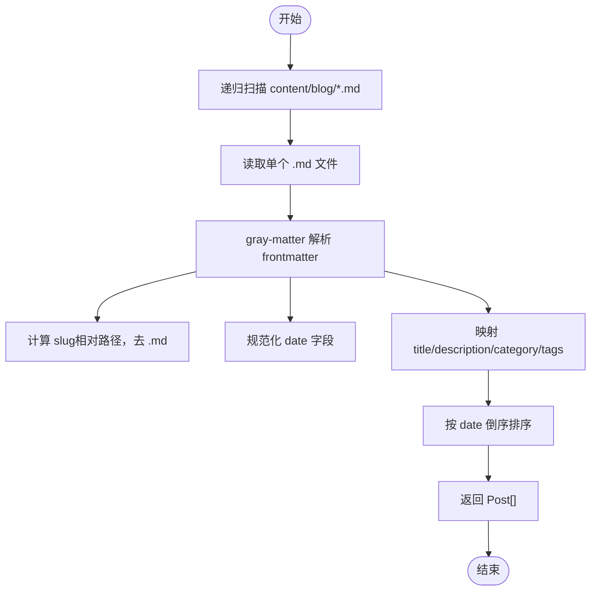
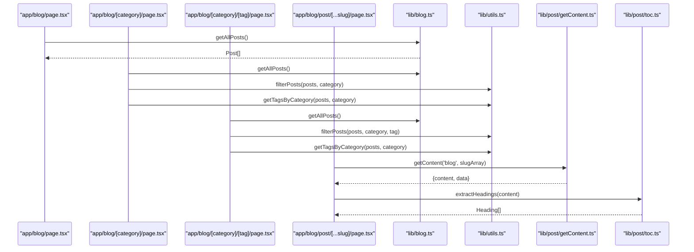
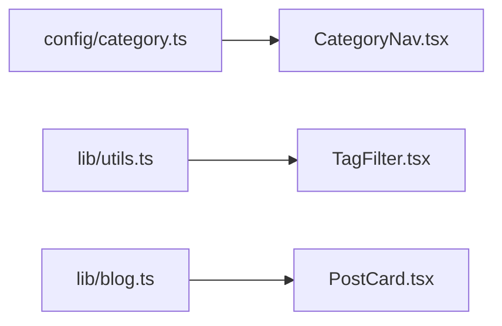
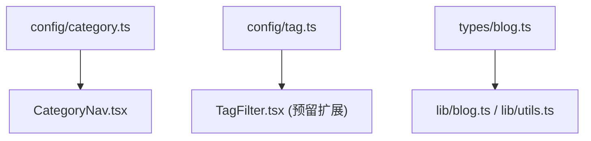
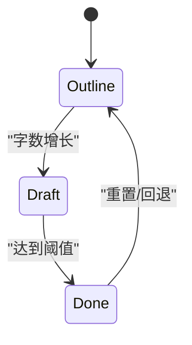
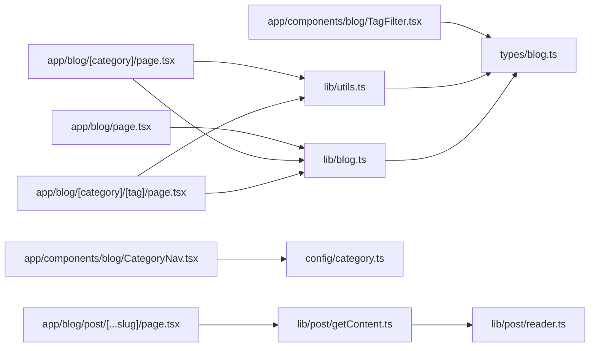

# 数据流设计

<cite>
**本文引用的文件**   
- [types/blog.ts](file://types/blog.ts)
- [lib/blog.ts](file://lib/blog.ts)
- [lib/utils.ts](file://lib/utils.ts)
- [config/category.ts](file://config/category.ts)
- [config/tag.ts](file://config/tag.ts)
- [app/blog/page.tsx](file://app/blog/page.tsx)
- [app/blog/[category]/page.tsx](file://app/blog/[category]/page.tsx)
- [app/blog/[category]/[tag]/page.tsx](file://app/blog/[category]/[tag]/page.tsx)
- [app/blog/post/[...slug]/page.tsx](file://app/blog/post/[...slug]/page.tsx)
- [app/components/blog/CategoryNav.tsx](file://app/components/blog/CategoryNav.tsx)
- [app/components/blog/TagFilter.tsx](file://app/components/blog/TagFilter.tsx)
- [app/components/blog/PostCard.tsx](file://app/components/blog/PostCard.tsx)
- [lib/post/getContent.ts](file://lib/post/getContent.ts)
- [lib/post/reader.ts](file://lib/post/reader.ts)
- [lib/post/toc.ts](file://lib/post/toc.ts)
- [scripts/inject-frontmatter.js](file://scripts/inject-frontmatter.js)
</cite>

## 目录
1. [引言](#引言)
2. [项目结构](#项目结构)
3. [核心组件](#核心组件)
4. [架构总览](#架构总览)
5. [详细组件分析](#详细组件分析)
6. [依赖关系分析](#依赖关系分析)
7. [性能考虑](#性能考虑)
8. [故障排查指南](#故障排查指南)
9. [结论](#结论)

## 引言
本设计文档面向 HuRui.dev 博客项目的数据流，目标是清晰描述从 Markdown 源文件到 React 组件的单向数据流。重点包括：
- 核心数据模型：Post、Tag、Category 的定义与关系映射
- 数据获取策略：静态生成时的数据预取、运行时数据加载、缓存机制
- 数据处理管道：gray-matter 解析 frontmatter 到结构化数据的转换
- 配置驱动的数据管理：通过配置文件管理分类、标签等元数据
- 数据流图与状态转换图：展示数据在各模块间的流转过程
- 错误处理与数据验证：确保数据的一致性与完整性

## 项目结构
本项目采用 Next.js App Router 组织页面，数据层集中在 lib 目录，类型定义在 types 目录，分类与标签的显示配置在 config 目录，Markdown 内容位于 content 目录。

图表来源
- [lib/blog.ts:1-134](file://lib/blog.ts#L1-L134)
- [lib/post/reader.ts:1-12](file://lib/post/reader.ts#L1-L12)
- [lib/post/getContent.ts:1-21](file://lib/post/getContent.ts#L1-L21)
- [lib/post/toc.ts:1-22](file://lib/post/toc.ts#L1-L22)
- [lib/utils.ts:1-36](file://lib/utils.ts#L1-L36)
- [config/category.ts:1-9](file://config/category.ts#L1-L9)
- [config/tag.ts:1-11](file://config/tag.ts#L1-L11)
- [types/blog.ts:1-16](file://types/blog.ts#L1-L16)
- [app/blog/page.tsx:1-21](file://app/blog/page.tsx#L1-L21)
- [app/blog/[category]/page.tsx:1-36](file://app/blog/[category]/page.tsx#L1-L36)
- [app/blog/[category]/[tag]/page.tsx:1-35](file://app/blog/[category]/[tag]/page.tsx#L1-L35)
- [app/blog/post/[...slug]/page.tsx:1-27](file://app/blog/post/[...slug]/page.tsx#L1-L27)
- [app/components/blog/CategoryNav.tsx:1-46](file://app/components/blog/CategoryNav.tsx#L1-L46)
- [app/components/blog/TagFilter.tsx:1-53](file://app/components/blog/TagFilter.tsx#L1-L53)
- [app/components/blog/PostCard.tsx:1-44](file://app/components/blog/PostCard.tsx#L1-L44)

章节来源
- [lib/blog.ts:1-134](file://lib/blog.ts#L1-L134)
- [lib/post/getContent.ts:1-21](file://lib/post/getContent.ts#L1-L21)
- [lib/post/reader.ts:1-12](file://lib/post/reader.ts#L1-L12)
- [lib/post/toc.ts:1-22](file://lib/post/toc.ts#L1-L22)
- [lib/utils.ts:1-36](file://lib/utils.ts#L1-L36)
- [config/category.ts:1-9](file://config/category.ts#L1-L9)
- [config/tag.ts:1-11](file://config/tag.ts#L1-L11)
- [types/blog.ts:1-16](file://types/blog.ts#L1-L16)
- [app/blog/page.tsx:1-21](file://app/blog/page.tsx#L1-L21)
- [app/blog/[category]/page.tsx:1-36](file://app/blog/[category]/page.tsx#L1-L36)
- [app/blog/[category]/[tag]/page.tsx:1-35](file://app/blog/[category]/[tag]/page.tsx#L1-L35)
- [app/blog/post/[...slug]/page.tsx:1-27](file://app/blog/post/[...slug]/page.tsx#L1-L27)
- [app/components/blog/CategoryNav.tsx:1-46](file://app/components/blog/CategoryNav.tsx#L1-L46)
- [app/components/blog/TagFilter.tsx:1-53](file://app/components/blog/TagFilter.tsx#L1-L53)
- [app/components/blog/PostCard.tsx:1-44](file://app/components/blog/PostCard.tsx#L1-L44)

## 核心组件
- 类型定义（types/blog.ts）
  - Post：包含 title、slug、date、description、category、tags
  - Tag：包含 name、slug
  - Category：枚举型前端分类键值
- 数据获取（lib/blog.ts）
  - getAllPosts：递归扫描 content/blog 下的 .md 文件，使用 gray-matter 解析 frontmatter，计算 slug、日期、描述、分类、标签，并按时间倒序排序
  - getAllCategories：从所有文章中抽取唯一 category，并追加“全部”选项
  - getAllTags：从所有文章的 tags 中抽取唯一 tag.name，并追加“all”选项
  - getKnowledgeMap / getAIEngineerMap：为知识体系与 AI Engineer 板块构建导航树，附带 status 字段（outline/draft/done）
- 工具函数（lib/utils.ts）
  - getTagsByCategory：按分类聚合去重后的标签集合
  - filterPosts：按分类与标签 slug 过滤文章
  - formatTags：将标签数组格式化为字符串
- 配置（config/category.ts, config/tag.ts）
  - CATEGORY_CONFIG：分类的显示 label
  - TAG_CONFIG：标签的显示 label 与颜色（当前未直接参与数据流，但为 UI 扩展提供基础）

章节来源
- [types/blog.ts:1-16](file://types/blog.ts#L1-L16)
- [lib/blog.ts:24-70](file://lib/blog.ts#L24-L70)
- [lib/blog.ts:83-133](file://lib/blog.ts#L83-L133)
- [lib/utils.ts:1-36](file://lib/utils.ts#L1-L36)
- [config/category.ts:1-9](file://config/category.ts#L1-L9)
- [config/tag.ts:1-11](file://config/tag.ts#L1-L11)

## 架构总览
整体采用单向数据流：
- 页面组件（Next.js Server Components）在渲染时同步读取文件系统，调用 lib 层函数获取数据
- lib/blog.ts 负责批量扫描与解析，产出 Post[]
- lib/utils.ts 对 Post[] 进行过滤与聚合
- 配置层提供分类与标签的显示信息
- 组件层消费结构化数据并进行渲染

图表来源
- [lib/blog.ts:24-50](file://lib/blog.ts#L24-L50)
- [lib/utils.ts:19-33](file://lib/utils.ts#L19-L33)
- [app/blog/page.tsx:6-19](file://app/blog/page.tsx#L6-L19)
- [app/blog/[category]/page.tsx:9-35](file://app/blog/[category]/page.tsx#L9-L35)
- [app/blog/[category]/[tag]/page.tsx:9-34](file://app/blog/[category]/[tag]/page.tsx#L9-L34)

## 详细组件分析

### 数据模型与关系映射
- Post 与 Tag：一对多关系（一篇文章拥有多个标签）
- Post 与 Category：一对一关系（一篇文章属于一个分类）
- Category 与 Tag：通过 Post 间接关联；同时可通过配置层统一控制显示名称与样式

图表来源
- [types/blog.ts:1-16](file://types/blog.ts#L1-L16)

章节来源
- [types/blog.ts:1-16](file://types/blog.ts#L1-L16)

### 数据获取与预处理管道
- 批量扫描与解析（getAllPosts）
  - 递归遍历 content/blog 目录，收集 .md 文件路径
  - 逐文件读取并使用 gray-matter 解析 frontmatter
  - 计算 slug（相对 blogDir 的路径，去除 .md 后缀），规范化日期，兼容 description/desc 字段，默认 category 为 'blog'，默认 tags 为空数组
  - 返回按 date 倒序排列的 Post[]
- 分类与标签聚合
  - getAllCategories：从 Post[] 中提取唯一 category，并追加“全部”
  - getAllTags：从 Post[] 的 tags 中提取唯一 name，并追加“all”
- 单篇文章读取（getContent + reader）
  - getContent 根据 type（blog/knowledge/ai-engineer）与 slug 数组拼接文件路径
  - reader 使用 fs.readFileSync 读取文件并用 gray-matter 解析，返回 {content, data}
- 目录提取（toc）
  - extractHeadings 基于正则匹配 # 标题，生成 Heading 列表（level、text、id）

图表来源
- [lib/blog.ts:9-50](file://lib/blog.ts#L9-L50)
- [lib/post/reader.ts:4-10](file://lib/post/reader.ts#L4-L10)
- [lib/post/getContent.ts:6-19](file://lib/post/getContent.ts#L6-L19)
- [lib/post/toc.ts:7-21](file://lib/post/toc.ts#L7-L21)

章节来源
- [lib/blog.ts:9-50](file://lib/blog.ts#L9-L50)
- [lib/post/reader.ts:1-12](file://lib/post/reader.ts#L1-L12)
- [lib/post/getContent.ts:1-21](file://lib/post/getContent.ts#L1-L21)
- [lib/post/toc.ts:1-22](file://lib/post/toc.ts#L1-L22)

### 页面路由与数据消费
- 首页（/blog）
  - 调用 getAllPosts 获取全部文章，直接渲染 PostCard 列表
- 分类页（/blog/:category）
  - 从 params 获取 category，调用 getAllPosts 后使用 filterPosts 过滤
  - 使用 getTagsByCategory 获取当前分类下的标签集合，供 TagFilter 使用
- 分类+标签页（/blog/:category/:tag）
  - 从 params 获取 category 与 tag，调用 getAllPosts 后使用 filterPosts 双重过滤
  - 同样使用 getTagsByCategory 提供标签筛选
- 文章详情页（/blog/post/:slug）
  - 使用 getContent('blog', slugArray) 读取具体 Markdown 文件
  - 使用 extractHeadings 生成目录，交由 ContentLayout 与 MarkdownRenderer 渲染

图表来源
- [app/blog/page.tsx:6-19](file://app/blog/page.tsx#L6-L19)
- [app/blog/[category]/page.tsx:9-35](file://app/blog/[category]/page.tsx#L9-L35)
- [app/blog/[category]/[tag]/page.tsx:9-34](file://app/blog/[category]/[tag]/page.tsx#L9-L34)
- [app/blog/post/[...slug]/page.tsx:11-26](file://app/blog/post/[...slug]/page.tsx#L11-L26)
- [lib/blog.ts:24-50](file://lib/blog.ts#L24-L50)
- [lib/utils.ts:19-33](file://lib/utils.ts#L19-L33)
- [lib/post/getContent.ts:6-19](file://lib/post/getContent.ts#L6-L19)
- [lib/post/toc.ts:7-21](file://lib/post/toc.ts#L7-L21)

章节来源
- [app/blog/page.tsx:1-21](file://app/blog/page.tsx#L1-L21)
- [app/blog/[category]/page.tsx:1-36](file://app/blog/[category]/page.tsx#L1-L36)
- [app/blog/[category]/[tag]/page.tsx:1-35](file://app/blog/[category]/[tag]/page.tsx#L1-L35)
- [app/blog/post/[...slug]/page.tsx:1-27](file://app/blog/post/[...slug]/page.tsx#L1-L27)

### 组件层数据消费
- CategoryNav：消费 config/category.ts 的分类配置，渲染分类导航链接
- TagFilter：消费由 utils.getTagsByCategory 生成的标签集合，渲染标签筛选链接
- PostCard：消费 Post 对象，渲染标题、日期、标签与描述

图表来源
- [config/category.ts:1-9](file://config/category.ts#L1-L9)
- [app/components/blog/CategoryNav.tsx:1-46](file://app/components/blog/CategoryNav.tsx#L1-L46)
- [lib/utils.ts:3-17](file://lib/utils.ts#L3-L17)
- [app/components/blog/TagFilter.tsx:1-53](file://app/components/blog/TagFilter.tsx#L1-L53)
- [lib/blog.ts:24-50](file://lib/blog.ts#L24-L50)
- [app/components/blog/PostCard.tsx:1-44](file://app/components/blog/PostCard.tsx#L1-L44)

章节来源
- [app/components/blog/CategoryNav.tsx:1-46](file://app/components/blog/CategoryNav.tsx#L1-L46)
- [app/components/blog/TagFilter.tsx:1-53](file://app/components/blog/TagFilter.tsx#L1-L53)
- [app/components/blog/PostCard.tsx:1-44](file://app/components/blog/PostCard.tsx#L1-L44)

### 配置驱动的数据管理
- 分类配置（config/category.ts）
  - 提供每个分类的 label，用于导航与展示
- 标签配置（config/tag.ts）
  - 提供标签的 label 与 color，便于未来扩展标签样式
- 类型约束（types/blog.ts）
  - Category 限定为前端分类键值，保证数据一致性

图表来源
- [config/category.ts:1-9](file://config/category.ts#L1-L9)
- [config/tag.ts:1-11](file://config/tag.ts#L1-L11)
- [types/blog.ts:1-16](file://types/blog.ts#L1-L16)
- [app/components/blog/CategoryNav.tsx:1-46](file://app/components/blog/CategoryNav.tsx#L1-L46)
- [app/components/blog/TagFilter.tsx:1-53](file://app/components/blog/TagFilter.tsx#L1-L53)
- [lib/blog.ts:24-50](file://lib/blog.ts#L24-L50)
- [lib/utils.ts:1-36](file://lib/utils.ts#L1-L36)

章节来源
- [config/category.ts:1-9](file://config/category.ts#L1-L9)
- [config/tag.ts:1-11](file://config/tag.ts#L1-L11)
- [types/blog.ts:1-16](file://types/blog.ts#L1-L16)

### 状态转换图（文章完成度）
对于 knowledge 与 ai-engineer 板块，文章存在 outline/draft/done 三种状态，由脚本注入或读取 frontmatter 中的 status 字段决定。

图表来源
- [lib/blog.ts:72-81](file://lib/blog.ts#L72-L81)
- [scripts/inject-frontmatter.js:106-112](file://scripts/inject-frontmatter.js#L106-L112)

章节来源
- [lib/blog.ts:72-81](file://lib/blog.ts#L72-L81)
- [scripts/inject-frontmatter.js:106-112](file://scripts/inject-frontmatter.js#L106-L112)

## 依赖关系分析
- 页面组件依赖 lib/blog.ts 与 lib/utils.ts 获取与过滤数据
- lib/blog.ts 依赖 fs、path、gray-matter 与 types/blog.ts
- lib/post/getContent.ts 依赖 lib/post/reader.ts
- 组件 CategoryNav 依赖 config/category.ts
- 组件 TagFilter 依赖 types/blog.ts 的 Tag 类型
- 工具函数 filterPosts 与 getTagsByCategory 依赖 types/blog.ts 的 Post 与 Category

图表来源
- [app/blog/page.tsx:1-21](file://app/blog/page.tsx#L1-L21)
- [app/blog/[category]/page.tsx:1-36](file://app/blog/[category]/page.tsx#L1-L36)
- [app/blog/[category]/[tag]/page.tsx:1-35](file://app/blog/[category]/[tag]/page.tsx#L1-L35)
- [app/blog/post/[...slug]/page.tsx:1-27](file://app/blog/post/[...slug]/page.tsx#L1-L27)
- [lib/post/getContent.ts:1-21](file://lib/post/getContent.ts#L1-L21)
- [lib/post/reader.ts:1-12](file://lib/post/reader.ts#L1-L12)
- [app/components/blog/CategoryNav.tsx:1-46](file://app/components/blog/CategoryNav.tsx#L1-L46)
- [app/components/blog/TagFilter.tsx:1-53](file://app/components/blog/TagFilter.tsx#L1-L53)
- [lib/utils.ts:1-36](file://lib/utils.ts#L1-L36)
- [lib/blog.ts:1-134](file://lib/blog.ts#L1-L134)
- [config/category.ts:1-9](file://config/category.ts#L1-L9)
- [types/blog.ts:1-16](file://types/blog.ts#L1-L16)

章节来源
- [app/blog/page.tsx:1-21](file://app/blog/page.tsx#L1-L21)
- [app/blog/[category]/page.tsx:1-36](file://app/blog/[category]/page.tsx#L1-L36)
- [app/blog/[category]/[tag]/page.tsx:1-35](file://app/blog/[category]/[tag]/page.tsx#L1-L35)
- [app/blog/post/[...slug]/page.tsx:1-27](file://app/blog/post/[...slug]/page.tsx#L1-L27)
- [lib/post/getContent.ts:1-21](file://lib/post/getContent.ts#L1-L21)
- [lib/post/reader.ts:1-12](file://lib/post/reader.ts#L1-L12)
- [app/components/blog/CategoryNav.tsx:1-46](file://app/components/blog/CategoryNav.tsx#L1-L46)
- [app/components/blog/TagFilter.tsx:1-53](file://app/components/blog/TagFilter.tsx#L1-L53)
- [lib/utils.ts:1-36](file://lib/utils.ts#L1-L36)
- [lib/blog.ts:1-134](file://lib/blog.ts#L1-L134)
- [config/category.ts:1-9](file://config/category.ts#L1-L9)
- [types/blog.ts:1-16](file://types/blog.ts#L1-L16)

## 性能考虑
- 静态生成阶段的数据预取
  - 页面组件为异步 Server Component，在构建期调用 getAllPosts 与 getContent，避免客户端请求开销
- 运行时数据加载
  - 当前实现为同步 fs.readFileSync 读取，适合小体量内容；若内容规模扩大，可引入内存缓存（如 WeakMap 或进程内缓存）以减少重复 I/O
- 缓存机制建议
  - 在 lib/blog.ts 中增加模块级缓存，对已解析的 Post[] 进行缓存，避免重复扫描与解析
  - 对 getContent 的结果可按 filePath 做细粒度缓存，提升详情页渲染性能
- 复杂度分析
  - getAllPosts：O(N log N)，N 为 .md 文件数量（排序）
  - filterPosts：O(N)
  - getTagsByCategory：O(N + M)，M 为标签总数

[本节为通用指导，不直接分析具体文件]

## 故障排查指南
- 文件不存在
  - reader.getFileContent 在文件不存在时返回 null，页面需做空值判断
  - 建议在页面层对 getContent 返回值进行校验，并提供友好的“文章不存在”提示
- frontmatter 缺失或字段异常
  - getAllPosts 中对 date 做了容错处理，无效日期会回退到当前时间
  - description 兼容 description 与 desc 字段，避免空值
  - category 默认值为 'blog'，tags 默认空数组，防止下游逻辑崩溃
- 状态字段（status）
  - readStatus 读取失败时默认返回 'outline'，保证导航树始终可用
- 分类与标签不一致
  - 若分类或标签未在 config 中配置，不影响数据流，但可能影响 UI 展示；建议在 config 中补齐以保持一致性

章节来源
- [lib/post/reader.ts:4-10](file://lib/post/reader.ts#L4-L10)
- [app/blog/post/[...slug]/page.tsx:15-17](file://app/blog/post/[...slug]/page.tsx#L15-L17)
- [lib/blog.ts:37-47](file://lib/blog.ts#L37-L47)
- [lib/blog.ts:72-81](file://lib/blog.ts#L72-L81)

## 结论
本项目实现了清晰的单向数据流：从 Markdown 源文件经 gray-matter 解析为结构化 Post 数据，再通过工具函数进行过滤与聚合，最终由 Next.js 页面组件与 UI 组件渲染。类型系统保障数据结构一致性，配置层提供分类与标签的显示元数据。当前实现简洁可靠，适合中小规模内容；随着内容增长，建议引入进程内缓存与更严格的输入校验，以提升性能与健壮性。