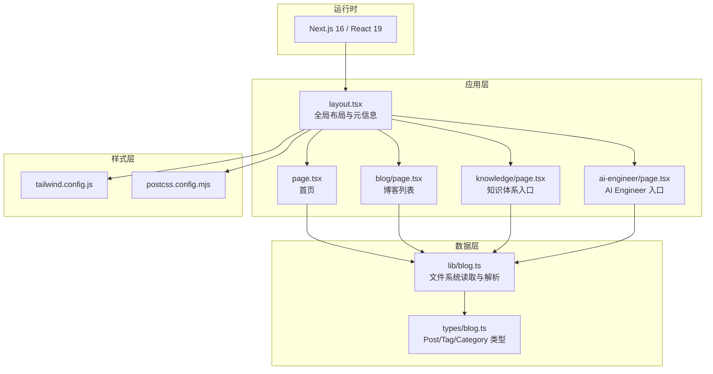
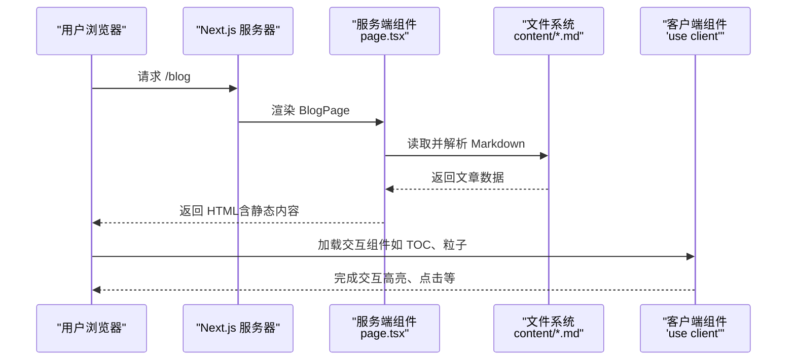
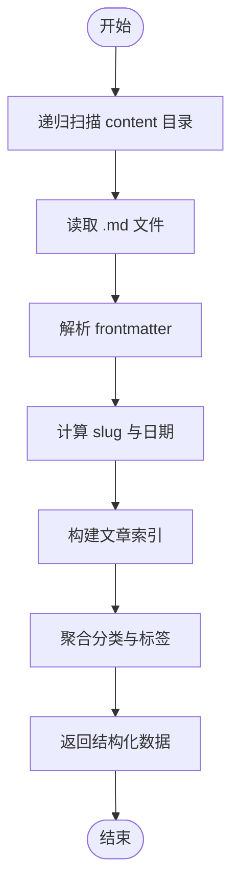
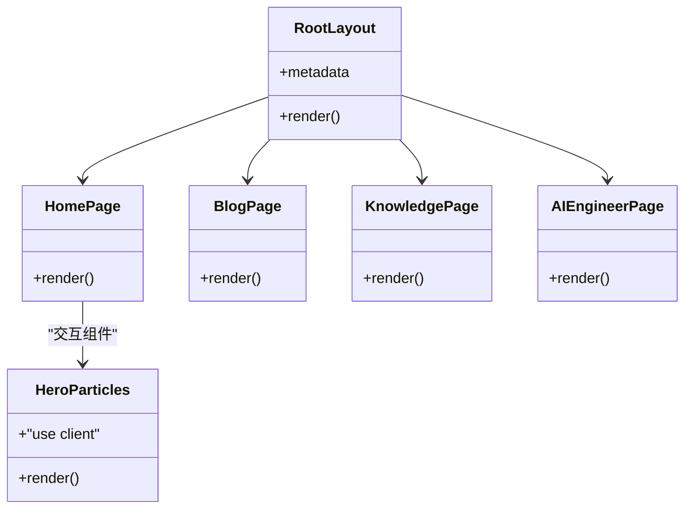
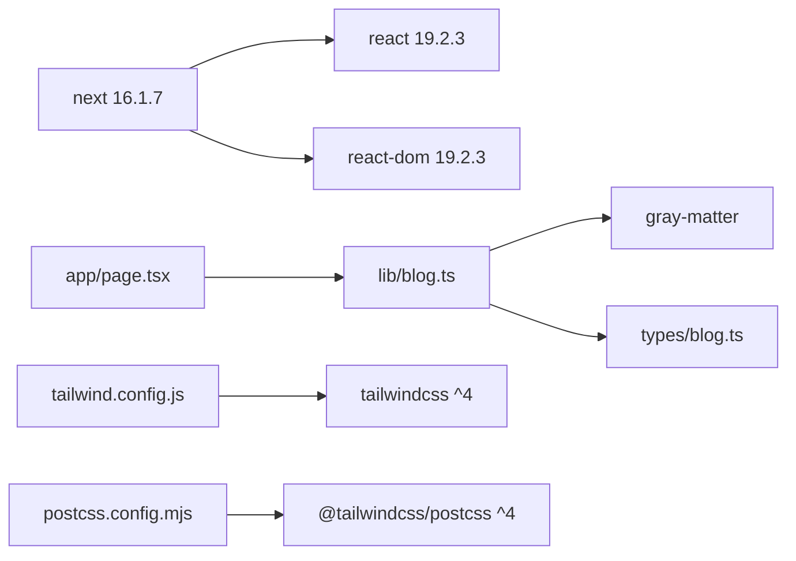

# 整体架构

<cite>
**本文引用的文件**   
- [README.md](file://README.md)
- [package.json](file://package.json)
- [next.config.ts](file://next.config.ts)
- [app/layout.tsx](file://app/layout.tsx)
- [app/page.tsx](file://app/page.tsx)
- [app/blog/page.tsx](file://app/blog/page.tsx)
- [app/knowledge/page.tsx](file://app/knowledge/page.tsx)
- [app/ai-engineer/page.tsx](file://app/ai-engineer/page.tsx)
- [lib/blog.ts](file://lib/blog.ts)
- [types/blog.ts](file://types/blog.ts)
- [tailwind.config.js](file://tailwind.config.js)
- [postcss.config.mjs](file://postcss.config.mjs)
- [app/components/HeroParticles.tsx](file://app/components/HeroParticles.tsx)
- [doc/blog.md](file://doc/blog.md)
</cite>

## 目录
1. [引言](#引言)
2. [项目结构](#项目结构)
3. [核心组件](#核心组件)
4. [架构总览](#架构总览)
5. [详细组件分析](#详细组件分析)
6. [依赖关系分析](#依赖关系分析)
7. [性能与优化策略](#性能与优化策略)
8. [故障排查指南](#故障排查指南)
9. [结论](#结论)

## 引言
本仓库是 HuRui.dev 博客的 Next.js 全栈应用，采用 App Router、React Server Components（RSC）与文件系统驱动的路由组织内容。站点以 Markdown 为内容源，通过构建期读取 frontmatter 生成文章索引与导航，页面在服务端渲染 HTML，并在需要交互时下沉到客户端组件。样式体系基于 Tailwind CSS 4 与 PostCSS 插件，配合 dark mode 与排版插件。

## 项目结构
- app：Next.js App Router 路由与页面布局，包含首页、博客、知识体系、AI Engineer 等模块；components 存放可复用 UI 组件；hooks 提供通用逻辑。
- content：Markdown 内容源，按主题分目录，frontmatter 描述标题、标签、分类等元信息。
- lib：数据访问与工具函数，如从文件系统扫描并解析 Markdown、生成分类与标签集合。
- types：TypeScript 类型定义，统一 Post、Tag、Category 等数据结构。
- config：分类与标签配置（若存在）。
- public：静态资源（图片等）。
- scripts：辅助脚本（如生成目录映射、注入 frontmatter）。
- 根级配置文件：next.config.ts、tailwind.config.js、postcss.config.mjs、package.json、tsconfig.json 等。

图表来源
- [app/layout.tsx:1-24](file://app/layout.tsx#L1-L24)
- [app/page.tsx:1-193](file://app/page.tsx#L1-L193)
- [app/blog/page.tsx:1-21](file://app/blog/page.tsx#L1-L21)
- [app/knowledge/page.tsx:1-59](file://app/knowledge/page.tsx#L1-L59)
- [app/ai-engineer/page.tsx:1-62](file://app/ai-engineer/page.tsx#L1-L62)
- [lib/blog.ts:1-134](file://lib/blog.ts#L1-L134)
- [types/blog.ts:1-16](file://types/blog.ts#L1-L16)
- [tailwind.config.js:1-9](file://tailwind.config.js#L1-L9)
- [postcss.config.mjs:1-8](file://postcss.config.mjs#L1-L8)

章节来源
- [README.md:1-37](file://README.md#L1-L37)
- [doc/blog.md:1-134](file://doc/blog.md#L1-L134)

## 核心组件
- 根布局与元信息：在 layout.tsx 中定义默认 title 模板与 description，设置 html lang 与 body 基础样式类，支持深色模式切换。
- 首页：page.tsx 作为服务端组件，调用 getAllPosts 获取文章列表，展示技术栈标签、导航卡片与最新博客。
- 博客列表：blog/page.tsx 同样为服务端组件，加载全部文章并以网格形式渲染 PostCard。
- 知识体系与 AI Engineer：knowledge/page.tsx 与 ai-engineer/page.tsx 分别使用 getKnowledgeMap 与 getAIEngineerMap 生成目录树与链接。
- 数据访问：lib/blog.ts 递归扫描 content 目录，解析 frontmatter，计算 slug、日期、分类与标签，并提供分类与标签聚合方法。
- 类型系统：types/blog.ts 定义 Post、Tag、Category 等类型，保证前后端数据结构一致。
- 样式系统：tailwind.config.js 启用 @tailwindcss/typography 与 darkMode class；postcss.config.mjs 接入 @tailwindcss/postcss。

章节来源
- [app/layout.tsx:1-24](file://app/layout.tsx#L1-L24)
- [app/page.tsx:1-193](file://app/page.tsx#L1-L193)
- [app/blog/page.tsx:1-21](file://app/blog/page.tsx#L1-L21)
- [app/knowledge/page.tsx:1-59](file://app/knowledge/page.tsx#L1-L59)
- [app/ai-engineer/page.tsx:1-62](file://app/ai-engineer/page.tsx#L1-L62)
- [lib/blog.ts:1-134](file://lib/blog.ts#L1-L134)
- [types/blog.ts:1-16](file://types/blog.ts#L1-L16)
- [tailwind.config.js:1-9](file://tailwind.config.js#L1-L9)
- [postcss.config.mjs:1-8](file://postcss.config.mjs#L1-L8)

## 架构总览
本项目采用“服务端优先”的 RSC 架构：
- 页面组件（page.tsx、layout.tsx）默认在服务端执行，直接读取文件系统与解析 Markdown，输出 HTML。
- 需要交互或浏览器 API 的组件（如粒子动画、TOC 高亮、返回按钮）使用 'use client' 标记，作为客户端组件在浏览器中运行。
- 数据获取集中在 lib/blog.ts，避免在页面中散落 IO 逻辑，便于测试与复用。
- 路由采用文件系统驱动，App Router 将目录结构与 URL 一一对应，支持动态段与嵌套路由。

图表来源
- [app/blog/page.tsx:1-21](file://app/blog/page.tsx#L1-L21)
- [lib/blog.ts:1-134](file://lib/blog.ts#L1-L134)
- [app/components/HeroParticles.tsx:1-40](file://app/components/HeroParticles.tsx#L1-L40)

## 详细组件分析

### 文件系统驱动的数据模型与解析流程
- 递归扫描 content 目录，收集 .md 文件路径。
- 对每个文件使用 gray-matter 解析 frontmatter，提取 title、description、category、tags、date 等字段。
- 根据相对路径计算 slug，兼容 Windows 路径分隔符。
- 聚合分类与标签，提供 getAllCategories、getAllTags 等方法。
- 针对 knowledge 与 ai-engineer 目录，生成带 slug 与 status 的目录树。

图表来源
- [lib/blog.ts:1-134](file://lib/blog.ts#L1-L134)

章节来源
- [lib/blog.ts:1-134](file://lib/blog.ts#L1-L134)
- [types/blog.ts:1-16](file://types/blog.ts#L1-L16)

### 页面与服务端组件的职责划分
- 所有 page.tsx 与 layout.tsx 均为服务端组件，负责数据获取与页面组装。
- 需要交互的组件（如 HeroParticles、TOC、BackButton、HomeButton、ContentLayout、MarkdownRenderer）使用 'use client'，承载状态、事件与浏览器 API。
- 跨边界传递的数据必须可序列化（如字符串、数字、对象），避免传递函数或 DOM 引用。

图表来源
- [app/layout.tsx:1-24](file://app/layout.tsx#L1-L24)
- [app/page.tsx:1-193](file://app/page.tsx#L1-L193)
- [app/blog/page.tsx:1-21](file://app/blog/page.tsx#L1-L21)
- [app/knowledge/page.tsx:1-59](file://app/knowledge/page.tsx#L1-L59)
- [app/ai-engineer/page.tsx:1-62](file://app/ai-engineer/page.tsx#L1-L62)
- [app/components/HeroParticles.tsx:1-40](file://app/components/HeroParticles.tsx#L1-L40)

章节来源
- [app/layout.tsx:1-24](file://app/layout.tsx#L1-L24)
- [app/page.tsx:1-193](file://app/page.tsx#L1-L193)
- [app/blog/page.tsx:1-21](file://app/blog/page.tsx#L1-L21)
- [app/knowledge/page.tsx:1-59](file://app/knowledge/page.tsx#L1-L59)
- [app/ai-engineer/page.tsx:1-62](file://app/ai-engineer/page.tsx#L1-L62)
- [app/components/HeroParticles.tsx:1-40](file://app/components/HeroParticles.tsx#L1-L40)

### 路由设计与 App Router 优势
- 路由即文件：app 目录下目录结构对应 URL，例如 /blog、/blog/[category]、/blog/[category]/[tag]、/knowledge/[...slug]、/ai-engineer/[...slug]。
- 动态段与嵌套路由：支持多级参数与 catch-all 段，便于扩展分类与标签维度。
- 相比 Pages Router，App Router 提供更强的 RSC 能力、流式渲染、并行数据获取与更清晰的组件职责划分。

章节来源
- [doc/blog.md:61-90](file://doc/blog.md#L61-L90)

## 依赖关系分析
- 运行时依赖：next 16.1.7、react 19.2.3、react-dom 19.2.3、gray-matter、react-markdown、rehype-*、remark-*、framer-motion、react-icons、reactflow、tsparticles 等。
- 样式依赖：tailwindcss ^4、@tailwindcss/postcss ^4、@tailwindcss/typography ^0.5.19。
- 开发依赖：typescript ^5、eslint ^9、prettier、husky、lint-staged 等。

图表来源
- [package.json:12-44](file://package.json#L12-L44)
- [lib/blog.ts:1-134](file://lib/blog.ts#L1-L134)
- [app/page.tsx:1-193](file://app/page.tsx#L1-L193)
- [types/blog.ts:1-16](file://types/blog.ts#L1-L16)
- [tailwind.config.js:1-9](file://tailwind.config.js#L1-L9)
- [postcss.config.mjs:1-8](file://postcss.config.mjs#L1-L8)

章节来源
- [package.json:1-53](file://package.json#L1-L53)

## 性能与优化策略
- 代码分割与按需加载
  - 客户端组件通过 'use client' 明确边界，仅将交互相关代码打包到客户端。
  - 第三方库（如 react-tsparticles、reactflow）按需引入，减少首屏体积。
- 服务端渲染与静态生成
  - 页面在服务端直接读取 Markdown 并渲染 HTML，提升首屏性能与 SEO。
  - 对于不常变化的内容，可在未来结合 SSG/ISR 进一步优化缓存与增量更新。
- 样式优化
  - Tailwind CSS 4 通过 PostCSS 处理，按需生成原子化样式，减少冗余 CSS。
  - dark mode 使用 class 策略，避免不必要的样式分支。
- 缓存策略
  - 当前 next.config.ts 为空配置，可根据业务需求开启缓存组件（Cache Components）或显式缓存指令（use cache）。
  - 建议在数据获取处使用稳定的 fetch 缓存策略（force-cache/no-store）以提升重复访问性能。
- 图片与媒体
  - 建议将图片放入 public/images，并通过 Next.js Image 组件进行优化（懒加载、格式转换、尺寸裁剪）。
- 构建与工程化
  - 使用 husky + lint-staged 在提交前执行 tsc 与 next lint，保障类型与代码质量。
  - 使用 prettier 统一代码风格，降低协作成本。

章节来源
- [next.config.ts:1-8](file://next.config.ts#L1-L8)
- [tailwind.config.js:1-9](file://tailwind.config.js#L1-L9)
- [postcss.config.mjs:1-8](file://postcss.config.mjs#L1-L8)
- [package.json:31-51](file://package.json#L31-L51)

## 故障排查指南
- 无法读取 Markdown 文件或 frontmatter 缺失
  - 检查 content 目录结构与文件名是否以 .md 结尾。
  - 确认 frontmatter 包含必要字段（title、date、tags、category）。
- 路由参数未生效或 404
  - 确认 app 下目录结构与 URL 匹配，动态段命名正确。
  - 检查 link 跳转路径是否与路由定义一致。
- 客户端组件报错
  - 确保需要交互的组件顶部有 'use client'。
  - 避免在服务端组件中使用浏览器 API（如 window、document）。
- 样式不生效或主题异常
  - 检查 tailwind.config.js 与 postcss.config.mjs 是否正确配置。
  - 确认 body 上是否存在 dark 类以启用深色模式。

章节来源
- [lib/blog.ts:1-134](file://lib/blog.ts#L1-L134)
- [app/layout.tsx:1-24](file://app/layout.tsx#L1-L24)
- [tailwind.config.js:1-9](file://tailwind.config.js#L1-L9)
- [postcss.config.mjs:1-8](file://postcss.config.mjs#L1-L8)

## 结论
HuRui.dev 博客采用 Next.js 16 App Router 与 React Server Components，形成“服务端取数 + 客户端交互”的清晰分层。文件系统驱动的路由与 Markdown 内容源使站点具备强可扩展性与易维护性。Tailwind CSS 4 提供原子化样式方案，配合 PostCSS 与 dark mode 满足现代前端工程需求。通过合理的代码分割、服务端渲染与缓存策略，项目在首屏性能、SEO 与可维护性之间取得良好平衡。