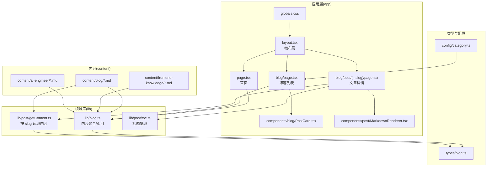
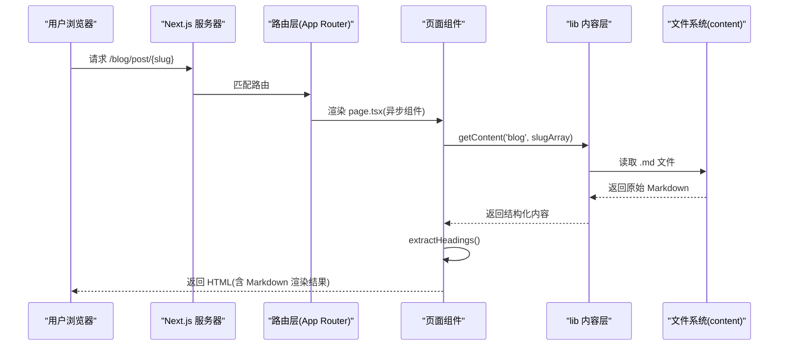
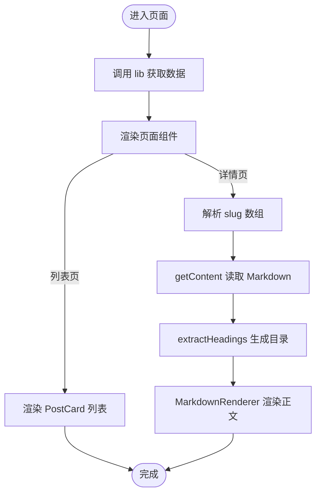
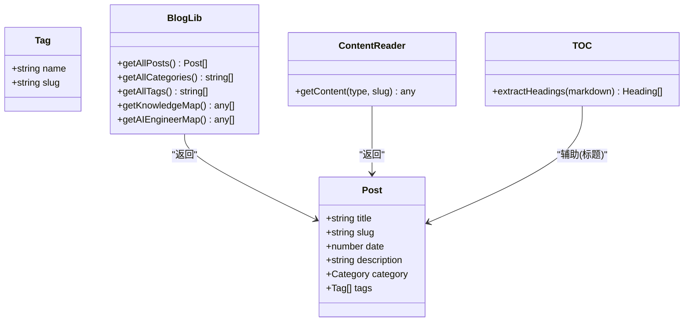
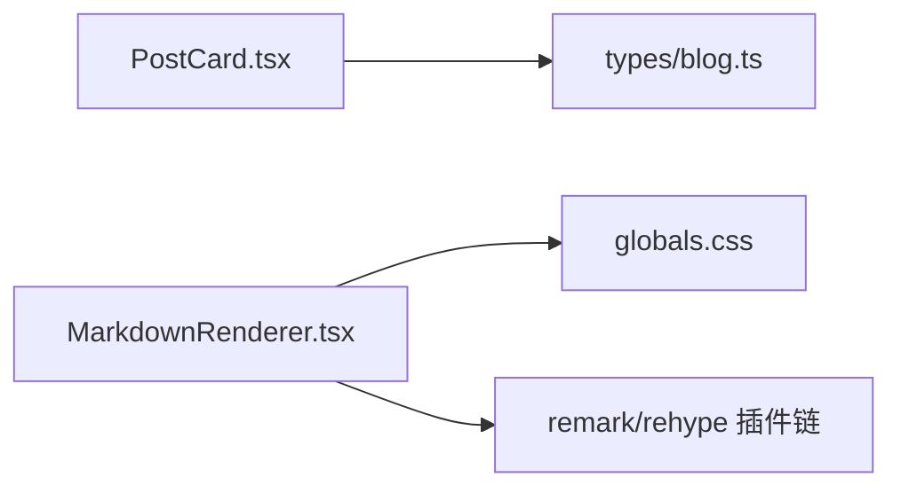
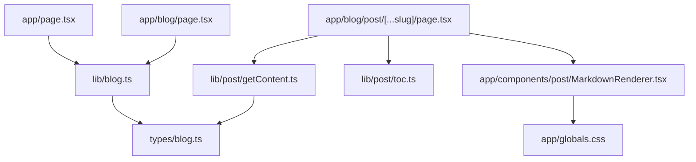

# 架构设计

<cite>
**本文引用的文件**   
- [README.md](file://README.md)
- [package.json](file://package.json)
- [next.config.ts](file://next.config.ts)
- [app/layout.tsx](file://app/layout.tsx)
- [app/page.tsx](file://app/page.tsx)
- [app/blog/page.tsx](file://app/blog/page.tsx)
- [app/blog/post/[...slug]/page.tsx](file://app/blog/post/[...slug]/page.tsx)
- [lib/blog.ts](file://lib/blog.ts)
- [lib/post/getContent.ts](file://lib/post/getContent.ts)
- [lib/post/toc.ts](file://lib/post/toc.ts)
- [types/blog.ts](file://types/blog.ts)
- [config/category.ts](file://config/category.ts)
- [app/components/blog/PostCard.tsx](file://app/components/blog/PostCard.tsx)
- [app/components/post/MarkdownRenderer.tsx](file://app/components/post/MarkdownRenderer.tsx)
- [app/globals.css](file://app/globals.css)
</cite>

## 目录
1. [引言](#引言)
2. [项目结构](#项目结构)
3. [核心组件](#核心组件)
4. [架构总览](#架构总览)
5. [详细组件分析](#详细组件分析)
6. [依赖关系分析](#依赖关系分析)
7. [性能与构建特性](#性能与构建特性)
8. [故障排查指南](#故障排查指南)
9. [结论](#结论)

## 引言
本设计文档面向 HuRui.dev 博客项目的整体架构，重点阐述基于 Next.js App Router 的路由组织、React Server Components（RSC）的使用模式、文件系统驱动的内容管理方案，以及组件化、单向数据流和配置驱动等核心设计模式。同时说明前后端分离的决策、静态站点生成（SSG）的性能优势，并解释技术选型（Next.js、React 19、Tailwind CSS 4 等）的原因与权衡。

## 项目结构
项目采用 Next.js App Router 的分层目录结构：
- app：页面路由与布局、页面级组件、全局样式
- lib：业务逻辑与工具函数（内容读取、TOC 提取等）
- types：类型定义
- config：配置项（分类标签映射等）
- content：以 Markdown 为载体的内容源（按主题分目录）
- scripts：辅助脚本（用于生成或注入 frontmatter）

图表来源
- [app/layout.tsx:1-24](file://app/layout.tsx#L1-L24)
- [app/page.tsx:1-193](file://app/page.tsx#L1-L193)
- [app/blog/page.tsx:1-21](file://app/blog/page.tsx#L1-L21)
- [app/blog/post/[...slug]/page.tsx:1-28](file://app/blog/post/[...slug]/page.tsx#L1-L28)
- [lib/blog.ts:1-134](file://lib/blog.ts#L1-L134)
- [lib/post/getContent.ts:1-21](file://lib/post/getContent.ts#L1-L21)
- [lib/post/toc.ts:1-23](file://lib/post/toc.ts#L1-L23)
- [types/blog.ts:1-16](file://types/blog.ts#L1-L16)
- [config/category.ts:1-9](file://config/category.ts#L1-L9)
- [app/globals.css:1-159](file://app/globals.css#L1-L159)

章节来源
- [README.md:1-37](file://README.md#L1-L37)
- [package.json:1-53](file://package.json#L1-L53)

## 核心组件
- 根布局与元信息：在根布局中统一设置语言、主题色变量、默认 SEO 元信息，确保全站一致体验。
- 首页：作为入口聚合最新博文卡片，提供知识体系、项目案例、AI Engineer 三大板块导航。
- 博客列表页：拉取全部文章并按时间排序展示，配合分类与标签筛选（通过组件组合）。
- 文章详情页：根据动态路由参数解析 slug，读取对应 Markdown 内容，渲染正文与目录。
- 内容读取层：封装对 content 目录下 Markdown 文件的递归扫描、frontmatter 解析、slug 计算、分类/标签聚合。
- 类型系统：使用 TypeScript 定义 Post、Tag、Category 等类型，保证数据契约稳定。
- 配置驱动：通过 config/category.ts 集中维护分类显示名等配置，便于扩展与多语言扩展。

章节来源
- [app/layout.tsx:1-24](file://app/layout.tsx#L1-L24)
- [app/page.tsx:1-193](file://app/page.tsx#L1-L193)
- [app/blog/page.tsx:1-21](file://app/blog/page.tsx#L1-L21)
- [app/blog/post/[...slug]/page.tsx:1-28](file://app/blog/post/[...slug]/page.tsx#L1-L28)
- [lib/blog.ts:1-134](file://lib/blog.ts#L1-L134)
- [types/blog.ts:1-16](file://types/blog.ts#L1-L16)
- [config/category.ts:1-9](file://config/category.ts#L1-L9)

## 架构总览
本项目采用“文件系统即路由 + RSC 服务端渲染”的架构：
- 路由层：App Router 将 URL 映射到 app 下的页面组件；动态路由支持多级 slug。
- 数据层：lib 模块直接读取 content 目录中的 Markdown 文件，解析 frontmatter 并返回结构化数据。
- 视图层：页面组件调用 lib 获取数据，再交由可复用组件渲染 UI。
- 样式层：Tailwind CSS 4 原子类 + 自定义 prose 样式，保障 Markdown 渲染一致性。

图表来源
- [app/blog/post/[...slug]/page.tsx:1-28](file://app/blog/post/[...slug]/page.tsx#L1-L28)
- [lib/post/getContent.ts:1-21](file://lib/post/getContent.ts#L1-L21)
- [lib/post/toc.ts:1-23](file://lib/post/toc.ts#L1-L23)

## 详细组件分析

### 路由与页面组件
- 根布局：集中处理语言、主题变量、SEO 元信息，为所有页面提供一致的上下文。
- 首页：聚合最新博文，提供三大入口卡片；使用服务端函数 getAllPosts 获取数据。
- 博客列表：调用 getAllPosts 渲染文章卡片网格；结合 CategoryNav、TagFilter 等组件实现筛选。
- 文章详情：解析 params.slug，调用 getContent 获取文章内容，extractHeadings 生成目录，MarkdownRenderer 渲染正文。

图表来源
- [app/page.tsx:1-193](file://app/page.tsx#L1-L193)
- [app/blog/page.tsx:1-21](file://app/blog/page.tsx#L1-L21)
- [app/blog/post/[...slug]/page.tsx:1-28](file://app/blog/post/[...slug]/page.tsx#L1-L28)
- [lib/blog.ts:1-134](file://lib/blog.ts#L1-L134)
- [lib/post/getContent.ts:1-21](file://lib/post/getContent.ts#L1-L21)
- [lib/post/toc.ts:1-23](file://lib/post/toc.ts#L1-L23)

章节来源
- [app/layout.tsx:1-24](file://app/layout.tsx#L1-L24)
- [app/page.tsx:1-193](file://app/page.tsx#L1-L193)
- [app/blog/page.tsx:1-21](file://app/blog/page.tsx#L1-L21)
- [app/blog/post/[...slug]/page.tsx:1-28](file://app/blog/post/[...slug]/page.tsx#L1-L28)

### 内容读取与数据结构
- getAllPosts：递归扫描 content/blog，解析 frontmatter，计算 slug，归一化为 Post[]，并按日期倒序排列。
- getKnowledgeMap/getAIEngineerMap：分别扫描 knowledge 与 ai-engineer 目录，生成层级目录树，附带状态字段。
- getContent：根据类型与 slug 拼接路径，读取对应 Markdown 文件，返回结构化内容对象。
- extractHeadings：从 Markdown 文本中提取 h1-h3 标题，生成 TOC 所需的数据结构。

图表来源
- [lib/blog.ts:1-134](file://lib/blog.ts#L1-L134)
- [lib/post/getContent.ts:1-21](file://lib/post/getContent.ts#L1-L21)
- [lib/post/toc.ts:1-23](file://lib/post/toc.ts#L1-L23)
- [types/blog.ts:1-16](file://types/blog.ts#L1-L16)

章节来源
- [lib/blog.ts:1-134](file://lib/blog.ts#L1-L134)
- [lib/post/getContent.ts:1-21](file://lib/post/getContent.ts#L1-L21)
- [lib/post/toc.ts:1-23](file://lib/post/toc.ts#L1-L23)
- [types/blog.ts:1-16](file://types/blog.ts#L1-L16)

### 组件与样式
- PostCard：接收 Post 数据，渲染标题、时间与标签，链接至文章详情页。
- MarkdownRenderer：客户端组件，集成 remark/rehype 插件链，支持 GFM、代码高亮、自动锚点、表格滚动等。
- 全局样式：Tailwind CSS 4 引入 + highlight.js 主题；自定义 prose 样式解决代码块、表格、图片溢出等问题。

图表来源
- [app/components/blog/PostCard.tsx:1-44](file://app/components/blog/PostCard.tsx#L1-L44)
- [app/components/post/MarkdownRenderer.tsx:1-40](file://app/components/post/MarkdownRenderer.tsx#L1-L40)
- [app/globals.css:1-159](file://app/globals.css#L1-L159)
- [types/blog.ts:1-16](file://types/blog.ts#L1-L16)

章节来源
- [app/components/blog/PostCard.tsx:1-44](file://app/components/blog/PostCard.tsx#L1-L44)
- [app/components/post/MarkdownRenderer.tsx:1-40](file://app/components/post/MarkdownRenderer.tsx#L1-L40)
- [app/globals.css:1-159](file://app/globals.css#L1-L159)

## 依赖关系分析
- 页面组件依赖 lib 进行数据获取，避免在组件内直接操作文件系统，提升可测试性与职责分离。
- lib 模块依赖 fs/path/gray-matter 等底层能力，对外暴露稳定的 API（如 getAllPosts、getContent）。
- 类型定义集中在 types/blog.ts，被多个页面与 lib 共享，保证数据契约一致。
- 样式通过 Tailwind CSS 4 与自定义 prose 规则组合，MarkdownRenderer 与 globals.css 形成强耦合但边界清晰。

图表来源
- [app/page.tsx:1-193](file://app/page.tsx#L1-L193)
- [app/blog/page.tsx:1-21](file://app/blog/page.tsx#L1-L21)
- [app/blog/post/[...slug]/page.tsx:1-28](file://app/blog/post/[...slug]/page.tsx#L1-L28)
- [lib/blog.ts:1-134](file://lib/blog.ts#L1-L134)
- [lib/post/getContent.ts:1-21](file://lib/post/getContent.ts#L1-L21)
- [lib/post/toc.ts:1-23](file://lib/post/toc.ts#L1-L23)
- [app/components/post/MarkdownRenderer.tsx:1-40](file://app/components/post/MarkdownRenderer.tsx#L1-L40)
- [app/globals.css:1-159](file://app/globals.css#L1-L159)

## 性能与构建特性
- 服务端渲染与静态化：页面组件为 async 函数，Next.js 可在构建期预取数据并生成静态 HTML，减少首屏加载时间。
- 文件系统驱动：内容变更无需重启服务即可在开发时热更新；生产环境可缓存内容索引，降低 I/O 开销。
- 样式优化：Tailwind CSS 4 按需生成样式，prose 定制样式仅作用于 Markdown 区域，避免全局污染。
- 前端交互最小化：MarkdownRenderer 为 'use client'，仅在需要交互（如代码高亮、锚点跳转）时执行客户端逻辑，其余部分保持服务端渲染。

[本节为通用性能讨论，不直接分析具体文件]

## 故障排查指南
- 文章不存在：当 getContent 无法找到对应 slug 的文件时，页面会返回“文章不存在”提示。检查 content 目录结构与 slug 是否一致。
- 目录为空或权限问题：lib 使用 fs.readdirSync 递归读取目录，若目录不存在或无权限会抛出异常。确认 content 目录存在且可读。
- Markdown 渲染异常：检查 remark/rehype 插件链是否正确注册，确认 rehype-highlight 主题已引入，表格与代码块样式未被覆盖。
- 样式溢出：若出现横向滚动或表格溢出，检查 globals.css 中 .prose 相关规则是否生效，必要时调整 table-wrapper 与 pre/code 样式。

章节来源
- [app/blog/post/[...slug]/page.tsx:1-28](file://app/blog/post/[...slug]/page.tsx#L1-L28)
- [lib/blog.ts:1-134](file://lib/blog.ts#L1-L134)
- [app/globals.css:1-159](file://app/globals.css#L1-L159)

## 结论
本项目以 Next.js App Router 为核心，结合 React Server Components 与服务端数据获取，构建了高性能、易维护的博客系统。通过文件系统驱动的内容管理与组件化架构，实现了清晰的职责划分与可扩展性。技术选型上，Next.js 提供了全栈能力与 SSR/SSG 支持，React 19 带来更优的并发与性能，Tailwind CSS 4 则提升了样式工程效率。整体架构在保证性能的同时，兼顾了可维护性与扩展空间。