# 组件架构

<cite>
**本文引用的文件**   
- [app/layout.tsx](file://app/layout.tsx)
- [app/page.tsx](file://app/page.tsx)
- [app/blog/page.tsx](file://app/blog/page.tsx)
- [app/blog/post/[...slug]/page.tsx](file://app/blog/post/[...slug]/page.tsx)
- [app/components/HeroParticles.tsx](file://app/components/HeroParticles.tsx)
- [app/components/HomeButton.tsx](file://app/components/HomeButton.tsx)
- [app/components/TOC.tsx](file://app/components/TOC.tsx)
- [app/components/blog/PostCard.tsx](file://app/components/blog/PostCard.tsx)
- [app/components/blog/CategoryNav.tsx](file://app/components/blog/CategoryNav.tsx)
- [app/components/blog/TagFilter.tsx](file://app/components/blog/TagFilter.tsx)
- [app/components/post/ContentLayout.tsx](file://app/components/post/ContentLayout.tsx)
- [app/components/post/BackButton.tsx](file://app/components/post/BackButton.tsx)
- [app/components/post/MarkdownRenderer.tsx](file://app/components/post/MarkdownRenderer.tsx)
- [app/hooks/useActiveHeading.ts](file://app/hooks/useActiveHeading.ts)
</cite>

## 目录
1. [引言](#引言)
2. [项目结构](#项目结构)
3. [核心组件](#核心组件)
4. [架构总览](#架构总览)
5. [详细组件分析](#详细组件分析)
6. [依赖关系分析](#依赖关系分析)
7. [性能与可维护性](#性能与可维护性)
8. [故障排查指南](#故障排查指南)
9. [结论](#结论)

## 引言
本文件面向 HuRui.dev 博客项目的 React 19 组件化设计，聚焦以下目标：
- 明确组件层次结构与职责边界
- 说明组件间通信机制（props、Context API、自定义 Hooks）
- 梳理本地状态与全局状态的策略
- 提供组件依赖图与交互流程图
- 解释响应式设计与主题切换在组件层面的实现

本项目采用 Next.js App Router 与 React Server Components（RSC）为主，关键交互逻辑通过“use client”客户端组件与自定义 Hooks 实现。整体遵循“布局组件负责骨架与排版、展示组件负责数据呈现、工具组件封装通用交互”的职责分离原则。

## 项目结构
- 页面路由位于 app 目录下，按功能域划分 blog、post、knowledge、ai-engineer、projects 等
- 组件集中在 app/components，按领域再分子目录 blog、post
- 业务 Hook 位于 app/hooks
- 样式与主题通过 Tailwind CSS 与根布局的 dark 模式类名控制

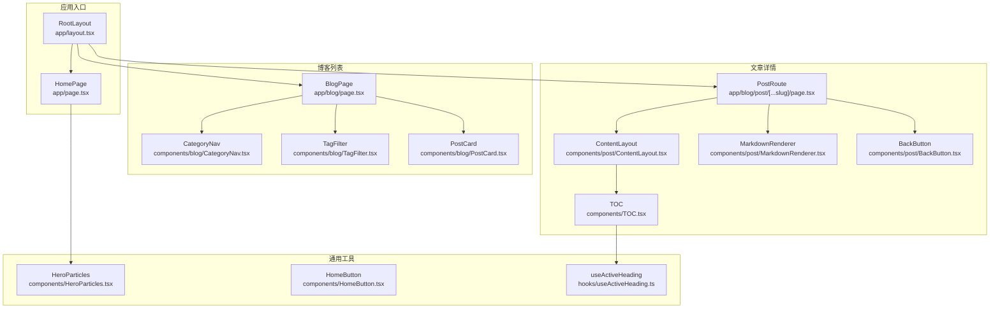

**图表来源**
- [app/layout.tsx:11-23](file://app/layout.tsx#L11-L23)
- [app/page.tsx:7-193](file://app/page.tsx#L7-L193)
- [app/blog/page.tsx:6-20](file://app/blog/page.tsx#L6-L20)
- [app/blog/post/[...slug]/page.tsx:11-27](file://app/blog/post/[...slug]/page.tsx#L11-L27)
- [app/components/HeroParticles.tsx:6-39](file://app/components/HeroParticles.tsx#L6-L39)
- [app/components/HomeButton.tsx:5-36](file://app/components/HomeButton.tsx#L5-L36)
- [app/components/TOC.tsx:9-44](file://app/components/TOC.tsx#L9-L44)
- [app/components/blog/PostCard.tsx:4-43](file://app/components/blog/PostCard.tsx#L4-L43)
- [app/components/blog/CategoryNav.tsx:4-45](file://app/components/blog/CategoryNav.tsx#L4-L45)
- [app/components/blog/TagFilter.tsx:4-52](file://app/components/blog/TagFilter.tsx#L4-L52)
- [app/components/post/ContentLayout.tsx:12-30](file://app/components/post/ContentLayout.tsx#L12-L30)
- [app/components/post/BackButton.tsx:6-29](file://app/components/post/BackButton.tsx#L6-L29)
- [app/components/post/MarkdownRenderer.tsx:10-39](file://app/components/post/MarkdownRenderer.tsx#L10-L39)
- [app/hooks/useActiveHeading.ts:12-33](file://app/hooks/useActiveHeading.ts#L12-L33)

**章节来源**
- [app/layout.tsx:11-23](file://app/layout.tsx#L11-L23)
- [app/page.tsx:7-193](file://app/page.tsx#L7-L193)
- [app/blog/page.tsx:6-20](file://app/blog/page.tsx#L6-L20)
- [app/blog/post/[...slug]/page.tsx:11-27](file://app/blog/post/[...slug]/page.tsx#L11-L27)

## 核心组件
- 布局组件 ContentLayout
  - 职责：承载文章内容区域与右侧目录侧边栏，处理桌面端固定定位与滚动可见性，移动端隐藏目录
  - 输入：headings（目录结构）、children（渲染内容）
  - 输出：结构化文章视图
- 展示组件 PostCard、HeroParticles
  - PostCard：以卡片形式展示文章标题、时间、标签与描述，并生成跳转链接
  - HeroParticles：首页 Hero 区域的粒子动画背景
- 工具组件 HomeButton、TOC
  - HomeButton：悬浮回到首页按钮，带微动效
  - TOC：根据 headings 渲染目录，高亮当前活动标题

**章节来源**
- [app/components/post/ContentLayout.tsx:12-30](file://app/components/post/ContentLayout.tsx#L12-L30)
- [app/components/blog/PostCard.tsx:4-43](file://app/components/blog/PostCard.tsx#L4-L43)
- [app/components/HeroParticles.tsx:6-39](file://app/components/HeroParticles.tsx#L6-L39)
- [app/components/HomeButton.tsx:5-36](file://app/components/HomeButton.tsx#L5-L36)
- [app/components/TOC.tsx:9-44](file://app/components/TOC.tsx#L9-L44)

## 架构总览
系统采用分层组织：
- 页面层（Server Components）：负责数据获取与页面组装
- 组件层：布局、展示、工具三类组件各司其职
- Hook 层：封装滚动监听、目录高亮等交互逻辑
- 样式层：Tailwind + 根布局 dark 模式类名驱动主题切换

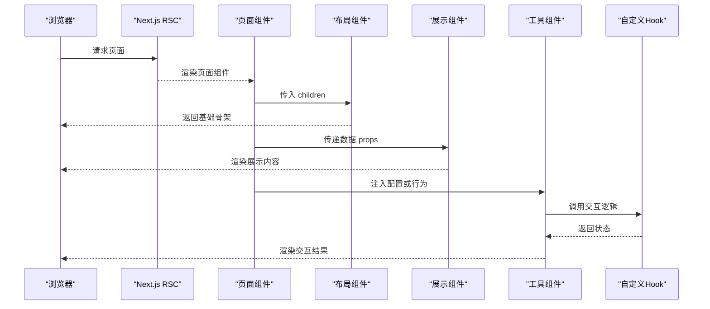

**图表来源**
- [app/layout.tsx:11-23](file://app/layout.tsx#L11-L23)
- [app/page.tsx:7-193](file://app/page.tsx#L7-L193)
- [app/components/post/ContentLayout.tsx:12-30](file://app/components/post/ContentLayout.tsx#L12-L30)
- [app/components/blog/PostCard.tsx:4-43](file://app/components/blog/PostCard.tsx#L4-L43)
- [app/components/TOC.tsx:9-44](file://app/components/TOC.tsx#L9-L44)
- [app/hooks/useActiveHeading.ts:12-33](file://app/hooks/useActiveHeading.ts#L12-L33)

## 详细组件分析

### 布局组件 ContentLayout
- 职责
  - 提供文章主体容器与右侧目录侧边栏
  - 使用响应式类名在移动端隐藏目录，在桌面端固定定位
- 关键设计
  - 通过 headings 构建目录树，将 TOC 作为子组件嵌入
  - 使用 flex 布局确保主内容与侧边栏自适应宽度
- 扩展点
  - 可扩展为支持移动端目录抽屉或顶部导航条

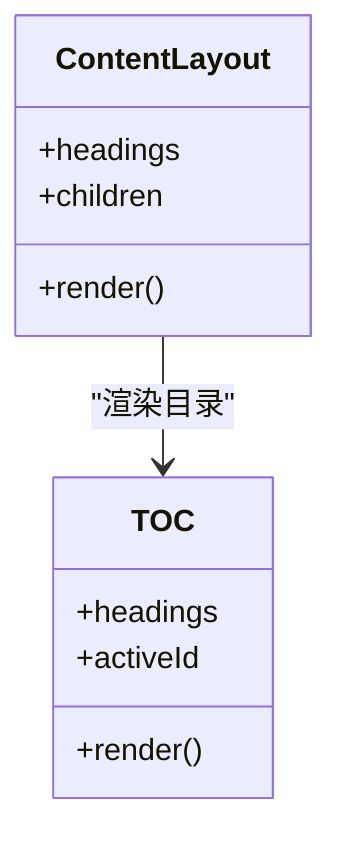

**图表来源**
- [app/components/post/ContentLayout.tsx:12-30](file://app/components/post/ContentLayout.tsx#L12-L30)
- [app/components/TOC.tsx:9-44](file://app/components/TOC.tsx#L9-L44)

**章节来源**
- [app/components/post/ContentLayout.tsx:12-30](file://app/components/post/ContentLayout.tsx#L12-L30)

### 展示组件 PostCard
- 职责
  - 展示单篇文章的标题、日期、标签与摘要
  - 生成文章详情页链接，支持可选 referrer 参数
- 复用性
  - 纯展示组件，无副作用，适合在列表页、推荐区等多处复用
- 响应式
  - 外层容器使用 Tailwind 的 hover 与过渡效果，适配不同屏幕尺寸

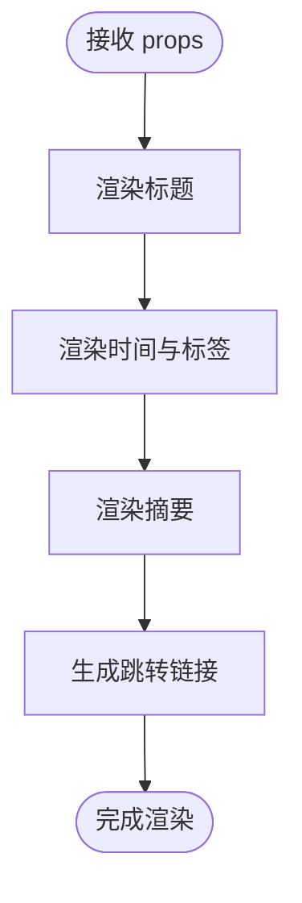

**图表来源**
- [app/components/blog/PostCard.tsx:4-43](file://app/components/blog/PostCard.tsx#L4-L43)

**章节来源**
- [app/components/blog/PostCard.tsx:4-43](file://app/components/blog/PostCard.tsx#L4-L43)

### 展示组件 HeroParticles
- 职责
  - 在首页 Hero 区域渲染粒子动画背景
- 关键点
  - 使用 react-tsparticles 与 tsparticles 初始化引擎
  - 配置粒子数量、颜色、形状、连线、交互事件（悬停排斥、点击推送）
- 性能
  - 全屏背景且 zIndex 较低，避免遮挡主要内容

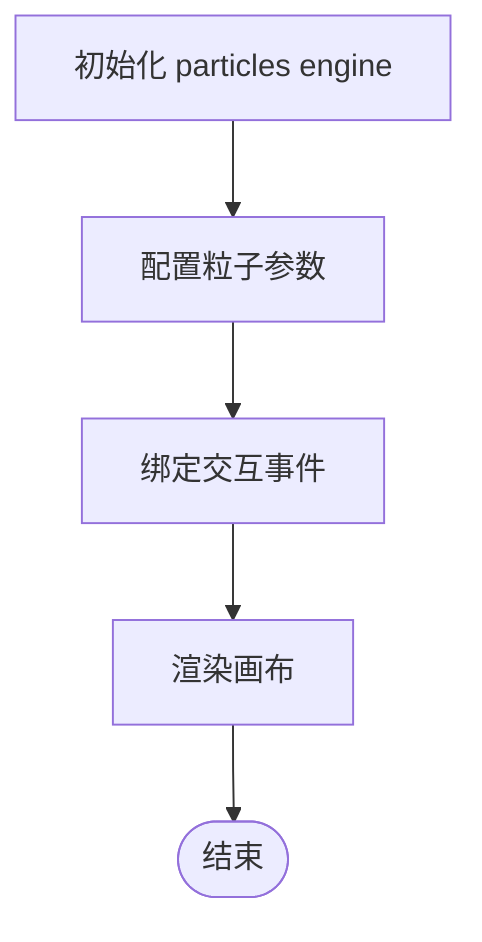

**图表来源**
- [app/components/HeroParticles.tsx:6-39](file://app/components/HeroParticles.tsx#L6-L39)

**章节来源**
- [app/components/HeroParticles.tsx:6-39](file://app/components/HeroParticles.tsx#L6-L39)

### 工具组件 HomeButton
- 职责
  - 提供悬浮回到首页的按钮，带轻微弹跳动画
- 交互
  - 使用 Next.js Link 进行导航
  - 内嵌 style jsx 定义自定义动画 keyframes

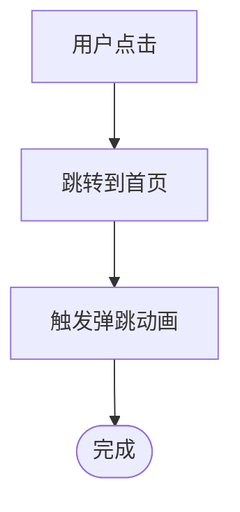

**图表来源**
- [app/components/HomeButton.tsx:5-36](file://app/components/HomeButton.tsx#L5-L36)

**章节来源**
- [app/components/HomeButton.tsx:5-36](file://app/components/HomeButton.tsx#L5-L36)

### 工具组件 TOC
- 职责
  - 根据 headings 渲染目录，并根据滚动位置高亮当前标题
- 交互
  - 使用 useActiveHeading Hook 计算 activeId
  - 通过锚点链接实现快速定位

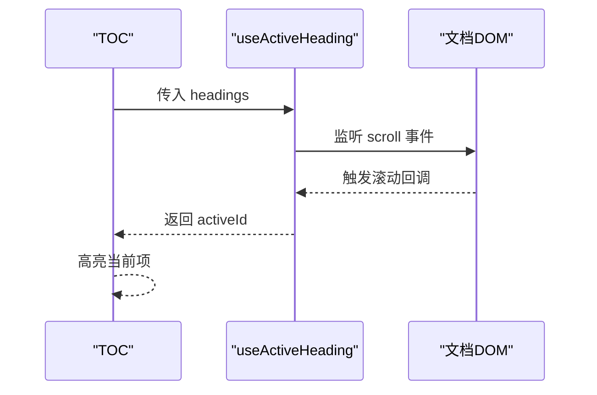

**图表来源**
- [app/components/TOC.tsx:9-44](file://app/components/TOC.tsx#L9-L44)
- [app/hooks/useActiveHeading.ts:12-33](file://app/hooks/useActiveHeading.ts#L12-L33)

**章节来源**
- [app/components/TOC.tsx:9-44](file://app/components/TOC.tsx#L9-L44)
- [app/hooks/useActiveHeading.ts:12-33](file://app/hooks/useActiveHeading.ts#L12-L33)

### 文章渲染 MarkdownRenderer
- 职责
  - 将 Markdown 内容渲染为 HTML，并增强链接、表格等元素
- 插件链
  - remarkGfm：支持 GitHub Flavored Markdown
  - rehypeHighlight：代码高亮
  - rehypeSlug：为标题生成 id
  - rehypeAutolinkHeadings：为标题添加自动链接
- 组件覆盖
  - a：内部链接使用 Next.js Link，外部链接新窗口打开
  - table：包裹 table 以实现横向滚动

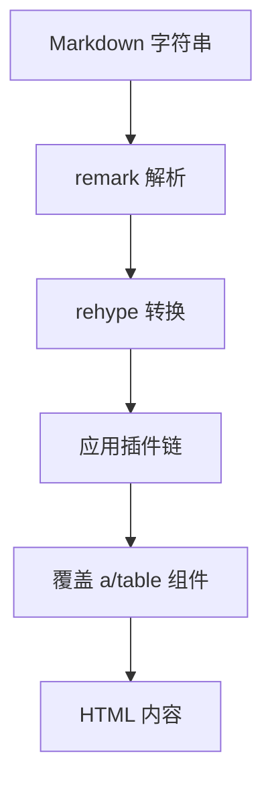

**图表来源**
- [app/components/post/MarkdownRenderer.tsx:10-39](file://app/components/post/MarkdownRenderer.tsx#L10-L39)

**章节来源**
- [app/components/post/MarkdownRenderer.tsx:10-39](file://app/components/post/MarkdownRenderer.tsx#L10-L39)

### 导航辅助 BackButton
- 职责
  - 根据 URL searchParams 中的 from 字段决定返回路径，否则回退到 fallback
- 交互
  - 使用 next/navigation 的 useRouter 进行编程式导航

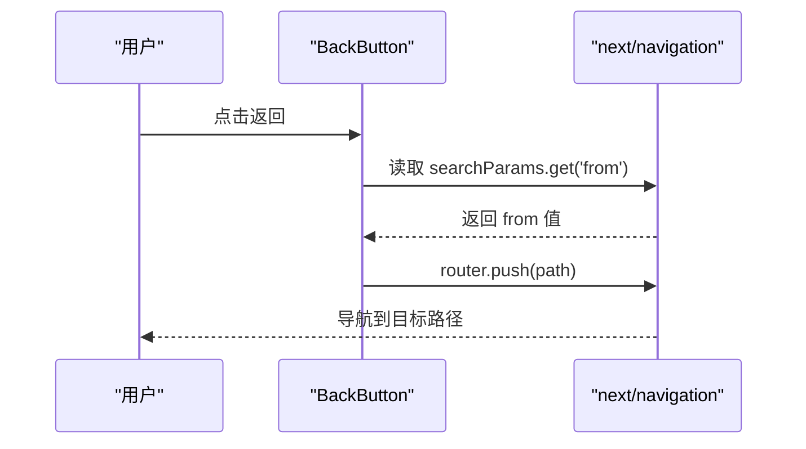

**图表来源**
- [app/components/post/BackButton.tsx:6-29](file://app/components/post/BackButton.tsx#L6-L29)

**章节来源**
- [app/components/post/BackButton.tsx:6-29](file://app/components/post/BackButton.tsx#L6-L29)

### 分类与标签导航 CategoryNav、TagFilter
- CategoryNav
  - 基于 CATEGORY_CONFIG 渲染分类导航，支持当前分类高亮
- TagFilter
  - 根据 tags 数组渲染标签过滤，支持当前标签高亮
- 共同点
  - 纯展示组件，通过 Link 进行路由跳转
  - 使用 Tailwind 条件类名实现选中态样式

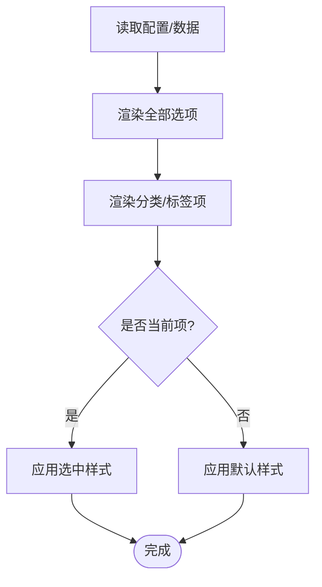

**图表来源**
- [app/components/blog/CategoryNav.tsx:4-45](file://app/components/blog/CategoryNav.tsx#L4-L45)
- [app/components/blog/TagFilter.tsx:4-52](file://app/components/blog/TagFilter.tsx#L4-L52)

**章节来源**
- [app/components/blog/CategoryNav.tsx:4-45](file://app/components/blog/CategoryNav.tsx#L4-L45)
- [app/components/blog/TagFilter.tsx:4-52](file://app/components/blog/TagFilter.tsx#L4-L52)

## 依赖关系分析
- 页面到组件
  - HomePage 引入 HeroParticles
  - BlogPage 引入 CategoryNav、TagFilter、PostCard
  - PostRoute 引入 ContentLayout、MarkdownRenderer、BackButton
- 组件到 Hook
  - TOC 依赖 useActiveHeading
- 组件到第三方库
  - HeroParticles 依赖 react-tsparticles、tsparticles
  - MarkdownRenderer 依赖 react-markdown、remark-gfm、rehype-highlight、rehype-slug、rehype-autolink-headings

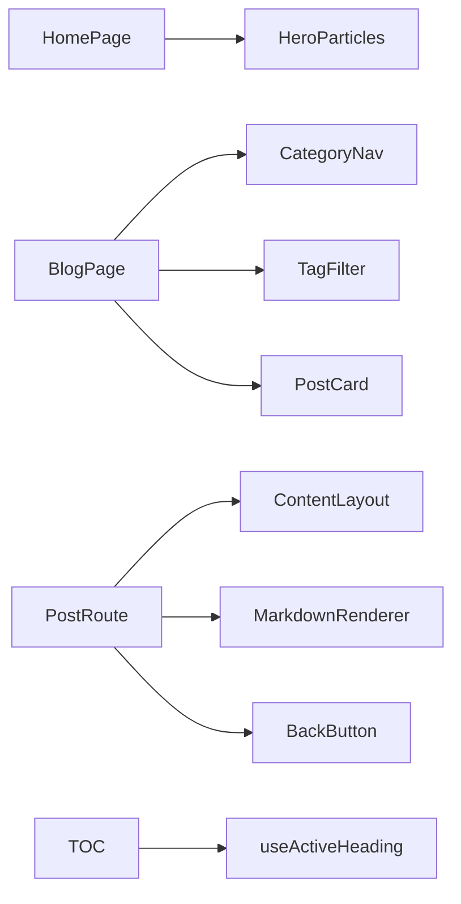

**图表来源**
- [app/page.tsx:7-193](file://app/page.tsx#L7-L193)
- [app/blog/page.tsx:6-20](file://app/blog/page.tsx#L6-L20)
- [app/blog/post/[...slug]/page.tsx:11-27](file://app/blog/post/[...slug]/page.tsx#L11-L27)
- [app/components/TOC.tsx:9-44](file://app/components/TOC.tsx#L9-L44)
- [app/hooks/useActiveHeading.ts:12-33](file://app/hooks/useActiveHeading.ts#L12-L33)

**章节来源**
- [app/page.tsx:7-193](file://app/page.tsx#L7-L193)
- [app/blog/page.tsx:6-20](file://app/blog/page.tsx#L6-L20)
- [app/blog/post/[...slug]/page.tsx:11-27](file://app/blog/post/[...slug]/page.tsx#L11-L27)
- [app/components/TOC.tsx:9-44](file://app/components/TOC.tsx#L9-L44)
- [app/hooks/useActiveHeading.ts:12-33](file://app/hooks/useActiveHeading.ts#L12-L33)

## 性能与可维护性
- 组件拆分清晰
  - 布局、展示、工具职责分明，便于测试与维护
- 服务端优先
  - 页面组件为异步 Server Component，减少客户端体积
- 客户端交互最小化
  - 仅必要的交互逻辑放在“use client”组件中
- 样式与主题
  - 使用 Tailwind 原子类与 dark 模式类名，统一主题切换
- 建议优化
  - 对长列表（如文章列表）考虑虚拟滚动或分页
  - 对粒子动画在低端设备上可降级或关闭
  - 对目录高亮的滚动监听可加入防抖/节流

[本节为通用指导，不直接分析具体文件]

## 故障排查指南
- 目录高亮异常
  - 检查 headings 的 id 是否与文章标题 id 一致
  - 确认 useActiveHeading 的滚动监听是否正确挂载与清理
- 链接跳转问题
  - 检查 MarkdownRenderer 中对 a 组件的覆盖逻辑
  - 确认 BackButton 的 from 参数与 getBackPath 返回值
- 主题切换无效
  - 检查根布局 body 上的 dark 类名是否正确应用
- 粒子动画卡顿
  - 降低粒子数量或禁用部分交互事件

**章节来源**
- [app/hooks/useActiveHeading.ts:12-33](file://app/hooks/useActiveHeading.ts#L12-L33)
- [app/components/post/MarkdownRenderer.tsx:10-39](file://app/components/post/MarkdownRenderer.tsx#L10-L39)
- [app/components/post/BackButton.tsx:6-29](file://app/components/post/BackButton.tsx#L6-L29)
- [app/layout.tsx:11-23](file://app/layout.tsx#L11-L23)
- [app/components/HeroParticles.tsx:6-39](file://app/components/HeroParticles.tsx#L6-L39)

## 结论
HuRui.dev 博客项目在 React 19 与 Next.js App Router 的基础上，形成了清晰的组件化架构：
- 布局组件负责页面骨架与响应式布局
- 展示组件专注数据呈现与可复用性
- 工具组件封装通用交互与导航
- 自定义 Hooks 解耦复杂交互逻辑
- 通过 Tailwind 与 dark 模式实现主题切换与响应式设计

该架构具备良好的可维护性与扩展性，适合持续迭代与团队协作。