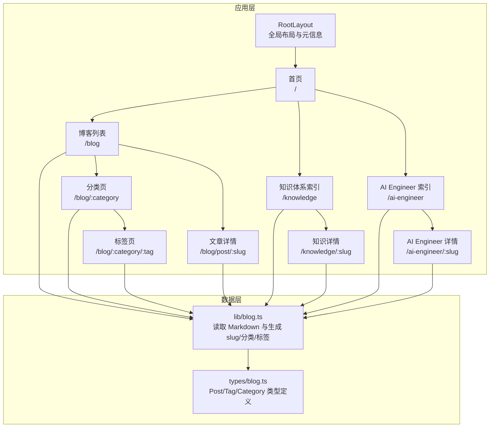
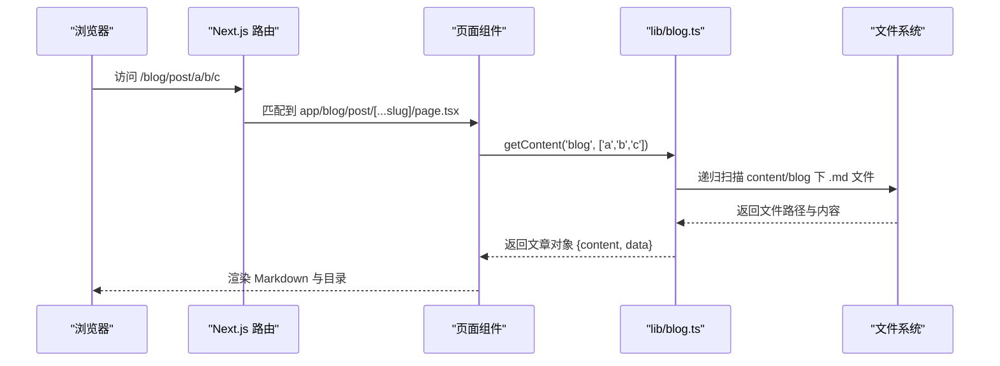
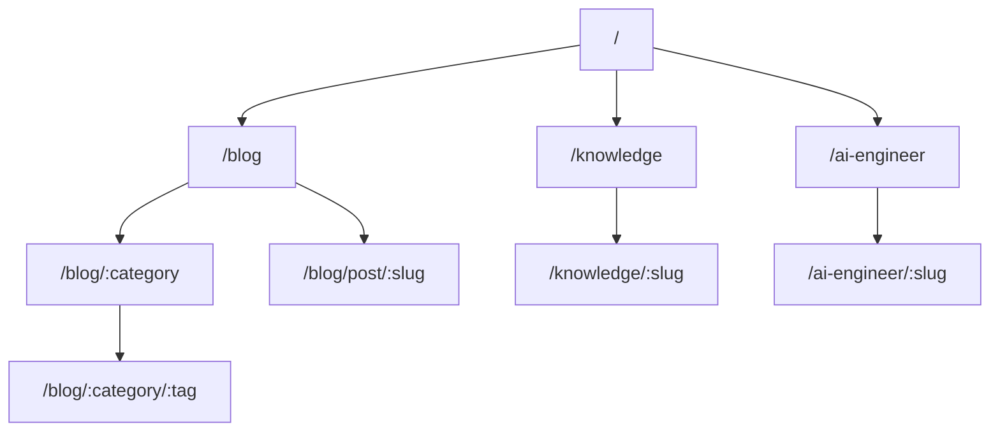
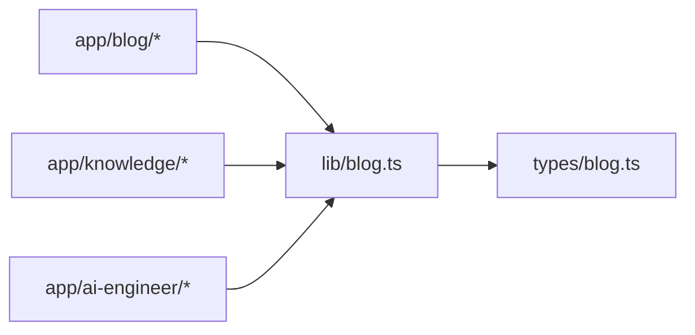

# 路由设计

<cite>
**本文引用的文件**   
- [app/layout.tsx](file://app/layout.tsx)
- [app/page.tsx](file://app/page.tsx)
- [app/blog/page.tsx](file://app/blog/page.tsx)
- [app/blog/[category]/page.tsx](file://app/blog/[category]/page.tsx)
- [app/blog/[category]/[tag]/page.tsx](file://app/blog/[category]/[tag]/page.tsx)
- [app/blog/post/[...slug]/page.tsx](file://app/blog/post/[...slug]/page.tsx)
- [app/knowledge/page.tsx](file://app/knowledge/page.tsx)
- [app/knowledge/[...slug]/page.tsx](file://app/knowledge/[...slug]/page.tsx)
- [app/ai-engineer/page.tsx](file://app/ai-engineer/page.tsx)
- [app/ai-engineer/[...slug]/page.tsx](file://app/ai-engineer/[...slug]/page.tsx)
- [lib/blog.ts](file://lib/blog.ts)
- [types/blog.ts](file://types/blog.ts)
</cite>

## 目录
1. [引言](#引言)
2. [项目结构与路由总览](#项目结构与路由总览)
3. [核心组件与职责](#核心组件与职责)
4. [架构总览](#架构总览)
5. [详细路由分析](#详细路由分析)
6. [依赖关系分析](#依赖关系分析)
7. [性能与可维护性](#性能与可维护性)
8. [故障排查指南](#故障排查指南)
9. [结论](#结论)
10. [附录：SEO 与元信息规范](#附录seo-与元信息规范)

## 引言
本文件为 HuRui.dev 博客项目的路由设计文档，基于 Next.js App Router 的文件系统路由机制，覆盖静态路由、动态路由、嵌套路由与并行路由的实现方式。重点说明页面组织原则（按功能模块划分）、路由参数处理（特别是 [...slug] 动态段）、导航流与数据传递机制，并提供路由映射表与 URL 结构图，帮助读者快速理解全站路由体系。

## 项目结构与路由总览
本项目采用 Next.js App Router 的约定式路由，根目录 app 下的每个文件夹对应一个路由段，page.tsx 作为页面入口，layout.tsx 提供全局布局与元信息。内容侧通过 content 目录下的 Markdown 文件驱动，由 lib/blog.ts 等工具函数读取并生成 slug、分类、标签等结构化数据。

图表来源
- [app/layout.tsx:1-24](file://app/layout.tsx#L1-L24)
- [app/page.tsx:1-193](file://app/page.tsx#L1-L193)
- [app/blog/page.tsx:1-21](file://app/blog/page.tsx#L1-L21)
- [app/blog/[category]/page.tsx:1-36](file://app/blog/[category]/page.tsx#L1-L36)
- [app/blog/[category]/[tag]/page.tsx:1-35](file://app/blog/[category]/[tag]/page.tsx#L1-L35)
- [app/blog/post/[...slug]/page.tsx:1-28](file://app/blog/post/[...slug]/page.tsx#L1-L28)
- [app/knowledge/page.tsx:1-59](file://app/knowledge/page.tsx#L1-L59)
- [app/knowledge/[...slug]/page.tsx:1-45](file://app/knowledge/[...slug]/page.tsx#L1-L45)
- [app/ai-engineer/page.tsx:1-62](file://app/ai-engineer/page.tsx#L1-L62)
- [app/ai-engineer/[...slug]/page.tsx:1-45](file://app/ai-engineer/[...slug]/page.tsx#L1-L45)
- [lib/blog.ts:1-134](file://lib/blog.ts#L1-L134)
- [types/blog.ts:1-16](file://types/blog.ts#L1-L16)

章节来源
- [app/layout.tsx:1-24](file://app/layout.tsx#L1-L24)
- [app/page.tsx:1-193](file://app/page.tsx#L1-L193)
- [lib/blog.ts:1-134](file://lib/blog.ts#L1-L134)

## 核心组件与职责
- 全局布局 RootLayout：定义站点标题模板、描述、语言与基础样式类名，所有页面共享。
- 首页 HomePage：聚合技术栈、卡片导航（跳转到 knowledge、projects、ai-engineer），以及最新博客列表跳转。
- 博客模块：
  - 列表页 /blog：展示全部文章卡片。
  - 分类页 /blog/:category：按分类过滤文章，并渲染标签筛选。
  - 标签页 /blog/:category/:tag：在分类基础上进一步按标签过滤。
  - 文章详情页 /blog/post/:slug：根据多级 slug 渲染文章内容与目录。
- 知识体系模块：
  - 索引页 /knowledge：从 content/frontend-knowledge 扫描生成目录树与链接。
  - 详情页 /knowledge/:slug：根据 slug 读取 Markdown 并渲染。
- AI Engineer 模块：
  - 索引页 /ai-engineer：从 content/ai-engineer 扫描生成目录树与链接。
  - 详情页 /ai-engineer/:slug：根据 slug 读取 Markdown 并渲染。
- 数据层 lib/blog.ts：递归扫描 Markdown 文件，解析 frontmatter，计算 slug，构建分类、标签、知识/AI 工程目录映射。
- 类型定义 types/blog.ts：统一 Post、Tag、Category 类型，保证页面与工具函数的类型安全。

章节来源
- [app/layout.tsx:1-24](file://app/layout.tsx#L1-L24)
- [app/page.tsx:1-193](file://app/page.tsx#L1-L193)
- [app/blog/page.tsx:1-21](file://app/blog/page.tsx#L1-L21)
- [app/blog/[category]/page.tsx:1-36](file://app/blog/[category]/page.tsx#L1-L36)
- [app/blog/[category]/[tag]/page.tsx:1-35](file://app/blog/[category]/[tag]/page.tsx#L1-L35)
- [app/blog/post/[...slug]/page.tsx:1-28](file://app/blog/post/[...slug]/page.tsx#L1-L28)
- [app/knowledge/page.tsx:1-59](file://app/knowledge/page.tsx#L1-L59)
- [app/knowledge/[...slug]/page.tsx:1-45](file://app/knowledge/[...slug]/page.tsx#L1-L45)
- [app/ai-engineer/page.tsx:1-62](file://app/ai-engineer/page.tsx#L1-L62)
- [app/ai-engineer/[...slug]/page.tsx:1-45](file://app/ai-engineer/[...slug]/page.tsx#L1-L45)
- [lib/blog.ts:1-134](file://lib/blog.ts#L1-L134)
- [types/blog.ts:1-16](file://types/blog.ts#L1-L16)

## 架构总览
Next.js App Router 以文件系统为路由契约，页面组件负责渲染与获取数据，布局组件负责全局 UI 与 SEO 元信息。数据层通过 fs 读取 Markdown 文件，结合 gray-matter 解析 frontmatter，生成 slug 与结构化数据供页面使用。

图表来源
- [app/blog/post/[...slug]/page.tsx:1-28](file://app/blog/post/[...slug]/page.tsx#L1-L28)
- [lib/blog.ts:1-134](file://lib/blog.ts#L1-L134)

## 详细路由分析

### 静态路由
- /：首页，聚合导航卡片与最新文章列表。
- /blog：博客列表页，调用 getAllPosts 渲染文章卡片。
- /knowledge：知识体系索引，调用 getKnowledgeMap 渲染目录树。
- /ai-engineer：AI Engineer 索引，调用 getAIEngineerMap 渲染目录树。
- /projects：项目案例页（存在路由文件）。

URL 示例
- https://hurui.dev/
- https://hurui.dev/blog
- https://hurui.dev/knowledge
- https://hurui.dev/ai-engineer
- https://hurui.dev/projects

章节来源
- [app/page.tsx:1-193](file://app/page.tsx#L1-L193)
- [app/blog/page.tsx:1-21](file://app/blog/page.tsx#L1-L21)
- [app/knowledge/page.tsx:1-59](file://app/knowledge/page.tsx#L1-L59)
- [app/ai-engineer/page.tsx:1-62](file://app/ai-engineer/page.tsx#L1-L62)

### 动态路由与嵌套路由
- /blog/[category]：分类页，接收 category 参数，过滤文章并渲染标签筛选器。
- /blog/[category]/[tag]：标签页，同时接收 category 与 tag 参数，进行双重过滤。
- /blog/post/[...slug]：文章详情页，接收多级 slug 数组，用于定位任意深度的 Markdown 文件。
- /knowledge/[...slug]：知识详情，支持多级 slug。
- /ai-engineer/[...slug]：AI Engineer 详情，支持多级 slug。

参数处理要点
- 单段动态参数：如 [category]、[tag]，通过 params 解构获取。
- 多段捕获组：如 [...slug]，params.slug 为字符串数组，需传给 getContent 以匹配 content 目录中的层级路径。

章节来源
- [app/blog/[category]/page.tsx:1-36](file://app/blog/[category]/page.tsx#L1-L36)
- [app/blog/[category]/[tag]/page.tsx:1-35](file://app/blog/[category]/[tag]/page.tsx#L1-L35)
- [app/blog/post/[...slug]/page.tsx:1-28](file://app/blog/post/[...slug]/page.tsx#L1-L28)
- [app/knowledge/[...slug]/page.tsx:1-45](file://app/knowledge/[...slug]/page.tsx#L1-L45)
- [app/ai-engineer/[...slug]/page.tsx:1-45](file://app/ai-engineer/[...slug]/page.tsx#L1-L45)

### 并行路由
当前仓库未显式使用 Next.js 并行路由（如 @folder 或 +layout 模式）。如需实现并行区域（例如主内容与侧边栏独立加载），可在 app 目录下新增带前缀的并行路由文件夹，并在父 layout 中通过 <Slot /> 注入。该能力在本项目中尚未启用。

### 路由映射表
| 路由 | 页面组件 | 说明 |
| --- | --- | --- |
| / | app/page.tsx | 首页，聚合导航与最新文章 |
| /blog | app/blog/page.tsx | 博客列表 |
| /blog/:category | app/blog/[category]/page.tsx | 按分类过滤文章 |
| /blog/:category/:tag | app/blog/[category]/[tag]/page.tsx | 按分类+标签过滤文章 |
| /blog/post/:slug | app/blog/post/[...slug]/page.tsx | 文章详情，支持多级 slug |
| /knowledge | app/knowledge/page.tsx | 知识体系索引 |
| /knowledge/:slug | app/knowledge/[...slug]/page.tsx | 知识详情，支持多级 slug |
| /ai-engineer | app/ai-engineer/page.tsx | AI Engineer 索引 |
| /ai-engineer/:slug | app/ai-engineer/[...slug]/page.tsx | AI Engineer 详情，支持多级 slug |
| /projects | app/projects/page.tsx | 项目案例页 |

### URL 结构图

图表来源
- [app/page.tsx:1-193](file://app/page.tsx#L1-L193)
- [app/blog/page.tsx:1-21](file://app/blog/page.tsx#L1-L21)
- [app/knowledge/page.tsx:1-59](file://app/knowledge/page.tsx#L1-L59)
- [app/ai-engineer/page.tsx:1-62](file://app/ai-engineer/page.tsx#L1-L62)

## 依赖关系分析
- 页面组件依赖 lib/blog.ts 提供的数据接口：getAllPosts、getKnowledgeMap、getAIEngineerMap。
- 工具函数依赖 fs 与 gray-matter 读取 Markdown 与 frontmatter，并通过 path 计算相对路径生成 slug。
- 类型定义 types/blog.ts 约束 Post、Tag、Category，确保页面与工具函数间的数据一致性。

图表来源
- [lib/blog.ts:1-134](file://lib/blog.ts#L1-L134)
- [types/blog.ts:1-16](file://types/blog.ts#L1-L16)

章节来源
- [lib/blog.ts:1-134](file://lib/blog.ts#L1-L134)
- [types/blog.ts:1-16](file://types/blog.ts#L1-L16)

## 性能与可维护性
- 服务端渲染与静态生成：页面组件为 async 函数，适合在服务端读取 Markdown 并渲染，减少客户端负担。
- 数据读取优化：lib/blog.ts 使用递归扫描与一次性排序，建议在生产环境考虑缓存已解析的文章集合，避免重复 IO。
- 路由可扩展性：使用 [...slug] 支持任意深度目录，便于后续扩展更多子分类与专题。
- 类型安全：通过 types/blog.ts 统一数据结构，降低页面与工具函数之间的耦合风险。

## 故障排查指南
- 文章不存在：当 getContent 返回空时，页面会显示“文章不存在”或“404 Not Found”。检查 content 目录是否存在对应 Markdown 文件，以及 slug 是否匹配。
- 分类或标签为空：若 filterPosts 或 getTagsByCategory 返回空结果，检查 frontmatter 中的 category/tags 字段是否正确配置。
- 元信息缺失：知识/AI 工程详情页通过 generateMetadata 设置 title/description；若 frontmatter 缺少这些字段，将返回空元信息。请补充 frontmatter 的 title 与 description。
- 路径分隔符问题：Windows 环境下 path.relative 可能产生反斜杠，lib/blog.ts 已做兼容替换，若仍异常，检查文件路径与命名规范。

章节来源
- [app/blog/post/[...slug]/page.tsx:1-28](file://app/blog/post/[...slug]/page.tsx#L1-L28)
- [app/knowledge/[...slug]/page.tsx:1-45](file://app/knowledge/[...slug]/page.tsx#L1-L45)
- [app/ai-engineer/[...slug]/page.tsx:1-45](file://app/ai-engineer/[...slug]/page.tsx#L1-L45)
- [lib/blog.ts:1-134](file://lib/blog.ts#L1-L134)

## 结论
本项目基于 Next.js App Router 实现了清晰、可扩展的博客路由体系：静态路由承载主要入口，动态路由与嵌套路由支撑分类、标签与多级文章详情，并行路由暂未启用但具备扩展空间。数据层通过统一的工具函数与类型定义，保证了页面组件的可读性与稳定性。整体路由设计遵循 SEO 友好的 URL 规范，并通过布局与页面级元信息配置提升搜索引擎可见性。

## 附录：SEO 与元信息规范
- 全局元信息：RootLayout 定义默认标题模板与站点描述，所有页面继承。
- 页面级元信息：知识/AI 工程详情页通过 generateMetadata 动态设置 title 与 description，来源于 Markdown frontmatter。
- URL 设计原则：
  - 使用语义化路径，如 /blog/post/:slug、/knowledge/:slug、/ai-engineer/:slug。
  - 多级 slug 使用 [...slug] 捕获，保持与 content 目录结构一致。
  - 分类与标签使用短小、可读的英文或拼音 slug，避免特殊字符。
- 最佳实践：
  - 在 frontmatter 中提供 title、description，确保搜索引擎抓取质量。
  - 保持 slug 稳定，避免频繁变更历史链接。
  - 对重要页面补充 canonical、open graph 等元信息（可在 generateMetadata 中扩展）。

章节来源
- [app/layout.tsx:1-24](file://app/layout.tsx#L1-L24)
- [app/knowledge/[...slug]/page.tsx:1-45](file://app/knowledge/[...slug]/page.tsx#L1-L45)
- [app/ai-engineer/[...slug]/page.tsx:1-45](file://app/ai-engineer/[...slug]/page.tsx#L1-L45)