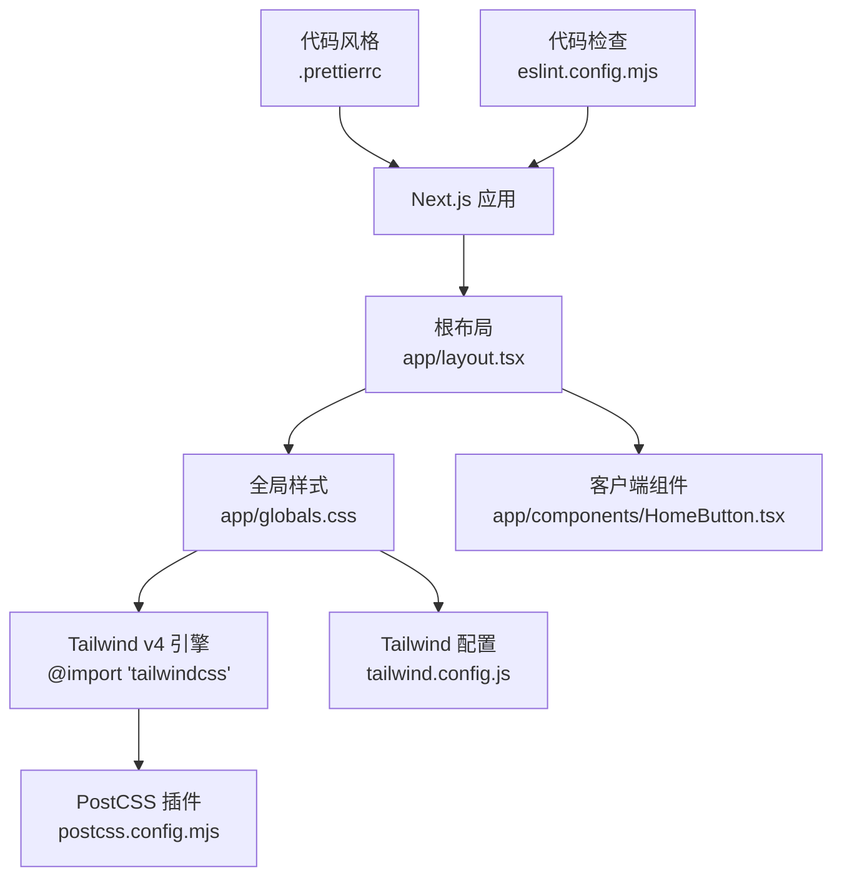
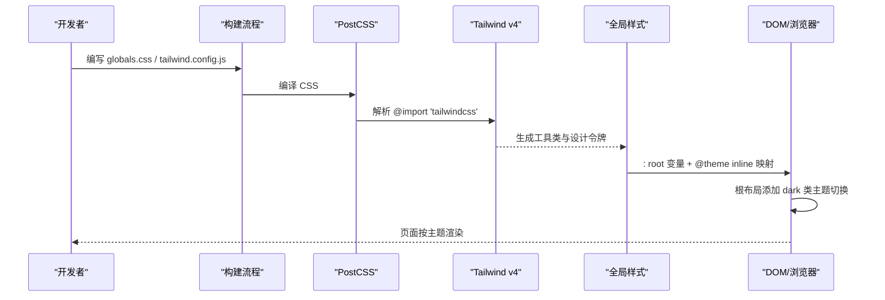
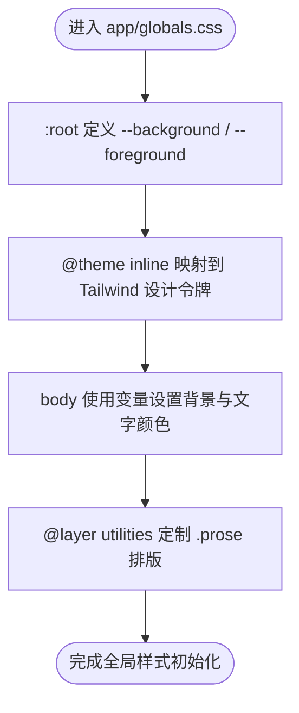
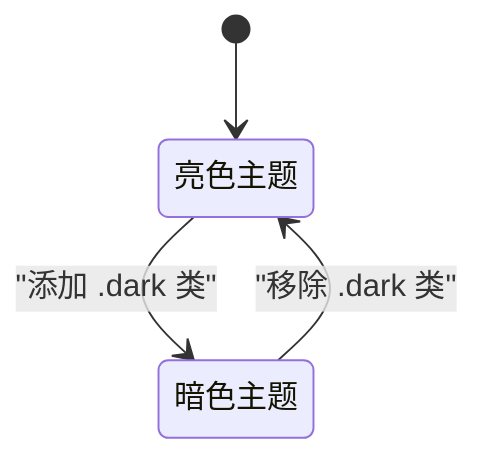
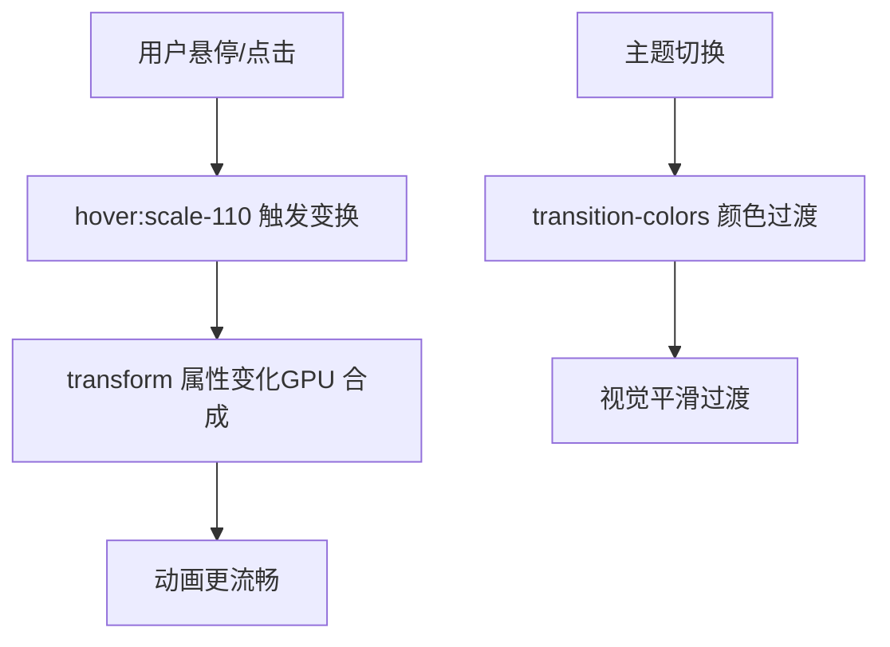
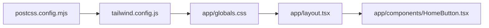

# 样式与主题

<cite>
**本文引用的文件**   
- [tailwind.config.js](file://tailwind.config.js)
- [postcss.config.mjs](file://postcss.config.mjs)
- [app/globals.css](file://app/globals.css)
- [app/layout.tsx](file://app/layout.tsx)
- [.prettierrc](file://.prettierrc)
- [eslint.config.mjs](file://eslint.config.mjs)
- [HomeButton.tsx](file://app/components/HomeButton.tsx)
</cite>

## 目录
1. [引言](#引言)
2. [项目结构](#项目结构)
3. [核心组件](#核心组件)
4. [架构总览](#架构总览)
5. [详细组件分析](#详细组件分析)
6. [依赖关系分析](#依赖关系分析)
7. [性能考虑](#性能考虑)
8. [故障排查指南](#故障排查指南)
9. [结论](#结论)
10. [附录：主题定制指南](#附录主题定制指南)

## 引言
本文件面向 HuRui.dev 博客项目的样式与主题系统，聚焦 Tailwind CSS 4 的配置与实践、全局样式组织、CSS 变量与主题切换机制、响应式策略、移动端适配、动画实现，以及 Prettier 与 ESLint 等开发体验相关的样式规范。目标是帮助读者快速理解并安全地扩展该项目的视觉系统与主题能力。

## 项目结构
本项目采用 Next.js App Router，样式体系围绕以下关键文件构建：
- 构建与样式工具链：PostCSS 配置、Tailwind 配置
- 全局样式与主题变量：全局 CSS 文件
- 根布局：应用级主题类名与过渡
- 客户端组件中的局部动画与交互样式
- 代码风格与质量规则：Prettier 与 ESLint

图表来源
- [app/layout.tsx:1-24](file://app/layout.tsx#L1-L24)
- [app/globals.css:1-159](file://app/globals.css#L1-L159)
- [postcss.config.mjs:1-8](file://postcss.config.mjs#L1-L8)
- [tailwind.config.js:1-9](file://tailwind.config.js#L1-L9)
- [HomeButton.tsx:1-37](file://app/components/HomeButton.tsx#L1-L37)

章节来源
- [app/layout.tsx:1-24](file://app/layout.tsx#L1-L24)
- [app/globals.css:1-159](file://app/globals.css#L1-L159)
- [postcss.config.mjs:1-8](file://postcss.config.mjs#L1-L8)
- [tailwind.config.js:1-9](file://tailwind.config.js#L1-L9)

## 核心组件
- Tailwind CSS 4 引擎与 PostCSS 集成：通过 `@import 'tailwindcss'` 引入 Tailwind v4 的 CSS-first 引擎，并由 PostCSS 处理。
- 设计令牌与主题映射：在 `app/globals.css` 中使用 `:root` 定义基础变量，并通过 `@theme inline` 将变量映射到 Tailwind 的设计令牌（如背景色、前景色、字体）。
- 暗色模式：Tailwind 配置启用 `darkMode: 'class'`，配合根布局中 body 的 `dark:` 变体实现明暗主题切换。
- Markdown 排版增强：基于 `@tailwindcss/typography` 的 `.prose` 进行内容排版定制，解决代码块、表格、图片、链接等内容的溢出与可读性问题。
- 客户端动画与交互：在组件内使用 Tailwind 工具类与自定义 keyframes 实现轻量动画。

章节来源
- [tailwind.config.js:1-9](file://tailwind.config.js#L1-L9)
- [postcss.config.mjs:1-8](file://postcss.config.mjs#L1-L8)
- [app/globals.css:1-159](file://app/globals.css#L1-L159)
- [app/layout.tsx:1-24](file://app/layout.tsx#L1-L24)
- [HomeButton.tsx:1-37](file://app/components/HomeButton.tsx#L1-L37)

## 架构总览
下图展示从构建到渲染的样式链路：PostCSS 调用 Tailwind v4 引擎，解析 `@import 'tailwindcss'`；Tailwind 读取 `tailwind.config.js` 中的插件与暗色模式设置；全局 CSS 通过 `@theme inline` 把 CSS 变量映射为 Tailwind 设计令牌；根布局提供 `dark` 类以驱动主题切换；组件层按需叠加工具类与自定义动画。

图表来源
- [postcss.config.mjs:1-8](file://postcss.config.mjs#L1-L8)
- [tailwind.config.js:1-9](file://tailwind.config.js#L1-L9)
- [app/globals.css:1-159](file://app/globals.css#L1-L159)
- [app/layout.tsx:1-24](file://app/layout.tsx#L1-L24)

## 详细组件分析

### Tailwind CSS 4 配置与使用
- 引入方式：通过 `@import 'tailwindcss'` 引入 Tailwind v4 的 CSS-first 引擎，不再需要传统的三个指令。
- 插件：启用 `@tailwindcss/typography`，用于 Markdown 内容排版。
- 暗色模式：设置为 `class`，即通过给根元素添加 `dark` 类来切换暗色主题。
- PostCSS：使用 `@tailwindcss/postcss` 插件处理 Tailwind v4。

章节来源
- [tailwind.config.js:1-9](file://tailwind.config.js#L1-L9)
- [postcss.config.mjs:1-8](file://postcss.config.mjs#L1-L8)
- [app/globals.css:1-2](file://app/globals.css#L1-L2)

### 全局样式与主题变量
- 基础变量：在 `:root` 中定义 `--background` 与 `--foreground`，作为全站色彩基线。
- 设计令牌映射：使用 `@theme inline` 将 CSS 变量映射到 Tailwind 的 `--color-background`、`--color-foreground` 以及字体令牌，从而让 Tailwind 工具类直接消费这些变量。
- 主体样式：body 使用 CSS 变量设置背景与文字颜色，并设置横向滚动兜底，防止内容溢出。
- Markdown 排版：在 `@layer utilities` 中定制 `.prose` 下的段落、标题、代码块、行内代码、图片、表格、链接、列表等样式，确保内容在不同屏幕下可读且不撑破布局。

图表来源
- [app/globals.css:4-14](file://app/globals.css#L4-L14)
- [app/globals.css:16-23](file://app/globals.css#L16-L23)
- [app/globals.css:27-158](file://app/globals.css#L27-L158)

章节来源
- [app/globals.css:1-159](file://app/globals.css#L1-L159)

### 主题切换机制（明/暗）
- 配置层面：Tailwind 启用 `darkMode: 'class'`，表示通过类名控制暗色主题。
- 运行层面：根布局的 body 同时包含亮色与暗色的 Tailwind 变体类，例如背景与文字颜色在 `bg-white` 与 `dark:bg-gray-900` 之间切换，并使用 `transition-colors duration-300` 实现平滑过渡。
- 变量层面：`.dark` 作用域可覆盖 `:root` 中的同名变量，从而实现整站换肤。

图表来源
- [tailwind.config.js:3-6](file://tailwind.config.js#L3-L6)
- [app/layout.tsx:16-22](file://app/layout.tsx#L16-L22)
- [app/globals.css:4-14](file://app/globals.css#L4-L14)

章节来源
- [tailwind.config.js:1-9](file://tailwind.config.js#L1-L9)
- [app/layout.tsx:1-24](file://app/layout.tsx#L1-L24)
- [app/globals.css:1-159](file://app/globals.css#L1-L159)

### 响应式设计与移动端适配
- 移动优先：Tailwind 默认移动优先，基础样式作用于最小屏，通过断点前缀（如 `sm:`、`md:`、`lg:`）逐步增强。
- 内容防溢出：对 `.prose` 及其子元素设置 `max-width: 100%`、`break-words`，并对代码块启用 `overflow-x: auto`，避免长代码或宽表格撑破布局。
- 表格优化：通过外层包装器与 `width: max-content`、`min-width: 100%` 的组合，使表格在小屏下可横向滚动而不破坏整体布局。
- 图片自适应：图片设置 `max-width: 100%` 与 `height: auto`，保证在不同视口下比例正确且不会溢出。

章节来源
- [app/globals.css:27-158](file://app/globals.css#L27-L158)

### 动画效果实现
- 组件内自定义动画：在客户端组件中使用 `<style jsx>` 定义 keyframes，并通过 Tailwind 工具类组合实现悬停缩放、弹跳等动效。
- 过渡与合成：根布局使用 `transition-colors duration-300` 实现主题切换时的颜色过渡；组件按钮使用 `transform` 与 `hover:scale-*` 触发 GPU 合成，提升动画流畅度。

图表来源
- [HomeButton.tsx:5-37](file://app/components/HomeButton.tsx#L5-L37)
- [app/layout.tsx:16-22](file://app/layout.tsx#L16-L22)

章节来源
- [HomeButton.tsx:1-37](file://app/components/HomeButton.tsx#L1-L37)
- [app/layout.tsx:1-24](file://app/layout.tsx#L1-L24)

### 代码格式化与 ESLint 规则
- Prettier：统一代码风格，包括分号、单引号、尾逗号、打印宽度、缩进等。
- ESLint：集成 Next.js Web Vitals 与 TypeScript 规则，并关闭默认忽略路径中与构建产物相关的目录；同时启用 `eslint-config-prettier` 以避免与 Prettier 冲突。

章节来源
- [.prettierrc:1-9](file://.prettierrc#L1-L9)
- [eslint.config.mjs:1-21](file://eslint.config.mjs#L1-L21)

## 依赖关系分析
样式相关模块之间的依赖如下：
- PostCSS 负责调用 Tailwind v4 引擎。
- Tailwind 读取配置文件，启用 typography 插件与暗色模式。
- 全局样式通过 `@theme inline` 将 CSS 变量映射到 Tailwind 设计令牌。
- 根布局提供主题切换所需的类名与过渡。
- 组件层复用 Tailwind 工具类与自定义动画。

图表来源
- [postcss.config.mjs:1-8](file://postcss.config.mjs#L1-L8)
- [tailwind.config.js:1-9](file://tailwind.config.js#L1-L9)
- [app/globals.css:1-159](file://app/globals.css#L1-L159)
- [app/layout.tsx:1-24](file://app/layout.tsx#L1-L24)
- [HomeButton.tsx:1-37](file://app/components/HomeButton.tsx#L1-L37)

章节来源
- [postcss.config.mjs:1-8](file://postcss.config.mjs#L1-L8)
- [tailwind.config.js:1-9](file://tailwind.config.js#L1-L9)
- [app/globals.css:1-159](file://app/globals.css#L1-L159)
- [app/layout.tsx:1-24](file://app/layout.tsx#L1-L24)
- [HomeButton.tsx:1-37](file://app/components/HomeButton.tsx#L1-L37)

## 性能考虑
- 首屏加载：Tailwind v4 通过 CSS-first 引擎减少构建复杂度；合理使用媒体查询拆分非关键样式可减少阻塞。
- 渲染路径：避免在动画中修改触发布局的属性（如 width、margin），优先使用 transform 与 opacity 走合成层。
- 合成层优化：对频繁变化的元素谨慎使用 will-change，避免内存暴涨；长列表可使用 content-visibility 跳过屏幕外渲染。
- 选择器与重排范围：避免过深的后代选择器；对频繁变化的元素脱离文档流以减少重排波及范围。

[本节为通用指导，不直接分析具体文件]

## 故障排查指南
- 主题未生效
  - 检查 Tailwind 是否启用 `darkMode: 'class'`。
  - 确认根布局或根元素是否存在 `dark` 类。
  - 验证 `@theme inline` 是否正确映射了 `--color-background`、`--color-foreground`。
- 内容溢出
  - 检查 `.prose *` 是否设置了 `max-width: 100%`。
  - 确认代码块与表格是否启用了横向滚动容器。
- 动画卡顿
  - 检查是否使用了 transform/opacity 而非 left/top/margin 等触发布局的属性。
  - 避免在循环中交替读写几何属性导致布局抖动。
- 样式优先级问题
  - 确认自定义样式位于 `@layer utilities`，与 Tailwind 工具类同层并按源码顺序生效。

章节来源
- [tailwind.config.js:1-9](file://tailwind.config.js#L1-L9)
- [app/globals.css:1-159](file://app/globals.css#L1-L159)
- [app/layout.tsx:1-24](file://app/layout.tsx#L1-L24)
- [HomeButton.tsx:1-37](file://app/components/HomeButton.tsx#L1-L37)

## 结论
本项目以 Tailwind CSS 4 为核心，结合 PostCSS 与 Next.js 根布局，构建了清晰的主题与样式体系。通过 CSS 变量与 `@theme inline` 的设计令牌映射，实现了可扩展的颜色与字体系统；通过 `darkMode: 'class'` 与根布局类名，完成了明暗主题的平滑切换；通过对 `.prose` 的精细化定制，确保了 Markdown 内容在各种设备上的可读性与稳定性；在动画方面，遵循合成层优化原则，提升了用户体验。配合 Prettier 与 ESLint，进一步保障了代码风格一致性与质量。

[本节为总结性内容，不直接分析具体文件]

## 附录：主题定制指南
- 修改颜色方案
  - 在 `:root` 中调整 `--background`、`--foreground` 或其他语义化变量。
  - 如需新增品牌色，可在 `@theme inline` 中新增 `--color-brand` 并映射到对应变量，随后在组件中使用 `bg-brand`、`text-brand` 等工具类。
- 修改字体样式
  - 在 `@theme inline` 中调整 `--font-sans`、`--font-mono`，使其指向新的字体变量或字体族。
- 调整布局间距
  - 若需统一间距基准，可在 `:root` 中定义间距变量并在 `@theme inline` 中映射到 Tailwind 的 spacing 令牌；或在组件中直接使用 Tailwind 的间距工具类。
- 扩展暗色主题
  - 在 `.dark` 作用域中覆盖 `:root` 的同名变量，或使用 Tailwind 的 `dark:` 变体类为组件指定暗色样式。
- 新增排版样式
  - 在 `@layer utilities` 中追加 `.prose` 的子规则，保持与现有样式一致的层级与命名约定。

章节来源
- [app/globals.css:4-14](file://app/globals.css#L4-L14)
- [app/globals.css:27-158](file://app/globals.css#L27-L158)
- [tailwind.config.js:1-9](file://tailwind.config.js#L1-L9)