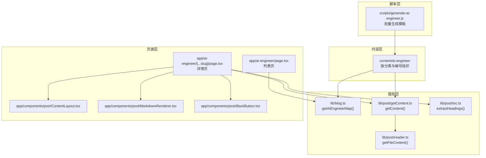
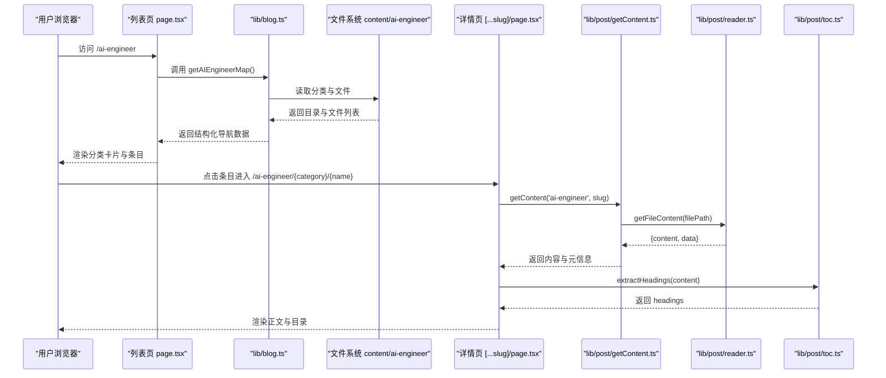
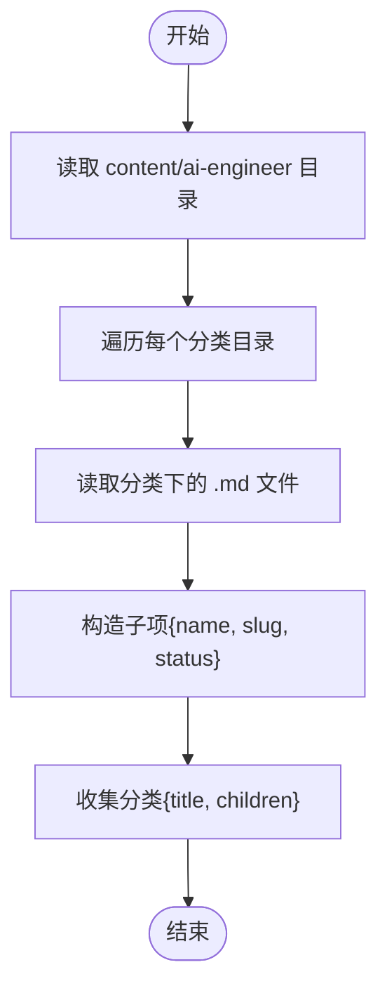
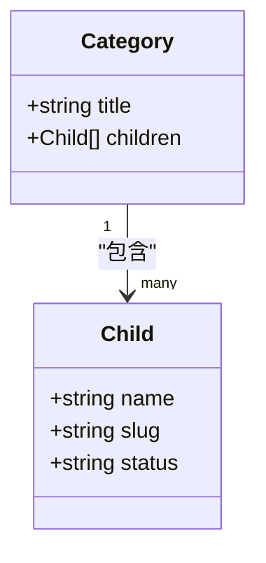
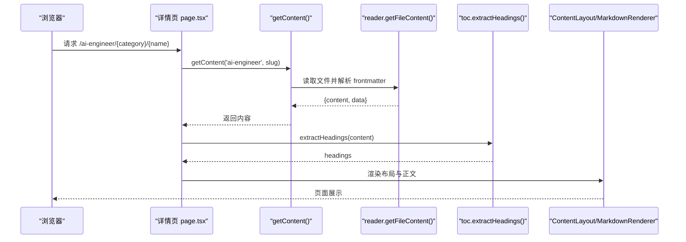
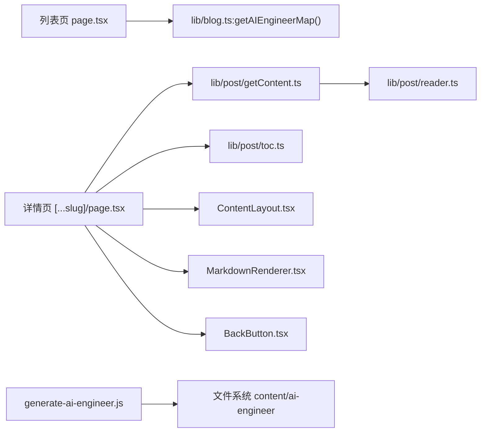
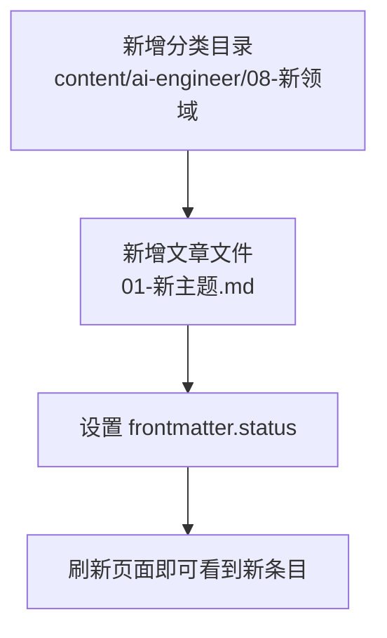

# AI 工程文档

<cite>
**本文引用的文件**   
- [app/ai-engineer/page.tsx](file://app/ai-engineer/page.tsx)
- [app/ai-engineer/[...slug]/page.tsx](file://app/ai-engineer/[...slug]/page.tsx)
- [lib/blog.ts](file://lib/blog.ts)
- [lib/post/getContent.ts](file://lib/post/getContent.ts)
- [lib/post/toc.ts](file://lib/post/toc.ts)
- [lib/post/reader.ts](file://lib/post/reader.ts)
- [scripts/generate-ai-engineer.js](file://scripts/generate-ai-engineer.js)
- [app/components/post/ContentLayout.tsx](file://app/components/post/ContentLayout.tsx)
- [app/components/post/MarkdownRenderer.tsx](file://app/components/post/MarkdownRenderer.tsx)
- [app/components/post/BackButton.tsx](file://app/components/post/BackButton.tsx)
</cite>

## 目录
1. [引言](#引言)
2. [项目结构](#项目结构)
3. [核心组件](#核心组件)
4. [架构总览](#架构总览)
5. [详细组件分析](#详细组件分析)
6. [依赖关系分析](#依赖关系分析)
7. [性能与体验优化](#性能与体验优化)
8. [故障排查指南](#故障排查指南)
9. [结论](#结论)
10. [附录：配置示例与扩展指南](#附录配置示例与扩展指南)

## 引言
本文件面向“AI 工程知识体系”的构建、组织与展示，系统性说明以下内容：
- getAIEngineerMap() 的工作机制与数据生成流程
- AI 技术栈的分类体系、学习路径规划与内容编排策略
- AI 工程页面的路由设计、动态内容加载与用户体验优化
- 知识的层次结构、章节关联与导航逻辑
- 状态管理与进度跟踪（基于 frontmatter 的状态字段）
- 如何添加新的 AI 技术主题和学习模块

## 项目结构
AI 工程文档采用“文件系统即内容源”的模式：
- 内容位于 content/ai-engineer 下，按“编号-分类名”的文件夹组织
- 每个分类目录下存放若干 .md 文章，文件名以“编号-标题.md”命名
- 运行时通过 Node fs 扫描目录，自动生成导航映射与页面路由
- 详情页使用 Next.js 的动态路由 [...slug] 渲染 Markdown 内容

图表来源
- [lib/blog.ts:108-133](file://lib/blog.ts#L108-L133)
- [lib/post/getContent.ts:1-21](file://lib/post/getContent.ts#L1-L21)
- [lib/post/reader.ts:1-12](file://lib/post/reader.ts#L1-L12)
- [lib/post/toc.ts:1-23](file://lib/post/toc.ts#L1-L23)
- [app/ai-engineer/page.tsx:1-62](file://app/ai-engineer/page.tsx#L1-L62)
- [app/ai-engineer/[...slug]/page.tsx:1-45](file://app/ai-engineer/[...slug]/page.tsx#L1-L45)
- [app/components/post/ContentLayout.tsx:1-31](file://app/components/post/ContentLayout.tsx#L1-L31)
- [app/components/post/MarkdownRenderer.tsx:1-40](file://app/components/post/MarkdownRenderer.tsx#L1-L40)
- [app/components/post/BackButton.tsx:1-30](file://app/components/post/BackButton.tsx#L1-L30)
- [scripts/generate-ai-engineer.js:1-221](file://scripts/generate-ai-engineer.js#L1-L221)

章节来源
- [app/ai-engineer/page.tsx:1-62](file://app/ai-engineer/page.tsx#L1-L62)
- [app/ai-engineer/[...slug]/page.tsx:1-45](file://app/ai-engineer/[...slug]/page.tsx#L1-L45)
- [lib/blog.ts:108-133](file://lib/blog.ts#L108-L133)
- [lib/post/getContent.ts:1-21](file://lib/post/getContent.ts#L1-L21)
- [lib/post/reader.ts:1-12](file://lib/post/reader.ts#L1-L12)
- [lib/post/toc.ts:1-23](file://lib/post/toc.ts#L1-L23)
- [scripts/generate-ai-engineer.js:1-221](file://scripts/generate-ai-engineer.js#L1-L221)

## 核心组件
- 列表页：读取 AI 工程知识地图并渲染分类与条目
- 详情页：根据动态路由解析 slug，加载对应 Markdown 内容，提取目录并渲染
- 内容读取：统一封装对 content 目录的访问，支持 blog/knowledge/ai-engineer 三类内容
- 目录提取：从 Markdown 文本中抽取 1-3 级标题，生成 TOC 数据结构
- 渲染器：将 Markdown 渲染为 HTML，处理链接、表格、代码高亮等
- 返回按钮：根据来源参数智能返回上一页或回退到默认入口
- 生成脚本：按预设的知识体系结构批量生成文章模板

章节来源
- [app/ai-engineer/page.tsx:1-62](file://app/ai-engineer/page.tsx#L1-L62)
- [app/ai-engineer/[...slug]/page.tsx:1-45](file://app/ai-engineer/[...slug]/page.tsx#L1-L45)
- [lib/post/getContent.ts:1-21](file://lib/post/getContent.ts#L1-L21)
- [lib/post/toc.ts:1-23](file://lib/post/toc.ts#L1-L23)
- [app/components/post/MarkdownRenderer.tsx:1-40](file://app/components/post/MarkdownRenderer.tsx#L1-L40)
- [app/components/post/BackButton.tsx:1-30](file://app/components/post/BackButton.tsx#L1-L30)
- [scripts/generate-ai-engineer.js:1-221](file://scripts/generate-ai-engineer.js#L1-L221)

## 架构总览
AI 工程文档的整体架构分为四层：
- 内容层：Markdown 文件按“编号-分类”组织，体现学习路径与难度梯度
- 服务层：提供目录扫描、内容读取、TOC 提取等能力
- 页面层：Next.js 列表页与详情页负责路由与渲染
- 工具层：生成脚本用于快速搭建知识骨架

图表来源
- [app/ai-engineer/page.tsx:1-62](file://app/ai-engineer/page.tsx#L1-L62)
- [lib/blog.ts:108-133](file://lib/blog.ts#L108-L133)
- [app/ai-engineer/[...slug]/page.tsx:1-45](file://app/ai-engineer/[...slug]/page.tsx#L1-L45)
- [lib/post/getContent.ts:1-21](file://lib/post/getContent.ts#L1-L21)
- [lib/post/reader.ts:1-12](file://lib/post/reader.ts#L1-L12)
- [lib/post/toc.ts:1-23](file://lib/post/toc.ts#L1-L23)

## 详细组件分析

### getAIEngineerMap() 工作机制
- 功能：扫描 content/ai-engineer 目录，按分类与文件顺序生成导航树
- 输出结构：每个分类包含 title 与 children；children 中的每项包含 name、slug、status
- 状态来源：从每篇文章的 frontmatter 中读取 status（outline/draft/done），未设置时默认为 outline
- 排序规则：分类与文件均按字典序排序，保证稳定的展示顺序

图表来源
- [lib/blog.ts:108-133](file://lib/blog.ts#L108-L133)

章节来源
- [lib/blog.ts:108-133](file://lib/blog.ts#L108-L133)

### AI 技术栈的组织结构与内容管理
- 分类体系：以“编号-分类名”作为一级目录，体现学习阶段与领域划分
- 文件命名：以“编号-标题.md”命名，便于排序与阅读
- 内容模板：通过 generate-ai-engineer.js 批量生成基础篇与进阶篇模板，保持结构一致
- 状态管理：frontmatter 的 status 字段标记完成度，用于前端展示“待完善”标签

图表来源
- [lib/blog.ts:108-133](file://lib/blog.ts#L108-L133)
- [scripts/generate-ai-engineer.js:100-178](file://scripts/generate-ai-engineer.js#L100-L178)

章节来源
- [lib/blog.ts:108-133](file://lib/blog.ts#L108-L133)
- [scripts/generate-ai-engineer.js:1-221](file://scripts/generate-ai-engineer.js#L1-L221)

### AI 工程页面的路由设计与动态内容加载
- 列表路由：/ai-engineer 由 app/ai-engineer/page.tsx 渲染，调用 getAIEngineerMap() 获取导航数据
- 详情路由：/ai-engineer/{category}/{name} 由 app/ai-engineer/[...slug]/page.tsx 处理
- 内容加载：详情页通过 getContent('ai-engineer', slug) 读取 Markdown 内容与 frontmatter
- 目录生成：使用 extractHeadings() 从正文中提取 1-3 级标题，供侧边栏 TOC 使用
- 渲染管线：ContentLayout 提供布局与 TOC，MarkdownRenderer 渲染正文，BackButton 提供返回

图表来源
- [app/ai-engineer/[...slug]/page.tsx:1-45](file://app/ai-engineer/[...slug]/page.tsx#L1-L45)
- [lib/post/getContent.ts:1-21](file://lib/post/getContent.ts#L1-L21)
- [lib/post/reader.ts:1-12](file://lib/post/reader.ts#L1-L12)
- [lib/post/toc.ts:1-23](file://lib/post/toc.ts#L1-L23)
- [app/components/post/ContentLayout.tsx:1-31](file://app/components/post/ContentLayout.tsx#L1-L31)
- [app/components/post/MarkdownRenderer.tsx:1-40](file://app/components/post/MarkdownRenderer.tsx#L1-L40)

章节来源
- [app/ai-engineer/[...slug]/page.tsx:1-45](file://app/ai-engineer/[...slug]/page.tsx#L1-L45)
- [lib/post/getContent.ts:1-21](file://lib/post/getContent.ts#L1-L21)
- [lib/post/toc.ts:1-23](file://lib/post/toc.ts#L1-L23)
- [app/components/post/ContentLayout.tsx:1-31](file://app/components/post/ContentLayout.tsx#L1-L31)
- [app/components/post/MarkdownRenderer.tsx:1-40](file://app/components/post/MarkdownRenderer.tsx#L1-L40)

### 用户体验优化
- 目录导航：桌面端显示固定侧边栏 TOC，移动端隐藏以提升可读性
- 链接处理：内部链接使用 Next Link 进行客户端跳转，外部链接在新窗口打开
- 表格与代码：表格包裹滚动容器，代码块启用语法高亮
- 返回逻辑：根据 URL 参数 from 决定返回目标，否则回退到 /ai-engineer

章节来源
- [app/components/post/ContentLayout.tsx:1-31](file://app/components/post/ContentLayout.tsx#L1-L31)
- [app/components/post/MarkdownRenderer.tsx:1-40](file://app/components/post/MarkdownRenderer.tsx#L1-L40)
- [app/components/post/BackButton.tsx:1-30](file://app/components/post/BackButton.tsx#L1-L30)

## 依赖关系分析
- 列表页依赖 lib/blog.ts 提供的 getAIEngineerMap()
- 详情页依赖 lib/post/getContent.ts 与 lib/post/reader.ts 读取内容
- 目录生成依赖 lib/post/toc.ts 的 extractHeadings()
- 渲染依赖 app/components/post/* 组件组合
- 生成脚本独立于运行期，仅用于初始化内容骨架

图表来源
- [app/ai-engineer/page.tsx:1-62](file://app/ai-engineer/page.tsx#L1-L62)
- [app/ai-engineer/[...slug]/page.tsx:1-45](file://app/ai-engineer/[...slug]/page.tsx#L1-L45)
- [lib/blog.ts:108-133](file://lib/blog.ts#L108-L133)
- [lib/post/getContent.ts:1-21](file://lib/post/getContent.ts#L1-L21)
- [lib/post/reader.ts:1-12](file://lib/post/reader.ts#L1-L12)
- [lib/post/toc.ts:1-23](file://lib/post/toc.ts#L1-L23)
- [app/components/post/ContentLayout.tsx:1-31](file://app/components/post/ContentLayout.tsx#L1-L31)
- [app/components/post/MarkdownRenderer.tsx:1-40](file://app/components/post/MarkdownRenderer.tsx#L1-L40)
- [app/components/post/BackButton.tsx:1-30](file://app/components/post/BackButton.tsx#L1-L30)
- [scripts/generate-ai-engineer.js:1-221](file://scripts/generate-ai-engineer.js#L1-L221)

章节来源
- [app/ai-engineer/page.tsx:1-62](file://app/ai-engineer/page.tsx#L1-L62)
- [app/ai-engineer/[...slug]/page.tsx:1-45](file://app/ai-engineer/[...slug]/page.tsx#L1-L45)
- [lib/blog.ts:108-133](file://lib/blog.ts#L108-L133)
- [lib/post/getContent.ts:1-21](file://lib/post/getContent.ts#L1-L21)
- [lib/post/reader.ts:1-12](file://lib/post/reader.ts#L1-L12)
- [lib/post/toc.ts:1-23](file://lib/post/toc.ts#L1-L23)
- [scripts/generate-ai-engineer.js:1-221](file://scripts/generate-ai-engineer.js#L1-L221)

## 性能与体验优化
- 目录与文件排序：使用默认排序保证稳定展示，避免频繁重排
- 内容读取：服务端同步读取文件，适合静态站点场景；若规模扩大可考虑缓存或增量构建
- 渲染优化：Markdown 渲染插件按需启用（GFM、高亮、自动锚点），减少不必要的处理
- 交互优化：内部链接使用客户端跳转，提升切换速度；外部链接新窗口打开，避免跳出站点

[本节为通用建议，不直接分析具体文件]

## 故障排查指南
- 404 Not Found：当 getContent 无法找到对应文件时会返回空值，详情页会显示 404。检查 slug 是否与文件路径一致，注意中文路径的编码解码逻辑
- 目录为空或分类缺失：确认 content/ai-engineer 下是否存在对应分类目录与 .md 文件，且命名符合“编号-标题.md”规范
- 状态显示异常：确保文章 frontmatter 中包含 status 字段（outline/draft/done），否则默认显示为 outline
- 链接跳转异常：MarkdownRenderer 会将以“/”开头的链接识别为内部链接并使用 Next Link；外部链接会在新窗口打开

章节来源
- [app/ai-engineer/[...slug]/page.tsx:1-45](file://app/ai-engineer/[...slug]/page.tsx#L1-L45)
- [lib/post/getContent.ts:1-21](file://lib/post/getContent.ts#L1-L21)
- [lib/blog.ts:72-81](file://lib/blog.ts#L72-L81)
- [app/components/post/MarkdownRenderer.tsx:1-40](file://app/components/post/MarkdownRenderer.tsx#L1-L40)

## 结论
本系统通过“文件系统即内容源”的方式，结合 Next.js 的动态路由与统一的读取/渲染管线，构建了可扩展的 AI 工程知识体系。getAIEngineerMap() 将目录结构转化为导航数据，详情页按需加载内容并生成目录，配合模板脚本与状态字段，实现了从内容生产到展示的完整闭环。该架构具备良好的可维护性与扩展性，适合持续演进 AI 工程知识图谱。

[本节为总结性内容，不直接分析具体文件]

## 附录：配置示例与扩展指南

### 添加新的 AI 技术主题与学习模块
- 在 content/ai-engineer 下新增分类目录，命名遵循“编号-分类名”，例如“08-新领域”
- 在该分类下新增 .md 文件，命名遵循“编号-标题.md”，例如“01-新主题.md”
- 在 frontmatter 中设置 status 字段（outline/draft/done），用于控制前端“待完善”标签
- 重新运行生成脚本（可选）：scripts/generate-ai-engineer.js 会根据 structure 配置批量生成模板，不会覆盖已有文件

图表来源
- [scripts/generate-ai-engineer.js:183-218](file://scripts/generate-ai-engineer.js#L183-L218)
- [lib/blog.ts:108-133](file://lib/blog.ts#L108-L133)

章节来源
- [scripts/generate-ai-engineer.js:1-221](file://scripts/generate-ai-engineer.js#L1-L221)
- [lib/blog.ts:108-133](file://lib/blog.ts#L108-L133)

### 学习路径规划与内容编排策略
- 基础篇（00-AI基础）：聚焦概念定义、关键特征与常见误区，帮助读者建立直观理解
- 进阶篇（01-07）：围绕原理、工作流程、工程实践展开，强调可控性、性能影响与应用场景
- 编号前缀：用于控制排序与学习顺序，建议按认知难度递增编排
- 状态字段：通过 status 区分“待完善/草稿/已完成”，便于团队协作与进度追踪

章节来源
- [scripts/generate-ai-engineer.js:9-95](file://scripts/generate-ai-engineer.js#L9-L95)
- [scripts/generate-ai-engineer.js:100-178](file://scripts/generate-ai-engineer.js#L100-L178)
- [lib/blog.ts:72-81](file://lib/blog.ts#L72-L81)