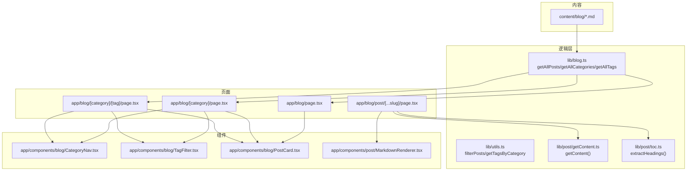
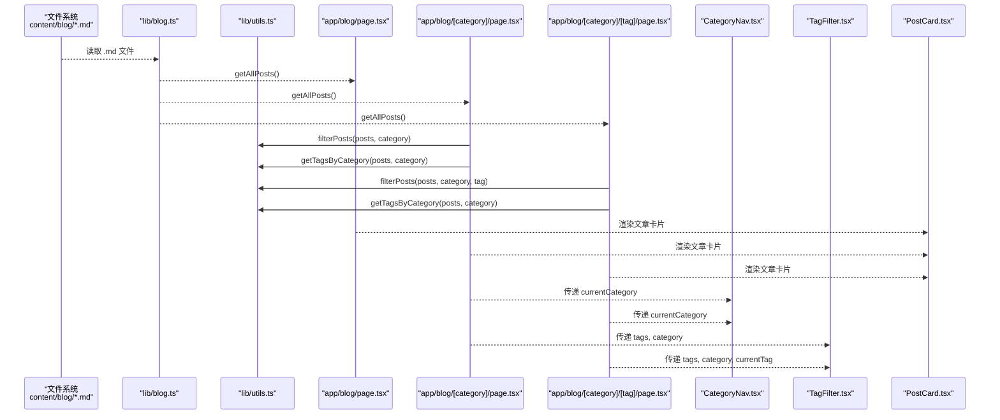
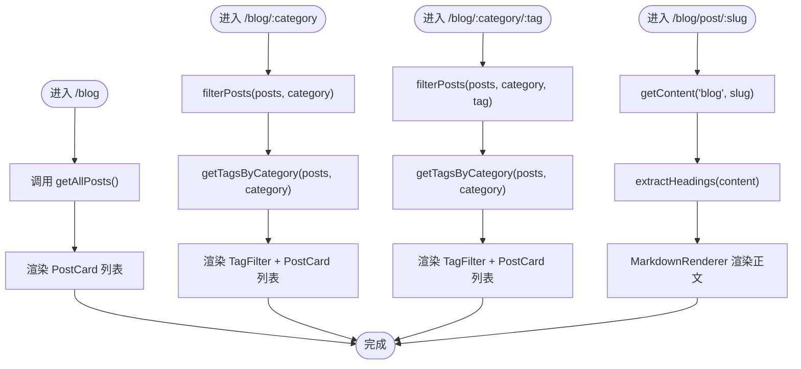
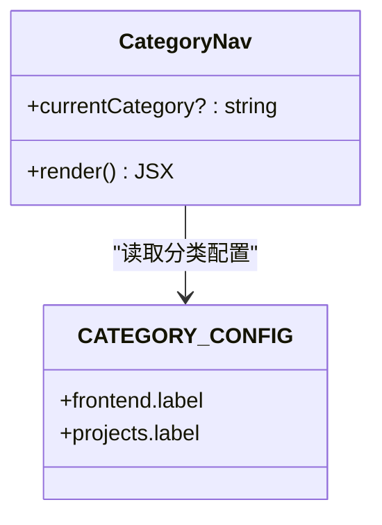
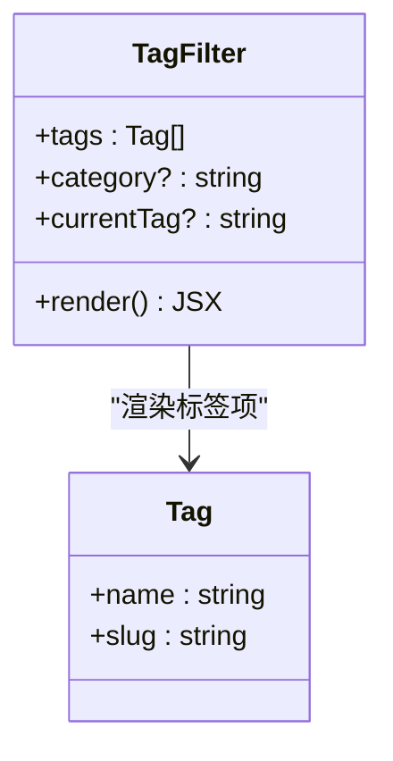
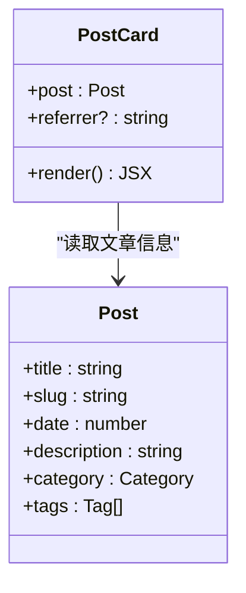
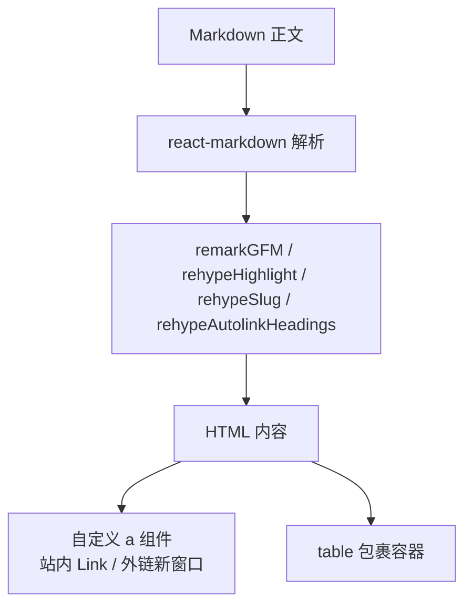
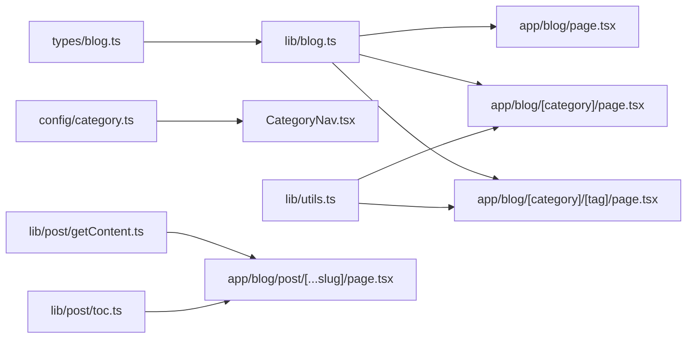

# 博客文章系统

<cite>
**本文引用的文件**   
- [lib/blog.ts](file://lib/blog.ts)
- [types/blog.ts](file://types/blog.ts)
- [config/category.ts](file://config/category.ts)
- [config/tag.ts](file://config/tag.ts)
- [app/components/blog/CategoryNav.tsx](file://app/components/blog/CategoryNav.tsx)
- [app/components/blog/TagFilter.tsx](file://app/components/blog/TagFilter.tsx)
- [app/components/blog/PostCard.tsx](file://app/components/blog/PostCard.tsx)
- [app/blog/page.tsx](file://app/blog/page.tsx)
- [app/blog/[category]/page.tsx](file://app/blog/[category]/page.tsx)
- [app/blog/[category]/[tag]/page.tsx](file://app/blog/[category]/[tag]/page.tsx)
- [app/blog/post/[...slug]/page.tsx](file://app/blog/post/[...slug]/page.tsx)
- [lib/utils.ts](file://lib/utils.ts)
- [lib/post/getContent.ts](file://lib/post/getContent.ts)
- [lib/post/toc.ts](file://lib/post/toc.ts)
- [app/components/post/MarkdownRenderer.tsx](file://app/components/post/MarkdownRenderer.tsx)
</cite>

## 目录
1. [简介](#简介)
2. [项目结构](#项目结构)
3. [核心组件与数据流](#核心组件与数据流)
4. [架构总览](#架构总览)
5. [详细组件分析](#详细组件分析)
6. [依赖关系分析](#依赖关系分析)
7. [性能考量](#性能考量)
8. [故障排查指南](#故障排查指南)
9. [结论](#结论)
10. [附录：使用示例与最佳实践](#附录使用示例与最佳实践)

## 简介
本博客文章系统基于 Next.js App Router，采用文件系统即内容（Filesystem as Content）的方式管理 Markdown 文章。系统通过读取 content 目录下的 Markdown 文件，解析 frontmatter，生成文章列表、分类与标签，并提供分类导航、标签筛选与文章卡片等 UI 组件。同时支持按分类和标签进行过滤，以及单篇文章的渲染与目录生成。

## 项目结构
- 内容层
  - content/blog：博客文章目录，每篇 Markdown 文件包含 frontmatter（title、date、description、category、tags 等）。
  - content/frontend-knowledge、content/ai-engineer：知识体系与 AI 工程化内容（非本次重点）。
- 逻辑层
  - lib/blog.ts：扫描 blog 目录、解析 frontmatter、生成 Post 列表、提取分类与标签。
  - lib/utils.ts：分类过滤、标签去重、标签格式化等工具函数。
  - lib/post/getContent.ts：根据 slug 读取具体文章内容。
  - lib/post/toc.ts：从 Markdown 正文中提取标题生成目录。
- 类型与配置
  - types/blog.ts：定义 Category、Tag、Post 等类型。
  - config/category.ts、config/tag.ts：分类与标签的配置映射（用于 UI 展示）。
- 页面与组件
  - app/blog/*：博客首页、分类页、分类+标签页、文章详情页。
  - app/components/blog/*：分类导航、标签筛选、文章卡片。
  - app/components/post/*：内容布局、Markdown 渲染、返回按钮等。

图表来源
- [lib/blog.ts:24-70](file://lib/blog.ts#L24-L70)
- [lib/utils.ts:3-33](file://lib/utils.ts#L3-L33)
- [lib/post/getContent.ts:6-19](file://lib/post/getContent.ts#L6-L19)
- [lib/post/toc.ts:7-21](file://lib/post/toc.ts#L7-L21)
- [app/blog/page.tsx:6-19](file://app/blog/page.tsx#L6-L19)
- [app/blog/[category]/page.tsx:9-34](file://app/blog/[category]/page.tsx#L9-L34)
- [app/blog/[category]/[tag]/page.tsx:9-34](file://app/blog/[category]/[tag]/page.tsx#L9-L34)
- [app/blog/post/[...slug]/page.tsx:11-27](file://app/blog/post/[...slug]/page.tsx#L11-L27)

章节来源
- [lib/blog.ts:1-134](file://lib/blog.ts#L1-L134)
- [lib/utils.ts:1-37](file://lib/utils.ts#L1-L37)
- [lib/post/getContent.ts:1-21](file://lib/post/getContent.ts#L1-L21)
- [lib/post/toc.ts:1-23](file://lib/post/toc.ts#L1-L23)
- [app/blog/page.tsx:1-21](file://app/blog/page.tsx#L1-L21)
- [app/blog/[category]/page.tsx:1-36](file://app/blog/[category]/page.tsx#L1-L36)
- [app/blog/[category]/[tag]/page.tsx:1-35](file://app/blog/[category]/[tag]/page.tsx#L1-L35)
- [app/blog/post/[...slug]/page.tsx:1-28](file://app/blog/post/[...slug]/page.tsx#L1-L28)

## 核心组件与数据流
- getAllPosts()
  - 递归扫描 content/blog 下所有 .md 文件。
  - 使用 gray-matter 解析 frontmatter，构造 Post 对象。
  - 计算 slug：相对路径去掉 .md 后缀，兼容 Windows 路径分隔符。
  - 日期处理：优先使用 frontmatter.date，否则使用当前时间；无效日期回退到 Date.now()。
  - 排序：按 date 降序排列（最新在前）。
- getAllCategories()
  - 基于 getAllPosts() 的结果，收集 category 字段并去重，返回包含“全部”的分类列表。
- getAllTags()
  - 遍历所有文章的 tags，收集 tag.name 去重，返回包含“all”的标签列表。
- filterPosts()
  - 按 category 与 tagSlug 双重过滤，支持仅分类、仅标签或两者组合。
- getTagsByCategory()
  - 在指定分类内对 tags 去重，返回 {name, slug} 列表供 TagFilter 使用。

章节来源
- [lib/blog.ts:24-70](file://lib/blog.ts#L24-L70)
- [lib/utils.ts:3-33](file://lib/utils.ts#L3-L33)

## 架构总览
下图展示了从 Markdown 文件到页面渲染的整体流程，包括分类与标签的生成、过滤与展示。

图表来源
- [lib/blog.ts:24-70](file://lib/blog.ts#L24-L70)
- [lib/utils.ts:3-33](file://lib/utils.ts#L3-L33)
- [app/blog/page.tsx:6-19](file://app/blog/page.tsx#L6-L19)
- [app/blog/[category]/page.tsx:9-34](file://app/blog/[category]/page.tsx#L9-L34)
- [app/blog/[category]/[tag]/page.tsx:9-34](file://app/blog/[category]/[tag]/page.tsx#L9-L34)

## 详细组件分析

### 文章列表与详情路由
- 博客首页
  - 调用 getAllPosts() 获取全部文章并按日期倒序。
  - 渲染 CategoryNav 与 PostCard 列表。
- 分类页
  - 接收 URL 参数 category，调用 filterPosts(posts, category) 得到该分类的文章。
  - 调用 getTagsByCategory(posts, category) 获取该分类下的标签集合，渲染 TagFilter。
- 分类+标签页
  - 接收 URL 参数 category 与 tag，调用 filterPosts(posts, category, tag) 得到过滤后的文章。
  - 同样渲染 TagFilter，并高亮当前标签。
- 文章详情页
  - 使用 getContent('blog', slugArray) 读取对应 Markdown 文件。
  - 使用 extractHeadings(post.content) 生成目录。
  - 通过 MarkdownRenderer 渲染正文，并处理外链与表格样式。

图表来源
- [app/blog/page.tsx:6-19](file://app/blog/page.tsx#L6-L19)
- [app/blog/[category]/page.tsx:9-34](file://app/blog/[category]/page.tsx#L9-L34)
- [app/blog/[category]/[tag]/page.tsx:9-34](file://app/blog/[category]/[tag]/page.tsx#L9-L34)
- [app/blog/post/[...slug]/page.tsx:11-27](file://app/blog/post/[...slug]/page.tsx#L11-L27)
- [lib/post/getContent.ts:6-19](file://lib/post/getContent.ts#L6-L19)
- [lib/post/toc.ts:7-21](file://lib/post/toc.ts#L7-L21)

章节来源
- [app/blog/page.tsx:1-21](file://app/blog/page.tsx#L1-L21)
- [app/blog/[category]/page.tsx:1-36](file://app/blog/[category]/page.tsx#L1-L36)
- [app/blog/[category]/[tag]/page.tsx:1-35](file://app/blog/[category]/[tag]/page.tsx#L1-L35)
- [app/blog/post/[...slug]/page.tsx:1-28](file://app/blog/post/[...slug]/page.tsx#L1-L28)

### 分类导航组件 CategoryNav
- 功能
  - 渲染“全部”与各分类链接。
  - 根据 currentCategory 高亮当前分类。
  - 链接目标：/blog 与 /blog/:category。
- 交互行为
  - 点击切换分类，URL 变化触发页面重新加载并显示对应分类文章。
- 数据来源
  - 使用 config/category.ts 中的 CATEGORY_CONFIG 提供分类 label。

图表来源
- [app/components/blog/CategoryNav.tsx:1-46](file://app/components/blog/CategoryNav.tsx#L1-L46)
- [config/category.ts:1-9](file://config/category.ts#L1-L9)

章节来源
- [app/components/blog/CategoryNav.tsx:1-46](file://app/components/blog/CategoryNav.tsx#L1-L46)
- [config/category.ts:1-9](file://config/category.ts#L1-L9)

### 标签筛选组件 TagFilter
- 功能
  - 渲染“全部”与各标签链接。
  - 根据 currentTag 高亮当前标签。
  - 链接目标：/blog 或 /blog/:category 或 /blog/:category/:tag。
- 数据来源
  - 由父页面传入 tags（来自 getTagsByCategory），确保只展示当前分类下的标签。

图表来源
- [app/components/blog/TagFilter.tsx:1-53](file://app/components/blog/TagFilter.tsx#L1-L53)
- [types/blog.ts:3-6](file://types/blog.ts#L3-L6)

章节来源
- [app/components/blog/TagFilter.tsx:1-53](file://app/components/blog/TagFilter.tsx#L1-L53)
- [types/blog.ts:1-16](file://types/blog.ts#L1-L16)

### 文章卡片组件 PostCard
- 渲染逻辑
  - 显示标题、日期与标签列表。
  - 描述文本最多两行显示（line-clamp-2）。
  - 点击跳转至 /blog/post/:slug，可选携带 from=referrer 参数以记录来源分类。
- 交互行为
  - hover 时边框与背景色变化，提升可点击感。

图表来源
- [app/components/blog/PostCard.tsx:1-44](file://app/components/blog/PostCard.tsx#L1-L44)
- [types/blog.ts:8-15](file://types/blog.ts#L8-L15)

章节来源
- [app/components/blog/PostCard.tsx:1-44](file://app/components/blog/PostCard.tsx#L1-L44)
- [types/blog.ts:1-16](file://types/blog.ts#L1-L16)

### Markdown 渲染与目录
- MarkdownRenderer
  - 使用 react-markdown 渲染 Markdown。
  - 启用 GFM、代码高亮、自动为标题添加锚点、外链在新窗口打开。
  - 自定义 a 与 table 组件，适配站内链接与表格滚动。
- extractHeadings
  - 正则匹配 # 到 ### 标题，生成目录项（level、text、id）。
  - id 为小写且空格替换为连字符，便于锚点定位。

图表来源
- [app/components/post/MarkdownRenderer.tsx:1-39](file://app/components/post/MarkdownRenderer.tsx#L1-L39)
- [lib/post/toc.ts:7-21](file://lib/post/toc.ts#L7-L21)

章节来源
- [app/components/post/MarkdownRenderer.tsx:1-39](file://app/components/post/MarkdownRenderer.tsx#L1-L39)
- [lib/post/toc.ts:1-23](file://lib/post/toc.ts#L1-L23)

## 依赖关系分析
- 模块耦合
  - 页面层依赖 lib/blog.ts 与 lib/utils.ts 提供数据与过滤能力。
  - 组件层依赖 types/blog.ts 的类型定义与 config/category.ts 的分类配置。
  - 文章详情页依赖 lib/post/getContent.ts 与 lib/post/toc.ts。
- 外部依赖
  - fs、path：文件系统与路径操作。
  - gray-matter：frontmatter 解析。
  - react-markdown、rehype-*、remark-gfm：Markdown 渲染与增强。
- 潜在循环依赖
  - 当前结构清晰，未见循环导入。

图表来源
- [types/blog.ts:1-16](file://types/blog.ts#L1-L16)
- [config/category.ts:1-9](file://config/category.ts#L1-L9)
- [lib/blog.ts:1-134](file://lib/blog.ts#L1-L134)
- [lib/utils.ts:1-37](file://lib/utils.ts#L1-L37)
- [lib/post/getContent.ts:1-21](file://lib/post/getContent.ts#L1-L21)
- [lib/post/toc.ts:1-23](file://lib/post/toc.ts#L1-L23)
- [app/blog/page.tsx:1-21](file://app/blog/page.tsx#L1-L21)
- [app/blog/[category]/page.tsx:1-36](file://app/blog/[category]/page.tsx#L1-L36)
- [app/blog/[category]/[tag]/page.tsx:1-35](file://app/blog/[category]/[tag]/page.tsx#L1-L35)
- [app/blog/post/[...slug]/page.tsx:1-28](file://app/blog/post/[...slug]/page.tsx#L1-L28)

章节来源
- [lib/blog.ts:1-134](file://lib/blog.ts#L1-L134)
- [lib/utils.ts:1-37](file://lib/utils.ts#L1-L37)
- [lib/post/getContent.ts:1-21](file://lib/post/getContent.ts#L1-L21)
- [lib/post/toc.ts:1-23](file://lib/post/toc.ts#L1-L23)
- [types/blog.ts:1-16](file://types/blog.ts#L1-L16)
- [config/category.ts:1-9](file://config/category.ts#L1-L9)
- [app/blog/page.tsx:1-21](file://app/blog/page.tsx#L1-L21)
- [app/blog/[category]/page.tsx:1-36](file://app/blog/[category]/page.tsx#L1-L36)
- [app/blog/[category]/[tag]/page.tsx:1-35](file://app/blog/[category]/[tag]/page.tsx#L1-L35)
- [app/blog/post/[...slug]/page.tsx:1-28](file://app/blog/post/[...slug]/page.tsx#L1-L28)

## 性能考量
- 文件 I/O
  - getAllPosts() 在构建期同步读取所有 Markdown 文件，适合静态站点；若文章数量极大，建议引入缓存或增量构建。
- 排序与过滤
  - 排序在内存中进行，复杂度 O(n log n)；过滤为 O(n)，整体开销较低。
- 渲染优化
  - PostCard 使用 Tailwind 类名减少 JS 样式开销。
  - MarkdownRenderer 按需启用插件，避免不必要的处理。

## 故障排查指南
- 文章不存在
  - 现象：文章详情页显示“文章不存在”。
  - 原因：getContent() 未找到对应 .md 文件或 slug 不匹配。
  - 排查：检查 URL slug 与 content 目录结构是否一致；确认文件名与路径大小写。
- 日期异常
  - 现象：文章日期显示为 1970 或当前时间。
  - 原因：frontmatter 中 date 字段无效或缺失。
  - 排查：确保 date 为有效 ISO 字符串；缺失时将回退到当前时间。
- 分类/标签为空
  - 现象：分类导航或标签筛选无选项。
  - 原因：CATEGORY_CONFIG 未配置或文章 frontmatter 缺少 category/tags。
  - 排查：补充 config/category.ts 配置；在 Markdown frontmatter 中添加 category 与 tags。
- 链接跳转异常
  - 现象：文章内链接未走 Next.js 路由或外链未新窗口打开。
  - 原因：MarkdownRenderer 自定义 a 组件逻辑未生效。
  - 排查：检查 href 是否为站内路径；确认 rehype 插件已启用。

章节来源
- [app/blog/post/[...slug]/page.tsx:11-27](file://app/blog/post/[...slug]/page.tsx#L11-L27)
- [lib/blog.ts:31-47](file://lib/blog.ts#L31-L47)
- [app/components/post/MarkdownRenderer.tsx:10-39](file://app/components/post/MarkdownRenderer.tsx#L10-L39)

## 结论
本博客系统以文件系统为中心，结合 Next.js 的 App Router 实现了高效的内容管理与展示。通过 getAllPosts()、getAllCategories()、getAllTags() 等核心函数，配合分类导航与标签筛选组件，提供了良好的浏览体验。文章详情页支持 Markdown 渲染与目录生成，满足技术博客的常见需求。建议在大规模内容场景下引入缓存与增量构建以提升性能。

## 附录：使用示例与最佳实践

### 如何添加新文章
- 在 content/blog 目录下创建新的 Markdown 文件，例如 content/blog/example.md。
- 在文件顶部添加 frontmatter，至少包含 title、date、description、category、tags。
- 刷新页面后，文章将出现在博客列表中，并按日期倒序排列。

参考实现位置
- [lib/blog.ts:24-50](file://lib/blog.ts#L24-L50)

### 如何配置分类与标签
- 分类
  - 在 config/category.ts 中添加分类键值对，如 projects: { label: '项目经验' }。
  - 在文章 frontmatter 中将 category 设置为对应键值。
- 标签
  - 在文章 frontmatter 中设置 tags 数组，每个元素包含 name 与 slug。
  - 如需统一颜色与显示名，可在 config/tag.ts 中扩展配置（UI 侧可按需消费）。

参考实现位置
- [config/category.ts:1-9](file://config/category.ts#L1-L9)
- [config/tag.ts:1-11](file://config/tag.ts#L1-L11)
- [types/blog.ts:3-6](file://types/blog.ts#L3-L6)

### 文章排序逻辑
- 默认按 date 降序（最新在前）。
- 若 frontmatter 中 date 无效或缺失，则使用当前时间戳。

参考实现位置
- [lib/blog.ts:37-50](file://lib/blog.ts#L37-L50)

### slug 生成规则
- 基于相对路径生成，去除 .md 后缀。
- 兼容 Windows 路径分隔符（反斜杠替换为正斜杠）。

参考实现位置
- [lib/blog.ts:31-35](file://lib/blog.ts#L31-L35)

### 日期处理机制
- 优先使用 frontmatter.date，转换为时间戳。
- 无效日期回退到 Date.now()。

参考实现位置
- [lib/blog.ts:37-38](file://lib/blog.ts#L37-L38)