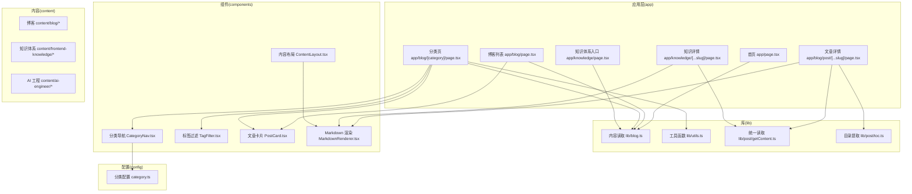
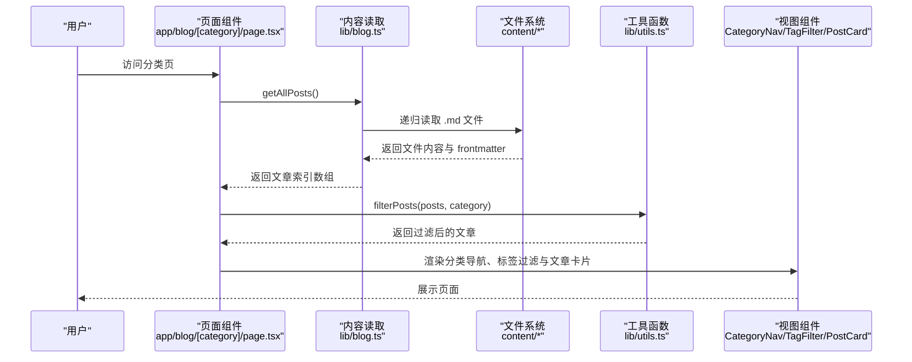
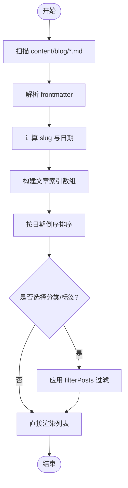
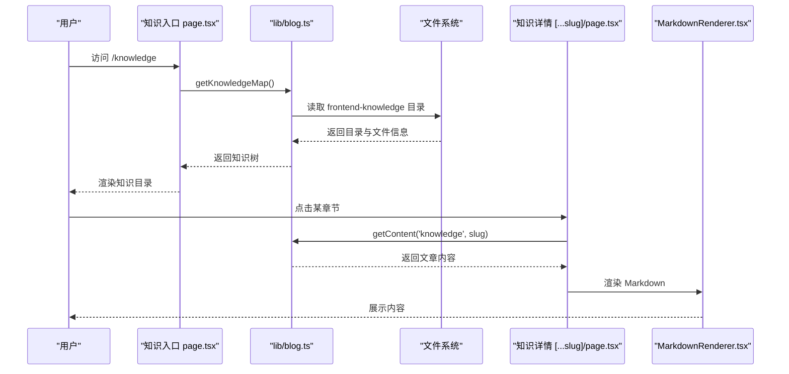
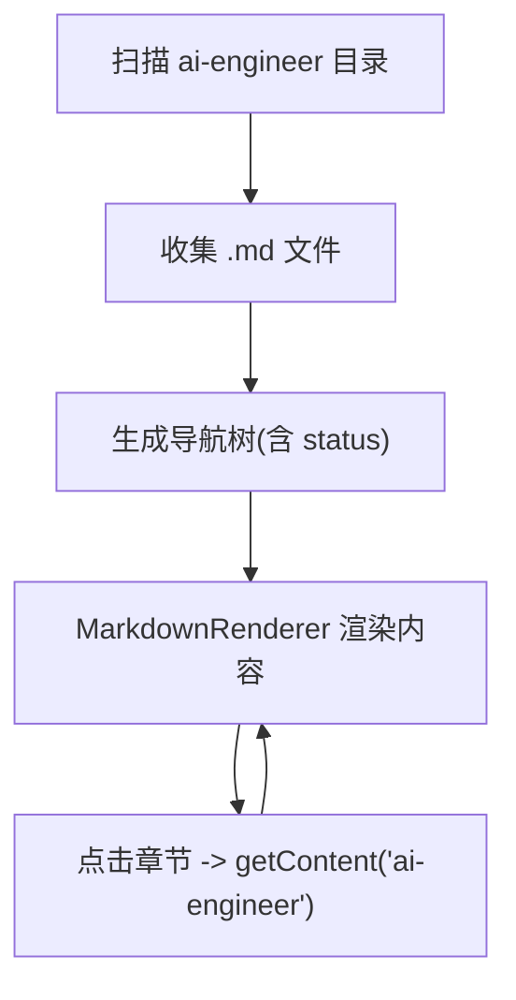
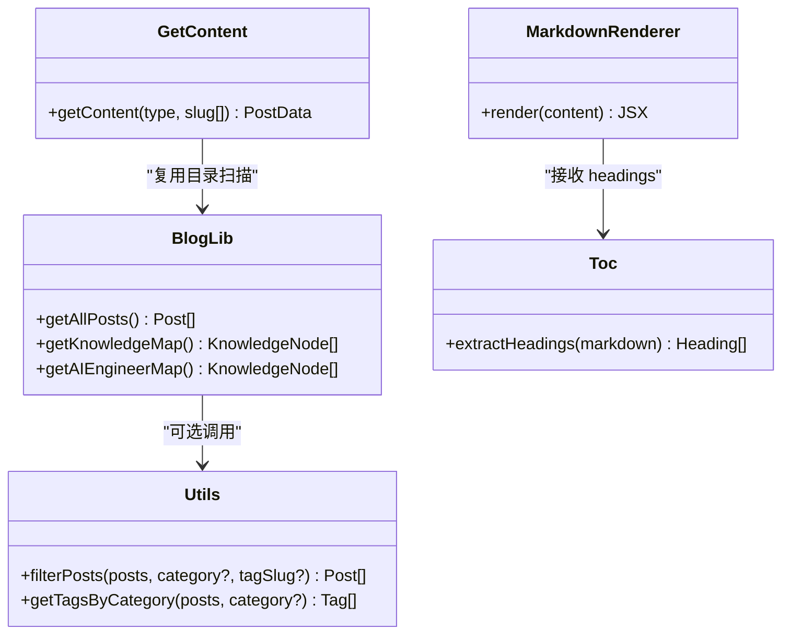
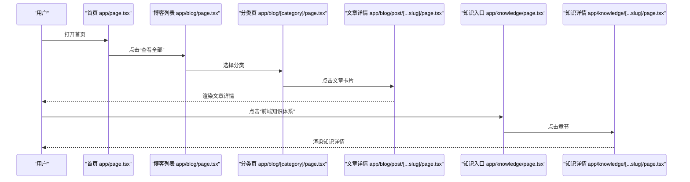
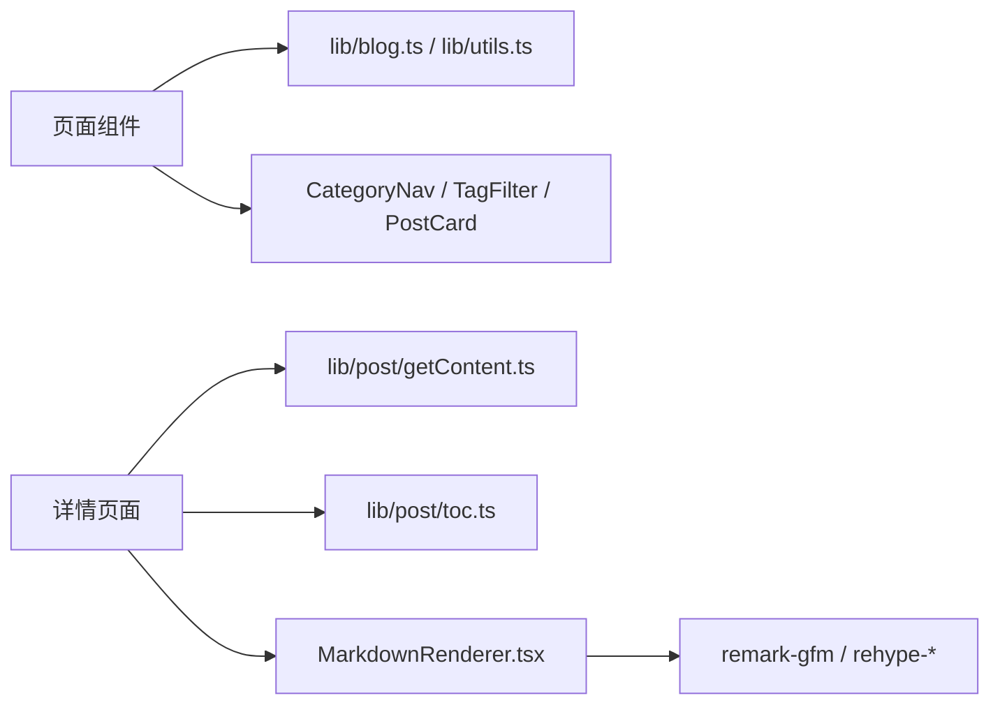

# 核心功能

<cite>
**本文引用的文件**   
- [README.md](file://README.md)
- [package.json](file://package.json)
- [app/layout.tsx](file://app/layout.tsx)
- [app/page.tsx](file://app/page.tsx)
- [lib/blog.ts](file://lib/blog.ts)
- [types/blog.ts](file://types/blog.ts)
- [lib/utils.ts](file://lib/utils.ts)
- [config/category.ts](file://config/category.ts)
- [app/components/blog/CategoryNav.tsx](file://app/components/blog/CategoryNav.tsx)
- [app/components/blog/TagFilter.tsx](file://app/components/blog/TagFilter.tsx)
- [app/components/blog/PostCard.tsx](file://app/components/blog/PostCard.tsx)
- [app/blog/page.tsx](file://app/blog/page.tsx)
- [app/blog/[category]/page.tsx](file://app/blog/[category]/page.tsx)
- [app/blog/post/[...slug]/page.tsx](file://app/blog/post/[...slug]/page.tsx)
- [lib/post/getContent.ts](file://lib/post/getContent.ts)
- [lib/post/toc.ts](file://lib/post/toc.ts)
- [app/components/post/MarkdownRenderer.tsx](file://app/components/post/MarkdownRenderer.tsx)
- [app/components/post/ContentLayout.tsx](file://app/components/post/ContentLayout.tsx)
- [app/knowledge/page.tsx](file://app/knowledge/page.tsx)
- [app/knowledge/[...slug]/page.tsx](file://app/knowledge/[...slug]/page.tsx)
- [scripts/generate-frontend-knowledge.js](file://scripts/generate-frontend-knowledge.js)
</cite>

## 目录
1. [简介](#简介)
2. [项目结构](#项目结构)
3. [核心组件](#核心组件)
4. [架构总览](#架构总览)
5. [详细组件分析](#详细组件分析)
6. [依赖关系分析](#依赖关系分析)
7. [性能考量](#性能考量)
8. [故障排查指南](#故障排查指南)
9. [结论](#结论)
10. [附录](#附录)

## 简介
本仓库是 HuRui.dev 博客的 Next.js 应用，围绕以下核心能力构建：
- 博客文章管理系统：基于 Markdown + frontmatter 的内容管理、分类与标签筛选、列表与详情展示。
- 知识体系展示：前端知识体系的树形导航与章节内容渲染。
- AI 工程文档：AI 工程师方向的专题内容组织与展示。
- 项目案例展示：静态数据驱动的项目案例页面（本项目中由配置数据驱动）。

设计目标：
- 以文件系统为“数据库”，通过脚本生成与读取，实现零后端的内容发布流程。
- 使用 React Server Components 进行服务端数据获取，减少客户端体积。
- 提供清晰的分类、标签与目录导航，提升阅读体验。
- 通过统一的 Markdown 渲染管线，支持语法高亮、表格、自动锚点等增强能力。

## 项目结构
整体采用 Next.js App Router 的结构化路由与组件分层：
- app：页面与组件（按功能域划分）
- lib：通用逻辑（内容读取、工具函数）
- config：站点级配置（分类、标签等）
- content：Markdown 内容源（blog、frontend-knowledge、ai-engineer）
- scripts：内容生成与注入脚本
- types：类型定义

图表来源
- [app/page.tsx:1-193](file://app/page.tsx#L1-L193)
- [app/blog/page.tsx:1-21](file://app/blog/page.tsx#L1-L21)
- [app/blog/[category]/page.tsx:1-36](file://app/blog/[category]/page.tsx#L1-L36)
- [app/blog/post/[...slug]/page.tsx:1-27](file://app/blog/post/[...slug]/page.tsx#L1-L27)
- [app/knowledge/page.tsx:1-58](file://app/knowledge/page.tsx#L1-L58)
- [app/knowledge/[...slug]/page.tsx:1-44](file://app/knowledge/[...slug]/page.tsx#L1-L44)
- [lib/blog.ts:1-134](file://lib/blog.ts#L1-L134)
- [lib/utils.ts:1-36](file://lib/utils.ts#L1-L36)
- [lib/post/getContent.ts:1-21](file://lib/post/getContent.ts#L1-L21)
- [lib/post/toc.ts:1-23](file://lib/post/toc.ts#L1-L23)
- [app/components/blog/CategoryNav.tsx:1-46](file://app/components/blog/CategoryNav.tsx#L1-L46)
- [app/components/blog/TagFilter.tsx:1-53](file://app/components/blog/TagFilter.tsx#L1-L53)
- [app/components/blog/PostCard.tsx:1-44](file://app/components/blog/PostCard.tsx#L1-L44)
- [app/components/post/MarkdownRenderer.tsx:1-40](file://app/components/post/MarkdownRenderer.tsx#L1-L40)
- [app/components/post/ContentLayout.tsx:1-31](file://app/components/post/ContentLayout.tsx#L1-L31)
- [config/category.ts:1-9](file://config/category.ts#L1-L9)

章节来源
- [README.md:1-37](file://README.md#L1-L37)
- [package.json:1-53](file://package.json#L1-L53)

## 核心组件
- 内容读取与索引
  - getAllPosts：递归扫描 blog 目录，解析 frontmatter，生成文章索引并排序。
  - getKnowledgeMap / getAIEngineerMap：扫描知识体系与 AI 工程目录，生成树形导航。
  - getContent：根据类型与 slug 数组定位具体 Markdown 文件并读取。
- 工具函数
  - filterPosts：按分类与标签过滤文章。
  - getTagsByCategory：按分类聚合标签集合。
- UI 组件
  - CategoryNav：分类导航，支持“全部”与各分类切换。
  - TagFilter：标签过滤，支持在当前分类下按标签筛选。
  - PostCard：文章卡片，展示标题、时间、标签与描述。
  - MarkdownRenderer：React Markdown 渲染器，启用 GFM、代码高亮、自动锚点与外链处理。
  - ContentLayout：内容布局，包含侧边目录 TOC 与正文区域。

章节来源
- [lib/blog.ts:1-134](file://lib/blog.ts#L1-L134)
- [lib/utils.ts:1-36](file://lib/utils.ts#L1-L36)
- [app/components/blog/CategoryNav.tsx:1-46](file://app/components/blog/CategoryNav.tsx#L1-L46)
- [app/components/blog/TagFilter.tsx:1-53](file://app/components/blog/TagFilter.tsx#L1-L53)
- [app/components/blog/PostCard.tsx:1-44](file://app/components/blog/PostCard.tsx#L1-L44)
- [app/components/post/MarkdownRenderer.tsx:1-40](file://app/components/post/MarkdownRenderer.tsx#L1-L40)
- [app/components/post/ContentLayout.tsx:1-31](file://app/components/post/ContentLayout.tsx#L1-L31)

## 架构总览
系统采用“文件系统即数据源”的架构：
- 内容层：Markdown 文件位于 content 目录下，按模块分目录组织。
- 读取层：lib 模块负责文件遍历、frontmatter 解析、路径映射与内容读取。
- 展示层：Next.js 页面组件在服务端拉取数据，渲染列表与详情；Markdown 在客户端渲染。

图表来源
- [app/blog/[category]/page.tsx:1-36](file://app/blog/[category]/page.tsx#L1-L36)
- [lib/blog.ts:24-51](file://lib/blog.ts#L24-L51)
- [lib/utils.ts:19-33](file://lib/utils.ts#L19-L33)

## 详细组件分析

### 博客文章管理系统
- 设计目标
  - 以 content/blog 为内容源，自动生成文章索引与详情页。
  - 支持分类与标签双重筛选，提供清晰的文章发现路径。
- 实现原理
  - 使用 gray-matter 解析 frontmatter，提取 title、date、description、category、tags 等字段。
  - 通过 path.relative 计算 slug，兼容 Windows 路径分隔符。
  - 列表页与服务端组件协作，按需渲染分类导航与标签过滤。
- 使用场景
  - 作者新增 Markdown 文件后，无需额外配置即可被索引与展示。
  - 读者可通过分类与标签快速定位感兴趣的文章。

图表来源
- [lib/blog.ts:9-51](file://lib/blog.ts#L9-L51)
- [lib/utils.ts:19-33](file://lib/utils.ts#L19-L33)

章节来源
- [lib/blog.ts:1-134](file://lib/blog.ts#L1-L134)
- [app/blog/page.tsx:1-21](file://app/blog/page.tsx#L1-L21)
- [app/blog/[category]/page.tsx:1-36](file://app/blog/[category]/page.tsx#L1-L36)
- [app/components/blog/CategoryNav.tsx:1-46](file://app/components/blog/CategoryNav.tsx#L1-L46)
- [app/components/blog/TagFilter.tsx:1-53](file://app/components/blog/TagFilter.tsx#L1-L53)
- [app/components/blog/PostCard.tsx:1-44](file://app/components/blog/PostCard.tsx#L1-L44)

### 知识体系展示
- 设计目标
  - 将前端知识体系以目录树形式呈现，支持“待完善”状态标记。
  - 每个章节对应一个 Markdown 文件，点击可进入详情。
- 实现原理
  - getKnowledgeMap 扫描 content/frontend-knowledge 目录，按文件夹作为一级分类，文件名作为二级条目。
  - 从 frontmatter 读取 status 字段，用于显示“待完善”。
  - 详情页通过 getContent('knowledge', slug) 读取并渲染。

图表来源
- [app/knowledge/page.tsx:1-58](file://app/knowledge/page.tsx#L1-L58)
- [lib/blog.ts:83-106](file://lib/blog.ts#L83-L106)
- [app/knowledge/[...slug]/page.tsx:1-44](file://app/knowledge/[...slug]/page.tsx#L1-L44)
- [lib/post/getContent.ts:1-21](file://lib/post/getContent.ts#L1-L21)
- [app/components/post/MarkdownRenderer.tsx:1-40](file://app/components/post/MarkdownRenderer.tsx#L1-L40)

章节来源
- [lib/blog.ts:83-106](file://lib/blog.ts#L83-L106)
- [app/knowledge/page.tsx:1-58](file://app/knowledge/page.tsx#L1-L58)
- [app/knowledge/[...slug]/page.tsx:1-44](file://app/knowledge/[...slug]/page.tsx#L1-L44)

### AI 工程文档
- 设计目标
  - 以专题方式组织 AI 工程相关内容，便于系统化学习与查阅。
- 实现原理
  - getAIEngineerMap 扫描 content/ai-engineer 目录，结构与知识体系一致。
  - 详情页通过 getContent('ai-engineer', slug) 读取并渲染。

图表来源
- [lib/blog.ts:108-133](file://lib/blog.ts#L108-L133)
- [lib/post/getContent.ts:1-21](file://lib/post/getContent.ts#L1-L21)
- [app/components/post/MarkdownRenderer.tsx:1-40](file://app/components/post/MarkdownRenderer.tsx#L1-L40)

章节来源
- [lib/blog.ts:108-133](file://lib/blog.ts#L108-L133)

### 项目案例展示
- 设计目标
  - 通过静态数据展示项目案例，突出技术栈与业务背景。
- 实现原理
  - 使用 app/data/projects.ts 中的结构化数据驱动页面渲染（当前仓库未直接引用该文件，但存在该数据源）。
  - 页面组件遍历数据并渲染卡片或列表。

章节来源
- [app/data/projects.ts](file://app/data/projects.ts)

### 内容管理与 Markdown 渲染管线
- Frontmatter 解析
  - 使用 gray-matter 解析 frontmatter，提取元数据（title、date、description、category、tags、status）。
- 目录与 TOC
  - extractHeadings 从 Markdown 中提取 h1-h3 标题，生成 TOC 所需的数据结构。
- Markdown 渲染
  - react-markdown 配合 remark-gfm、rehype-highlight、rehype-slug、rehype-autolink-headings 实现富文本渲染。
  - 自定义 a 组件区分站内链接与外链，table 包裹以提升样式可控性。

图表来源
- [lib/blog.ts:1-134](file://lib/blog.ts#L1-L134)
- [lib/utils.ts:1-36](file://lib/utils.ts#L1-L36)
- [lib/post/getContent.ts:1-21](file://lib/post/getContent.ts#L1-L21)
- [lib/post/toc.ts:1-23](file://lib/post/toc.ts#L1-L23)
- [app/components/post/MarkdownRenderer.tsx:1-40](file://app/components/post/MarkdownRenderer.tsx#L1-L40)

章节来源
- [lib/blog.ts:1-134](file://lib/blog.ts#L1-L134)
- [lib/utils.ts:1-36](file://lib/utils.ts#L1-L36)
- [lib/post/getContent.ts:1-21](file://lib/post/getContent.ts#L1-L21)
- [lib/post/toc.ts:1-23](file://lib/post/toc.ts#L1-L23)
- [app/components/post/MarkdownRenderer.tsx:1-40](file://app/components/post/MarkdownRenderer.tsx#L1-L40)

### 用户交互流程与页面导航
- 首页
  - 展示技术栈、知识体系、项目案例、AI 工程入口卡片以及最新博客摘要。
- 博客列表与分类
  - 分类导航切换不同分类；标签过滤在当前分类下进一步筛选。
- 文章详情
  - 左侧目录导航（TOC），右侧正文内容；支持外链与表格样式。
- 知识体系
  - 目录树展示各章节，点击进入详情；支持“待完善”状态提示。

图表来源
- [app/page.tsx:104-146](file://app/page.tsx#L104-L146)
- [app/blog/page.tsx:1-21](file://app/blog/page.tsx#L1-L21)
- [app/blog/[category]/page.tsx:1-36](file://app/blog/[category]/page.tsx#L1-L36)
- [app/blog/post/[...slug]/page.tsx:1-27](file://app/blog/post/[...slug]/page.tsx#L1-L27)
- [app/knowledge/page.tsx:1-58](file://app/knowledge/page.tsx#L1-L58)
- [app/knowledge/[...slug]/page.tsx:1-44](file://app/knowledge/[...slug]/page.tsx#L1-L44)

章节来源
- [app/page.tsx:1-193](file://app/page.tsx#L1-L193)
- [app/blog/page.tsx:1-21](file://app/blog/page.tsx#L1-L21)
- [app/blog/[category]/page.tsx:1-36](file://app/blog/[category]/page.tsx#L1-L36)
- [app/blog/post/[...slug]/page.tsx:1-27](file://app/blog/post/[...slug]/page.tsx#L1-L27)
- [app/knowledge/page.tsx:1-58](file://app/knowledge/page.tsx#L1-L58)
- [app/knowledge/[...slug]/page.tsx:1-44](file://app/knowledge/[...slug]/page.tsx#L1-L44)

## 依赖关系分析
- 组件耦合
  - 页面组件依赖 lib 层的数据读取与工具函数，UI 组件仅关注展示与交互。
  - MarkdownRenderer 与 ContentLayout 解耦，前者专注渲染，后者负责布局与 TOC。
- 外部依赖
  - gray-matter：frontmatter 解析。
  - react-markdown 生态：GFM、代码高亮、自动锚点等。
  - tailwindcss 与 typography：样式与排版。

图表来源
- [app/blog/page.tsx:1-21](file://app/blog/page.tsx#L1-L21)
- [app/blog/[category]/page.tsx:1-36](file://app/blog/[category]/page.tsx#L1-L36)
- [app/blog/post/[...slug]/page.tsx:1-27](file://app/blog/post/[...slug]/page.tsx#L1-L27)
- [lib/blog.ts:1-134](file://lib/blog.ts#L1-L134)
- [lib/utils.ts:1-36](file://lib/utils.ts#L1-L36)
- [lib/post/getContent.ts:1-21](file://lib/post/getContent.ts#L1-L21)
- [lib/post/toc.ts:1-23](file://lib/post/toc.ts#L1-L23)
- [app/components/post/MarkdownRenderer.tsx:1-40](file://app/components/post/MarkdownRenderer.tsx#L1-L40)

章节来源
- [package.json:12-29](file://package.json#L12-L29)

## 性能考量
- 服务端渲染
  - 列表与详情在服务端读取 Markdown 与 frontmatter，减少客户端请求与解析开销。
- 渲染优化
  - MarkdownRenderer 仅在客户端渲染，避免服务端 React 运行时负担。
- 缓存建议
  - 可将 getAllPosts 结果缓存于内存或持久化存储，降低频繁 IO。
- 资源加载
  - 合理使用 next/font 与 Tailwind Typography，控制字体与样式体积。

[本节为通用指导，不直接分析具体文件]

## 故障排查指南
- 文章不存在
  - 现象：文章详情页显示“文章不存在”。
  - 原因：getContent 无法找到对应 Markdown 文件或 slug 不匹配。
  - 处理：检查 content 目录结构与 slug 生成逻辑。
- 分类或标签为空
  - 现象：分类导航或标签过滤无数据。
  - 原因：frontmatter 未正确设置 category 或 tags。
  - 处理：确保 frontmatter 字段完整且类型正确。
- 目录导航异常
  - 现象：TOC 未生成或锚点无效。
  - 原因：extractHeadings 正则未匹配到标题或 Markdown 标题层级不规范。
  - 处理：检查 h1-h3 标题格式与内容一致性。

章节来源
- [app/blog/post/[...slug]/page.tsx:11-17](file://app/blog/post/[...slug]/page.tsx#L11-L17)
- [lib/post/toc.ts:7-22](file://lib/post/toc.ts#L7-L22)

## 结论
HuRui.dev 博客以文件系统为核心数据源，结合 Next.js 的服务端渲染与 React 客户端渲染，实现了高效、可扩展的博客与知识体系展示方案。通过分类与标签机制、Markdown 渲染管线与清晰的页面导航，既满足作者的内容发布需求，也提升了读者的阅读体验。未来可在缓存策略、SEO 优化与多语言支持方面持续演进。

[本节为总结性内容，不直接分析具体文件]

## 附录
- 开发环境
  - 启动命令参考 README。
- 依赖说明
  - 关键依赖包括 gray-matter、react-markdown、rehype-*、tailwindcss 等。
- 内容生成脚本
  - generate-frontend-knowledge.js 用于批量生成知识体系模板文件，便于快速搭建目录结构。

章节来源
- [README.md:3-17](file://README.md#L3-L17)
- [package.json:12-29](file://package.json#L12-L29)
- [scripts/generate-frontend-knowledge.js:1-78](file://scripts/generate-frontend-knowledge.js#L1-L78)