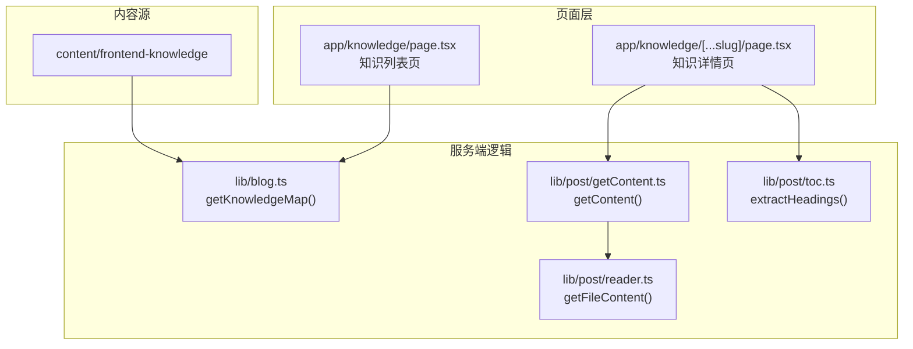
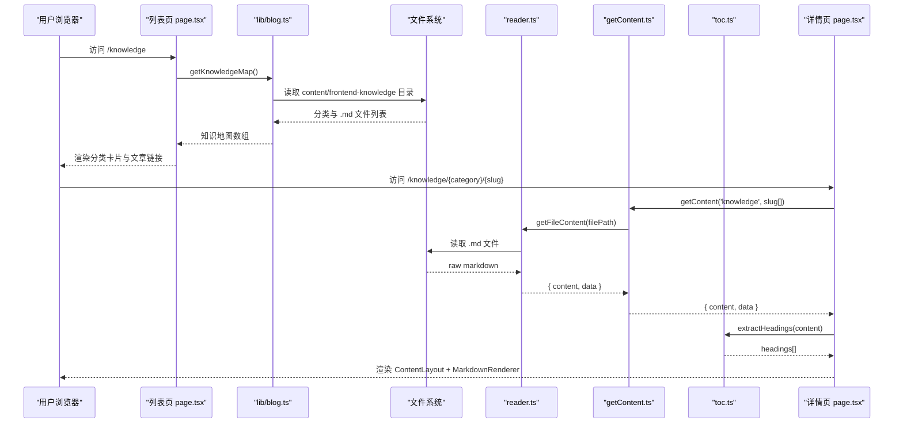
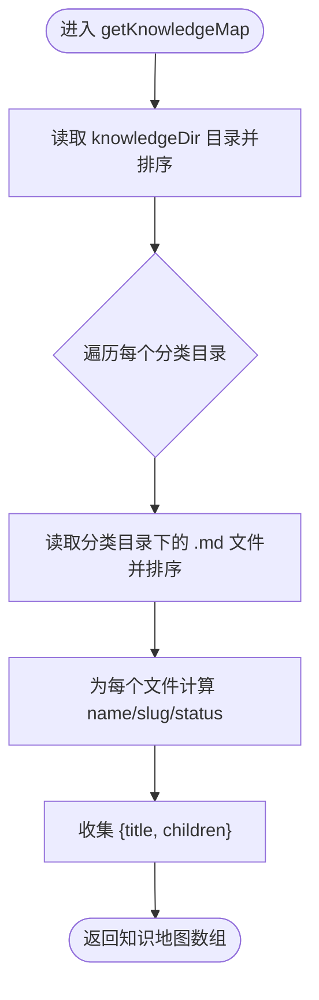
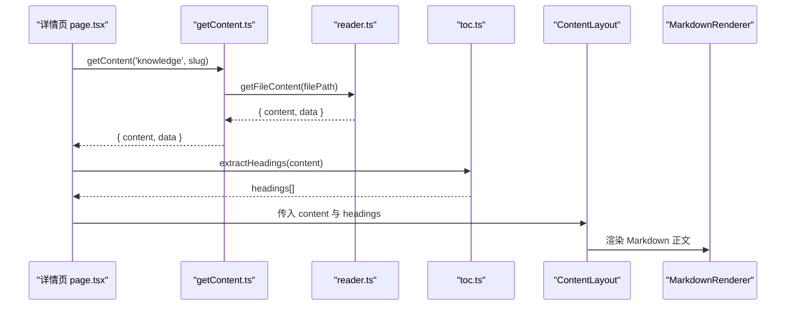
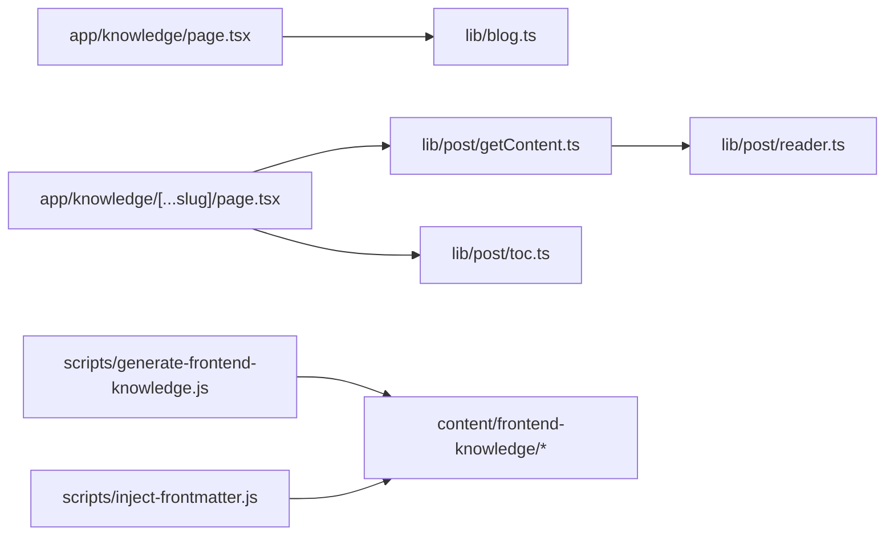

# 知识体系展示

<cite>
**本文引用的文件**   
- [app/knowledge/page.tsx](file://app/knowledge/page.tsx)
- [app/knowledge/[...slug]/page.tsx](file://app/knowledge/[...slug]/page.tsx)
- [lib/blog.ts](file://lib/blog.ts)
- [lib/post/getContent.ts](file://lib/post/getContent.ts)
- [lib/post/reader.ts](file://lib/post/reader.ts)
- [lib/post/toc.ts](file://lib/post/toc.ts)
- [scripts/generate-frontend-knowledge.js](file://scripts/generate-frontend-knowledge.js)
- [scripts/inject-frontmatter.js](file://scripts/inject-frontmatter.js)
</cite>

## 目录
1. [简介](#简介)
2. [项目结构](#项目结构)
3. [核心组件](#核心组件)
4. [架构总览](#架构总览)
5. [详细组件分析](#详细组件分析)
6. [依赖关系分析](#依赖关系分析)
7. [性能与可扩展性](#性能与可扩展性)
8. [故障排查指南](#故障排查指南)
9. [结论](#结论)
10. [附录：配置与示例](#附录配置与示例)

## 简介
本章节面向“前端知识体系”的展示功能，系统性说明其架构设计、数据组织规范、路由与渲染流程，以及状态管理机制。重点包括：
- getKnowledgeMap() 的工作机制与目录解析策略
- 知识文件的命名约定与 frontmatter 状态字段
- Next.js 动态路由的知识详情页渲染流程
- 层级结构与导航交互体验
- 如何新增章节与文章，以及 outline/draft/done 状态的维护方式

## 项目结构
知识体系的数据位于 content/frontend-knowledge 目录下，采用“编号-分类名”作为一级目录，每个分类下以“编号-标题.md”的文件形式组织文章。运行时通过 Next.js 的路由与 Node 文件系统读取生成页面。

图表来源
- [lib/blog.ts:83-106](file://lib/blog.ts#L83-L106)
- [lib/post/getContent.ts:6-20](file://lib/post/getContent.ts#L6-L20)
- [lib/post/reader.ts:4-11](file://lib/post/reader.ts#L4-L11)
- [lib/post/toc.ts:7-22](file://lib/post/toc.ts#L7-L22)
- [app/knowledge/page.tsx:5-58](file://app/knowledge/page.tsx#L5-L58)
- [app/knowledge/[...slug]/page.tsx:8-44](file://app/knowledge/[...slug]/page.tsx#L8-L44)

章节来源
- [app/knowledge/page.tsx:5-58](file://app/knowledge/page.tsx#L5-L58)
- [app/knowledge/[...slug]/page.tsx:8-44](file://app/knowledge/[...slug]/page.tsx#L8-L44)
- [lib/blog.ts:83-106](file://lib/blog.ts#L83-L106)
- [lib/post/getContent.ts:6-20](file://lib/post/getContent.ts#L6-L20)
- [lib/post/reader.ts:4-11](file://lib/post/reader.ts#L4-L11)
- [lib/post/toc.ts:7-22](file://lib/post/toc.ts#L7-L22)

## 核心组件
- 知识列表页：调用 getKnowledgeMap() 获取分类与文章清单，按网格布局渲染，并根据 status 显示“待完善”标签。
- 知识详情页：基于 [...slug] 动态路由解析路径，读取 Markdown 正文与 frontmatter，提取标题层级生成目录，渲染 Markdown 内容。
- 数据层：
  - lib/blog.ts：扫描 knowledgeDir 目录，构建知识地图（分类→文章），并读取每篇文章的 status。
  - lib/post/getContent.ts：根据 type 与 slug 拼接文件路径，解码中文路径，返回 { content, data }。
  - lib/post/reader.ts：统一读取 Markdown 文件并解析 frontmatter。
  - lib/post/toc.ts：从 Markdown 中提取 h1-h3 标题，生成目录项。

章节来源
- [app/knowledge/page.tsx:5-58](file://app/knowledge/page.tsx#L5-L58)
- [app/knowledge/[...slug]/page.tsx:8-44](file://app/knowledge/[...slug]/page.tsx#L8-L44)
- [lib/blog.ts:83-106](file://lib/blog.ts#L83-L106)
- [lib/post/getContent.ts:6-20](file://lib/post/getContent.ts#L6-L20)
- [lib/post/reader.ts:4-11](file://lib/post/reader.ts#L4-L11)
- [lib/post/toc.ts:7-22](file://lib/post/toc.ts#L7-L22)

## 架构总览
知识体系的运行链路如下：
- 列表页请求 /knowledge → 调用 getKnowledgeMap() → 遍历 content/frontend-knowledge 目录 → 组装分类与文章信息 → 渲染网格卡片与链接。
- 详情页请求 /knowledge/{category}/{article-slug} → getContent('knowledge', slug) → reader 读取文件 → 解析 frontmatter 与正文 → toc 提取目录 → ContentLayout + MarkdownRenderer 渲染。

图表来源
- [app/knowledge/page.tsx:5-58](file://app/knowledge/page.tsx#L5-L58)
- [lib/blog.ts:83-106](file://lib/blog.ts#L83-L106)
- [lib/post/getContent.ts:6-20](file://lib/post/getContent.ts#L6-L20)
- [lib/post/reader.ts:4-11](file://lib/post/reader.ts#L4-L11)
- [lib/post/toc.ts:7-22](file://lib/post/toc.ts#L7-L22)
- [app/knowledge/[...slug]/page.tsx:8-44](file://app/knowledge/[...slug]/page.tsx#L8-L44)

## 详细组件分析

### getKnowledgeMap() 工作机制
- 读取 content/frontend-knowledge 下的所有一级目录，并按字典序排序。
- 对每个分类目录：
  - 过滤出 .md 文件并排序。
  - 将文件名中的“编号-”前缀去除得到显示名称。
  - 生成 slug：/knowledge/{category}/{filename-without-.md}。
  - 读取该文件的 frontmatter.status，若不存在则默认 'outline'。
- 返回形如 [{ title, children: [{ name, slug, status }] }] 的结构。

图表来源
- [lib/blog.ts:83-106](file://lib/blog.ts#L83-L106)

章节来源
- [lib/blog.ts:83-106](file://lib/blog.ts#L83-L106)

### 目录结构与命名约定
- 一级目录：使用“编号-分类名”，例如 00-前端认知、01-JavaScript核心 等。
- 二级文件：使用“编号-标题.md”，例如 01-数据类型.md。
- 编号用于保证顺序稳定；显示名称在渲染时去除“编号-”前缀。
- 分类与文章的 slug 由目录名与文件名决定，不含扩展名。

章节来源
- [lib/blog.ts:83-106](file://lib/blog.ts#L83-L106)
- [scripts/generate-frontend-knowledge.js:64-167](file://scripts/generate-frontend-knowledge.js#L64-L167)

### 知识文件组织规范与 frontmatter 状态管理
- 文件位置：content/frontend-knowledge/{分类}/{编号-标题}.md。
- frontmatter 关键字段：
  - title：页面标题（SEO）。
  - description：页面描述（SEO）。
  - status：完成度状态，支持 outline / draft / done。
  - updatedAt：更新时间（YYYY-MM-DD）。
  - module：所属分类名（去编号前缀）。
  - order：文件名中的数字编号。
- 状态规则：
  - 未设置 status 时默认为 'outline'。
  - 可通过脚本 inject-frontmatter.js 自动推断 status（基于正文行数阈值）。
- 列表页对 status === 'outline' 的文章显示“待完善”标签。

章节来源
- [lib/blog.ts:72-81](file://lib/blog.ts#L72-L81)
- [scripts/inject-frontmatter.js:4-18](file://scripts/inject-frontmatter.js#L4-L18)
- [scripts/inject-frontmatter.js:123-155](file://scripts/inject-frontmatter.js#L123-L155)
- [app/knowledge/page.tsx:32-51](file://app/knowledge/page.tsx#L32-L51)

### 路由设计与动态路由处理
- 列表路由：/knowledge → app/knowledge/page.tsx。
- 详情路由：/knowledge/{category}/{article-slug} → app/knowledge/[...slug]/page.tsx。
- 动态参数解析：
  - params.slug 为字符串数组，例如 ["01-JavaScript核心", "01-数据类型"]。
  - getContent('knowledge', slug) 会将 slug 中各段 decodeURIComponent 后拼接为文件路径。
- 元数据生成：generateMetadata 中读取 frontmatter.title/description 作为 SEO 元信息。

章节来源
- [app/knowledge/[...slug]/page.tsx:8-24](file://app/knowledge/[...slug]/page.tsx#L8-L24)
- [lib/post/getContent.ts:6-20](file://lib/post/getContent.ts#L6-L20)

### 内容渲染流程
- 详情页调用 getContent('knowledge', slug) 获取 { content, data }。
- 使用 extractHeadings(content) 提取 h1-h3 标题，生成目录项。
- 通过 ContentLayout 包裹 BackButton 与 MarkdownRenderer，渲染正文与目录。

图表来源
- [app/knowledge/[...slug]/page.tsx:26-44](file://app/knowledge/[...slug]/page.tsx#L26-L44)
- [lib/post/getContent.ts:6-20](file://lib/post/getContent.ts#L6-L20)
- [lib/post/reader.ts:4-11](file://lib/post/reader.ts#L4-L11)
- [lib/post/toc.ts:7-22](file://lib/post/toc.ts#L7-L22)

章节来源
- [app/knowledge/[...slug]/page.tsx:26-44](file://app/knowledge/[...slug]/page.tsx#L26-L44)
- [lib/post/toc.ts:7-22](file://lib/post/toc.ts#L7-L22)

### 层级结构与导航交互
- 层级结构：分类（一级）→ 文章（二级）。
- 导航交互：
  - 列表页以网格卡片展示分类，每个分类下列出其文章链接。
  - 文章链接指向 /knowledge/{category}/{article-slug}。
  - 列表中对 status === 'outline' 的文章显示“待完善”标签，提示未完成。
  - 详情页提供返回按钮，回退到 /knowledge。

章节来源
- [app/knowledge/page.tsx:16-54](file://app/knowledge/page.tsx#L16-L54)
- [app/knowledge/[...slug]/page.tsx:38-42](file://app/knowledge/[...slug]/page.tsx#L38-L42)

## 依赖关系分析
- 页面层依赖：
  - 列表页依赖 lib/blog.ts 的 getKnowledgeMap()。
  - 详情页依赖 lib/post/getContent.ts、lib/post/toc.ts。
- 数据层依赖：
  - getContent.ts 依赖 reader.ts 进行文件读取与 frontmatter 解析。
  - blog.ts 直接读取文件系统并解析 frontmatter 以获取 status。
- 工具脚本：
  - generate-frontend-knowledge.js 用于批量生成占位文章骨架。
  - inject-frontmatter.js 用于批量注入 frontmatter 并推断 status。

图表来源
- [app/knowledge/page.tsx:5-58](file://app/knowledge/page.tsx#L5-L58)
- [app/knowledge/[...slug]/page.tsx:8-44](file://app/knowledge/[...slug]/page.tsx#L8-L44)
- [lib/blog.ts:83-106](file://lib/blog.ts#L83-L106)
- [lib/post/getContent.ts:6-20](file://lib/post/getContent.ts#L6-L20)
- [lib/post/reader.ts:4-11](file://lib/post/reader.ts#L4-L11)
- [lib/post/toc.ts:7-22](file://lib/post/toc.ts#L7-L22)
- [scripts/generate-frontend-knowledge.js:182-211](file://scripts/generate-frontend-knowledge.js#L182-L211)
- [scripts/inject-frontmatter.js:123-155](file://scripts/inject-frontmatter.js#L123-L155)

章节来源
- [lib/blog.ts:83-106](file://lib/blog.ts#L83-L106)
- [lib/post/getContent.ts:6-20](file://lib/post/getContent.ts#L6-L20)
- [lib/post/reader.ts:4-11](file://lib/post/reader.ts#L4-L11)
- [lib/post/toc.ts:7-22](file://lib/post/toc.ts#L7-L22)
- [scripts/generate-frontend-knowledge.js:182-211](file://scripts/generate-frontend-knowledge.js#L182-L211)
- [scripts/inject-frontmatter.js:123-155](file://scripts/inject-frontmatter.js#L123-L155)

## 性能与可扩展性
- 目录扫描与文件读取均为同步操作（fs.readdirSync、fs.readFileSync），在开发或静态构建阶段执行，避免运行时阻塞。
- 建议：
  - 保持分类与文章数量合理，避免单分类下过多文件导致首屏渲染压力。
  - 如需增量更新，可考虑缓存知识地图结果（例如基于目录哈希）。
  - 对大型知识库，可将目录扫描改为异步或预生成 JSON 供前端消费。

[本节为通用指导，不直接分析具体文件]

## 故障排查指南
- 404 Not Found：
  - 检查 URL 是否匹配 /knowledge/{category}/{article-slug}。
  - 确认 content/frontend-knowledge 下存在对应目录与 .md 文件。
  - 若包含中文路径，确保 getContent 已对 slug 进行 decodeURIComponent。
- 列表页无数据或状态异常：
  - 检查 getKnowledgeMap 是否能读取到目录与文件。
  - 确认 frontmatter.status 是否存在；缺失时默认 'outline'。
- 详情页无法渲染目录：
  - 检查 Markdown 正文是否包含 h1-h3 标题。
  - 确认 extractHeadings 正则能匹配到标题行。

章节来源
- [app/knowledge/[...slug]/page.tsx:31-34](file://app/knowledge/[...slug]/page.tsx#L31-L34)
- [lib/post/getContent.ts:13-15](file://lib/post/getContent.ts#L13-L15)
- [lib/blog.ts:72-81](file://lib/blog.ts#L72-L81)
- [lib/post/toc.ts:7-22](file://lib/post/toc.ts#L7-L22)

## 结论
知识体系展示功能通过清晰的目录规范与 frontmatter 状态管理，结合 Next.js 的动态路由与 SSR/SSG 能力，实现了稳定的知识地图生成与内容渲染。getKnowledgeMap() 负责目录解析与状态读取，getContent() 与 reader.ts 负责内容加载，toc.ts 负责目录提取。整体架构简洁、职责清晰，便于扩展新的分类与文章。

[本节为总结性内容，不直接分析具体文件]

## 附录：配置与示例

### 添加新章节的步骤
- 在 content/frontend-knowledge 下新建目录，命名格式：{编号}-{分类名}，例如 10-新领域。
- 在该目录下创建文章文件，命名格式：{编号}-{标题}.md，例如 01-入门指南.md。
- 可选：在文章顶部添加 frontmatter，至少包含 title 与 description，status 可设为 outline/draft/done。
- 刷新 /knowledge 页面即可看到新分类与文章。

章节来源
- [lib/blog.ts:83-106](file://lib/blog.ts#L83-L106)
- [scripts/generate-frontend-knowledge.js:182-211](file://scripts/generate-frontend-knowledge.js#L182-L211)

### 文章 frontmatter 示例字段说明
- title：页面标题（必填，用于 SEO 与详情页元信息）。
- description：页面描述（推荐，用于 SEO 摘要）。
- status：完成度状态（可选，默认 outline）。
- updatedAt：更新时间（YYYY-MM-DD，推荐）。
- module：所属分类名（去编号前缀，可由脚本自动生成）。
- order：文件名中的数字编号（可由脚本自动生成）。

章节来源
- [scripts/inject-frontmatter.js:4-18](file://scripts/inject-frontmatter.js#L4-L18)
- [scripts/inject-frontmatter.js:123-155](file://scripts/inject-frontmatter.js#L123-L155)

### 状态管理与使用方式
- 状态值：outline（待完善）、draft（草稿）、done（已完成）。
- 默认值：未设置 status 时视为 outline。
- 列表页表现：outline 状态的文章显示“待完善”标签，并以较浅颜色区分。
- 自动化推断：inject-frontmatter.js 可根据正文行数阈值推断 status，便于批量初始化。

章节来源
- [lib/blog.ts:72-81](file://lib/blog.ts#L72-L81)
- [app/knowledge/page.tsx:32-51](file://app/knowledge/page.tsx#L32-L51)
- [scripts/inject-frontmatter.js:123-155](file://scripts/inject-frontmatter.js#L123-L155)