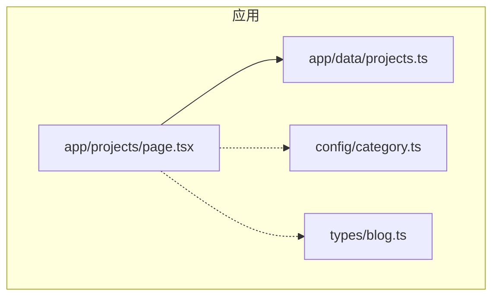
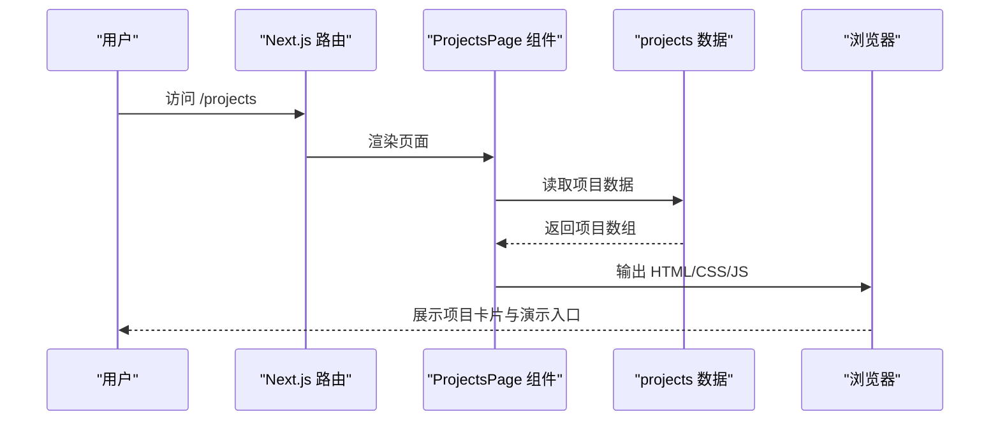
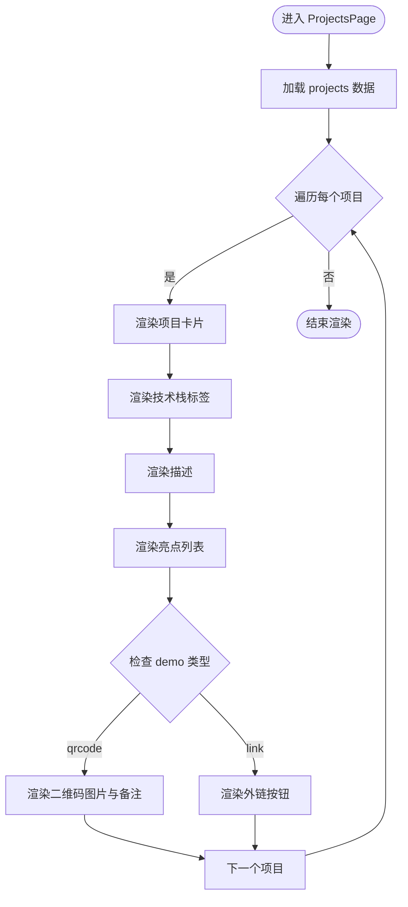
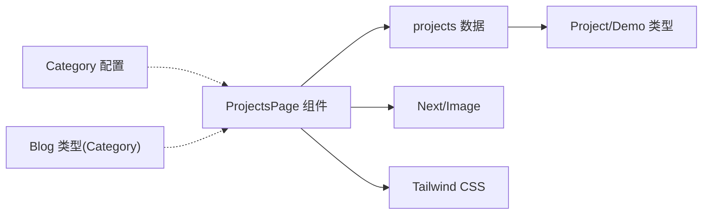

# 项目案例展示

<cite>
**本文引用的文件**   
- [projects.ts](file://app/data/projects.ts)
- [page.tsx（项目页面）](file://app/projects/page.tsx)
- [category.ts（分类配置）](file://config/category.ts)
- [blog.ts（博客类型定义）](file://types/blog.ts)
</cite>

## 目录
1. [简介](#简介)
2. [项目结构](#项目结构)
3. [核心组件与数据模型](#核心组件与数据模型)
4. [架构总览](#架构总览)
5. [详细组件分析](#详细组件分析)
6. [依赖关系分析](#依赖关系分析)
7. [性能与体验优化](#性能与体验优化)
8. [故障排查指南](#故障排查指南)
9. [结论](#结论)
10. [附录：配置与扩展示例](#附录配置与扩展示例)

## 简介
本项目案例展示模块用于集中呈现个人/团队的项目经验，包括项目名称、技术栈、描述、亮点以及演示入口（外链或二维码）。该模块采用“静态数据 + 页面渲染”的轻量架构，便于快速维护与扩展。当前实现以 Next.js 页面组件为主，数据来源于本地 TypeScript 数据文件。

## 项目结构
- 数据层：位于 app/data/projects.ts，定义项目数据结构与示例数据。
- 视图层：位于 app/projects/page.tsx，负责项目列表的布局与渲染。
- 配置层：config/category.ts 提供分类标签映射；types/blog.ts 提供通用类型（如 Category），与项目模块解耦但可复用。

图表来源
- [page.tsx（项目页面）:1-120](file://app/projects/page.tsx#L1-L120)
- [projects.ts:1-106](file://app/data/projects.ts#L1-L106)
- [category.ts:1-9](file://config/category.ts#L1-L9)
- [blog.ts:1-16](file://types/blog.ts#L1-L16)

章节来源
- [page.tsx（项目页面）:1-120](file://app/projects/page.tsx#L1-L120)
- [projects.ts:1-106](file://app/data/projects.ts#L1-L106)
- [category.ts:1-9](file://config/category.ts#L1-L9)
- [blog.ts:1-16](file://types/blog.ts#L1-L16)

## 核心组件与数据模型
- 数据模型
  - Demo：演示项联合类型，支持外链与二维码两种形式。
  - Project：项目对象，包含名称、技术栈、描述、亮点与演示集合。
  - projects：项目数组常量，作为页面渲染的数据源。
- 页面组件
  - ProjectsPage：项目案例页，遍历 projects 渲染卡片，并区分渲染外链按钮与二维码图片。

章节来源
- [projects.ts:1-106](file://app/data/projects.ts#L1-L106)
- [page.tsx（项目页面）:1-120](file://app/projects/page.tsx#L1-L120)

## 架构总览
项目案例展示采用“数据驱动 + 单向渲染”的简单架构：
- 数据源：TypeScript 常量数组 projects。
- 渲染器：Next.js 页面组件 ProjectsPage。
- 样式：Tailwind CSS 原子类完成响应式与交互效果。
- 外部资源：外链跳转与本地二维码图片。

图表来源
- [page.tsx（项目页面）:1-120](file://app/projects/page.tsx#L1-L120)
- [projects.ts:1-106](file://app/data/projects.ts#L1-L106)

## 详细组件分析

### 数据模型设计（Project 与 Demo）
- Project
  - name：项目名称，用作唯一标识与标题。
  - tech：技术栈标签数组，用于在卡片中展示。
  - desc：项目简述，用于说明业务背景与目标。
  - highlights：亮点列表，突出关键能力或成果。
  - demo：演示集合，支持外链与二维码两种形态。
- Demo
  - link：外链演示，包含 url 与可选 label。
  - qrcode：二维码演示，包含 url 与 note。

复杂度与可扩展性
- 时间复杂度：O(n) 遍历渲染项目列表。
- 空间复杂度：O(n) 存储项目数据。
- 扩展点：Demo 联合类型易于新增其他演示形态（如视频、录屏等）。

章节来源
- [projects.ts:1-106](file://app/data/projects.ts#L1-L106)

### 项目卡片渲染逻辑
- 列表渲染：遍历 projects，为每个项目生成一个卡片容器。
- 信息分层：
  - 标题：project.name
  - 标签：project.tech 数组渲染为多个小标签
  - 描述：project.desc
  - 亮点：project.highlights 列表
- 演示区：
  - 若 demo.type === 'qrcode'，渲染二维码图片与备注。
  - 否则渲染外链按钮，使用 target="_blank" 打开新窗口。

图表来源
- [page.tsx（项目页面）:1-120](file://app/projects/page.tsx#L1-L120)
- [projects.ts:1-106](file://app/data/projects.ts#L1-L106)

章节来源
- [page.tsx（项目页面）:1-120](file://app/projects/page.tsx#L1-L120)

### 页面布局与响应式适配
- 布局容器：最大宽度限制与居中，内边距保证呼吸感。
- 卡片样式：白底、边框、圆角、悬停高亮与背景色变化。
- 标签布局：flex-wrap 自动换行，间距统一。
- 演示区：flex-wrap 自适应排列，外链按钮与二维码并列显示。
- 移动端友好：通过 Tailwind 断点与紧凑间距提升小屏可读性。

章节来源
- [page.tsx（项目页面）:1-120](file://app/projects/page.tsx#L1-L120)

### 分类展示与筛选机制
- 当前实现：项目页面直接渲染全部项目，未内置按技术栈或关键词的筛选逻辑。
- 分类配置：config/category.ts 定义了“项目经验”分类标签，可用于导航或与其他模块联动。
- 类型系统：types/blog.ts 中的 Category 包含 'projects'，可与博客模块共用分类语义。

建议扩展
- 在前端增加基于 tech 数组的筛选下拉或标签选择器。
- 结合 URL 查询参数（如 ?tech=React）进行筛选与分享。
- 将 category 与 tag 体系引入项目数据，以便复用现有筛选组件。

章节来源
- [category.ts:1-9](file://config/category.ts#L1-L9)
- [blog.ts:1-16](file://types/blog.ts#L1-L16)
- [page.tsx（项目页面）:1-120](file://app/projects/page.tsx#L1-L120)

### 搜索机制
- 当前实现：未提供搜索框或搜索逻辑。
- 建议方案：
  - 前端搜索：监听输入，过滤 name/desc/highlights/tech 字段。
  - 后端/静态生成：根据内容索引构建搜索索引，提高大数据量下的性能。

[本节为概念性说明，不直接分析具体文件]

## 依赖关系分析
- 组件依赖
  - ProjectsPage 依赖 projects 数据。
  - 页面使用 Next/Image 组件渲染二维码。
  - 样式依赖 Tailwind CSS。
- 类型依赖
  - Project 与 Demo 类型定义集中在 data 层，供页面消费。
  - Category 类型与分类配置在 config/types 层，与项目模块解耦。

图表来源
- [page.tsx（项目页面）:1-120](file://app/projects/page.tsx#L1-L120)
- [projects.ts:1-106](file://app/data/projects.ts#L1-L106)
- [category.ts:1-9](file://config/category.ts#L1-L9)
- [blog.ts:1-16](file://types/blog.ts#L1-L16)

章节来源
- [page.tsx（项目页面）:1-120](file://app/projects/page.tsx#L1-L120)
- [projects.ts:1-106](file://app/data/projects.ts#L1-L106)
- [category.ts:1-9](file://config/category.ts#L1-L9)
- [blog.ts:1-16](file://types/blog.ts#L1-L16)

## 性能与体验优化
- 渲染性能
  - 当前为静态数据，无额外状态管理开销。
  - 列表渲染使用 key={project.name}，确保稳定键值。
- 图片优化
  - 使用 Next/Image 对二维码进行尺寸控制与懒加载（按需配置）。
- 交互体验
  - 卡片悬停边框与背景变化，增强反馈。
  - 外链按钮使用新窗口打开，避免中断当前浏览。
- 可扩展性
  - 通过 Demo 联合类型扩展新的演示形态（如视频、录屏、在线预览）。
  - 预留分类与标签字段，便于后续接入筛选与搜索。

[本节为通用指导，不直接分析具体文件]

## 故障排查指南
- 二维码无法显示
  - 检查图片路径是否正确，确认 public/images 下存在对应文件。
  - 检查 Next/Image 的 src 是否指向有效资源。
- 外链无法打开
  - 检查 demo.url 是否为合法地址。
  - 确认 target="_blank" 与 rel="noopener noreferrer" 已设置。
- 项目信息缺失
  - 检查 projects.ts 中对应项目的必填字段是否完整（name、tech、desc、highlights、demo）。
- 样式异常
  - 确认 Tailwind CSS 已正确安装与配置。
  - 检查类名拼写与断点是否生效。

章节来源
- [page.tsx（项目页面）:1-120](file://app/projects/page.tsx#L1-L120)
- [projects.ts:1-106](file://app/data/projects.ts#L1-L106)

## 结论
项目案例展示模块以简洁的数据结构与清晰的渲染逻辑实现了项目经验的集中呈现。通过扩展 Demo 类型与引入分类/筛选/搜索能力，可进一步提升用户体验与可维护性。建议在保持轻量架构的同时，逐步完善交互与检索功能，以满足更复杂的展示需求。

[本节为总结性内容，不直接分析具体文件]

## 附录：配置与扩展示例

### 添加新项目
- 在 projects.ts 中添加一条 Project 记录，包含 name、tech、desc、highlights、demo。
- demo 可为外链或二维码，按需组合多条演示。

章节来源
- [projects.ts:1-106](file://app/data/projects.ts#L1-L106)

### 自定义展示样式
- 调整卡片容器的 Tailwind 类名，修改边框、圆角、阴影与悬停效果。
- 调整标签与描述的排版间距与字号，提升可读性。
- 为外链按钮与二维码区域增加统一的间距与对齐方式。

章节来源
- [page.tsx（项目页面）:1-120](file://app/projects/page.tsx#L1-L120)

### 分类与标签扩展
- 在 config/category.ts 中补充更多分类标签，便于导航与聚合。
- 在 types/blog.ts 中扩展 Category 类型，使项目模块与博客模块共享分类语义。

章节来源
- [category.ts:1-9](file://config/category.ts#L1-L9)
- [blog.ts:1-16](file://types/blog.ts#L1-L16)

### 增删改查操作与状态维护
- 当前为静态数据，不涉及运行时状态管理。
- 如需动态维护，可将 projects 迁移至服务端接口或 CMS，并在页面中通过请求获取数据。
- 建议引入表单与校验逻辑，确保新增/编辑项目时字段完整性与格式正确。

[本节为概念性说明，不直接分析具体文件]