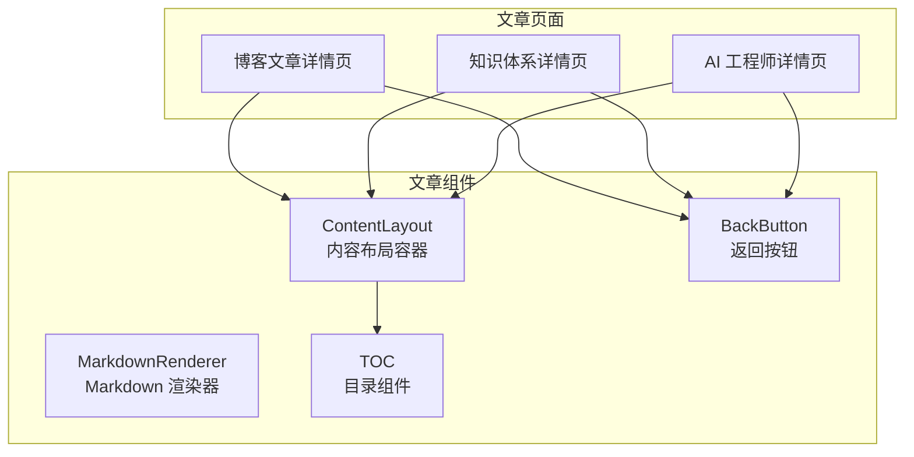
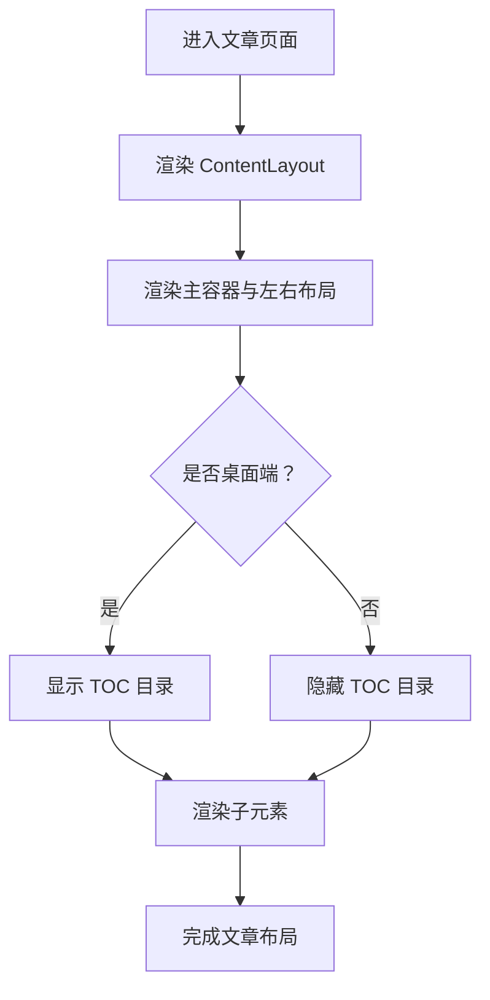
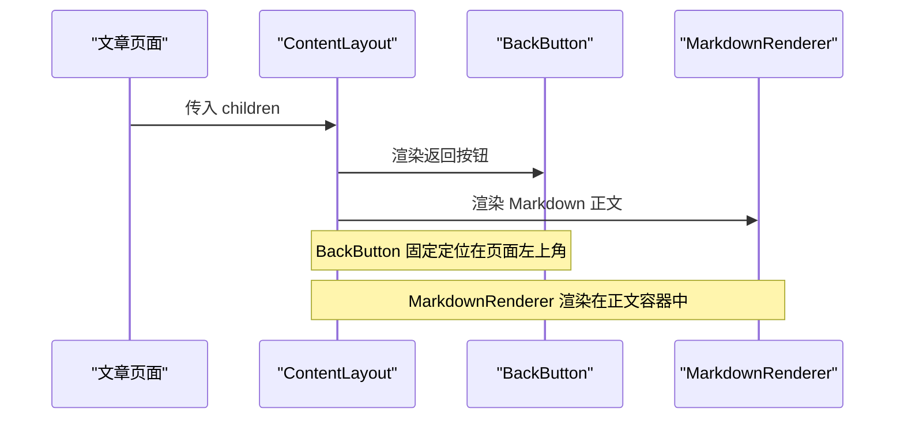
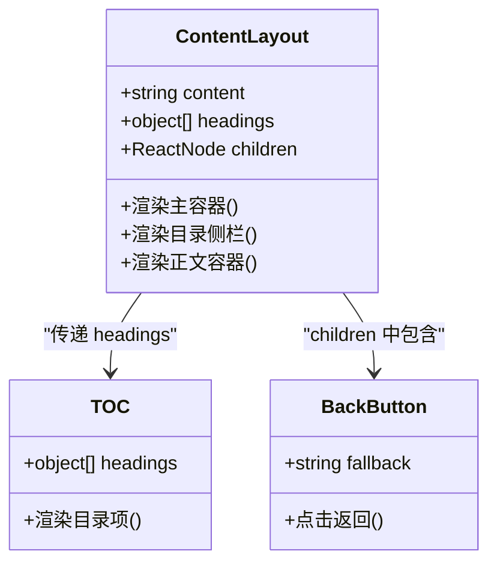
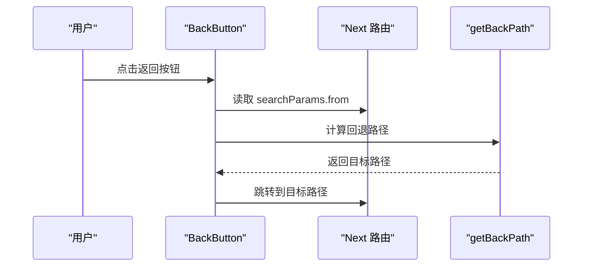
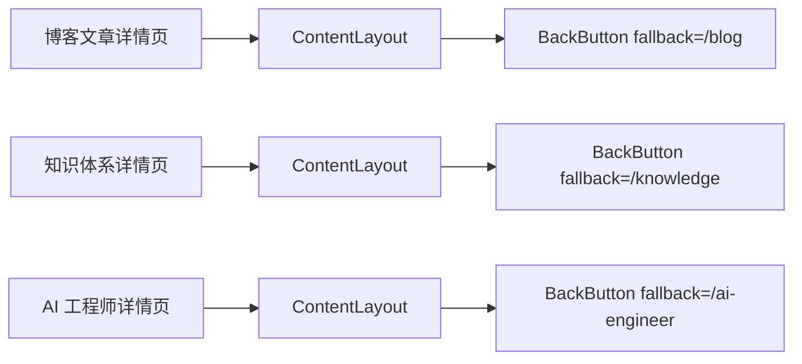
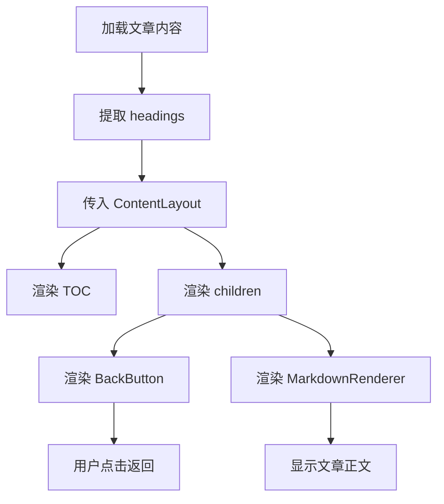

# ContentLayout 内容布局组件

<cite>
**本文引用的文件**   
- [ContentLayout.tsx](file://app/components/post/ContentLayout.tsx)
- [BackButton.tsx](file://app/components/post/BackButton.tsx)
- [page.tsx（博客文章详情页）](file://app/blog/post/[...slug]/page.tsx)
- [page.tsx（知识体系详情页）](file://app/knowledge/[...slug]/page.tsx)
- [page.tsx（AI 工程师详情页）](file://app/ai-engineer/[...slug]/page.tsx)
- [getBackPath.ts](file://lib/navigation/getBackPath.ts)
</cite>

## 目录
1. [简介](#简介)
2. [项目结构中的位置](#项目结构中的位置)
3. [核心职责与整体架构](#核心职责与整体架构)
4. [Props 接口说明](#props-接口说明)
5. [插槽机制与子元素约定](#插槽机制与子元素约定)
6. [样式结构与可定制点](#样式结构与可定制点)
7. [与 BackButton 的协作关系](#与-backbutton-的协作关系)
8. [在不同页面中的使用方式](#在不同页面中的使用方式)
9. [数据流与渲染流程](#数据流与渲染流程)
10. [扩展指南](#扩展指南)
11. [常见问题与排错](#常见问题与排错)
12. [总结](#总结)

## 简介
ContentLayout 是一个面向文章内容页面的统一布局容器。它负责：
- 提供统一的页面主体区域；
- 在桌面端显示目录侧边栏，在手机端隐藏；
- 承载正文内容、返回按钮等子元素；
- 与 TOC 目录组件协作，提升长文阅读体验；
- 与 BackButton 返回按钮配合，形成完整的文章页导航结构。

该组件不直接解析 Markdown，也不处理路由跳转逻辑，而是专注于“文章内容的展示布局”。

## 项目结构中的位置
ContentLayout 位于文章相关组件目录中，与 BackButton、MarkdownRenderer 共同构成文章详情页的基础能力。

**图表来源**
- [ContentLayout.tsx:1-31](file://app/components/post/ContentLayout.tsx#L1-L31)
- [BackButton.tsx:1-30](file://app/components/post/BackButton.tsx#L1-L30)
- [page.tsx（博客文章详情页）:1-28](file://app/blog/post/[...slug]/page.tsx#L1-L28)
- [page.tsx（知识体系详情页）:1-44](file://app/knowledge/[...slug]/page.tsx#L1-L44)
- [page.tsx（AI 工程师详情页）:1-45](file://app/ai-engineer/[...slug]/page.tsx#L1-L45)

**章节来源**
- [ContentLayout.tsx:1-31](file://app/components/post/ContentLayout.tsx#L1-L31)

## 核心职责与整体架构
ContentLayout 的核心职责是“为文章内容提供稳定、一致的布局骨架”，而不是承担业务逻辑。其关键行为如下：
- 使用主容器包裹整个文章区域；
- 左侧放置 TOC 目录，仅在桌面端显示；
- 右侧放置文章正文容器；
- 通过 children 接收 BackButton、MarkdownRenderer 等子组件；
- 将 headings 传递给 TOC，用于生成文章目录。

[本图为概念流程图，不直接映射具体代码结构]

**章节来源**
- [ContentLayout.tsx:12-30](file://app/components/post/ContentLayout.tsx#L12-L30)

## Props 接口说明
ContentLayout 当前暴露的 props 包括 content、headings 和 children。其中 content 虽然被声明为 props，但组件实际并未直接使用；真正参与渲染的是 headings 与 children。

| 属性名 | 类型 | 是否必填 | 默认值 | 说明 |
|---|---|---:|---:|---|
| content | string | 否 | 无 | 原始文章内容字符串，当前未参与渲染，属于预留或历史遗留字段 |
| headings | Array\<object\> | 否 | 无 | 目录标题数组，每个对象包含 id、text、level |
| children | ReactNode | 否 | 无 | 文章正文及辅助 UI，例如 BackButton、MarkdownRenderer |

headings 的结构建议如下：

| 字段 | 类型 | 说明 |
|---|---|---|
| id | string | 标题锚点标识，通常由 Markdown 标题解析生成 |
| text | string | 标题文本 |
| level | number | 标题层级，例如 h1、h2、h3 对应不同层级 |

**章节来源**
- [ContentLayout.tsx:6-10](file://app/components/post/ContentLayout.tsx#L6-L10)
- [ContentLayout.tsx:12-15](file://app/components/post/ContentLayout.tsx#L12-L15)

## 插槽机制与子元素约定
ContentLayout 没有显式命名插槽，而是通过 React children 实现插槽能力。调用方可以将任意 React 节点放入 ContentLayout，这些子元素会按顺序渲染到正文容器中。

典型子元素组合：
- BackButton：固定在页面左上角的返回按钮；
- MarkdownRenderer：将 Markdown 内容渲染为 HTML；
- 其他自定义 UI：例如作者信息、更新时间、相关文章推荐等。

**图表来源**
- [page.tsx（博客文章详情页）:21-25](file://app/blog/post/[...slug]/page.tsx#L21-L25)
- [page.tsx（知识体系详情页）:38-42](file://app/knowledge/[...slug]/page.tsx#L38-L42)
- [page.tsx（AI 工程师详情页）:38-42](file://app/ai-engineer/[...slug]/page.tsx#L38-L42)

**章节来源**
- [ContentLayout.tsx:16-27](file://app/components/post/ContentLayout.tsx#L16-L27)

## 样式结构与可定制点
ContentLayout 使用 Tailwind CSS 构建响应式布局，主要样式结构如下：

| 区域 | 作用 | 关键样式行为 | 可定制方向 |
|---|---|---|---|
| main 主容器 | 页面主体区域 | 最大宽度、居中、内边距、垂直间距 | 调整最大宽度、内外边距、背景色 |
| flex 容器 | 左右布局容器 | 横向排列、间距 | 调整 gap、对齐方式 |
| aside 目录侧栏 | 桌面端目录 | 隐藏于移动端、固定宽度、粘性定位、滚动 | 调整宽度、粘性位置、滚动行为 |
| article 正文容器 | 正文区域 | 弹性增长、最小宽度、prose 样式、无最大宽度限制 | 调整 prose 主题、字体、行高、颜色 |

需要注意：
- 目录侧栏在移动端隐藏，避免占用正文空间；
- 目录侧栏使用粘性定位，便于长文阅读时始终可见；
- 正文容器使用 prose 类，适合 Markdown 渲染后的排版；
- 若需要全局主题化，可通过 Tailwind 配置或 CSS 变量覆盖。

**图表来源**
- [ContentLayout.tsx:6-30](file://app/components/post/ContentLayout.tsx#L6-L30)
- [BackButton.tsx:6-28](file://app/components/post/BackButton.tsx#L6-L28)

**章节来源**
- [ContentLayout.tsx:17-27](file://app/components/post/ContentLayout.tsx#L17-L27)

## 与 BackButton 的协作关系
ContentLayout 本身不负责返回逻辑，但它是 BackButton 的常见宿主容器。BackButton 通过 Next.js 路由获取 from 参数，并借助 getBackPath 计算最终跳转路径。

协作要点：
- ContentLayout 负责把 BackButton 放在正文上方；
- BackButton 负责用户点击后的路由跳转；
- getBackPath 根据 from 参数映射回退路径，否则使用 fallback；
- 各页面在调用 ContentLayout 时传入不同的 fallback，例如 /blog、/knowledge、/ai-engineer。

**图表来源**
- [BackButton.tsx:6-19](file://app/components/post/BackButton.tsx#L6-L19)
- [getBackPath.ts:1-16](file://lib/navigation/getBackPath.ts#L1-L16)

**章节来源**
- [BackButton.tsx:6-28](file://app/components/post/BackButton.tsx#L6-L28)
- [getBackPath.ts:1-16](file://lib/navigation/getBackPath.ts#L1-L16)

## 在不同页面中的使用方式
ContentLayout 被多个文章类页面复用，包括博客文章、知识体系和 AI 工程师内容。

### 博客文章详情页
- 从 getContent 获取文章内容；
- 从 extractHeadings 提取标题列表；
- 将 BackButton 和 MarkdownRenderer 作为 children 传入 ContentLayout；
- fallback 设置为 /blog。

### 知识体系详情页
- 同样加载 Markdown 内容并提取 headings；
- 将 BackButton 的 fallback 设置为 /knowledge；
- 使用 ContentLayout 包裹正文。

### AI 工程师详情页
- 加载 ai-engineer 分类下的 Markdown 内容；
- 将 BackButton 的 fallback 设置为 /ai-engineer；
- 使用 ContentLayout 包裹正文。

**图表来源**
- [page.tsx（博客文章详情页）:21-25](file://app/blog/post/[...slug]/page.tsx#L21-L25)
- [page.tsx（知识体系详情页）:38-42](file://app/knowledge/[...slug]/page.tsx#L38-L42)
- [page.tsx（AI 工程师详情页）:38-42](file://app/ai-engineer/[...slug]/page.tsx#L38-L42)

**章节来源**
- [page.tsx（博客文章详情页）:11-27](file://app/blog/post/[...slug]/page.tsx#L11-L27)
- [page.tsx（知识体系详情页）:26-44](file://app/knowledge/[...slug]/page.tsx#L26-L44)
- [page.tsx（AI 工程师详情页）:26-45](file://app/ai-engineer/[...slug]/page.tsx#L26-L45)

## 数据流与渲染流程
ContentLayout 的数据流相对简单：
1. 页面组件读取 Markdown 内容；
2. 提取 headings 并传给 ContentLayout；
3. ContentLayout 将 headings 传给 TOC；
4. ContentLayout 渲染 children，包括 BackButton 和 MarkdownRenderer；
5. 用户交互由 BackButton 处理，内容展示由 MarkdownRenderer 处理。

[本图为概念流程图，不直接映射具体代码结构]

**章节来源**
- [ContentLayout.tsx:12-30](file://app/components/post/ContentLayout.tsx#L12-L30)

## 扩展指南
如果需要在 ContentLayout 基础上扩展功能，建议遵循以下原则：

### 新增可选 props
- 如果需要控制目录是否显示，可增加 showTOC 布尔 prop；
- 如果需要自定义目录容器样式，可增加 tocClassName 或 containerClassName；
- 如果需要支持多列目录，可增加 layoutMode 枚举。

### 改进 children 契约
- 目前 children 直接渲染，未做严格校验；
- 可在开发模式下提示缺少 BackButton 或 MarkdownRenderer；
- 可考虑引入命名插槽，例如 header、content、footer，提高可读性。

### 样式扩展
- 若需要适配更宽的文章内容，可调整 main 容器的最大宽度；
- 若需要深色模式，可通过 Tailwind 的 dark 前缀扩展；
- 若需要自定义 prose 主题，建议在 MarkdownRenderer 或全局样式中处理。

### 与导航系统扩展
- 若需要支持更多 from 来源，可扩展 getBackPath 的 fromMap；
- 若需要支持动态回退路径，可将 fallback 改为函数或路由对象。

**章节来源**
- [ContentLayout.tsx:6-30](file://app/components/post/ContentLayout.tsx#L6-L30)
- [getBackPath.ts:1-16](file://lib/navigation/getBackPath.ts#L1-L16)

## 常见问题与排错

### 问题一：ContentLayout 的 content prop 未生效
现象：传入 content 后页面没有变化。  
原因：ContentLayout 当前只使用 headings 和 children，content 未被渲染。  
解决：
- 如果只需要布局，继续使用 children 传入 MarkdownRenderer；
- 如果希望 ContentLayout 直接渲染 content，需修改组件内部逻辑。

**章节来源**
- [ContentLayout.tsx:6-10](file://app/components/post/ContentLayout.tsx#L6-L10)
- [ContentLayout.tsx:12-30](file://app/components/post/ContentLayout.tsx#L12-L30)

### 问题二：移动端目录遮挡正文
现象：在小屏幕设备上目录仍然占据空间。  
原因：当前目录侧栏使用移动端隐藏策略，正常情况下不应遮挡。  
排查：
- 检查是否覆盖了 hidden lg:block 样式；
- 检查外层容器是否改变了 flex 行为；
- 检查是否有全局样式强制显示 aside。

**章节来源**
- [ContentLayout.tsx:18-22](file://app/components/post/ContentLayout.tsx#L18-L22)

### 问题三：返回按钮跳转到错误页面
现象：点击返回后跳转到非预期路径。  
原因：searchParams.from 不在 fromMap 中，或 fallback 设置不正确。  
解决：
- 确认 URL 中 from 参数是否正确；
- 如需新增来源，扩展 getBackPath 的 fromMap；
- 确保页面传入正确的 fallback。

**章节来源**
- [BackButton.tsx:6-19](file://app/components/post/BackButton.tsx#L6-L19)
- [getBackPath.ts:1-16](file://lib/navigation/getBackPath.ts#L1-L16)

### 问题四：正文溢出或表格撑破布局
现象：长表格或长代码导致页面横向滚动。  
原因：正文容器虽使用 prose，但超宽内容仍可能溢出。  
解决：
- 在 MarkdownRenderer 或全局样式中为表格添加滚动容器；
- 为 pre 代码块启用横向滚动；
- 保持正文容器 min-w-0 与 max-w-none 的组合。

**章节来源**
- [ContentLayout.tsx:24-26](file://app/components/post/ContentLayout.tsx#L24-L26)

## 总结
ContentLayout 是一个简洁而稳定的文章内容布局组件。它通过响应式布局、目录侧栏和 children 插槽机制，为博客文章、知识体系和 AI 工程师内容提供了统一的展示结构。与 BackButton 和 TOC 的配合，使其能够胜任大多数长文阅读场景。未来可根据实际需求扩展 props、插槽契约和样式定制能力，同时保持其“专注布局”的职责边界。