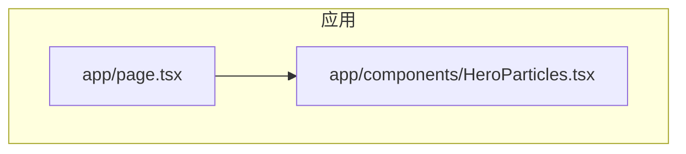
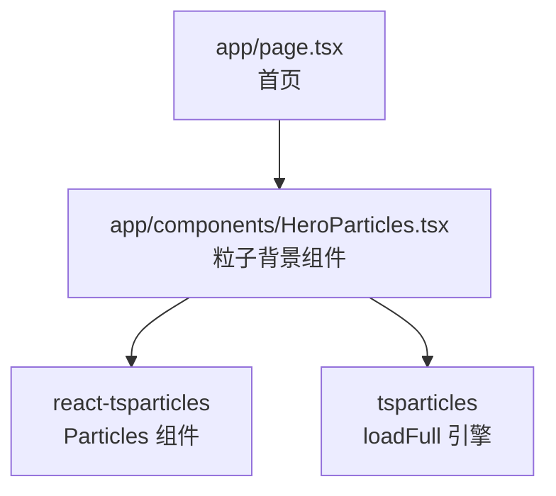
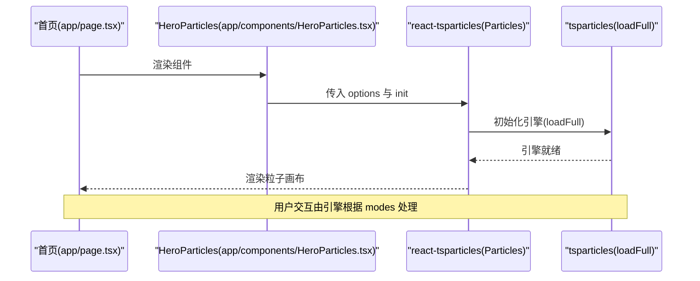
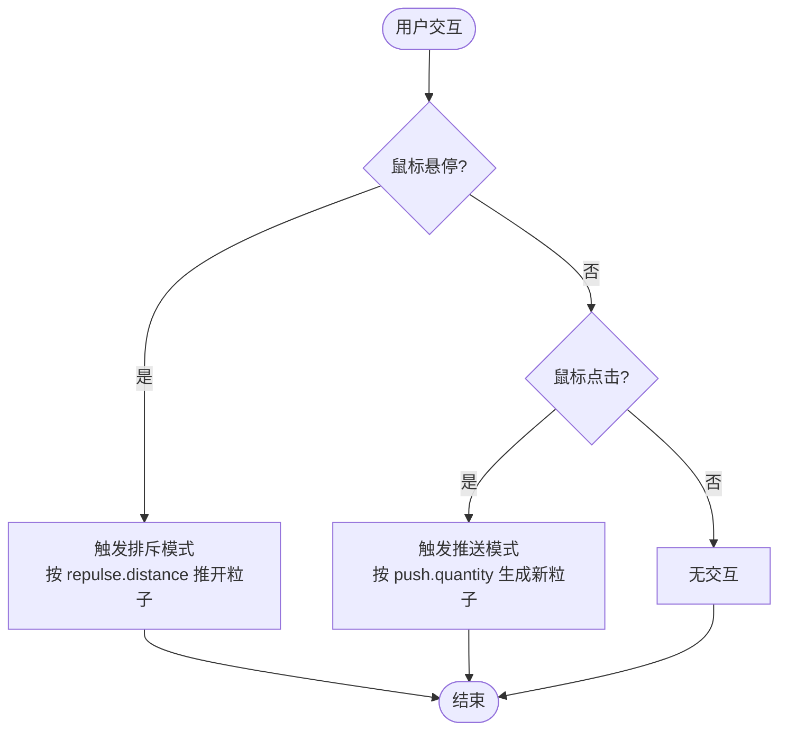
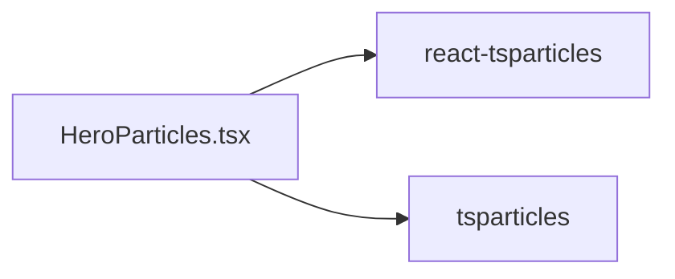

# HeroParticles 粒子背景组件

<cite>
**本文引用的文件**   
- [app/components/HeroParticles.tsx](file://app/components/HeroParticles.tsx)
- [app/page.tsx](file://app/page.tsx)
- [package.json](file://package.json)
</cite>

## 目录
1. [简介](#简介)
2. [项目结构](#项目结构)
3. [核心组件](#核心组件)
4. [架构总览](#架构总览)
5. [详细组件分析](#详细组件分析)
6. [依赖关系分析](#依赖关系分析)
7. [性能与优化建议](#性能与优化建议)
8. [故障排查指南](#故障排查指南)
9. [结论](#结论)
10. [附录：配置参考与示例](#附录配置参考与示例)

## 简介
HeroParticles 是一个基于 react-tsparticles 实现的动态粒子背景组件，用于在页面顶部区域提供可交互的粒子动画效果。该组件默认启用全屏背景、六边形粒子形状、连线效果，以及鼠标悬停排斥和点击推送等交互行为，适合用作首页 Hero 区域的视觉增强层。

## 项目结构
在本项目中，HeroParticles 位于 app/components 目录下，并在首页中作为子组件引入使用。

**图示来源**
- [app/page.tsx:5-24](file://app/page.tsx#L5-L24)
- [app/components/HeroParticles.tsx:1-40](file://app/components/HeroParticles.tsx#L1-L40)

**章节来源**
- [app/page.tsx:1-30](file://app/page.tsx#L1-L30)
- [app/components/HeroParticles.tsx:1-40](file://app/components/HeroParticles.tsx#L1-L40)

## 核心组件
HeroParticles 组件封装了 react-tsparticles 的 Particles 组件，并通过 init 钩子加载 tsparticles 完整引擎，同时通过 options 配置粒子的外观、运动、连线与交互行为。

- 初始化流程
  - 使用 useCallback 包裹初始化函数，避免不必要的重渲染。
  - 调用 loadFull 以加载完整的 tsparticles 引擎能力。
- 渲染输出
  - 返回一个 Particles 实例，设置 id 与 options。
- 关键配置项
  - fullScreen：启用全屏并设置层级为负值，使其作为背景层。
  - particles.number：控制粒子数量与密度。
  - particles.color/shape/opacity/size：定义颜色、形状（六边形）、透明度与大小。
  - particles.links：启用连线，设置距离、颜色、透明度与线宽。
  - particles.move：启用移动、速度、方向与边界反弹。
  - interactivity.events.onHover/click：启用悬停排斥与点击推送。
  - interactivity.modes.repulse/push：配置排斥距离与推送数量。
  - detectRetina：开启高分屏适配。

**章节来源**
- [app/components/HeroParticles.tsx:1-40](file://app/components/HeroParticles.tsx#L1-L40)

## 架构总览
下图展示了 HeroParticles 在首页中的集成方式及其与底层库的关系。

**图示来源**
- [app/page.tsx:5-24](file://app/page.tsx#L5-L24)
- [app/components/HeroParticles.tsx:3-14](file://app/components/HeroParticles.tsx#L3-L14)

## 详细组件分析

### 组件职责与数据流
- 职责
  - 提供可复用的粒子背景渲染逻辑。
  - 集中管理粒子样式与交互配置。
- 数据流
  - 父组件（首页）直接渲染 HeroParticles。
  - HeroParticles 内部通过 Particles 组件将配置传递给 tsparticles 引擎。
  - 用户交互事件由 tsparticles 引擎处理，并根据 modes 配置执行排斥或推送。

**图示来源**
- [app/page.tsx:20-24](file://app/page.tsx#L20-L24)
- [app/components/HeroParticles.tsx:6-14](file://app/components/HeroParticles.tsx#L6-L14)

### 初始化与引擎加载
- 使用 useCallback 缓存初始化函数，减少重复创建开销。
- 通过 loadFull 加载完整引擎，确保所有插件与更新器可用。

**章节来源**
- [app/components/HeroParticles.tsx:6-9](file://app/components/HeroParticles.tsx#L6-L9)

### 粒子样式与运动
- 数量与密度
  - number.value 控制基础数量；density.enable 与 area 控制密度分布区域。
- 颜色与透明度
  - color.value 设置粒子颜色；opacity.value 设置整体透明度。
- 形状与大小
  - shape.type 与 polygon.sides 设置为六边形；size.value 设置粒子尺寸。
- 连线效果
  - links.enable 启用连线；distance 控制连线阈值；color/opacity/width 控制连线样式。
- 运动行为
  - move.enable 启用移动；speed 控制速度；direction 控制方向；outModes.default 设置为 bounce 实现边界反弹。

**章节来源**
- [app/components/HeroParticles.tsx:15-25](file://app/components/HeroParticles.tsx#L15-L25)

### 交互事件与模式
- 悬停排斥
  - onHover.enable 与 mode 设为 repulse；repulse.distance 控制排斥半径。
- 点击推送
  - onClick.enable 与 mode 设为 push；push.quantity 控制每次点击产生的粒子数量。

**图示来源**
- [app/components/HeroParticles.tsx:26-35](file://app/components/HeroParticles.tsx#L26-L35)

**章节来源**
- [app/components/HeroParticles.tsx:26-35](file://app/components/HeroParticles.tsx#L26-L35)

### 高分屏适配
- 启用 detectRetina 以提升高分辨率屏幕下的渲染清晰度。

**章节来源**
- [app/components/HeroParticles.tsx:36-37](file://app/components/HeroParticles.tsx#L36-L37)

## 依赖关系分析
- 运行时依赖
  - react-tsparticles：React 封装组件。
  - tsparticles：粒子引擎核心库。
- 版本信息
  - package.json 中声明了 react-tsparticles 与 tsparticles 的版本范围。

**图示来源**
- [app/components/HeroParticles.tsx:3-4](file://app/components/HeroParticles.tsx#L3-L4)
- [package.json:21-29](file://package.json#L21-L29)

**章节来源**
- [package.json:21-29](file://package.json#L21-L29)

## 性能与优化建议
- 控制粒子数量
  - 适当降低 number.value 以减少绘制压力，尤其在低端设备或移动端。
- 调整密度区域
  - 增大 density.area 可降低单位面积内的粒子密度，从而提升性能。
- 简化连线
  - 增大 links.distance 或关闭 links.enable，减少连线计算量。
- 降低速度与复杂度
  - 减小 move.speed，避免频繁的位置更新。
- 禁用不必要的高清适配
  - 在低分辨率场景下可考虑关闭 detectRetina。
- 条件渲染
  - 在非首屏或非必要页面延迟加载或隐藏粒子背景，减少初始渲染开销。

[本节为通用性能建议，不直接分析具体文件]

## 故障排查指南
- 粒子未显示
  - 检查是否已安装 react-tsparticles 与 tsparticles 依赖。
  - 确认组件是否在客户端环境渲染（组件标记为 "use client"）。
- 交互无效
  - 检查 interactivity.events 与 modes 配置是否正确启用。
  - 确认父容器未被其他元素遮挡（fullScreen.zIndex 为负值）。
- 高分屏模糊
  - 确认 detectRetina 已启用。
- 性能卡顿
  - 降低 number.value、move.speed，或关闭 links.enable。
  - 增大 density.area 以降低密度。

**章节来源**
- [app/components/HeroParticles.tsx:1-40](file://app/components/HeroParticles.tsx#L1-L40)

## 结论
HeroParticles 组件通过简洁的配置实现了丰富的粒子背景效果，具备悬停排斥与点击推送等交互能力，适合作为首页 Hero 区域的视觉增强层。通过合理调优参数，可在视觉效果与性能之间取得平衡。

[本节为总结性内容，不直接分析具体文件]

## 附录：配置参考与示例

### 组件 Props 接口说明
- id：画布标识符，便于调试与定位。
- init：初始化回调，用于加载 tsparticles 引擎。
- options：粒子系统配置对象，包含以下主要子项：
  - fullScreen：全屏开关与层级。
  - particles：粒子外观与行为（number、color、shape、opacity、size、links、move）。
  - interactivity：交互事件与模式（events.onHover/onClick、modes.repulse/push）。
  - detectRetina：高分屏适配开关。

**章节来源**
- [app/components/HeroParticles.tsx:11-38](file://app/components/HeroParticles.tsx#L11-L38)

### 常用配置示例（路径引用）
- 粒子数量与密度
  - 参考：[app/components/HeroParticles.tsx:17-18](file://app/components/HeroParticles.tsx#L17-L18)
- 颜色、形状、透明度、大小
  - 参考：[app/components/HeroParticles.tsx:19-22](file://app/components/HeroParticles.tsx#L19-L22)
- 连线效果
  - 参考：[app/components/HeroParticles.tsx:23](file://app/components/HeroParticles.tsx#L23)
- 运动行为
  - 参考：[app/components/HeroParticles.tsx:24](file://app/components/HeroParticles.tsx#L24)
- 交互事件与模式
  - 参考：[app/components/HeroParticles.tsx:26-35](file://app/components/HeroParticles.tsx#L26-L35)
- 高分屏适配
  - 参考：[app/components/HeroParticles.tsx:36-37](file://app/components/HeroParticles.tsx#L36-L37)

### 在不同页面中集成使用
- 首页集成
  - 在首页中导入并渲染 HeroParticles，作为 Hero 区域的背景层。
  - 参考：[app/page.tsx:5-24](file://app/page.tsx#L5-L24)

**章节来源**
- [app/page.tsx:5-24](file://app/page.tsx#L5-L24)

### 响应式适配方案
- 当前实现通过 detectRetina 提升高分屏清晰度。
- 如需进一步响应式优化，可在不同断点下动态调整 number.value、density.area、links.distance 等参数，以实现更佳的视觉与性能平衡。

[本节为通用适配建议，不直接分析具体文件]