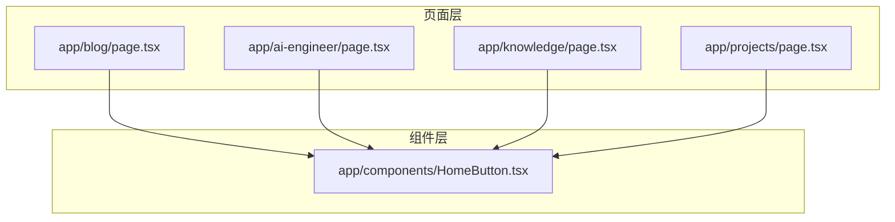
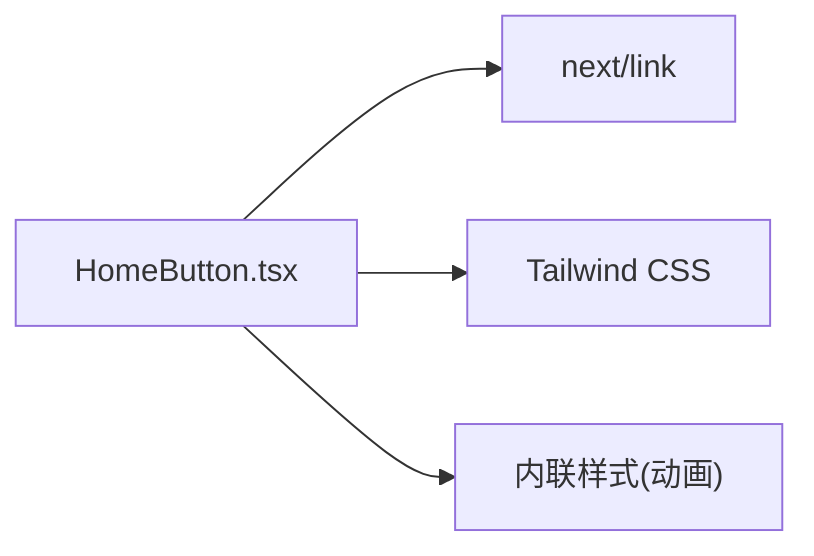

# HomeButton 导航按钮组件

<cite>
**本文引用的文件**   
- [HomeButton.tsx](file://app/components/HomeButton.tsx)
- [blog/page.tsx](file://app/blog/page.tsx)
- [ai-engineer/page.tsx](file://app/ai-engineer/page.tsx)
- [knowledge/page.tsx](file://app/knowledge/page.tsx)
- [projects/page.tsx](file://app/projects/page.tsx)
</cite>

## 目录
1. [简介](#简介)
2. [项目结构](#项目结构)
3. [核心组件](#核心组件)
4. [架构总览](#架构总览)
5. [详细组件分析](#详细组件分析)
6. [依赖关系分析](#依赖关系分析)
7. [性能与可访问性](#性能与可访问性)
8. [使用示例与最佳实践](#使用示例与最佳实践)
9. [故障排查](#故障排查)
10. [结论](#结论)

## 简介
HomeButton 是一个用于“回到首页”的固定定位导航按钮。它通过 Next.js 的 Link 组件实现客户端路由跳转，提供深色模式适配、悬停缩放动画以及缓慢弹跳动画，提升用户在多页面站点中的导航体验。该组件以无状态形式存在，默认无 props，样式基于 Tailwind CSS 原子类与内联样式组合实现。

## 项目结构
在本项目中，HomeButton 位于应用组件目录下，被多个页面作为全局导航入口引入，典型使用位置包括博客列表页、AI 工程师知识页、前端知识页与项目案例页等。



图表来源
- [blog/page.tsx:1-21](file://app/blog/page.tsx#L1-L21)
- [ai-engineer/page.tsx:1-62](file://app/ai-engineer/page.tsx#L1-L62)
- [knowledge/page.tsx:1-59](file://app/knowledge/page.tsx#L1-L59)
- [projects/page.tsx:1-120](file://app/projects/page.tsx#L1-L120)
- [HomeButton.tsx:1-37](file://app/components/HomeButton.tsx#L1-L37)

章节来源
- [HomeButton.tsx:1-37](file://app/components/HomeButton.tsx#L1-L37)
- [blog/page.tsx:1-21](file://app/blog/page.tsx#L1-L21)
- [ai-engineer/page.tsx:1-62](file://app/ai-engineer/page.tsx#L1-L62)
- [knowledge/page.tsx:1-59](file://app/knowledge/page.tsx#L1-L59)
- [projects/page.tsx:1-120](file://app/projects/page.tsx#L1-L120)

## 核心组件
- 组件职责：提供“回到首页”的固定导航入口，统一视觉风格与交互行为。
- 技术栈：Next.js（客户端组件）、Tailwind CSS（样式）、内联样式（自定义动画）。
- 路由策略：使用 Next.js Link 组件进行客户端导航，目标路径为根路径。
- 可访问性：为链接提供语义化 aria-label，便于屏幕阅读器识别。

章节来源
- [HomeButton.tsx:1-37](file://app/components/HomeButton.tsx#L1-L37)

## 架构总览
HomeButton 作为独立 UI 组件，被各页面直接渲染，不持有业务状态；路由跳转由 Next.js Link 在客户端完成。整体流程简洁清晰：用户点击按钮 → Link 触发客户端导航 → 浏览器跳转到根路径。

```mermaid
sequenceDiagram
participant User as "用户"
participant Page as "任意页面"
participant HB as "HomeButton"
participant Link as "Next.js Link"
participant Router as "客户端路由器"
User->>HB : 点击“回到首页”
HB->>Link : 触发 href="/"
Link->>Router : 发起客户端路由跳转
Router-->>Page : 渲染根页面
```

图表来源
- [HomeButton.tsx:8-23](file://app/components/HomeButton.tsx#L8-L23)

## 详细组件分析

### 功能与用途
- 提供全站统一的“回到首页”快捷入口。
- 固定在视口左上角，避免长内容滚动后丢失导航能力。
- 适用于文章列表、知识体系、项目展示等多页面场景。

章节来源
- [HomeButton.tsx:5-23](file://app/components/HomeButton.tsx#L5-L23)

### 视觉设计与样式定制
- 基础外观：圆形按钮、阴影、浅色背景与文字颜色。
- 深色模式：通过 dark: 前缀切换背景与文字色。
- 交互反馈：悬停时轻微放大（scale）并改变背景色。
- 动画效果：缓慢弹跳动画（自定义 keyframes），增强引导感。
- 定位方式：fixed 定位，z-index 较高，确保浮于内容之上。
- 尺寸：固定宽高，图标尺寸适中，保证触控友好。

扩展建议
- 若需主题化，可将颜色与尺寸抽离为 CSS 变量或 Tailwind 配置项。
- 动画时长与幅度可通过 CSS 变量控制，便于统一调整。

章节来源
- [HomeButton.tsx:10-34](file://app/components/HomeButton.tsx#L10-L34)

### 交互行为
- 点击即导航至根路径，采用客户端跳转，避免整页刷新。
- 悬停提供缩放与背景色变化，增强可发现性。
- 持续缓慢弹跳动画提示用户注意。

章节来源
- [HomeButton.tsx:10-34](file://app/components/HomeButton.tsx#L10-L34)

### Props 接口
当前版本为无参组件，未暴露任何 props。若后续需要支持：
- 自定义目标路径（如 /home）
- 自定义样式覆盖（className）
- 显示文本或图标替换
- 是否启用动画
- 无障碍标签文案

可在保持向后兼容的前提下逐步扩展。

章节来源
- [HomeButton.tsx:5-6](file://app/components/HomeButton.tsx#L5-L6)

### 路由跳转逻辑
- 使用 Next.js Link 组件，href 固定为根路径。
- 客户端路由跳转，用户体验流畅。
- 与 BackButton 等返回式组件不同，HomeButton 是单向“回首页”，不涉及来源判断。

章节来源
- [HomeButton.tsx:8-23](file://app/components/HomeButton.tsx#L8-L23)

### 与其他导航组件的配合
- 与 BackButton 配合：BackButton 负责“返回上一页”，HomeButton 负责“回到首页”，二者互补。
- 与分类导航（CategoryNav）配合：在博客列表中，HomeButton 提供全局入口，CategoryNav 提供内容维度导航。
- 与 TOC 配合：TOC 聚焦当前页面锚点，HomeButton 提供跨页面导航。

章节来源
- [blog/page.tsx:10-12](file://app/blog/page.tsx#L10-L12)
- [post/BackButton.tsx:1-29](file://app/components/post/BackButton.tsx#L1-L29)

## 依赖关系分析
- 运行时依赖：Next.js Link（客户端路由）、React（组件渲染）。
- 样式依赖：Tailwind CSS（原子类）、内联 style（自定义动画）。
- 页面耦合：低耦合，仅通过 JSX 树注入到页面中，不共享状态。



图表来源
- [HomeButton.tsx:1-37](file://app/components/HomeButton.tsx#L1-L37)

章节来源
- [HomeButton.tsx:1-37](file://app/components/HomeButton.tsx#L1-L37)

## 性能与可访问性
- 性能
  - 客户端组件标记，按需加载；按钮体积小，对首屏影响极小。
  - 动画使用 CSS transform，GPU 加速友好。
  - 无额外网络请求。
- 可访问性
  - 为链接提供 aria-label，利于屏幕阅读器朗读。
  - 建议使用语义化的 button 或 a 元素（当前为 Link 包裹的 a），已具备键盘可操作能力。
- 响应式设计
  - 固定定位与尺寸在移动端同样可用；如需更大触控区域，可增加 padding 或尺寸。
  - 深色模式通过 Tailwind 自动适配系统主题。

章节来源
- [HomeButton.tsx:10-34](file://app/components/HomeButton.tsx#L10-L34)

## 使用示例与最佳实践

### 基本用法
在任意页面中引入并渲染 HomeButton，即可在页面左上角出现“回到首页”按钮。

参考路径
- [blog/page.tsx:10-12](file://app/blog/page.tsx#L10-L12)
- [ai-engineer/page.tsx:9-11](file://app/ai-engineer/page.tsx#L9-L11)
- [knowledge/page.tsx:9-11](file://app/knowledge/page.tsx#L9-L11)
- [projects/page.tsx:7-9](file://app/projects/page.tsx#L7-L9)

### 与分类导航组合
在博客列表页中，将 HomeButton 置于 CategoryNav 之前，确保用户先看到全局入口，再进入内容维度导航。

参考路径
- [blog/page.tsx:10-12](file://app/blog/page.tsx#L10-L12)

### 与返回按钮组合
在详情页或子页面中，同时提供 BackButton 与 HomeButton，分别满足“返回来源”和“回到首页”的需求。

参考路径
- [post/BackButton.tsx:1-29](file://app/components/post/BackButton.tsx#L1-L29)

### 样式定制建议
- 若希望统一主题，可将颜色、尺寸、动画参数提取到 Tailwind 配置或 CSS 变量。
- 若需要禁用动画，可通过外层容器 class 控制 animation 属性。

章节来源
- [HomeButton.tsx:25-34](file://app/components/HomeButton.tsx#L25-L34)

## 故障排查
- 按钮不可见
  - 检查父容器是否设置了 overflow-hidden 或 z-index 冲突导致被遮挡。
  - 确认 Tailwind 暗黑模式配置是否正确生效。
- 点击无效
  - 确认 Next.js Link 正常工作，且根路由存在。
  - 检查是否有其他事件冒泡拦截了点击。
- 动画卡顿
  - 避免在按钮上叠加复杂动画或重绘样式。
  - 确保动画仅使用 transform 与 opacity。

章节来源
- [HomeButton.tsx:10-34](file://app/components/HomeButton.tsx#L10-L34)

## 结论
HomeButton 是一个轻量、稳定、易用的全局导航组件，适合在多页面站点中提供一致的“回到首页”入口。其设计遵循最小化依赖、高内聚低耦合原则，并通过 Tailwind 与内联样式实现了良好的视觉与交互体验。未来可按需扩展 props 以支持更灵活的定制与主题化。