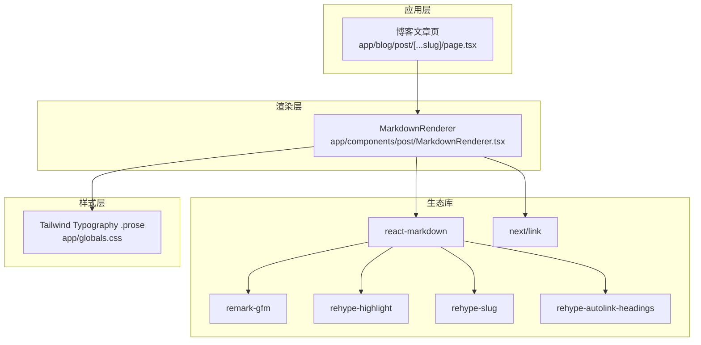
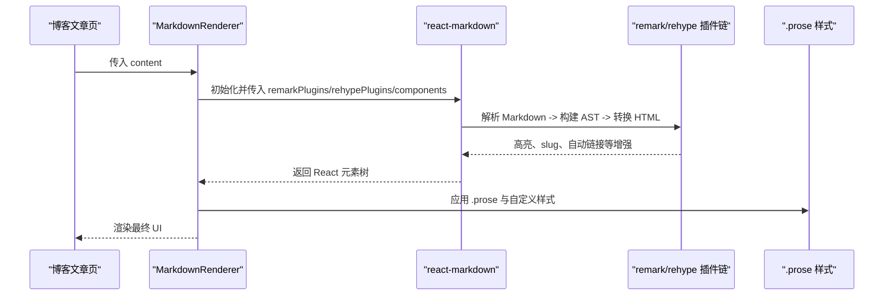
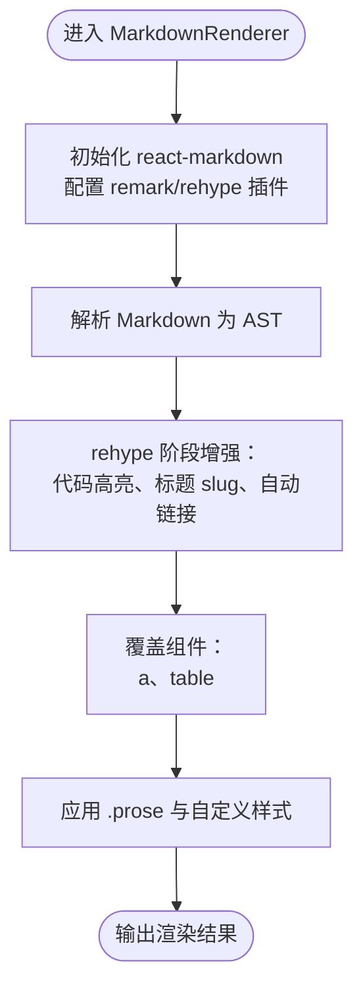
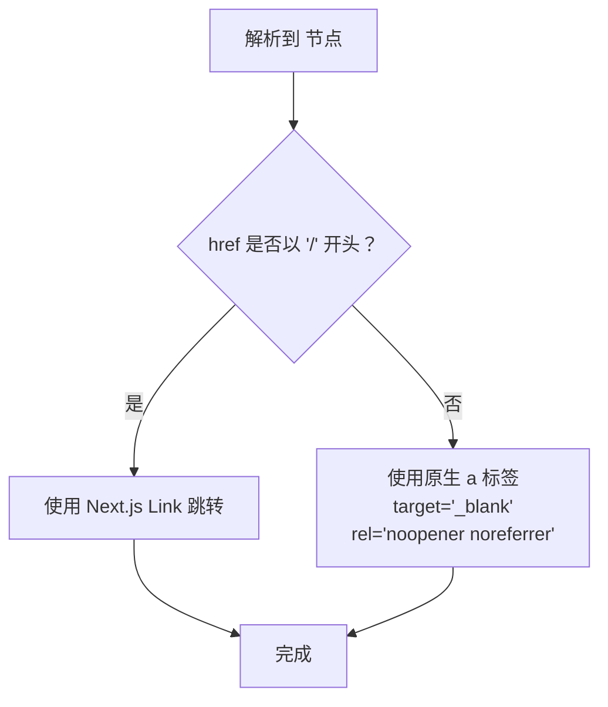
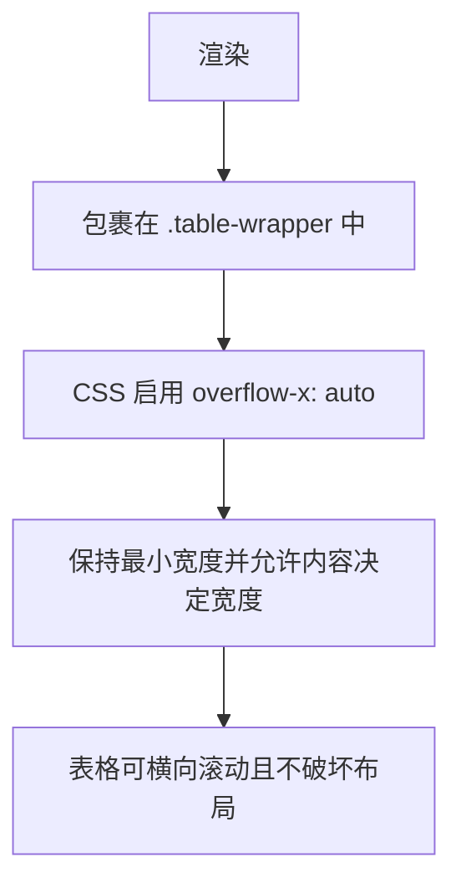
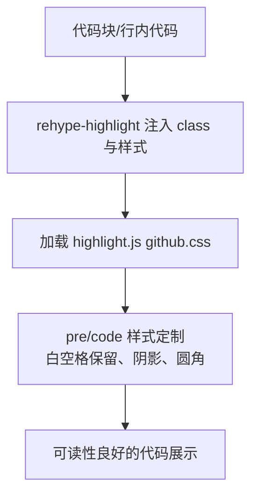
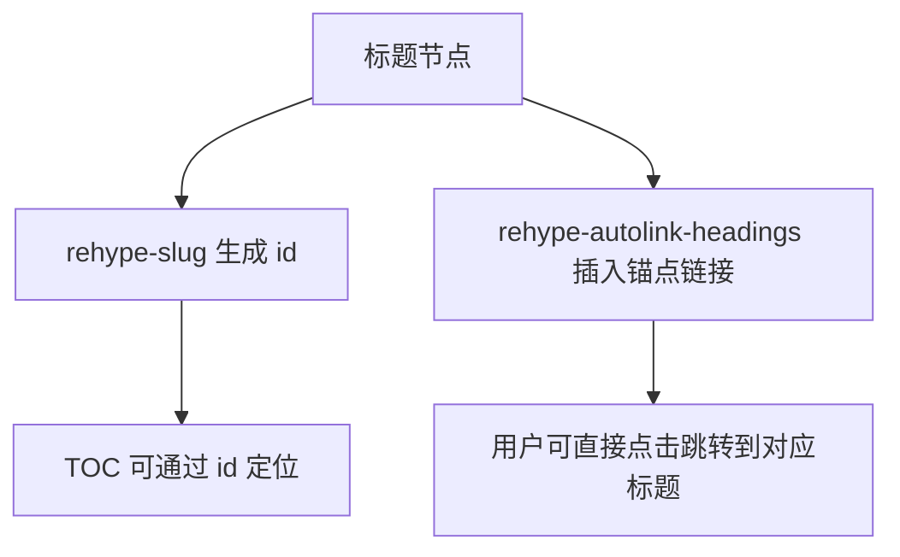
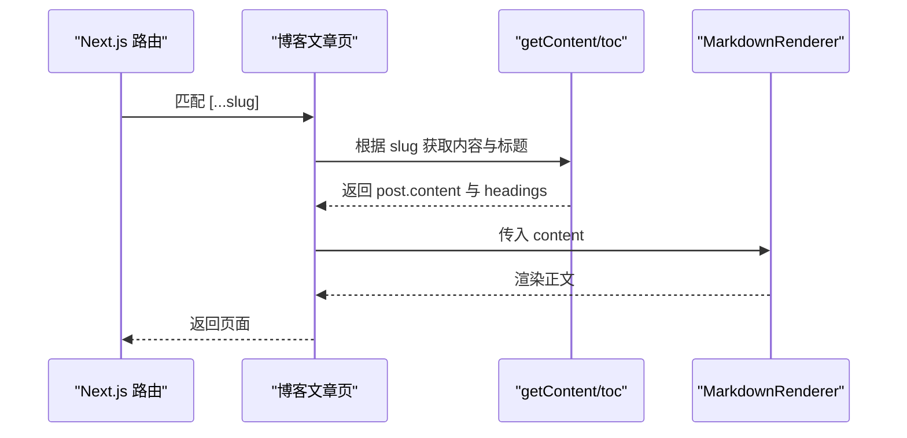
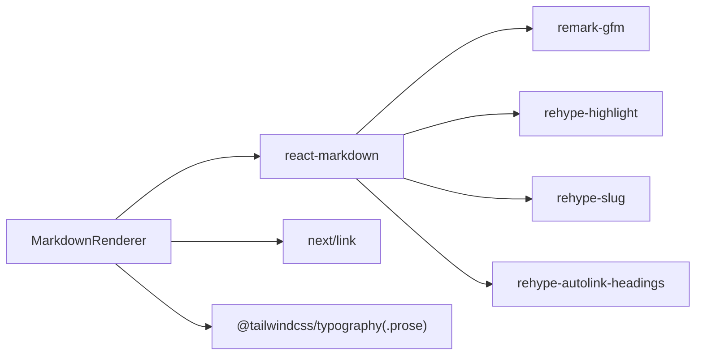

# MarkdownRenderer Markdown 渲染器

<cite>
**本文引用的文件**   
- [MarkdownRenderer.tsx](file://app/components/post/MarkdownRenderer.tsx)
- [page.tsx（博客文章页）](file://app/blog/post/[...slug]/page.tsx)
- [globals.css（全局样式与 Tailwind 排版）](file://app/globals.css)
- [package.json（依赖声明）](file://package.json)
</cite>

## 目录
1. [简介](#简介)
2. [项目结构](#项目结构)
3. [核心组件](#核心组件)
4. [架构总览](#架构总览)
5. [详细组件分析](#详细组件分析)
6. [依赖关系分析](#依赖关系分析)
7. [性能考虑](#性能考虑)
8. [故障排除指南](#故障排除指南)
9. [结论](#结论)

## 简介
本文件为 MarkdownRenderer 组件的详细技术文档。该组件基于 react-markdown，结合 remark-gfm、rehype-highlight、rehype-slug、rehype-autolink-headings 等插件，提供 GFM 语法支持、代码高亮、标题锚点与自动链接、内部路由链接处理、表格横向滚动等能力。同时，通过 Tailwind Typography 的 .prose 类与自定义样式，确保长内容、宽表格、代码块在移动端和窄屏下不撑破布局。

## 项目结构
MarkdownRenderer 位于客户端组件目录中，被博客文章页面引用，负责将 Markdown 字符串渲染为 React 元素树；样式由全局样式表统一控制。

图表来源
- [MarkdownRenderer.tsx:1-39](file://app/components/post/MarkdownRenderer.tsx#L1-L39)
- [page.tsx（博客文章页）:1-27](file://app/blog/post/[...slug]/page.tsx#L1-L27)
- [globals.css:1-159](file://app/globals.css#L1-L159)

章节来源
- [MarkdownRenderer.tsx:1-39](file://app/components/post/MarkdownRenderer.tsx#L1-L39)
- [page.tsx（博客文章页）:1-27](file://app/blog/post/[...slug]/page.tsx#L1-L27)
- [globals.css:1-159](file://app/globals.css#L1-L159)

## 核心组件
- MarkdownRenderer：客户端组件，接收 content 字符串，使用 react-markdown 进行渲染，并通过 remark/rehype 插件链扩展功能。
- 博客文章页：服务端组件，读取文章内容并传入 MarkdownRenderer。

关键职责
- 启用 GFM 语法（表格、删除线、任务列表等）。
- 代码块语法高亮。
- 标题生成 slug 与自动锚点链接。
- 区分站内相对链接与外部链接，分别走 Next.js 导航或新窗口打开。
- 表格包裹容器以支持横向滚动。
- 通过 .prose 与自定义 CSS 保证排版与响应式体验。

章节来源
- [MarkdownRenderer.tsx:10-39](file://app/components/post/MarkdownRenderer.tsx#L10-L39)
- [page.tsx（博客文章页）:11-26](file://app/blog/post/[...slug]/page.tsx#L11-L26)

## 架构总览
下图展示从文章数据到最终 DOM 的关键流程：

图表来源
- [MarkdownRenderer.tsx:13-36](file://app/components/post/MarkdownRenderer.tsx#L13-L36)
- [globals.css:25-159](file://app/globals.css#L25-L159)

## 详细组件分析

### MarkdownRenderer 组件
- 输入：content（Markdown 字符串）
- 输出：React 元素树，包含段落、标题、代码块、表格、链接等
- 插件链：
  - remark-gfm：启用 GitHub Flavored Markdown 语法
  - rehype-highlight：对代码块进行语法高亮
  - rehype-slug：为标题生成 id（slug）
  - rehype-autolink-headings：为标题自动生成带锚点的链接
- 组件覆盖：
  - a：根据 href 是否以 / 开头，选择 Next.js Link 或原生 a 标签（外链在新窗口打开并设置安全属性）
  - table：用外层容器包裹以实现横向滚动

图表来源
- [MarkdownRenderer.tsx:13-36](file://app/components/post/MarkdownRenderer.tsx#L13-L36)

#### 链接处理策略
- 站内链接（href 以 / 开头）：使用 Next.js Link 实现客户端跳转，保留 SPA 体验。
- 外部链接：使用原生 a 标签，target="_blank" 并添加 rel="noopener noreferrer" 提升安全性。

图表来源
- [MarkdownRenderer.tsx:17-27](file://app/components/post/MarkdownRenderer.tsx#L17-L27)

#### 表格与横向滚动
- 表格被包裹在带有 table-wrapper 类的容器中，配合全局样式实现横向滚动，避免撑破布局。

图表来源
- [MarkdownRenderer.tsx:28-32](file://app/components/post/MarkdownRenderer.tsx#L28-L32)
- [globals.css:111-135](file://app/globals.css#L111-L135)

#### 代码高亮
- 使用 rehype-highlight 对代码块进行高亮，样式来自 highlight.js 主题（github.css）。
- 代码块容器支持横向滚动，行内代码使用浅色背景与圆角。

图表来源
- [MarkdownRenderer.tsx:5-6](file://app/components/post/MarkdownRenderer.tsx#L5-L6)
- [globals.css:70-100](file://app/globals.css#L70-L100)

#### 标题与锚点
- rehype-slug 为标题生成稳定的 id。
- rehype-autolink-headings 为标题自动生成可点击的锚点链接。

图表来源
- [MarkdownRenderer.tsx:6-7](file://app/components/post/MarkdownRenderer.tsx#L6-L7)

章节来源
- [MarkdownRenderer.tsx:1-39](file://app/components/post/MarkdownRenderer.tsx#L1-L39)

### 与页面集成
- 博客文章页在服务端获取文章内容后，将 content 与 headings 传给 ContentLayout，并将 content 传递给 MarkdownRenderer。
- 文章不存在时显示占位提示。

图表来源
- [page.tsx（博客文章页）:11-26](file://app/blog/post/[...slug]/page.tsx#L11-L26)

章节来源
- [page.tsx（博客文章页）:1-27](file://app/blog/post/[...slug]/page.tsx#L1-L27)

### 样式与排版
- 使用 @tailwindcss/typography 的 .prose 作为基础排版。
- 针对代码块、图片、表格、链接等进行强化：
  - 代码块：阴影、圆角、横向滚动、保留空白格式
  - 图片：自适应宽度、圆角
  - 表格：外层容器横向滚动、内容决定宽度
  - 链接：颜色与悬停效果、超长链接换行
- 全局 body 防止整体横向滚动。

章节来源
- [globals.css:1-159](file://app/globals.css#L1-L159)

## 依赖关系分析
- react-markdown：Markdown 解析与 React 渲染核心
- remark-gfm：GitHub Flavored Markdown 支持
- rehype-highlight：代码高亮
- rehype-slug：标题 slug 生成
- rehype-autolink-headings：标题自动链接
- next/link：客户端路由跳转
- @tailwindcss/typography：.prose 排版基础

图表来源
- [package.json:12-29](file://package.json#L12-L29)
- [MarkdownRenderer.tsx:3-8](file://app/components/post/MarkdownRenderer.tsx#L3-L8)

章节来源
- [package.json:12-29](file://package.json#L12-L29)
- [MarkdownRenderer.tsx:3-8](file://app/components/post/MarkdownRenderer.tsx#L3-L8)

## 性能考虑
- 插件链优化
  - 仅在需要时启用 rehype-highlight，避免不必要的计算。
  - 若不需要标题 slug 或自动链接，可移除对应插件以减少开销。
- 代码高亮
  - 按需引入 highlight.js 语言包，减少打包体积。
  - 对大量代码块场景，考虑懒加载或虚拟滚动。
- 图片优化
  - 当前未使用 Next.js Image，建议对大图使用 Next/Image 或 CDN 优化，开启延迟加载与尺寸限制。
- 渲染路径
  - MarkdownRenderer 为客户端组件，适合交互较多的场景；如仅需静态渲染，可在服务端预渲染 HTML 以降低首屏成本。
- 样式与重排
  - 表格与代码块的横向滚动已做优化，避免触发整页重排。
  - 保持 .prose 的 max-width 与 break-word，防止长内容溢出。

[本节为通用性能建议，不直接分析具体文件]

## 故障排除指南
- 代码高亮不生效
  - 确认已安装并引入 rehype-highlight 与 highlight.js 主题样式。
  - 检查代码块是否包含正确的 language 元信息。
- 链接跳转异常
  - 站内链接必须以 / 开头才会走 Next.js Link；否则会被当作外链处理。
  - 外链会在新窗口打开，如需同窗跳转，需自定义组件逻辑。
- 表格溢出
  - 确认表格被 .table-wrapper 包裹，且全局样式启用了 overflow-x: auto。
- 标题锚点无效
  - 确认 rehype-slug 与 rehype-autolink-headings 均已启用。
  - 检查浏览器地址栏 hash 是否与标题 id 一致。
- 样式错乱
  - 确认 .prose 类存在且未被覆盖。
  - 检查 highlight.js 主题是否成功加载。

章节来源
- [MarkdownRenderer.tsx:13-36](file://app/components/post/MarkdownRenderer.tsx#L13-L36)
- [globals.css:70-159](file://app/globals.css#L70-L159)

## 结论
MarkdownRenderer 通过 react-markdown 与 remark/rehype 插件体系，提供了完善的 GFM 支持、代码高亮、标题锚点与自动链接、内外链区分以及表格横向滚动等能力。配合 Tailwind Typography 与自定义样式，保证了复杂内容的稳定排版与用户体验。建议在后续迭代中按需裁剪插件、优化图片与代码高亮资源，并根据业务需求扩展更多自定义组件与安全策略。