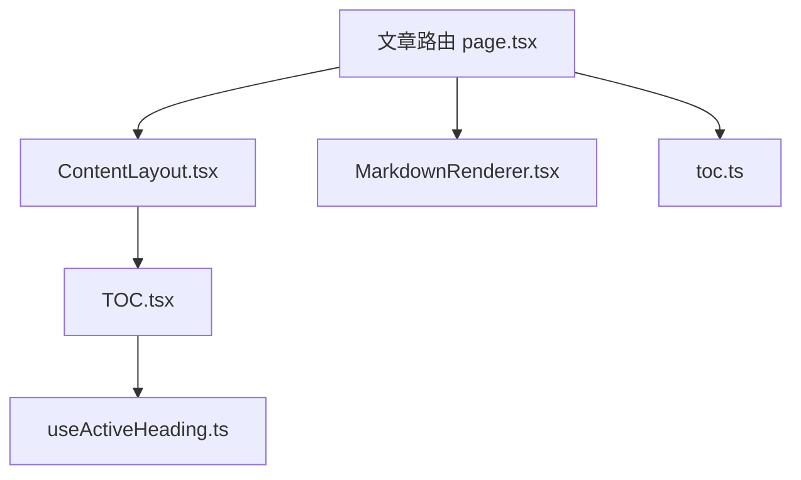
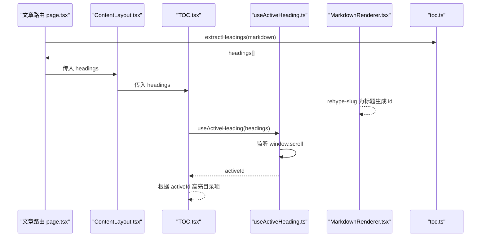
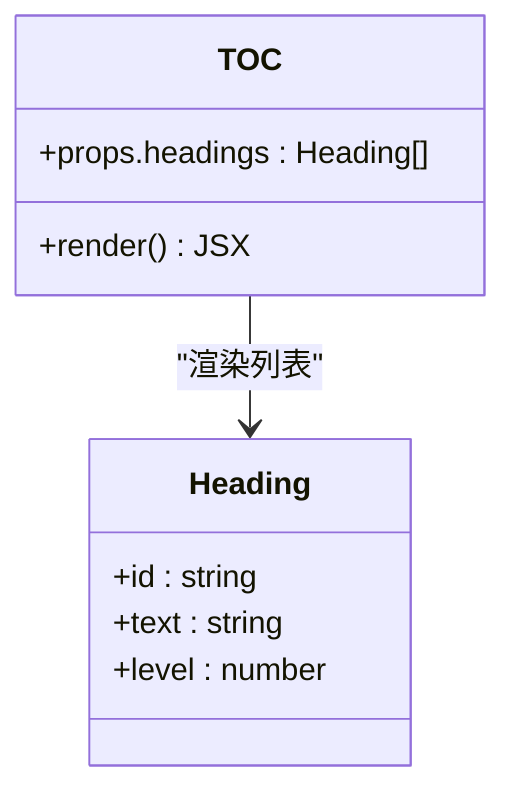
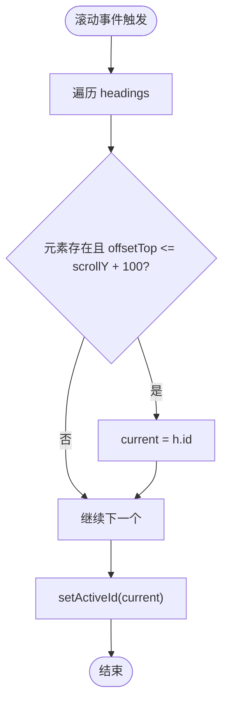
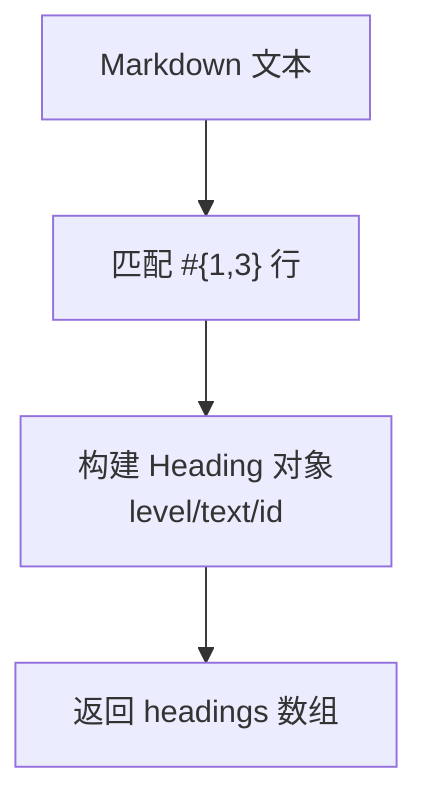
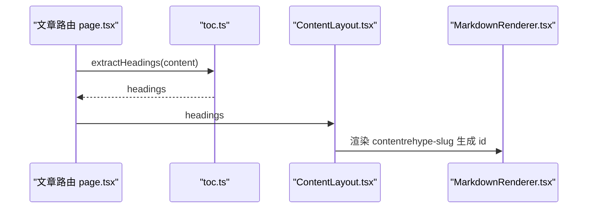
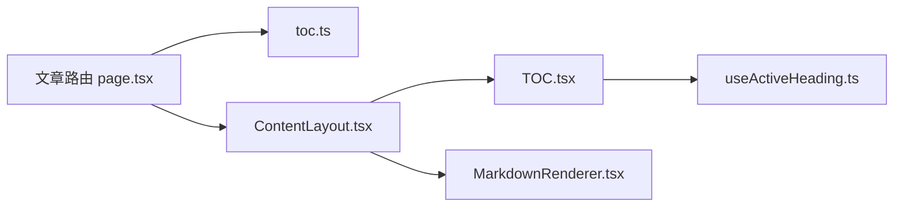
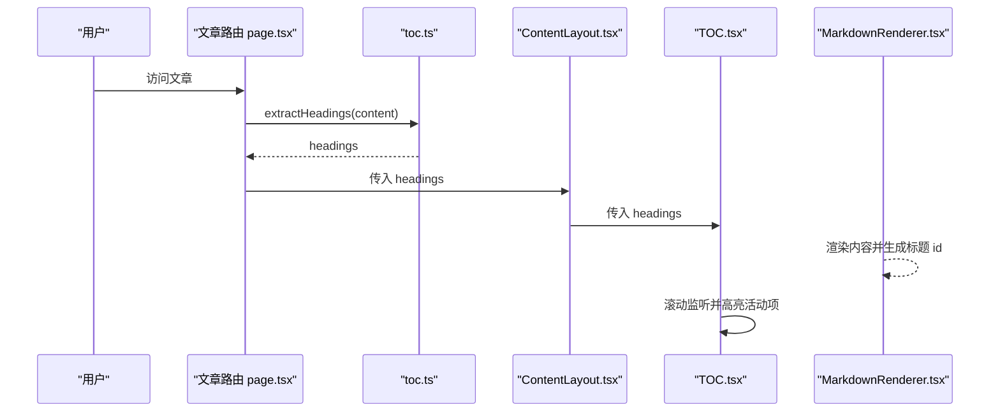

# TOC 目录组件

<cite>
**本文引用的文件**   
- [TOC.tsx](file://app/components/TOC.tsx)
- [useActiveHeading.ts](file://app/hooks/useActiveHeading.ts)
- [toc.ts](file://lib/post/toc.ts)
- [ContentLayout.tsx](file://app/components/post/ContentLayout.tsx)
- [MarkdownRenderer.tsx](file://app/components/post/MarkdownRenderer.tsx)
- [page.tsx（文章页）](file://app/blog/post/[...slug]/page.tsx)
</cite>

## 目录
1. [简介](#简介)
2. [项目结构](#项目结构)
3. [核心组件](#核心组件)
4. [架构总览](#架构总览)
5. [详细组件分析](#详细组件分析)
6. [依赖关系分析](#依赖关系分析)
7. [性能与优化](#性能与优化)
8. [样式与定制](#样式与定制)
9. [使用示例](#使用示例)
10. [常见问题排查](#常见问题排查)
11. [结论](#结论)

## 简介
本章节介绍 TOC 目录组件的职责与整体行为：根据文章内容自动生成目录项，并在滚动时高亮当前活动标题。该能力由以下部分协作完成：
- 从 Markdown 内容中提取标题，生成带 id、text、level 的 headings 列表
- 在渲染阶段为标题添加锚点 id，使目录可跳转
- 监听页面滚动，计算当前可见区域对应的活动标题并高亮对应目录项
- 提供清晰的层级缩进与交互体验

## 项目结构
TOC 相关代码分布在客户端组件、钩子、工具函数以及文章页面中：
- 客户端组件：TOC.tsx
- 滚动监听钩子：useActiveHeading.ts
- 标题提取工具：toc.ts
- 布局容器：ContentLayout.tsx
- Markdown 渲染器：MarkdownRenderer.tsx
- 文章路由页面：page.tsx（文章页）

**图表来源**
- [page.tsx（文章页）:1-28](file://app/blog/post/[...slug]/page.tsx#L1-L28)
- [ContentLayout.tsx:1-30](file://app/components/post/ContentLayout.tsx#L1-L30)
- [TOC.tsx:1-45](file://app/components/TOC.tsx#L1-L45)
- [useActiveHeading.ts:1-34](file://app/hooks/useActiveHeading.ts#L1-L34)
- [MarkdownRenderer.tsx:1-39](file://app/components/post/MarkdownRenderer.tsx#L1-L39)
- [toc.ts:1-23](file://lib/post/toc.ts#L1-L23)

**章节来源**
- [page.tsx（文章页）:1-28](file://app/blog/post/[...slug]/page.tsx#L1-L28)
- [ContentLayout.tsx:1-30](file://app/components/post/ContentLayout.tsx#L1-L30)
- [TOC.tsx:1-45](file://app/components/TOC.tsx#L1-L45)
- [useActiveHeading.ts:1-34](file://app/hooks/useActiveHeading.ts#L1-L34)
- [MarkdownRenderer.tsx:1-39](file://app/components/post/MarkdownRenderer.tsx#L1-L39)
- [toc.ts:1-23](file://lib/post/toc.ts#L1-L23)

## 核心组件
- TOC 组件：接收 headings 数据，渲染目录列表，并根据 activeId 高亮当前项
- useActiveHeading 钩子：监听滚动事件，返回当前活动标题 id
- toc 工具：从 Markdown 文本中提取 h1-h3 标题，生成 headings 数组
- ContentLayout：将 headings 传递给 TOC，并负责左右布局
- MarkdownRenderer：通过 rehype-slug 为标题生成 id，供目录跳转和滚动检测使用

**章节来源**
- [TOC.tsx:1-45](file://app/components/TOC.tsx#L1-L45)
- [useActiveHeading.ts:1-34](file://app/hooks/useActiveHeading.ts#L1-L34)
- [toc.ts:1-23](file://lib/post/toc.ts#L1-L23)
- [ContentLayout.tsx:1-30](file://app/components/post/ContentLayout.tsx#L1-L30)
- [MarkdownRenderer.tsx:1-39](file://app/components/post/MarkdownRenderer.tsx#L1-L39)

## 架构总览
下图展示了从文章内容到目录高亮的完整流程：

**图表来源**
- [page.tsx（文章页）:19-25](file://app/blog/post/[...slug]/page.tsx#L19-L25)
- [toc.ts:7-21](file://lib/post/toc.ts#L7-L21)
- [ContentLayout.tsx:12-22](file://app/components/post/ContentLayout.tsx#L12-L22)
- [TOC.tsx:9-10](file://app/components/TOC.tsx#L9-L10)
- [useActiveHeading.ts:15-31](file://app/hooks/useActiveHeading.ts#L15-L31)
- [MarkdownRenderer.tsx:13-16](file://app/components/post/MarkdownRenderer.tsx#L13-L16)

## 详细组件分析

### TOC 组件
职责与行为：
- 接收 headings 数组，按 level 进行缩进展示
- 使用 useActiveHeading 获取当前活动标题 id
- 对匹配 activeId 的目录项应用高亮样式
- 点击目录项跳转到对应锚点

数据结构与复杂度：
- 输入：headings 数组，每项包含 id、text、level
- 渲染：O(n) 遍历 headings 生成列表
- 高亮判断：O(1) 比较 activeId 与当前项 id

错误处理与边界：
- headings 为空时不渲染任何目录项
- 未找到对应 id 的元素时，不会报错但不会高亮

**图表来源**
- [TOC.tsx:5-45](file://app/components/TOC.tsx#L5-L45)

**章节来源**
- [TOC.tsx:1-45](file://app/components/TOC.tsx#L1-L45)

### useActiveHeading 钩子
职责与行为：
- 维护 activeId 状态
- 监听 window.scroll，遍历 headings，查找第一个顶部进入可视区域的标题作为活动项
- 清理副作用：移除 scroll 监听

滚动监听逻辑：
- 对于每个 heading，检查其 DOM 元素的 offsetTop 是否小于等于当前滚动位置加阈值（100px）
- 更新 activeId 以触发 TOC 重渲染

性能考量：
- 每次滚动都会遍历 headings，时间复杂度 O(n)
- 未做防抖或节流，频繁滚动可能带来一定开销

**图表来源**
- [useActiveHeading.ts:15-31](file://app/hooks/useActiveHeading.ts#L15-L31)

**章节来源**
- [useActiveHeading.ts:1-34](file://app/hooks/useActiveHeading.ts#L1-L34)

### 标题提取工具 toc.ts
职责与行为：
- 使用正则匹配 Markdown 中的 h1-h3 标题
- 生成 id：将标题文本转为小写并用连字符替换空格
- 输出 headings 数组，包含 level、text、id

复杂度：
- 单次解析 O(m)，m 为 Markdown 行数
- 正则匹配与字符串操作开销较小

**图表来源**
- [toc.ts:7-21](file://lib/post/toc.ts#L7-L21)

**章节来源**
- [toc.ts:1-23](file://lib/post/toc.ts#L1-L23)

### 布局与渲染协作
- 文章路由调用 extractHeadings 生成 headings，并传给 ContentLayout
- ContentLayout 将 headings 传给 TOC，同时渲染文章内容
- MarkdownRenderer 通过 rehype-slug 为标题生成 id，确保 TOC 能正确定位

**图表来源**
- [page.tsx（文章页）:19-25](file://app/blog/post/[...slug]/page.tsx#L19-L25)
- [ContentLayout.tsx:12-22](file://app/components/post/ContentLayout.tsx#L12-L22)
- [MarkdownRenderer.tsx:13-16](file://app/components/post/MarkdownRenderer.tsx#L13-L16)

**章节来源**
- [page.tsx（文章页）:1-28](file://app/blog/post/[...slug]/page.tsx#L1-L28)
- [ContentLayout.tsx:1-30](file://app/components/post/ContentLayout.tsx#L1-L30)
- [MarkdownRenderer.tsx:1-39](file://app/components/post/MarkdownRenderer.tsx#L1-L39)

## 依赖关系分析
- TOC 依赖 useActiveHeading 钩子
- 文章路由依赖 toc 工具与 ContentLayout
- ContentLayout 依赖 TOC
- MarkdownRenderer 依赖 rehype-slug 生成标题 id

**图表来源**
- [page.tsx（文章页）:1-28](file://app/blog/post/[...slug]/page.tsx#L1-L28)
- [toc.ts:1-23](file://lib/post/toc.ts#L1-L23)
- [ContentLayout.tsx:1-30](file://app/components/post/ContentLayout.tsx#L1-L30)
- [TOC.tsx:1-45](file://app/components/TOC.tsx#L1-L45)
- [useActiveHeading.ts:1-34](file://app/hooks/useActiveHeading.ts#L1-L34)
- [MarkdownRenderer.tsx:1-39](file://app/components/post/MarkdownRenderer.tsx#L1-L39)

**章节来源**
- [page.tsx（文章页）:1-28](file://app/blog/post/[...slug]/page.tsx#L1-L28)
- [toc.ts:1-23](file://lib/post/toc.ts#L1-L23)
- [ContentLayout.tsx:1-30](file://app/components/post/ContentLayout.tsx#L1-L30)
- [TOC.tsx:1-45](file://app/components/TOC.tsx#L1-L45)
- [useActiveHeading.ts:1-34](file://app/hooks/useActiveHeading.ts#L1-L34)
- [MarkdownRenderer.tsx:1-39](file://app/components/post/MarkdownRenderer.tsx#L1-L39)

## 性能与优化
当前实现要点：
- 滚动监听直接绑定 window.scroll，无防抖/节流
- 每次滚动遍历 headings，时间复杂度 O(n)
- headings 数量通常较少，影响有限；但在长文或多目录场景下建议优化

优化建议：
- 在 useActiveHeading 中添加防抖或节流，减少高频滚动时的计算
- 使用 IntersectionObserver 替代 scroll 监听，基于视口交集判定活动标题，降低计算量
- 对 headings 进行缓存，避免重复解析
- 若 headings 动态变化，考虑 memo 化 TOC 列表渲染

[本节为通用性能建议，不直接分析具体文件]

## 样式与定制
- 层级缩进：根据 level 设置不同左外边距，形成视觉层级
- 活动高亮：当 activeId 与当前项 id 匹配时，应用强调色与字体粗细
- 响应式：侧边栏在大屏显示，移动端隐藏
- 主题定制：可通过 Tailwind 类名覆盖颜色、字号、间距等

可定制点：
- 高亮颜色与字体样式
- 缩进间距与行间距
- 侧边栏宽度与粘性定位偏移

**章节来源**
- [TOC.tsx:12-43](file://app/components/TOC.tsx#L12-L43)

## 使用示例
典型用法流程：
1. 在文章路由中读取文章内容
2. 调用 extractHeadings 生成 headings
3. 将 headings 传入 ContentLayout
4. ContentLayout 将 headings 传给 TOC
5. MarkdownRenderer 渲染内容并为标题生成 id
6. TOC 通过 useActiveHeading 监听滚动并高亮活动项

**图表来源**
- [page.tsx（文章页）:19-25](file://app/blog/post/[...slug]/page.tsx#L19-L25)
- [toc.ts:7-21](file://lib/post/toc.ts#L7-L21)
- [ContentLayout.tsx:12-22](file://app/components/post/ContentLayout.tsx#L12-L22)
- [TOC.tsx:9-10](file://app/components/TOC.tsx#L9-L10)
- [MarkdownRenderer.tsx:13-16](file://app/components/post/MarkdownRenderer.tsx#L13-L16)

**章节来源**
- [page.tsx（文章页）:1-28](file://app/blog/post/[...slug]/page.tsx#L1-L28)
- [toc.ts:1-23](file://lib/post/toc.ts#L1-L23)
- [ContentLayout.tsx:1-30](file://app/components/post/ContentLayout.tsx#L1-L30)
- [TOC.tsx:1-45](file://app/components/TOC.tsx#L1-L45)
- [MarkdownRenderer.tsx:1-39](file://app/components/post/MarkdownRenderer.tsx#L1-L39)

## 常见问题排查
- 目录无法高亮
  - 确认 MarkdownRenderer 已启用 rehype-slug，为标题生成 id
  - 检查 headings 中的 id 是否与 DOM 元素 id 一致
- 目录不显示
  - 确认 headings 非空且层级合理（h1-h3）
  - 检查 ContentLayout 是否正确传递 headings 给 TOC
- 滚动高亮不准确
  - 调整 useActiveHeading 中的阈值（当前为 100px）
  - 考虑使用 IntersectionObserver 提升准确性
- 性能问题
  - 为滚动监听添加防抖/节流
  - 减少 headings 数量或分页加载

**章节来源**
- [useActiveHeading.ts:15-31](file://app/hooks/useActiveHeading.ts#L15-L31)
- [MarkdownRenderer.tsx:13-16](file://app/components/post/MarkdownRenderer.tsx#L13-L16)
- [ContentLayout.tsx:12-22](file://app/components/post/ContentLayout.tsx#L12-L22)

## 结论
TOC 目录组件通过简洁的数据流与钩子协作，实现了文章目录的自动生成与滚动高亮。其核心在于：
- 使用 toc.ts 提取标题并生成 id
- 使用 rehype-slug 在渲染阶段注入 id
- 使用 useActiveHeading 监听滚动并计算活动标题
- 在 TOC 中渲染层级结构与高亮样式

建议在长文或复杂场景中引入 IntersectionObserver 与防抖/节流以提升性能与准确性。