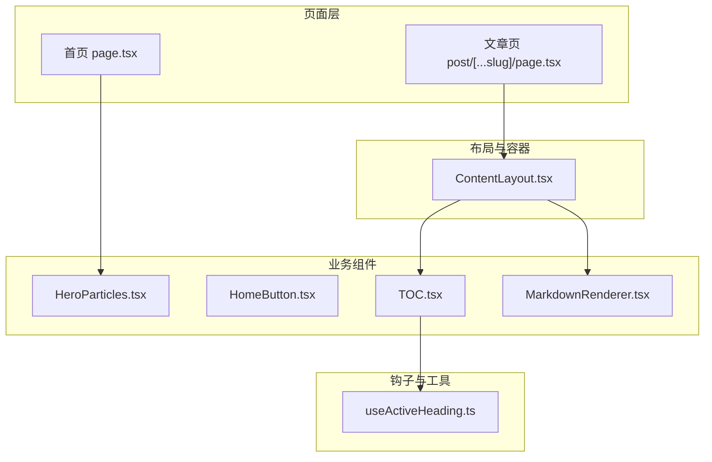
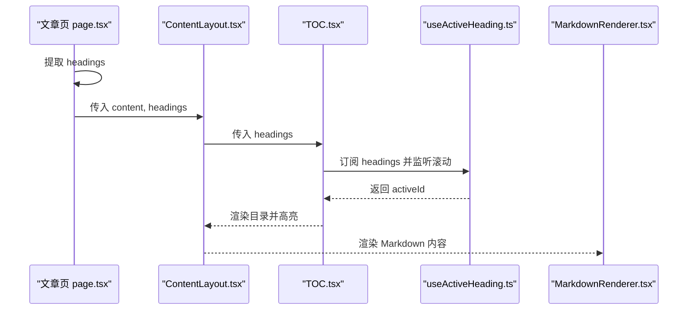
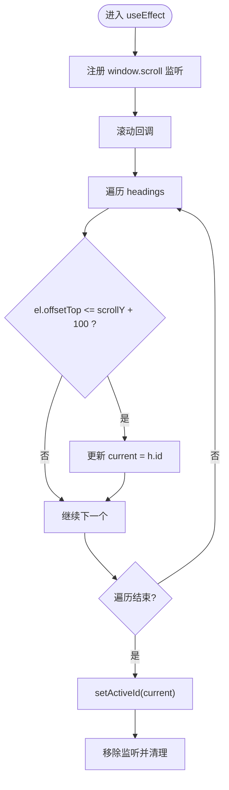
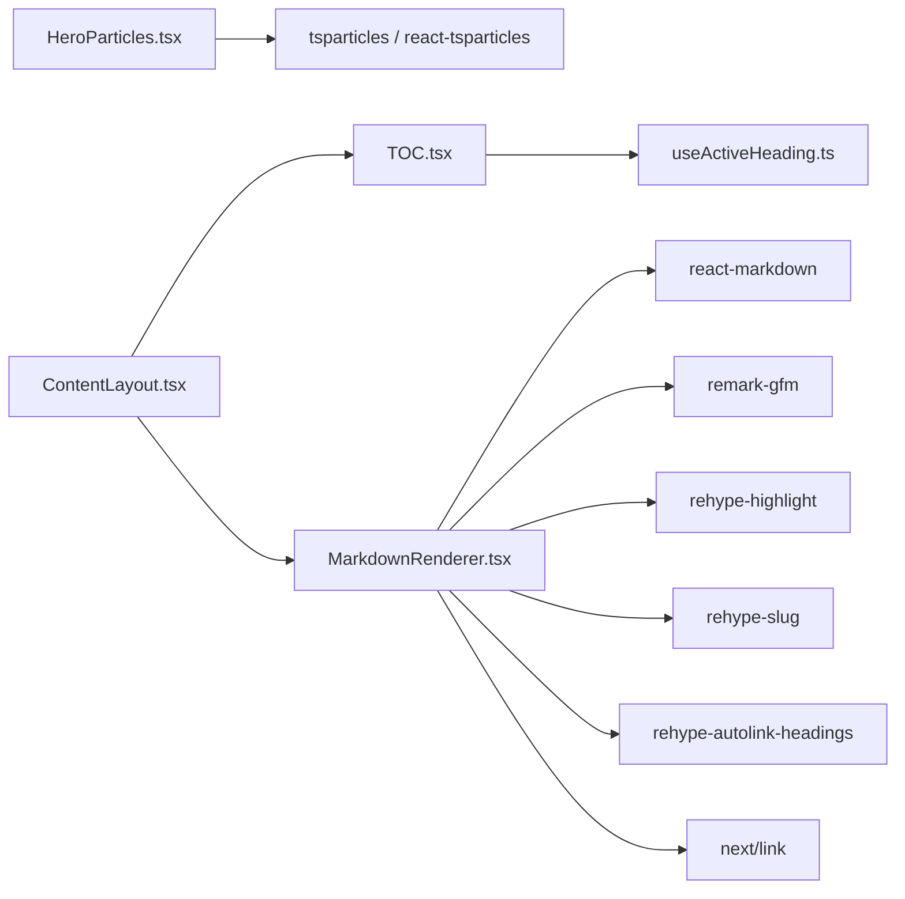

# 组件系统

<cite>
**本文引用的文件**   
- [HeroParticles.tsx](file://app/components/HeroParticles.tsx)
- [HomeButton.tsx](file://app/components/HomeButton.tsx)
- [TOC.tsx](file://app/components/TOC.tsx)
- [ContentLayout.tsx](file://app/components/post/ContentLayout.tsx)
- [MarkdownRenderer.tsx](file://app/components/post/MarkdownRenderer.tsx)
- [useActiveHeading.ts](file://app/hooks/useActiveHeading.ts)
- [page.tsx](file://app/page.tsx)
- [post/[...slug]/page.tsx](file://app/blog/post/[...slug]/page.tsx)
- [layout.tsx](file://app/layout.tsx)
- [tailwind.config.js](file://tailwind.config.js)
</cite>

## 目录
1. [简介](#简介)
2. [项目结构](#项目结构)
3. [核心组件](#核心组件)
4. [架构总览](#架构总览)
5. [详细组件分析](#详细组件分析)
6. [依赖关系分析](#依赖关系分析)
7. [性能与可访问性](#性能与可访问性)
8. [主题与样式扩展](#主题与样式扩展)
9. [故障排查](#故障排查)
10. [结论](#结论)

## 简介
本文件为 HuRui.dev 博客项目的“组件系统”技术文档，聚焦以下可复用组件：
- HeroParticles 粒子背景组件
- HomeButton 导航按钮
- TOC 目录组件
- ContentLayout 内容布局
- MarkdownRenderer Markdown 渲染器
并配套说明其 props 接口、事件处理、状态管理、样式定制、组合模式、使用示例、最佳实践与性能优化建议。

## 项目结构
组件位于 app/components 与 app/components/post 下，配合 hooks/useActiveHeading 提供滚动高亮能力；页面通过 Next.js App Router 的 page.tsx 组合这些组件完成展示。

图表来源
- [page.tsx:20-24](file://app/page.tsx#L20-L24)
- [post/[...slug]/page.tsx:21-25](file://app/blog/post/[...slug]/page.tsx#L21-L25)
- [ContentLayout.tsx:12-29](file://app/components/post/ContentLayout.tsx#L12-L29)
- [TOC.tsx:9-44](file://app/components/TOC.tsx#L9-L44)
- [MarkdownRenderer.tsx:10-39](file://app/components/post/MarkdownRenderer.tsx#L10-L39)
- [useActiveHeading.ts:12-33](file://app/hooks/useActiveHeading.ts#L12-L33)

章节来源
- [page.tsx:1-193](file://app/page.tsx#L1-L193)
- [post/[...slug]/page.tsx:1-28](file://app/blog/post/[...slug]/page.tsx#L1-L28)

## 核心组件
本节概述各组件的职责与协作方式：
- HeroParticles：在首页 Hero 区域提供全屏粒子动画背景。
- HomeButton：固定在左上角的返回首页按钮，带自定义缓动动画。
- TOC：根据传入的标题列表渲染侧边目录，并与滚动位置联动高亮当前章节。
- ContentLayout：文章页主布局，左侧固定 TOC，右侧渲染文章内容。
- MarkdownRenderer：将 Markdown 文本渲染为 HTML，支持 GFM、代码高亮、自动锚点链接等。

章节来源
- [HeroParticles.tsx:1-40](file://app/components/HeroParticles.tsx#L1-L40)
- [HomeButton.tsx:1-37](file://app/components/HomeButton.tsx#L1-L37)
- [TOC.tsx:1-45](file://app/components/TOC.tsx#L1-L45)
- [ContentLayout.tsx:1-31](file://app/components/post/ContentLayout.tsx#L1-L31)
- [MarkdownRenderer.tsx:1-40](file://app/components/post/MarkdownRenderer.tsx#L1-L40)

## 架构总览
组件间的数据流与调用关系如下：

图表来源
- [post/[...slug]/page.tsx:19-25](file://app/blog/post/[...slug]/page.tsx#L19-L25)
- [ContentLayout.tsx:12-29](file://app/components/post/ContentLayout.tsx#L12-L29)
- [TOC.tsx:9-44](file://app/components/TOC.tsx#L9-L44)
- [useActiveHeading.ts:12-33](file://app/hooks/useActiveHeading.ts#L12-L33)
- [MarkdownRenderer.tsx:10-39](file://app/components/post/MarkdownRenderer.tsx#L10-L39)

## 详细组件分析

### HeroParticles 粒子背景组件
职责
- 在 Hero 区域渲染全屏粒子动画背景，提升视觉吸引力。

Props 与配置
- 无外部 props，内部通过 options 对象配置粒子数量、颜色、形状、连线、交互（悬停排斥、点击推送）等。

事件与交互
- 基于 react-tsparticles 的事件系统，启用 onHover 与 onClick 两种交互模式。

状态管理
- 使用 useCallback 缓存初始化函数，避免重复创建。

样式与层级
- 设置 fullScreen.enable=true 且 zIndex=-1，确保背景不遮挡前景内容。

使用示例
- 在首页 Hero 区域直接渲染该组件作为背景。

最佳实践
- 仅在首屏或需要强调视觉的区域使用，避免在长列表或频繁重排区域引入额外开销。
- 如需自定义外观，调整 options.particles 与 interactivity.modes 相关字段。

性能要点
- 粒子数量 value=80，密度 area=800，适合中等性能设备；移动端可考虑降低数值。
- detectRetina=true 保证高分屏清晰度，但可能增加绘制成本。

章节来源
- [HeroParticles.tsx:1-40](file://app/components/HeroParticles.tsx#L1-L40)
- [page.tsx:20-24](file://app/page.tsx#L20-L24)

### HomeButton 导航按钮
职责
- 提供固定位置的“回到首页”入口，增强导航体验。

Props
- 无外部 props。

事件与行为
- 使用 Next.js Link 进行客户端导航，aria-label 提升可访问性。

样式与动画
- 使用 Tailwind 类名实现圆角、阴影、深色模式适配与悬浮缩放。
- 内嵌 style jsx 定义 bounce-slow 关键帧动画，形成缓慢弹跳效果。

使用示例
- 在全局布局或页面中按需引入，通常置于左上角。

最佳实践
- 保持 z-index 较高以确保浮于其他元素之上。
- 若需多语言文案，可将 aria-label 抽离为配置项。

章节来源
- [HomeButton.tsx:1-37](file://app/components/HomeButton.tsx#L1-L37)

### TOC 目录组件
职责
- 根据标题列表渲染侧边目录，并根据滚动位置高亮当前章节。

Props
- headings: Array<{ id: string; text: string; level: number }>

状态管理
- 通过 useActiveHeading(headings) 获取 activeId，用于高亮当前条目。

交互
- 点击目录项跳转至对应锚点（href={`#${h.id}`}）。

样式
- 使用 Tailwind 控制缩进层级（level 1/2/3），active 时高亮文字。

使用示例
- 由 ContentLayout 传入 headings 并渲染。

最佳实践
- 确保每个 heading 的 id 唯一且稳定，便于定位与 SEO。
- 对大量目录项可考虑虚拟滚动或分页加载。

章节来源
- [TOC.tsx:1-45](file://app/components/TOC.tsx#L1-L45)
- [useActiveHeading.ts:1-34](file://app/hooks/useActiveHeading.ts#L1-L34)

### ContentLayout 内容布局
职责
- 文章页的主布局容器，左侧固定 TOC，右侧渲染文章内容。

Props
- headings: Array<{ id: string; text: string; level: number }>
- children: ReactNode

布局策略
- 桌面端显示 TOC 侧栏，移动端隐藏；右侧 article 自适应宽度。
- 使用 prose 类名（来自 @tailwindcss/typography）统一排版。

使用示例
- 在文章页包裹 BackButton 与 MarkdownRenderer。

最佳实践
- 保持 headings 与正文中的锚点一致，确保 TOC 与内容同步。
- 若内容过长，可结合懒加载图片与代码块折叠以提升性能。

章节来源
- [ContentLayout.tsx:1-31](file://app/components/post/ContentLayout.tsx#L1-L31)
- [post/[...slug]/page.tsx:21-25](file://app/blog/post/[...slug]/page.tsx#L21-L25)

### MarkdownRenderer Markdown 渲染器
职责
- 将 Markdown 文本渲染为 HTML，并注入必要的插件与组件替换逻辑。

Props
- content: string

插件与能力
- remarkGfm：支持表格、任务列表等 GFM 语法。
- rehypeHighlight：代码块语法高亮。
- rehypeSlug：为标题生成 id，供 TOC 与锚点使用。
- rehypeAutolinkHeadings：为标题添加自动链接。

组件替换
- a：内部路由以 Next.js Link 渲染，外部链接在新窗口打开并设置安全属性。
- table：包裹 table-wrapper 以便横向滚动。

使用示例
- 在文章页中接收 Markdown 字符串并渲染。

最佳实践
- 若需自定义代码主题，可在 rehypeHighlight 配置中指定 theme。
- 对超大 Markdown 内容可考虑分片渲染或延迟加载。

章节来源
- [MarkdownRenderer.tsx:1-40](file://app/components/post/MarkdownRenderer.tsx#L1-L40)

### useActiveHeading 滚动高亮钩子
职责
- 监听滚动事件，计算当前可见的标题 id，供 TOC 高亮使用。

输入与输出
- 输入：headings 数组
- 输出：activeId 字符串

算法流程

图表来源
- [useActiveHeading.ts:12-33](file://app/hooks/useActiveHeading.ts#L12-L33)

注意事项
- 未做防抖/节流，高频滚动可能触发多次状态更新；可考虑加入 requestAnimationFrame 或节流函数优化。
- 偏移阈值 100px 可根据实际阅读习惯调整。

章节来源
- [useActiveHeading.ts:1-34](file://app/hooks/useActiveHeading.ts#L1-L34)

## 依赖关系分析
组件与外部库的依赖关系如下：

图表来源
- [HeroParticles.tsx:1-40](file://app/components/HeroParticles.tsx#L1-L40)
- [MarkdownRenderer.tsx:1-40](file://app/components/post/MarkdownRenderer.tsx#L1-L40)
- [TOC.tsx:1-45](file://app/components/TOC.tsx#L1-L45)
- [ContentLayout.tsx:1-31](file://app/components/post/ContentLayout.tsx#L1-L31)

章节来源
- [HeroParticles.tsx:1-40](file://app/components/HeroParticles.tsx#L1-L40)
- [MarkdownRenderer.tsx:1-40](file://app/components/post/MarkdownRenderer.tsx#L1-L40)
- [TOC.tsx:1-45](file://app/components/TOC.tsx#L1-L45)
- [ContentLayout.tsx:1-31](file://app/components/post/ContentLayout.tsx#L1-L31)

## 性能与可访问性
- 首屏性能
  - HeroParticles 仅在首页 Hero 区域使用，避免全局渲染带来的性能损耗。
  - 可考虑在移动端降低粒子数量或禁用部分交互。
- 滚动性能
  - useActiveHeading 未加防抖/节流，建议在后续版本中加入节流或 rAF 方案以减少重绘。
- 渲染性能
  - MarkdownRenderer 使用多个 rehype 插件，建议在构建期预编译 Markdown 或在服务端渲染阶段减少运行时开销。
- 可访问性
  - HomeButton 提供 aria-label，建议为所有交互按钮补充 role 与键盘焦点管理。
  - 目录链接应确保目标元素具备唯一 id，避免重复或空 id。

[本节为通用指导，不直接分析具体文件]

## 主题与样式扩展
- 深色模式
  - 根布局 body 已支持 dark:bg-gray-900 等深色类名；Tailwind 配置启用 darkMode: 'class'，可通过 html/body 上的 class 切换主题。
- 排版主题
  - 使用 @tailwindcss/typography 的 prose 类统一文章排版；可在 tailwind.config.js 中扩展 typography 主题色与字体。
- 自定义动画
  - HomeButton 使用 style jsx 定义 bounce-slow 动画；建议将动画抽取到全局样式或 Tailwind 扩展中以保持一致性。
- 代码高亮主题
  - rehypeHighlight 支持主题配置，可在 MarkdownRenderer 中注入 highlight.js 的主题样式以匹配站点主题。

章节来源
- [layout.tsx:11-23](file://app/layout.tsx#L11-L23)
- [tailwind.config.js:1-9](file://tailwind.config.js#L1-L9)
- [HomeButton.tsx:25-34](file://app/components/HomeButton.tsx#L25-L34)
- [MarkdownRenderer.tsx:1-40](file://app/components/post/MarkdownRenderer.tsx#L1-L40)

## 故障排查
- 目录无法高亮
  - 检查 Markdown 是否启用了 rehypeSlug，确保标题具备 id。
  - 确认 headings 数组中的 id 与正文锚点一致。
- 目录点击无效
  - 检查目标元素是否存在对应 id，且未被动态移除。
- 粒子背景遮挡内容
  - 检查 HeroParticles 的 zIndex 与父容器 overflow 设置，确保前景内容不被覆盖。
- 代码高亮不生效
  - 确认 rehypeHighlight 与 highlight.js 主题样式已正确引入。
- 深色模式不生效
  - 检查 html/body 是否包含 dark class，以及 Tailwind 配置是否正确启用 darkMode: 'class'。

章节来源
- [useActiveHeading.ts:12-33](file://app/hooks/useActiveHeading.ts#L12-L33)
- [MarkdownRenderer.tsx:1-40](file://app/components/post/MarkdownRenderer.tsx#L1-L40)
- [HeroParticles.tsx:15-37](file://app/components/HeroParticles.tsx#L15-L37)
- [tailwind.config.js:1-9](file://tailwind.config.js#L1-L9)

## 结论
本组件系统围绕“内容可读性与视觉表现”展开：
- HeroParticles 提供沉浸式背景体验；
- HomeButton 强化导航可达性；
- TOC 与 useActiveHeading 协同提升长文导航效率；
- ContentLayout 统一文章布局；
- MarkdownRenderer 打通 Markdown 生态链，兼顾可扩展性与可定制性。
在实际使用中，建议遵循上述最佳实践与性能优化建议，并结合主题系统进行样式扩展，以获得一致的阅读体验与开发体验。