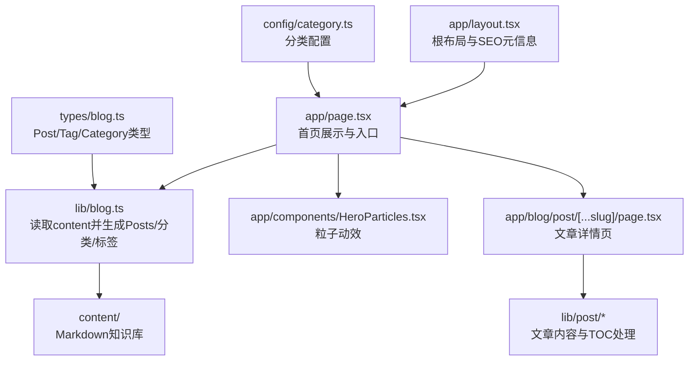
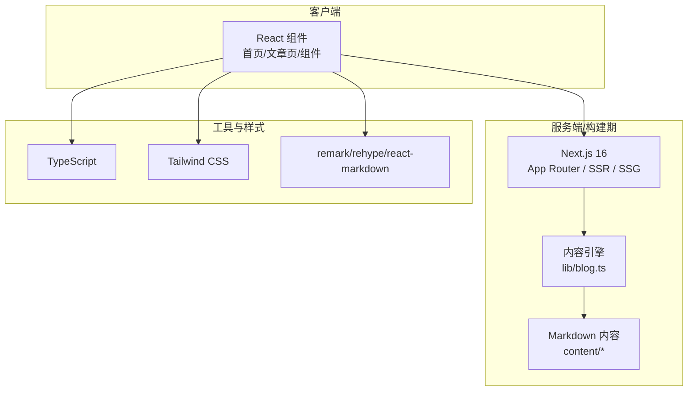
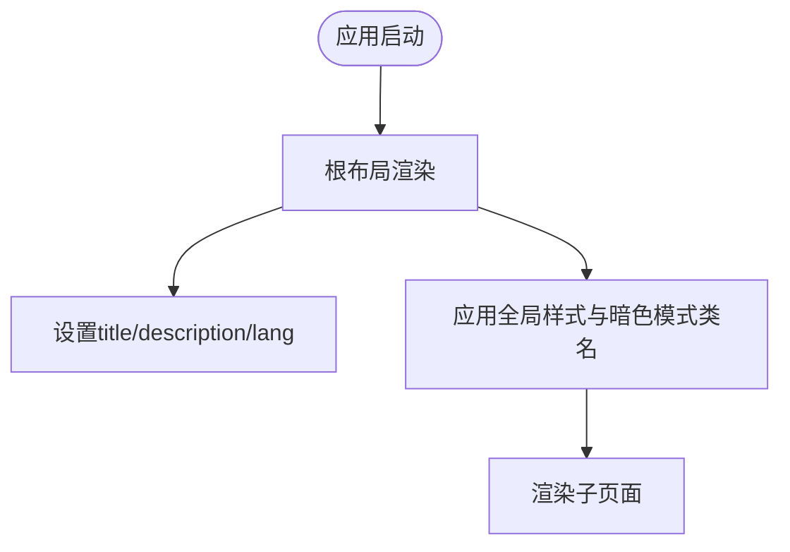
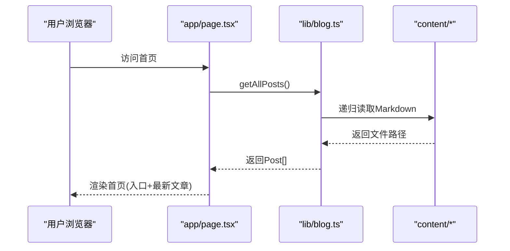
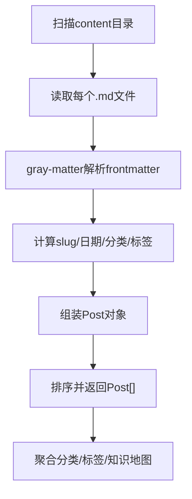
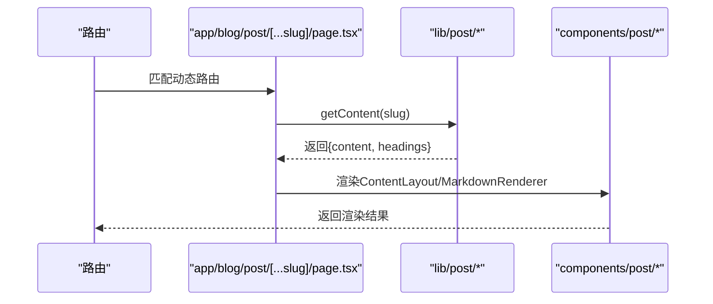
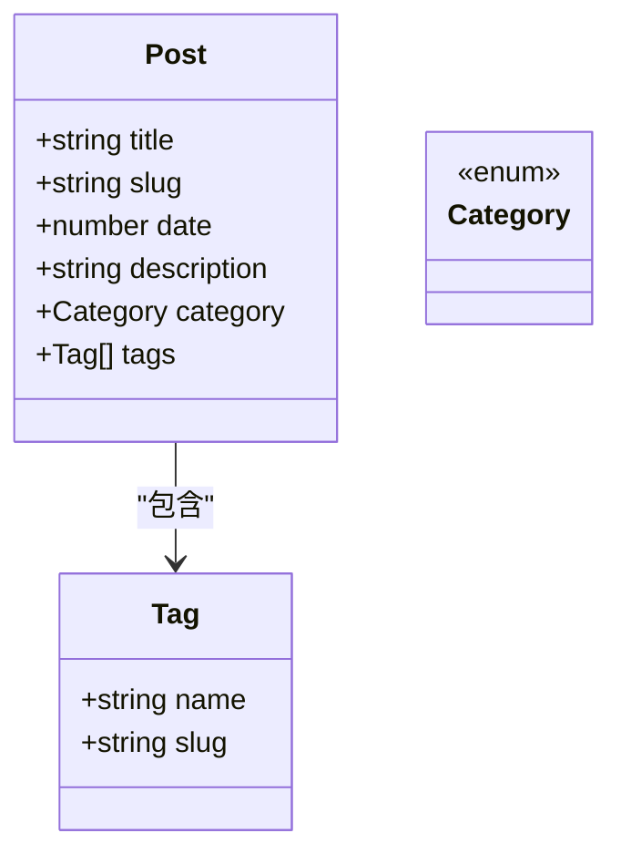
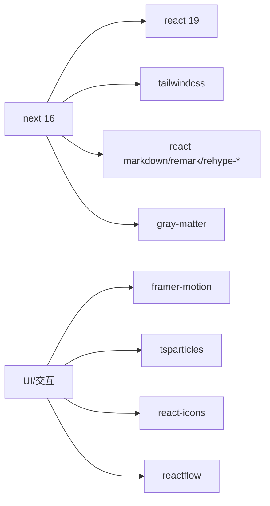

# 项目概述

<cite>
**本文引用的文件**   
- [README.md](file://README.md)
- [package.json](file://package.json)
- [next.config.ts](file://next.config.ts)
- [app/layout.tsx](file://app/layout.tsx)
- [app/page.tsx](file://app/page.tsx)
- [lib/blog.ts](file://lib/blog.ts)
- [types/blog.ts](file://types/blog.ts)
- [config/category.ts](file://config/category.ts)
- [app/components/HeroParticles.tsx](file://app/components/HeroParticles.tsx)
- [app/blog/post/[...slug]/page.tsx](file://app/blog/post/[...slug]/page.tsx)
</cite>

## 目录
1. [简介](#简介)
2. [项目结构](#项目结构)
3. [核心组件](#核心组件)
4. [架构总览](#架构总览)
5. [详细组件分析](#详细组件分析)
6. [依赖关系分析](#依赖关系分析)
7. [性能与体验优化](#性能与体验优化)
8. [快速开始指南](#快速开始指南)
9. [常见问题排查](#常见问题排查)
10. [结语](#结语)

## 简介
HuRui.dev 是一个基于 Next.js 16 与 React 19 构建的个人技术博客网站，聚焦前端知识体系与 AI 工程文档分享。项目采用 App Router、TypeScript、Tailwind CSS、Markdown 内容驱动与丰富的交互库，提供结构化知识管理、现代化 UI、响应式布局、暗色模式支持以及 SEO 基础能力。

- 目标：沉淀前端与 AI 工程化知识，形成可检索、可扩展的知识体系，并以现代 Web 技术呈现。
- 核心价值：以 Markdown 为单一事实源，通过脚本与工具链生成导航与页面；以 Next.js 的 SSR/SSG 能力提升首屏与 SEO；以 Tailwind 与 Framer Motion 打造流畅、现代的阅读体验。

**章节来源**
- [README.md:1-37](file://README.md#L1-L37)
- [package.json:1-53](file://package.json#L1-L53)

## 项目结构
项目采用 Next.js App Router 的分层组织方式，结合“内容即数据”的 Markdown 驱动策略：

- app：页面与组件（路由、布局、UI 组件）
- content：按主题划分的 Markdown 知识库（前端知识、AI 工程师、博客文章）
- lib：业务逻辑（读取 Markdown、解析 frontmatter、分类与标签聚合）
- config：站点配置（分类映射等）
- types：类型定义（Post、Tag、Category）
- scripts：辅助脚本（生成知识树、注入 frontmatter）

**图表来源**
- [app/layout.tsx:1-24](file://app/layout.tsx#L1-L24)
- [app/page.tsx:1-193](file://app/page.tsx#L1-L193)
- [lib/blog.ts:1-134](file://lib/blog.ts#L1-L134)
- [app/components/HeroParticles.tsx:1-40](file://app/components/HeroParticles.tsx#L1-L40)
- [app/blog/post/[...slug]/page.tsx:1-27](file://app/blog/post/[...slug]/page.tsx#L1-L27)
- [config/category.ts:1-9](file://config/category.ts#L1-L9)
- [types/blog.ts:1-16](file://types/blog.ts#L1-L16)

**章节来源**
- [app/layout.tsx:1-24](file://app/layout.tsx#L1-L24)
- [app/page.tsx:1-193](file://app/page.tsx#L1-L193)
- [lib/blog.ts:1-134](file://lib/blog.ts#L1-L134)
- [config/category.ts:1-9](file://config/category.ts#L1-L9)
- [types/blog.ts:1-16](file://types/blog.ts#L1-L16)

## 核心组件
- 根布局与站点元信息：在根布局中设置站点标题模板、描述与语言，并提供全局样式与暗色模式的基础类名。
- 首页：聚合最新博客、技术栈标签、三大入口（前端知识、项目案例、AI Engineer），并渲染最近文章列表。
- 内容引擎：递归扫描 Markdown 文件，解析 frontmatter，计算 slug、日期、分类与标签，输出统一 Post 模型。
- 类型系统：使用 TypeScript 定义 Post、Tag、Category，确保数据流类型安全。
- 交互增强：HeroParticles 提供粒子背景效果，增强视觉吸引力。

**章节来源**
- [app/layout.tsx:1-24](file://app/layout.tsx#L1-L24)
- [app/page.tsx:1-193](file://app/page.tsx#L1-L193)
- [lib/blog.ts:1-134](file://lib/blog.ts#L1-L134)
- [types/blog.ts:1-16](file://types/blog.ts#L1-L16)
- [app/components/HeroParticles.tsx:1-40](file://app/components/HeroParticles.tsx#L1-L40)

## 架构总览
整体采用“Next.js App Router + Markdown 内容驱动 + TS 类型约束 + Tailwind 样式”的现代前端架构。

**图表来源**
- [package.json:12-30](file://package.json#L12-L30)
- [app/layout.tsx:1-24](file://app/layout.tsx#L1-L24)
- [lib/blog.ts:1-134](file://lib/blog.ts#L1-L134)

## 详细组件分析

### 根布局与站点元信息
- 职责：定义站点默认标题模板、描述、语言与全局样式类名，支撑 SEO 与暗色模式切换。
- 关键点：
  - 标题模板用于子页面自动拼接。
  - body 上包含明/暗主题类名，便于后续主题切换逻辑扩展。

**图表来源**
- [app/layout.tsx:1-24](file://app/layout.tsx#L1-L24)

**章节来源**
- [app/layout.tsx:1-24](file://app/layout.tsx#L1-L24)

### 首页与入口聚合
- 职责：聚合全站入口与最新文章，展示技术栈标签与社交链接。
- 关键点：
  - 调用 getAllPosts 获取文章列表，取前 6 篇作为“最新博客”。
  - 三个主要入口卡片：前端知识、项目案例、AI Engineer。
  - 文章卡片展示标题、摘要与标签。

**图表来源**
- [app/page.tsx:1-193](file://app/page.tsx#L1-L193)
- [lib/blog.ts:24-50](file://lib/blog.ts#L24-L50)

**章节来源**
- [app/page.tsx:1-193](file://app/page.tsx#L1-L193)
- [lib/blog.ts:24-50](file://lib/blog.ts#L24-L50)

### 内容引擎与知识地图
- 职责：扫描 content 目录，解析 frontmatter，生成 Posts、分类、标签与知识地图。
- 关键点：
  - getAllPosts：遍历 blog 目录，解析 frontmatter，计算 slug/date/category/tags，并按时间倒序排序。
  - getKnowledgeMap/getAIEngineerMap：按目录结构生成知识树，附带 status 状态。
  - getAllCategories/getAllTags：聚合分类与标签集合。

**图表来源**
- [lib/blog.ts:9-50](file://lib/blog.ts#L9-L50)
- [lib/blog.ts:53-134](file://lib/blog.ts#L53-L134)

**章节来源**
- [lib/blog.ts:1-134](file://lib/blog.ts#L1-L134)

### 文章详情页渲染流程
- 职责：根据动态路由参数加载文章，提取标题层级，渲染 Markdown 内容与侧边 TOC。
- 关键点：
  - 从 params 解析 slug 数组，调用 getContent 获取文章。
  - 若文章不存在，返回占位提示。
  - 使用 extractHeadings 生成 TOC，交由 ContentLayout 与 MarkdownRenderer 渲染。

**图表来源**
- [app/blog/post/[...slug]/page.tsx:1-27](file://app/blog/post/[...slug]/page.tsx#L1-L27)

**章节来源**
- [app/blog/post/[...slug]/page.tsx:1-27](file://app/blog/post/[...slug]/page.tsx#L1-L27)

### 类型系统与分类配置
- 类型系统：Post、Tag、Category 明确数据结构，保障内容管道类型安全。
- 分类配置：CATEGORY_CONFIG 集中管理分类显示名称，便于扩展与维护。

**图表来源**
- [types/blog.ts:1-16](file://types/blog.ts#L1-L16)
- [config/category.ts:1-9](file://config/category.ts#L1-L9)

**章节来源**
- [types/blog.ts:1-16](file://types/blog.ts#L1-L16)
- [config/category.ts:1-9](file://config/category.ts#L1-L9)

## 依赖关系分析
- 运行时依赖：
  - next 16：App Router、SSR/SSG、路由与构建优化。
  - react/react-dom 19：组件框架与渲染。
  - gray-matter：解析 Markdown frontmatter。
  - react-markdown/remark/rehype-*：Markdown 到 HTML 的转换与插件生态。
  - tailwindcss/@tailwindcss/typography：样式系统与排版。
  - framer-motion：动画与过渡。
  - react-tsparticles/tsparticles：粒子动效。
  - react-icons：图标库。
  - reactflow：流程图/架构图可视化（可用于知识图谱）。
- 开发依赖：
  - typescript、eslint、prettier、husky、lint-staged：代码质量与提交钩子。

**图表来源**
- [package.json:12-44](file://package.json#L12-L44)

**章节来源**
- [package.json:12-44](file://package.json#L12-L44)

## 性能与体验优化
- 首屏与 SEO：
  - 根布局设置 title 模板与 description，利于搜索引擎抓取。
  - Next.js 的 SSR/SSG 减少首屏白屏，提升可索引性。
- 内容渲染：
  - 使用 remark/rehype 生态进行 Markdown 转 HTML，按需启用语法高亮、自动锚点等插件。
- 交互与动效：
  - HeroParticles 提供轻量级粒子背景，注意在移动端控制粒子数量与复杂度以避免卡顿。
- 样式与主题：
  - Tailwind 原子化样式，配合暗色模式类名，便于主题扩展。
- 构建与打包：
  - 按需引入第三方库，避免全量引入导致包体膨胀。

[本节为通用指导，不直接分析具体文件]

## 快速开始指南
- 环境准备：Node.js 与任意包管理器（npm/yarn/pnpm/bun）。
- 安装依赖：执行包管理器 install 命令。
- 启动开发服务器：运行 dev 脚本，打开本地地址查看效果。
- 编辑内容：在 content 目录下新增或修改 Markdown 文件，刷新即可看到更新。
- 构建与部署：运行 build 脚本生成静态产物，再使用 start 启动生产服务；推荐部署至 Vercel。

**章节来源**
- [README.md:3-17](file://README.md#L3-L17)
- [package.json:5-10](file://package.json#L5-L10)

## 常见问题排查
- 文章无法显示或为空：
  - 检查 content 目录下的 Markdown 文件是否存在且命名规范。
  - 确认 frontmatter 字段是否完整（如 title、date、tags）。
- 分类/标签未生效：
  - 检查 frontmatter 中的 category/tags 是否与 config/category.ts 保持一致。
- 页面样式异常：
  - 确认 Tailwind 已正确引入，检查全局样式与暗色模式类名是否正确应用。
- 动效卡顿：
  - 调整 HeroParticles 的参数（如 number、density、speed），降低移动端负载。

**章节来源**
- [lib/blog.ts:24-50](file://lib/blog.ts#L24-L50)
- [config/category.ts:1-9](file://config/category.ts#L1-L9)
- [app/layout.tsx:17-20](file://app/layout.tsx#L17-L20)
- [app/components/HeroParticles.tsx:15-37](file://app/components/HeroParticles.tsx#L15-L37)

## 结语
本项目以 Next.js 16 与 React 19 为核心，结合 Markdown 内容驱动与现代前端工具链，构建了结构清晰、易于扩展的前端与 AI 工程知识平台。通过类型约束、内容引擎与丰富交互库，既保证了工程的可维护性与可读性，也提供了良好的用户体验与 SEO 基础。建议在此基础上继续完善分类与标签体系、增加搜索与归档功能，并持续优化移动端性能与可访问性。

[本节为总结性内容，不直接分析具体文件]